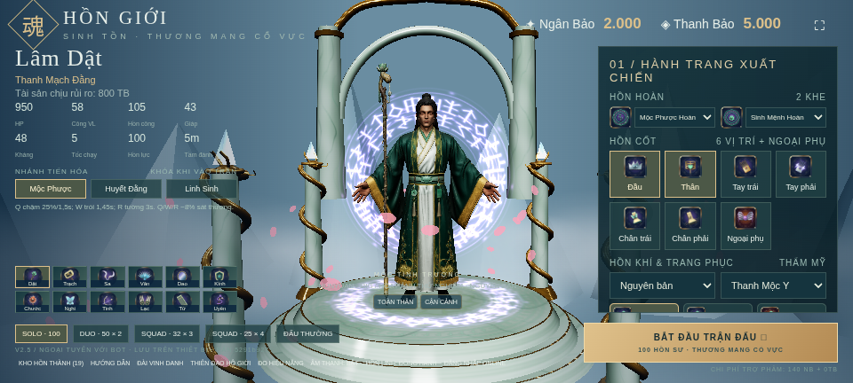
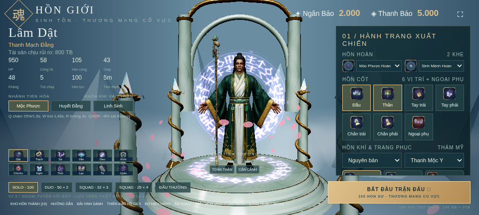

# Báo cáo đối chiếu APK 445 MB / 303 MB và rà soát toàn bộ conver10

Mốc mã nguồn được đánh giá: **4ee877a**. Rà soát ngày **19/10/2026, giờ Việt Nam**. Báo cáo này được công bố trước khi sửa lại production. Các ảnh mới bên dưới chụp trên cloud; chưa có điện thoại Android kết nối.

## Kết luận

**Bạn nhận xét đúng về việc hình ảnh gần như không đổi. Bản 445 MB chưa thay rig/animation trong sảnh hoặc trận.** Phần tăng khoảng 142 MB chủ yếu là hai GLB dành cho trang xem thử riêng. Tất cả **507 file model/mỹ thuật dùng chung từ bản trước giữ nguyên SHA-256**. Tôi đã gửi bản có công cụ chẩn đoán trong khi phần sửa rig chưa được tích hợp; bản đó chưa đáp ứng yêu cầu sửa nhân vật.

Việc bạn thấy lag hơn trên điện thoại là phản hồi thực tế cần xử lý. Tuy nhiên, phép đo cloud không xác nhận được nguyên nhân riêng của bản 445 MB. Các GLB xem thử không được tải trong đường vào sảnh/trận thông thường ở các lần đo. Không thể lấy dung lượng APK tăng làm bằng chứng chúng trực tiếp làm giảm FPS. Cả hai bản còn chung tải render rất lớn và một lỗi giải phóng cache model nguồn.

## 1. Hai APK đã kiểm đúng file

| Thuộc tính | Bản gọi là 300 MB | Bản 445 MB |
| --- | ---: | ---: |
| Commit chứa APK | c5d0e5a | 4fb7de7 |
| Số byte thật | 303.123.808 | 445.435.506 |
| MB thập phân | 303,124 | 445,436 |
| Android versionName | 1.0 | 2.5.f22aced7 |
| File trong ZIP | 967 | 976 |
| Tổng dữ liệu giải nén | 382.322.274 | 579.076.816 |
| Ký APK và đọc metadata | đạt | đạt |

SHA-256 bản cũ: `7400d6fe10636274d3147fa6dec208cdce5132bd2c671b87e38450d237e2e2ed`.

SHA-256 bản mới: `1f53131d9a3322303cfeb3eaf2ed19677ccf0107e746244c5eaea7bf0c19a669`.

Đã đọc/so hash mọi ZIP entry từ hai APK thật, không dựng lại để giả lập bản cũ. Chữ ký và CRC đọc được. Chi tiết, SHA từng file và metadata GLB nằm trong [apk-comparison.json](docs/review-conver10/apk-comparison.json); phương pháp đo và bảng kết quả trong [apk-notes.md](docs/review-conver10/apk-notes.md).

### Dung lượng tăng ở đâu?

| File mới | Byte nén trong ZIP | Byte giải nén |
| --- | ---: | ---: |
| models/rig-review/H01.glb | 73.537.864 | 99.618.472 |
| models/rig-review/H02.glb | 68.822.301 | 97.112.948 |
| H01-held.json và manifest | 3.424 | 9.604 |
| **Tổng riêng thư mục review** | **142.363.589** | **196.741.024** |

Toàn APK tăng **142.311.698 byte, tức 46,95%**. Riêng thư mục review lớn hơn mức tăng ròng 51.891 byte vì phần còn lại giảm nhẹ. Không có texture hoặc GLB cũ nào trong 507 file mỹ thuật chung được thay bằng bản rig mới. Metadata bản dựng cũng ghi rõ **runtimeRigReplaced: false**.

## 2. Ảnh từ đúng hai APK

Đây là file web trích nguyên byte trong APK, chạy bằng Chromium/SwiftShader cloud ở cùng viewport 960 × 432, DPR 1. Không phải ảnh Android. Hình sau entrance cho thấy tài nguyên hiển thị; không dùng nhãn seek thời gian làm bằng chứng pose khớp đã đúng.

| Bản 303 MB | Bản 445 MB |
| --- | --- |
|  |  |
|  |  |

Các ảnh trong trận có workload bot ngẫu nhiên, không dùng làm phép so FPS có kiểm soát. Ảnh t2_1 là lệnh seek được yêu cầu, không phải xác nhận pose tại 2,1 giây: code seek chưa khôi phục trạng thái hiển thị sau khi đổi sang model nguồn tĩnh.

## 3. Vì sao rig mới chưa xuất hiện và animation còn sai?

1. `scripts/copy-rig-review.mjs` thêm GLB vào trang `rig-review.html`. Sảnh/trận vẫn dùng asset cũ qua `src/manual-hero-assets.js`, `manual-hero.js`, `manual-h02.js`. Manifest staging còn tắt runtime. Không có đường kích hoạt rig mới đã đạt kiểm định.
2. Trong entrance, actor dùng rig cũ. **Sau entrance**, `syncTencentPreview` ẩn thân skinned và hiện lại thân Hunyuan nguồn không có skin/animation. Mixer vẫn cập nhật driver bị ẩn. Vì vậy không thể coi model nguồn tĩnh đang hiện là kết quả rig mới.
3. `HeroPoseController` mới chỉ được import trong test, chưa nối vào actor thật. GLB xem thử vẫn có sáu clip cũ `Attack/Cast/Dash/Entrance/Idle/Run`, thiếu `IDLE_HOLD` yêu cầu.
4. H02 runtime còn dùng socket/tay phải; prompt hiện hành yêu cầu **tay trái cầm chùy, lòng bàn tay phải chống đất**. H01 yêu cầu **tay phải chống đất khi chồm hổm, sau đó tay phải giữ trượng**, tay trái đặt đùi rồi thả lỏng. Hai file dữ liệu entrance theo từng tướng chưa tồn tại.

Danh mục lỗi kèm file:dòng, giới hạn phép đo và hướng sửa nằm trong [rig-notes.md](docs/review-conver10/rig-notes.md). Prompt áp dụng là [H01-H02-ENTRANCE-PROMPT-2.md](docs/requests/H01-H02-ENTRANCE-PROMPT-2.md), có ghi thay thế mô tả cũ. Không trộn quy tắc tay từ hai phiên bản.

## 4. Đã xem lại đủ 142/142 ảnh conver10

Đã đọc toàn bộ ảnh theo 16 bảng chỉ mục và mở lại ảnh gốc ở các điểm lỗi. Cả 142 file đều decode được, khớp Git blob trong registry. [gallery-notes.md](docs/review-conver10/gallery-notes.md) có nhận xét riêng từng ảnh, diễn tiến và phạm vi chứng minh. [gallery-review.json](docs/review-conver10/gallery-review.json) lưu hash/độ phủ và kiểm kê 78 báo cáo JSON liên quan. Ảnh nguyên bản không bị thay hoặc giảm nét.

### Tách mesh chưa phải tách đúng áo

Tên mesh thân/tay không phản ánh sạch bề mặt: mảnh viền xanh/vàng gần chân vẫn ở trong mesh này. Phân vùng theo màu và khoảng cách không theo liên thông bề mặt nên còn lẫn lớp/mảnh. Hai vạt có 15 và 13 thành phần liên thông sau phép weld vị trí 1 µm; một số có thể là trim rời hợp lệ, nhưng chưa có mapping ngữ nghĩa chứng minh.

Khoảng mở ngang ở ảnh này là phép dịch thử có chủ ý, không phải bằng chứng seam runtime tự hở 30 cm. Nó phơi lộ vùng chọn vụn, biên nham nhở và thiếu bề mặt bị che trong nguồn. Không được tự tạo thân người ẩn rồi gọi là dữ liệu gốc.

### Lỗi kéo áo còn tới ảnh cuối

Lỗi nêm áo lặp từ ảnh 100 qua 103/106/109/121 tới 139. Chỉ xem mặt trước sẽ bỏ sót lỗi sau lưng. Ảnh này chưa có trượng nên cũng không chứng minh contact vũ khí.

### Những kết quả có thật nhưng chỉ có phạm vi hẹp

- Một pose cầm trượng H01 từng qua kiểm contact bề mặt thật; không tương đương toàn thân/chuỗi animation đạt, và không được chuyển chứng nhận sang GLB có trọng số khác.
- GLB tách vạt giữ nguyên 1.499.726 tam giác/UV/texture, nhưng bảo toàn dữ liệu không bảo đảm phân đoạn đúng.
- H02 đã được sửa camera vừa khung ở ảnh 142; đó là sửa framing, chưa chứng minh rig/contact/Android.
- Bản thử hip-only có strain 1,0 nhưng hở đường nối tới **388,343 mm**, nên bị loại. Bản refit 2.000 vòng vẫn p99.9 **1,894217**, max **3,497870**, vượt ngưỡng **1,5 / 2,0**. Không được giảm ngưỡng để gọi đạt.

## 5. Thủ phạm tải nặng và các giới hạn phép đo

| Chỉ số hiện tại chung cho cả hai APK | H01 | H02 |
| --- | ---: | ---: |
| Tam giác thân nguồn | 1.499.726 | 1.499.746 |
| Tam giác vũ khí nguồn | 619.640 | 1.500.000 |
| Tổng thân + vũ khí | 2.119.366 | 2.999.746 |
| Tam giác render sảnh cloud đã quan sát | 2.138.398 | 3.018.778 |
| Draw calls cùng cảnh | 54 | 56 |

Ngoài nguồn độ phân giải cao đang hiện, driver rig cũ và tài nguyên liên quan vẫn được giữ. Đây là tải GPU/CPU cần đo trên máy thật, không phải lý do giảm texture. Tôi không nén ảnh, giảm pixelRatio hay thay ánh sáng trong lần đánh giá này.

Đã thấy lỗi cache chung: `loadManualAsset` lưu theo URL tương đối, `releaseManualSourceAsset` tra URL tuyệt đối nên không tìm thấy entry để giải phóng. Phải sửa quản lý vòng đời có kiểm tra người dùng chung; không dispose texture khi actor khác còn giữ clone. Đây là lỗi có ở **cả hai bản**, chưa chứng minh gây chênh lệch 445/303 trên điện thoại.

Các lần A/B chạy tuần tự **cũ → mới → mới → cũ**, mỗi lượt browser/storage mới, trích đúng APK. Bảng thời gian đầy đủ, renderer và điều kiện trong [apk-notes.md](docs/review-conver10/apk-notes.md). Cloud dùng SwiftShader khoảng 1–2 FPS nên không đại diện GPU điện thoại; trận chưa fixed seed. Chưa có kết luận số FPS/RAM Android hoặc tuyên bố hết lag.

| Thứ tự chạy cloud | APK | H01 từ điều hướng tới nguồn sẵn sàng | H02 từ chọn tướng tới nguồn sẵn sàng |
| --- | --- | ---: | ---: |
| 1 | 303 MB | 9,971 s | 11,264 s |
| 2 | 445 MB | 10,547 s | 12,053 s |
| 3 | 445 MB | 9,767 s | 10,506 s |
| 4 | 303 MB | 11,111 s | 14,002 s |

Cả bốn lượt không có page/console error hoặc request thất bại. Khoảng thời gian chồng lấn; mẫu nhỏ này không cho thấy bản 445 MB chậm hơn nhất quán. Đường actor còn ép detail high, kể cả caller yêu cầu mobile/low; hai bản cùng tải H01 driver 60k, H02 driver 30k. Đây là một điểm cần tách khỏi chất lượng model nguồn khi điều tra tải thừa.

## 6. Kiểm định cũ có điểm mù cần sửa trước

- Seam checker bỏ qua hai primitive cùng một node và node trùng tên. Fixture có hai phần hở **100 mm** vẫn báo đạt với **0 cặp kiểm**. Báo seam đạt trên mesh chưa split cũng không chứng minh biên áo split liên tục.
- Edge checker chỉ giới hạn giãn, nên tam giác bị ép sập có ratio 0 vẫn báo đạt. Cần chặn sập/non-finite và đo riêng tiết diện khớp 0,7–1,4; không lấy strain làm chứng nhận thể tích.
- Source vertex mapping chưa được lưu bền sau compaction; bare XYZ có thể ghép nhầm hai lớp đang chạm nhau. Cần ID nguồn/hash và nhóm đường may đã kiểm tra.
- Solver áo giữ bảng ảnh hưởng bốn xương cánh tay cho cả vùng xuống gần chân; không có Hips/pelvis. Thêm vòng tối ưu với cùng bảng xương không thể giải quyết thiếu bậc tự do.

Unit test chạy đạt chỉ chứng minh những assertion được viết, không chứng minh mỹ thuật hoặc mục tiêu toàn bộ. Goal rig hiện vẫn blocked; verify:master lịch sử vẫn **0/37**. Không sửa status thành hoàn thành chỉ vì đóng APK được.

## 7. Thực hiện lại conver10 sau khi công bố báo cáo

Thứ tự sửa: (1) khóa lại seam/collapse bằng regression test, lưu provenance từng mặt/đỉnh; (2) phân đoạn hai vạt trên graph bề mặt nguồn, kiểm mesh cô lập trước/sau và đường may; (3) đổi miền ảnh hưởng áo/thân/tay đúng giải phẫu, kiểm nhiều pose thay vì một pose; (4) bake Entrance/IDLE_HOLD theo đúng tay từ dữ liệu từng tướng, kiểm nối/loop/contact; (5) chỉ kích hoạt actor mới khi đúng GLB qua tất cả gate; (6) đo lại runtime và đóng APK khi việc sửa thực sự được tích hợp.

Đồng thời sẽ tách asset chẩn đoán khỏi build game mặc định, sửa cache để không giữ nhầm tài nguyên. Không đổi texture/UV nguồn, GDD, ví/kho/vault/HMAC hoặc ngưỡng nghiệm thu. Bản không đạt tiếp tục bị chặn, không được gửi như một bản rig đã sửa xong.

Mọi ảnh mới tiếp tục đăng cùng thời gian ở [picture/conver10/online-pic.md](picture/conver10/online-pic.md). Báo cáo này là mốc đánh giá **trước sửa**; kết quả sửa và các gate còn thiếu được ghi riêng, không viết đè lịch sử thất bại.

Nhật ký thực hiện lại sau audit: [docs/anim-report/conver10-redo/README.md](docs/anim-report/conver10-redo/README.md). Có kết quả kiểm thử runtime/packaging và từng bản thử rig, phân biệt phần đã đạt với phần còn bị chặn.

## Tiến độ ngày 21/10/2026 (UTC+7)

Hàn Trạch đã qua phạm vi FK độc lập 452 frame: 0 vi phạm khớp/stance/vận tốc/vùng chân theo bộ kiểm tra; trượt neo chân 0,231 mm, xuyên sàn vùng chân 1,759 mm, nối Entrance/Idle và replay giữ mixer/action đạt. Đây chưa phải nghiệm thu toàn model: áo vẫn xuyên sàn và full grip chưa đạt. Lâm Dật còn lỗi nối tay phải sang Idle và biến dạng áo khi ngồi.

Nguồn, UV và texture 4096 giữ nguyên. Kiểm thử cloud: 299/299 và 215/215 pass; verify:master vẫn BLOCKED 0/37. Chưa có APK mới, chưa đo trên điện thoại thật. Chi tiết phép đo trước/sau và giới hạn tại [STANCE-AND-FK-2026-10-21.md](docs/anim-report/conver10-redo/STANCE-AND-FK-2026-10-21.md); ảnh gốc tại [picture/conver10/online-pic.md](picture/conver10/online-pic.md).
