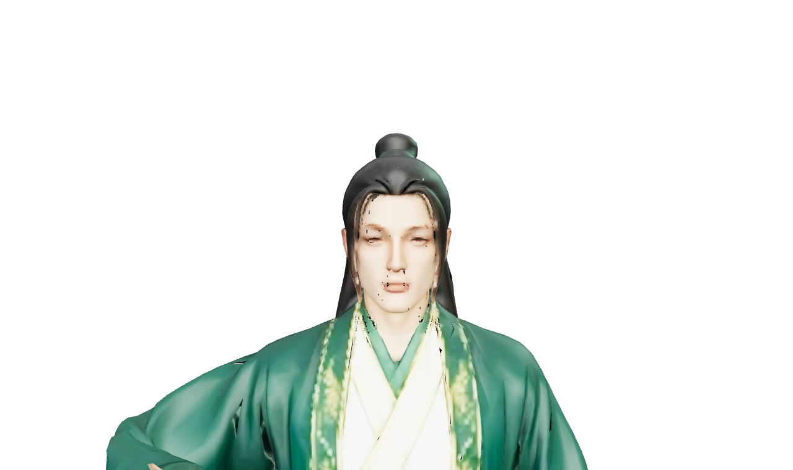
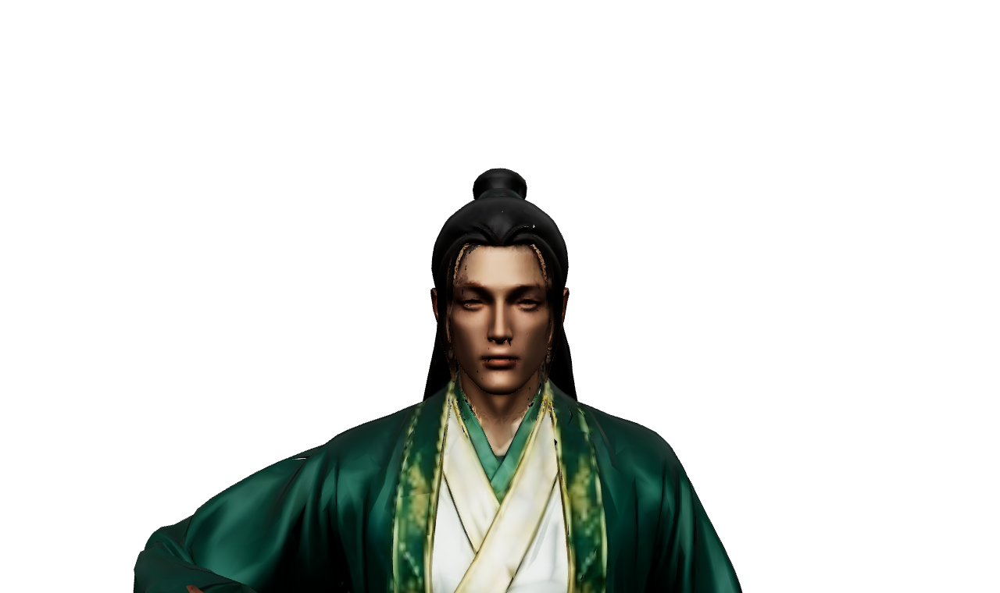
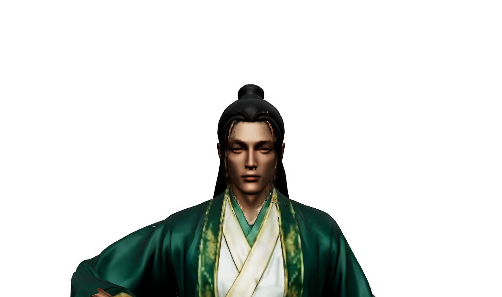

# GLB fidelity — 18/10/2026

Nhánh `fidelity/01bb51b-native-glb` bắt đầu tại `01bb51b`; lịch sử trước giữ ở `archive/perf-checkpoint-20261018` (`f948c4f`). Chỉ áp dụng các path sửa boot của `9a94940`, không mang asset nén/resizing/bake/loader/đồ họa của các commit sau. Patch đối chiếu: [restore-vs-previous-head.patch](fidelity/restore-vs-previous-head.patch).

Audit xác nhận pixelRatio (1.25 balanced/1.5 ultra), mức balanced/ultra, icon WebP128, tone mapping ACES, colorSpace sRGB, ánh sáng và hàm character-fidelity đều đã có ở01bb51b, không phải thay đổi mới ở f948c4f. Phần sau đó thêm các derivative GLB giới hạn1024/512 và ETC1S màu, atlas bake low64/medium256. Nhánh này không dùng chúng.

**01bb51b là mốc lịch sử được yêu cầu, không đồng nghĩa đã trung thực GLB.** Ngay tại mốc đó, character-fidelity tắt vertexColors, ép metalness≤0.05 cho H01, gán albedo thành emissive0.28, normalScale0.35, AO0.25, IBL1.1, exposure1.35 và bốn đèn màu. Các giá trị này phải được đo/loại bỏ khi đối chiếu với GLB, không được gọi là vật liệu nguyên bản.

## Phương pháp và số đo cloud

Reference dùng glTF source trong `assets/base_models` (kiểm SHA bằng file runtime fallback gốc), giữ nguyên mesh/rig và cùng pose/camera. Material reference lấy từ GLTFLoader chưa ghi đè. sRGB output, ACES exposure1, RoomEnvironment PMREM256; đây là một cấu hình tham chiếu trung tính rõ ràng, không phải glTF quy định duy nhất một ánh sáng. Game comparison giữ material/light/fog/exposure của game, loại UI và background khỏi phép đo bằng object mask. Ảnh lobby thật vẫn được lưu riêng. ΔE76: sRGB → tuyến tính → XYZ D65 → Lab, chỉ pixel opaque thuộc nhân vật. Không đo sai số cả nền/UI rồi gọi đó là sai số model.

| Nhân vật / góc | Trước sửa | Sau material/IBL nguyên bản | Sau UASTC q4 + mipmap |
|---|---:|---:|---:|
| H01 toàn thân |41,1661|0,0000|1,0738|
| H01 cận mặt |35,0161|0,0000|0,9456|
| H02 toàn thân |26,3866|0,0000|chưa encode|
| H02 cận mặt |23,7352|0,0000|chưa encode|

Nguồn số liệu: [before](fidelity/before/deltae.json), [native](fidelity/after-native/deltae.json), [UASTC checkpoint H01](fidelity/after-uastc-checkpoint/deltae.json). H02 trong checkpoint vẫn dùng source, không được coi là thử UASTC. ΔE0 là khung nhân vật cô lập ở cùng điều kiện, không khẳng định ảnh cả sảnh có UI/bệ đài giống reference. Sai số sau UASTC là tổng pipeline nén + sinh mipmap, chưa tách riêng ảnh hưởng mỗi bộ lọc.

| Cận mặt H01 source trung tính | Game trước sửa | Game sau giữ nguyên material |
|---|---|---|
|  |  |  |

| Sảnh toàn thân H01 sau | Sảnh cận mặt H01 sau |
|---|---|
|  |  |

| Source cận mặt | UASTC cùng kích thước |
|---|---|
|  |  |

### Nguyên nhân đã xác định bằng code/descriptor

- Vertex colors: hàm cũ ép false, nhưng cả hai GLB đang đối chiếu vốn đã false; đây không phải nguồn lệch màu của hai file này. Bản mới không ép giá trị này cho GLB khác.
- Color space: GLTFLoader đã đặt albedo sRGB và các map dữ liệu tuyến tính đúng; không cần thêm chuyển gamma hay tô lại màu.
- Tone mapping/exposure: ACES được giữ; exposure về1 theo reference, bỏ biến thiên1.35/1.25 theo hero.
- Emissive/metalness: H01 bị ép metalness0.05 và gắn albedo làm emissive trắng0.28. Đã bỏ hoàn toàn, giữ hệ số và map gốc. H02 không bị ép metalness này nhưng vẫn bị sửa normals/AO/IBL.
- Normals/AO: source `[1,-1]` bị đổi thành `[0.35,0.35]`, làm mất cả cường độ lẫn dấu trụcY; AO1 bị giảm0.25. Đã giữ nguyên giá trị source.
- Lighting: bỏ bốn đèn màu chiếu sáng giả lên model, tắt point light xanh ở sảnh; dùng môi trường trung tính. IBL bake cũ bị ép cube64 bằng `_setSize`; bỏ can thiệp này, bake kích thước chuẩn256 (768×1024 RGBA16F). Scene cũng dùng IBL để bệ đài không thành màu đen sau khi bỏ đèn.
- Fog/bloom: sảnh không phủ fog tint hoặc bloom hậu kỳ lên màu model. Map battle vẫn có fog; luật, tọa độ và gameplay không sửa.
- Nét: giữ cap pixelRatio của preset nguyên bản, ngừng adaptive giảm pixelRatio; H01/H02 dùng GLB high source ở cả balanced/ultra. Không resize bất cứ ảnh nguồn nào.

## Chặn ở bước bake, chưa đạt toàn bộ mục tiêu

Probe HDR thật: `npm run assets:probe:hdr`, exit1. [stderr](fidelity/build/hdr-uastc.stderr.txt): `Only R8, RG8, RGB8, or RGBA8 UNORM and SRGB formats can be encoded, but format is VK_FORMAT_R16G16B16A16_SFLOAT`. Không ép HDR về8bit. Đã hỏi giữ ngoại lệ HDR16F hay nâng engine/transcoder.

Prototype LDR: `npm run assets:models:fidelity` dùng UASTC q4 không RDO, không resize, mipmap; Meshopt không quantize/reorder/simplify/resample. Đọc lại file xuất và so toàn bộ accessor geometry/UV/weight, morph, inverse bind và mọi giá trị keyframe. Đã xong H01 high/medium/low; hủy lượt mobile sau khi có phép đo lệch màu để không tự duyệt chất lượng. Không phải lỗi animation. Registry mặc định tắt toàn bộ derivative GPU, kể cả derivative giảm kích thước cũ; giữ GLB source cho đến khi có lựa chọn.

Chưa hoàn thành bake toàn bộ texture cố định và warm toàn bộ model/clip. Không tuyên bố đã hết khựng lần đầu. Không có số đo Android thật. Các câu hỏi đang chờ chỉ phát sinh từ lỗi build HDR và sai lệch ảnh sau encode, không hỏi lại các lựa chọn giảm chất lượng cũ.

Bằng chứng input trực tiếp ở [checkpoint-native/capture.json](fidelity/checkpoint-native/capture.json): script kiểm bytes GLB source trong assets/base_models bằng file fallback runtime trước khi render. SHA H01:`ffa5f3b43fd7047104ddb14cca4b1c45539035d33e8c485934d0a6f4c8031e5c`. HDR IBL giữ đầy đủ RGBA16F; không convert/clamp sang LDR.

Lưu ý kiểm thử: một lượt npm test sớm thất bại vì catalogue codegen chưa xuất (không phải animation lệch); sau khi có checkpoint catalogue,128/128 qua. Lượt encode mobile bị dừng chủ động sau quality review, log có ghi signal/error; chỉ ba receipt H01 high/medium/low được coi đã kiểm định, không nhận là hoàn tất13file.

Kiểm bổ sung hai vũ khí ở tư thế đứng, cùng camera: Mộc Tinh Trượng và Chấn Nhạc Chùy đều ΔE76 trung bình0,0000 ở [checkpoint-native/deltae.json](fidelity/checkpoint-native/deltae.json). Đã bỏ pulse xanh nền0.12 của trượng khi idle; chỉ giữ pulse thoáng qua ở mốc hoạt ảnh xuất hiện. Không sửa clip/timeline/điểm tiếp đất. Bốn input GLB body/weapon đối chiếu bytes bằng source bank: [source-bytes.json](fidelity/checks/source-bytes.json).

## APK checkpoint để xem vật liệu, không phải bản bake/warm hoàn tất

Mã bản:`d33086af`; APK:49521186byte; SHA256:`fd9e9985e66310bd625d5aab1c0162bf4c786ea60bc135f1871e3e2e5a98b46d`. `npm test`:128/128; unit material/offline8/8; test H01 đủ8mốc pose/grip/impact, reload cache và offline qua;9 tình huống boot/offline qua. `verify:master` vẫn **BLOCKED0/37**, không hạ ngưỡng. `android:apk` checkpoint thành công. Probe bakeHDR **exit1** như ghi trên.

Cloud cold H01 high trong test browser:4954ms (document42ms); chưa có cặp timing trước/sau cùng preset tương đương, không so bừa với mobile LOD cũ và không gọi là hết khựng. Các số ΔE là cloud SwiftShader, không phải điện thoại. ADB không có thiết bị.
