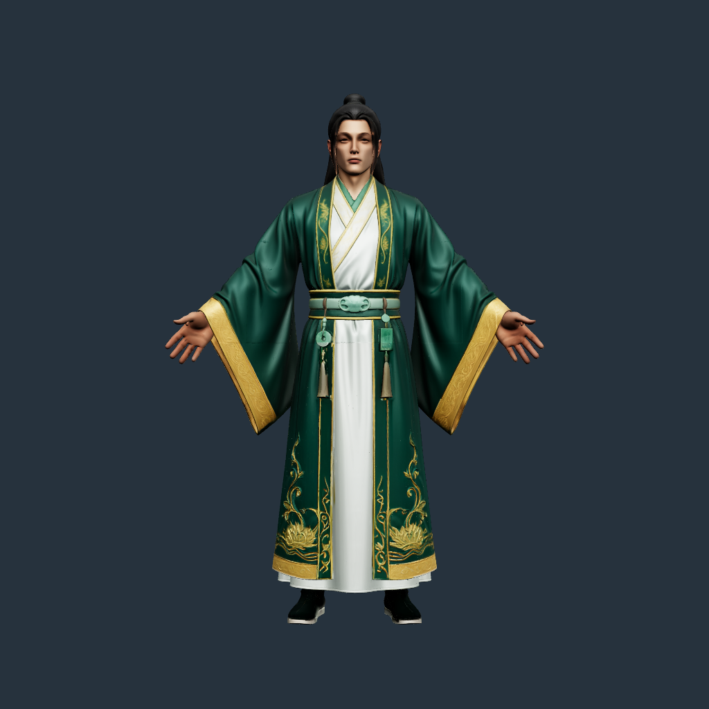
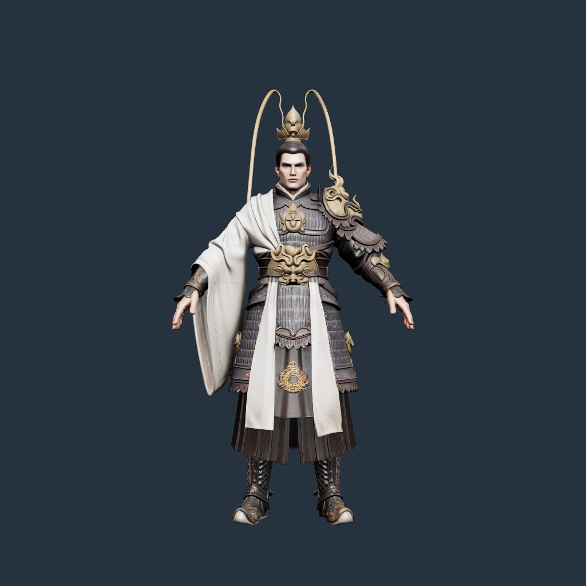
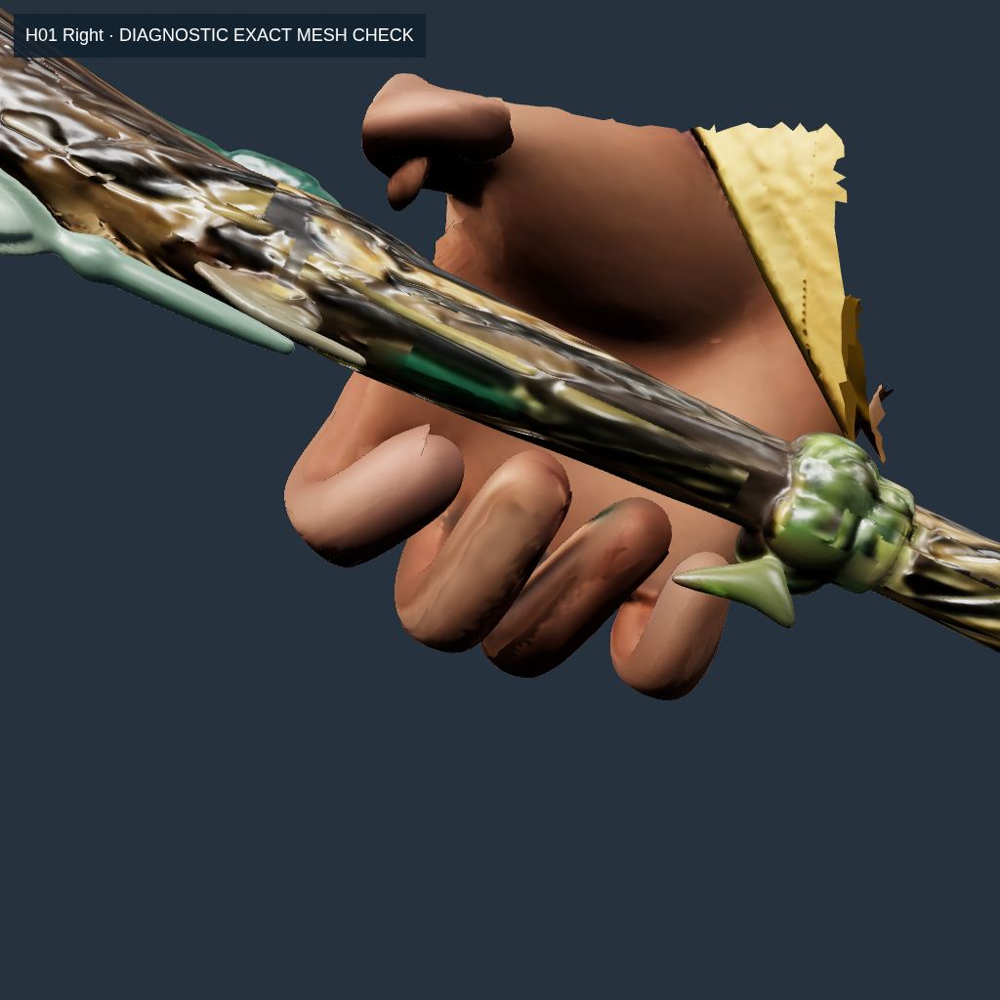
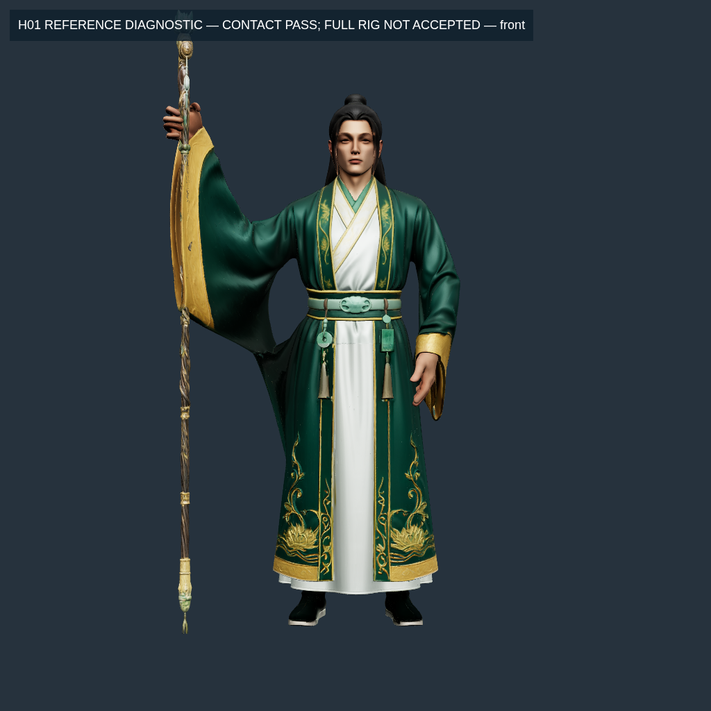

# H01/H02 — source-resolution rig rebuild

Status: staging; not activated in the lobby or APK. This report records completed rig groundwork, not completion of the entrance task.

User authorization to continue without technical approval questions is recorded in [authorization.md](rig-audit/authorization.md). Original audit: [RIG-AUDIT.md](RIG-AUDIT.md). Reference prompt: [H01-H02-ENTRANCE-PROMPT-2.md](requests/H01-H02-ENTRANCE-PROMPT-2.md).

## Completed groundwork

- Transferred skin weights from the existing rigs with Blender 4.3.2 onto the actual full-resolution Tencent source meshes. Rebuilt inverse bind matrices, calibrated the wrists and all finger bind axes using measured source-surface landmarks.
- Kept source position, normal, UV and triangle-index accessor bytes and embedded image bytes unchanged. Original files were not overwritten. Receipts next to each GLB contain source/donor/output SHA-256 hashes.
- Retained 52 joints, all six legacy clip names, rotation sample times/counts and Hips translation samples. Re-expressed donor rotations relative to the calibrated bind; ensured quaternion hemisphere continuity. Removed the old scale and non-root translation tracks to prevent bone stretching. This preserves legacy bind-relative rotations, including their existing anatomical defects; it does **not** certify those poses.
- Normalized four-influence weights. Excluded green silk/white cuffs from finger reweighting using measured source hand albedo; applied three 0.5-factor smoothing passes at non-finger transitions, followed by a local hand diffusion solve and projected edge constraints. All processing affects skin weights only. Coincident UV-seam vertices retain identical weights; fingertips remain attached to their actual distal bones.
- Added calibrated swing–twist joint-limit checks, finger FK, capsule/shaft collision checks, reproducible grip search, source-versus-rig render comparison and a local interactive review page. No external asset service is involved.

## Measurements

Cloud Chromium with SwiftShader, 1024×1024, the same camera/environment/materials for source and candidate. These are RGB pixel differences, **not ΔE**. No phone measurements.

| Check | H01 | H02 |
| --- | ---: | ---: |
| Original triangles retained | 1,499,726 | 1,499,746 |
| Original vertices retained | 869,627 | 895,581 |
| Finger bones receiving nonzero skin weights | 30/30 | 30/30 (legacy had 8 empty finger bones) |
| Source geometry/UV/image bytes | identical | identical |
| Maximum inverse-bind identity error | 6.59e-8 | 1.94e-7 |
| Mean bind-render RGB error, 0–255 | 0.0002810 | 0.0002038 |
| Pixels with channel difference >2 | 0.002193% | 0.001335% |
| Legacy animation frames checked at 60Hz | 566 | 650 |
| Maximum bone-length fractional change | 0 | 0 |

Machine-readable evidence: [structure](rig-audit/fullres-structure.json), [browser](rig-audit/fullres-browser/report.json), [legacy joint-limit failures](rig-audit/legacy-joint-limits.json), [grip acceptance](hand-frames/grip-acceptance.json). Render edge outliers remain visible in the browser report; mean values are not claims of pixel identity.

| Original GLB | Rig at bind pose | Legacy motion sample |
| --- | --- | --- |
|  |  |  |
|  |  |  |

## Remaining blockers

1. Legacy finger clips use rotations that violate the calibrated anatomical axes, especially the old right-hand grip. Entrance also contains excessive spine/head/foot angles; Run hyperextends knees. Retargeting preserves these defects and is not their repair. Strict `test:rig:joints` fails; the report lists joints, axes and measured ranges.
2. H01's corrected geometric grip search passes the current capsule thresholds, including 3–5 mm palm gap and opposed thumb. This remains a candidate: actual deformed-skin contact and all visual hand checks still need validation. The previous exploratory result at 14 mm palm gap was invalid and has been discarded.
3. H02's grip search still fails for the actual 33.47 mm-radius handle. A failed optimization is not proof the pose is physically impossible. No failed grip is applied to runtime; no hand/weapon scaling or relaxed threshold is used to hide it. Experimental metacarpal cupping is disabled because the current rig does not contain those deforming joints.
4. Both closed-hand skin diagnostics now pass: H01 maximum 1.9451, H02 1.5482, with the unchanged limit 2.0. This covers the diagnostic poses, not every animation or the actual grip pose. Loose sleeve deformation still needs visual correction in motion. Diagnostic hand crops deliberately cut triangles at the crop boundary; those edges are not changes to the source mesh.
5. The persistent `HeroPoseController` component is implemented and passes four tests for real mixer playback, 10-second hold, large-delta event order, repeat playback and invalid-clip rejection. It is not integrated into the lobby. New reference entrance/`IDLE_HOLD` clips, full replay/switch stress checks and a new APK are pending. The current game still has the previously audited static-model swap after entrance. This rebuild does not yet fix that runtime path.

## Reproduce

```bash
npm run assets:rig                 # Blender transfer cached by source/donor hashes
npm run test:rig:structure         # original accessor/image bytes, weights, IBM, clip integrity
node tools/rig/generate-bind-frames.mjs
npm run test:rig:browser           # source-bind images and real skin deformation in Chromium
npm run test:rig:skin              # strict; both diagnostic hand poses now pass
npm run test:rig:joints            # strict; currently fails on legacy clips
npm run test:rig:grip              # strict; currently fails on H02
npm run test:rig:contact           # strict; both source-skin/cylinder diagnostics fail
node tools/hand-frame.mjs --rigged # open/closed hand views; diagnostic, not grip acceptance
npm test
npm run verify:master
```

Review locally with `npm run dev`, then `/tools/rig-review.html?hero=H01&rigged=1&view=full` or `hero=H02`. Clip buttons use an AnimationMixer on the full-resolution skinned mesh. Omit `rigged=1` to view the unmodified source. This review path is not the game's lobby.

Validation at this checkpoint: `npm test` **143 passed**. The additional regression checks UV-seam vertices with permuted joint slots. Joint and H02 grip checks still fail as described. `verify:master` remains **BLOCKED, 0/37**, rather than being waived or relabelled as passed. No APK was rebuilt or tested on an Android device for this checkpoint.

## Hand-weight repair measurements

These compare an early candidate from this rebuild with the final staging candidate, not with the shipped APK. Both use the same original mesh and the same diagnostic closed-hand bone pose. Thresholds remain p99.9 ≤1.5 and maximum ≤2.0.

| Edge-stretch ratio | H01 before → after | H02 before → after |
| --- | --- | --- |
| p99.9 | 1.8415 → 1.4500 | 1.9328 → 1.4500 |
| Maximum | 76.6756 → 1.9451 (**passes**) | 52.4724 → 1.5482 (**passes**) |

[Before](rig-audit/skin-strain-before-diffusion.json) and [after](rig-audit/skin-strain.json) retain the measured worst edges. The latter also checks that the actual source fingertip skin follows the distal bones; it does not accept a stationary hand as a repair. [UV-seam checks](rig-audit/fullres-structure.json) report zero weight disagreement across 119,782 H01 and 145,724 H02 coincident-position pairs.

Blender automatic bone heat was attempted on H01 and rejected because it returned no usable finger weights. [Attempt record](rig-audit/blender-heat-attempt.json). The file-writing path remains the source-preserving local weight solver; the **rig itself is still staging**.


Joint cross-section ratios, actual deformed-skin/weapon contact, the new entrance clips and Android hardware performance have not been accepted or measured by these component checks.

## Follow-up: seam-safe fitting and source-weapon diagnostics

The fitter now canonicalizes joint slots at coincident UV-seam vertices before caching per-joint transformations. A regression exercises equivalent weights stored in different slot orders. H01 uses 6,000 offline fitting iterations instead of 500, preserving the source mesh and textures. This increases asset-processing time, not runtime work. The previous checkpoint's independent measurements are retained in [skin-strain-before-seam-fit.json](rig-audit/skin-strain-before-seam-fit.json); the maximum closed-hand ratio decreased from 2.9154 to 1.9451.

Grip search now includes the original anatomical extension bounds (MCP −30°, PIP/DIP −5°) and distinguishes the measured contact-surface normal from the finger bind-frame normal. These are different frames; changing contact direction must not silently rotate the finger bind axes. Shaft directions are projected onto the contact plane, with the original angular/contact thresholds enforced.

`node tools/rig/preview-grips.mjs` renders the actual full-resolution skinned hand with the original weapon in three diagnostic views. The rest of the body is cropped only in this review to avoid inward-facing hand cameras being obscured by the torso. It compares rendered fingertip FK with the solver and measures deformed source-skin vertices against the measured shaft cylinder. That cylinder excludes weapon ornaments; this is an additional rejection check, not a complete mesh/mesh contact acceptance. Failed grip candidates are labelled **REJECTED CONTACT** and never installed into the game.

The rendered FK matches the solver to within 8.22e-8 m for H01 and 6.68e-8 m for H02. However, the actual deformed hand-region mesh intrudes into the measured shaft cylinder by **11.356 mm / 13.024 mm**, respectively; both fail the unchanged **3 mm** limit. This region includes cuffs: H01's worst vertex is on the gold cuff (source albedo RGB 144/106/41), rather than finger skin. H01's geometric capsule pass is therefore insufficient to accept the complete grip placement. `test:rig:contact` fails for these results; the staging manifest records this independently of the open/closed-hand strain pass. Evidence: [grip-runtime-diagnostic.json](hand-frames/grip-runtime-diagnostic.json).

An offline coupled solve also re-evaluated the actual skinned contact triangle after each finger solve, rather than treating the rest-pose palm point as stationary. Ten iterations converged the palm gap but did not fix the other contact constraints; **neither result is applied**. The full [iteration report](hand-frames/grip-contact-refinement.json) is retained to avoid repeating this failed approach unchanged. Remaining work is skin weighting/contact correction and new reference clips, followed by runtime integration and Android testing. No new APK is produced from these rejected poses.

The search also retained all **34 H01 geometric passes** and checked each against the deformed source hand/cuff region. The best coarse alternative still had 7.172 mm intrusion and 7.060 mm actual palm gap, exceeding the 3 mm / 3–5 mm limits. Continuous refinement evaluated 125 H01 parameter sets and 31 H02 sets. Its best H01 compromise reduced intrusion to 4.984 mm but left a 7.216 mm palm gap and failed geometric conditions; **it is rejected**, as is H02. These are failed exploratory poses, not improvements applied to the game. The worst-point records include source vertex IDs, source/posed coordinates, joint weights and source albedo samples, distinguishing cuff interference from finger-skin errors. See [candidate checks](hand-frames/H01-grip-contact-refinement.json).

An additional bone-heat attempt used sealed, 1.2 mm voxel proxies derived from the source hand crop, rather than the full body. Both normal numerical scale and a temporary 100× calculation scale failed with all 15 right-finger groups empty. No accepted weights or replacement model were exported. This is an algorithmic failure, not a missing Blender installation. [Attempt record](rig-audit/voxel-heat-attempt.json) and [Blender log](rig-audit/H01-voxel-heat-attempt.log). The temporary proxy is never a game asset.


## Exact source-mesh contact and upright reference pose

The older cylinder diagnostics above remain rejected. A new source-triangle test uses a BVH of the original weapon, three independent parity rays, and adaptive triangle subdivision. It rejects ambiguous inside/outside queries and unresolved subdivision bounds. The 3 mm penetration limit is unchanged. Source topology is audited before certification: H01's weapon forms a closed, balanced oriented parity chain with four degenerate and four non-manifold edges; it is **not** described as a strict two-manifold mesh. H02's source weapon passes the strict manifold check. Neither source is repaired or replaced.

For H01's **local hand pose**, the accepted search result uses weapon axial roll 275°. The vertex-only maximum penetration is 2.8792 mm; adaptive testing of 26,000 hand/cuff source triangles finds 2.9429 mm maximum sampled depth and a 2.9991 mm conservative upper bound, with zero ambiguous/unresolved queries. Actual palm gap is 4.6075 mm and palm-facing dot is 0.94747. Rendered fingertip FK agrees with the offline solver within 8.23e-8 m. This is a local contact result, not acceptance of the full character or animation. The thumb is still visually loose and needs review with the complete pose. Evidence: [exact search](hand-frames/H01-exact-grip-search.json), [rendered FK](hand-frames/grip-runtime-exact.json).



Calibration now derives the wrist longitudinal axis from the measured hand frame rather than the first child (Thumb1), and records mirrored lateral/twist signs. Mirrored physical rotations are regression-tested. No joint limits are widened. Rechecking the six legacy clips still fails; they are not accepted reference animations.

`ReferencePose` solves the anatomical elbow hinge and scans upper-arm roll without scaling bones. The H01 upright target at staff center `[-0.56, 1.64, 0.20]` m passes all joint limits, with wrist positional error 2.61e-9 m. Its measured palm direction is rotated 30° toward the front to permit a legal wrist; this remains a diagnostic pose for visual review. An unreachable target is rejected without mutating the skeleton. [Pose report](anim-report/H01-reference-idle-solve.json).

The existing staging weights **fail at that actual full-arm pose**: right hand/cuff p99.9/max edge stretch 3.1045/6.3197, left 1.4865/2.8470. The best weapon roll search still finds 4.3158 mm vertex intrusion. [Strain](anim-report/H01-reference-strain.json), [contact](anim-report/H01-reference-contact.json). This explains why a local hand contact pass alone must not activate a complete rig.

The weight fitter now accepts the actual reference rotations in addition to the two generic hand poses, and can adjust hand/cuff vertices with no finger influence. Fixed neighboring vertices use their actual posed positions; a regression guards against falsely classifying common whole-arm rigid motion as skin stretch. Alternative output/report directories keep experiments separate from the accepted staging files. Example:

```bash
HERO=H01 REFERENCE_POSE=docs/anim-report/H01-reference-idle-solve.json \
  RIG_OUTPUT_DIR=.local/rig-candidates/reference SKIN_FIT_ITERATIONS=6000 npm run assets:rig
HERO=H01 RIG_INPUT_DIR=.local/rig-candidates/reference \
  RIG_REPORT_DIR=docs/anim-report/reference-fit node tools/rig-verify-fullres.mjs
RIG_INPUT_DIR=.local/rig-candidates/reference \
  RIG_REPORT_DIR=docs/anim-report/reference-fit npm run test:rig:reference-strain
RIG_INPUT_DIR=.local/rig-candidates/reference \
  RIG_REPORT_DIR=docs/anim-report/reference-fit npm run test:rig:reference-contact
```

Additional H02 source palm/proximal-finger contact probes still produce no accepted geometric grip; they are diagnostic measurements, not a proof that a correct grip is impossible. No new entrance/IDLE_HOLD clip, runtime activation or Android APK is claimed by this checkpoint.


The actual-pose refit completed in an isolated output directory. Independent source verification confirms unchanged source geometry/UV/images, all 30 weighted finger bones, and inverse-bind error 6.59e-8. Its rig SHA-256 is `e23c6f1f39fcaaf3792cac219799ab1a38422ee4eb2525563b98726710b061c3`. The same reference pose now has hand/cuff stretch p99.9/max **1.4512/1.7860 right**, **1.4133/1.4501 left**; both pass the original limits. Generic open/closed hand tests also pass, maximum 1.9453. These checks do not replace whole-body validation.

Whole-body edge validation was then added to the **same pose**, and exposes a separate sleeve defect: p99.9 **27.6831**, maximum **395.1734**. One source sleeve edge of 0.32994 mm expands to 130.3841 mm. The source triangles are continuous, but transferred body/sleeve weights vary sharply; hand-region fitting cannot repair edges outside its scope. This result is retained in [whole-body report](anim-report/reference-fit/whole-body/H01-reference-strain.json). The candidate remains rejected for the complete pose. A separate sleeve-region diffusion/constraint experiment is being measured; it does not overwrite the current staging rigs.

The full-arm contact search after hand refitting still fails at 4.3158 mm. Moving the hand 20 mm upward along the unchanged upright staff reduces vertex intrusion to 2.9252 mm, but adaptive triangle checking finds a **3.0418 mm** interior intrusion and rejects it. Other measured hand-height trials (−40, −20, −10, +10, +40 mm) also fail. No vertex-only pass is substituted for the triangle test.


Validation so far: **152 automated tests passed**, zero failures/skips. `verify:master` still reports **BLOCKED 0/37**. Source assets and both existing staging GLBs remain unchanged; no runtime switch or APK rebuild has occurred. All numerical and rendered results in this section are from the cloud environment, not an Android phone.


### Sleeve experiments and rejection results

Inspection of the actual transferred weights identifies a specific error: sleeve vertices 752647/752585, near source position `[-0.391, 0.873, 0.073]`, carry roughly 52% Hips, 35% RightUpLeg and 12% RightLeg. Nearby sleeve vertices also carry Hand/ForeArm weights. This makes tiny source edges separate abruptly when the arm is raised. The measurements identify an incorrect influence assignment; increasing hand-fit iterations alone cannot fix it.

`fit-reference-body.mjs` keeps each experiment under `.local/rig-candidates/`, never the runtime assets. It tests sleeve diffusion with fixed influence supports, continuous bind-space arm/spine supports, and a faded transition over the garment. All preserve source geometry/UV/embedded images; they are **not accepted skin replacements**:

| Experiment | Whole-body p99.9 / maximum edge stretch | Outcome |
| --- | --- | --- |
| Existing refit, hand region only | 27.6831 / 395.1734 | Reject full pose; hands pass |
| 32 sleeve smoothing passes + 1,000 constraints | 10.4773 / 69.8154 | Reject; right hand regresses |
| Analytic arm supports, hard region boundary, 100 constraints | 23.6145 / 231.8048 | Reject; region boundary discontinuity |
| Continuous garment fade, 100 constraints | 6.5330 / 22.9943 | Reject; hand-edge and generic-pose checks remain required |

Protecting a hand crop alone is insufficient: its edge check includes the neighboring endpoint outside that crop. The fitter now supports fixed vertices, while the experiment preserves both the hand/finger-influenced vertices and their directly connected neighbors. All original acceptance thresholds remain unchanged. A regression proves that the fitter must report an unresolved edge rather than move protected hand weights to conceal it. The final protected experiment is measured independently in `anim-report/body-fixed-hands/`.

A separate Blender automatic bone-heat attempt disables all 30 finger bones and solves only body bones on the real source surface. It still fails: all 869,627 source vertices are unweighted, so no weight binary or geometry is accepted. This is an algorithmic rejection, not a missing installation. [Recorded result](rig-audit/body-heat-attempt.json).

H02 now also has a deterministic differential-evolution finger search (1,000 generations at its best measured patch). It retains all anatomical/contact bounds; the search objective uses a small **stricter interior margin**, while acceptance bounds remain unchanged. Thumb/index/middle still fail, and ring/pinky pass. [Result](hand-frames/H02-deep-grip-search.json). A triangle-plane section audit finds the narrowest sampled shaft radius about 32.466 mm, versus the existing 33.470 mm section; no shaft scale or source weapon data is changed. [Sections](hand-frames/H02-weapon-sections.json).

Final automated suite at this checkpoint: **154 passed, zero failed/skipped**. `verify:master`: **BLOCKED 0/37**, not waived. Neither a new rig nor a new APK is activated by these diagnostic results. Source models and the two staging GLBs retain their previous hashes.


Final protected sleeve trial (20 iterations): both actual-pose hand/cuff checks retain their passing values **1.4512/1.7860 right**, **1.4133/1.4501 left**, and the generic whole-mesh hand diagnostics pass (maximum **1.9453**). Protecting the complete finger-influenced region plus its neighboring endpoints prevents the earlier regressions. Source byte/UV/image/rig validation also passes. However, the upright **whole-body** check remains rejected at p99.9 **7.8622**, maximum **29.0057**. Its SHA-256 is `09ef0b87a4b55dfe9834929d04940dd866eabe27d45619ab6c44c8e9f15533ed`. This is an intermediate diagnostic result, not a final visual or animation acceptance. [Independent results](anim-report/body-fixed-hands/H01-reference-strain.json).

Reproduce this rejected sleeve experiment after generating the isolated reference-fit GLB:

```bash
SKIN_FIT_ITERATIONS=20 node tools/rig/fit-reference-body.mjs --continuous-sleeves --preserve-hands
RIG_INPUT_DIR=.local/rig-candidates/reference-body-continuous-fixed-hands \
  RIG_REPORT_DIR=docs/anim-report/body-fixed-hands node tools/rig/validate-reference-strain.mjs --whole-body
```

The second command intentionally exits nonzero while whole-body strain fails. Do not copy this candidate into runtime assets. Remaining work includes source-surface body/sleeve weighting, a valid H02 grip, full reference entrance/IDLE_HOLD clips, whole-animation/contact/volume checks and actual Android testing.


## Surface-graph weights and a passing H01 upright grip

This stage uses the actual source triangle graph instead of nearest donor anatomy. A positive inverse-edge-length Dirichlet Laplacian interpolates four shared arm/spine supports on each side. UV-coincident source vertices share weights, while the actual source position/index/normal/UV/image arrays are unchanged. Hand/finger-influenced regions and their neighboring edge endpoints remain protected. Disconnected components with no boundary anchors retain their input weights. The numerical solve reaches relative residuals below 1e-6; this is solver convergence, **not rig acceptance**.

The local Python tools require `numpy==2.3.5` and `scipy==1.17.0`, listed in `tools/rig/requirements-surface.txt`. These are development dependencies for asset processing and the new math tests; they are not Android runtime dependencies. They were already available in the cloud environment. A fresh development environment can install them with `python3 -m pip install -r tools/rig/requirements-surface.txt`.

Global optimization then minimizes exact original-edge stretch over normalized, nonnegative four-bone skin weights. Two tested backends are retained: L-BFGS on normalized weights and a metric-projected simplex solver with a checked descent bound. Analytic gradients are checked against finite differences, including UV-weld accumulation. Projection normalization and monotone descent are independently tested. The earlier per-edge projection experiment worsens the full-pose result and remains rejected.

All rows below use the **same original upright pose** and unchanged acceptance thresholds (p99.9 ≤1.5, maximum ≤2.0):

| Source-weight candidate | Whole-body p99.9 | Maximum | Full-pose result |
| --- | ---: | ---: | --- |
| Prior protected sleeve experiment | 7.8622 | 29.0057 | Reject |
| Surface harmonic interpolation | 2.4935 | 6.8605 | Reject |
| Harmonic + per-edge projection, 300 iterations | 2.8107 | 15.4500 | Reject; worse |
| Harmonic + global L-BFGS, 300 iterations | 2.1630 | 4.7064 | Reject |
| Global + metric projection, 500 iterations | 1.9648 | 3.6218 | Reject |
| Expanded-domain harmonic interpolation | 2.2663 | 6.1411 | Reject |

The projected candidate retains **passing** independent source-byte/rig structure and generic whole-mesh hand tests; its original-pose hand/cuff tests remain **1.4512/1.7860 right**, **1.4133/1.4501 left**. These component passes do not override the whole-body failure. Its SHA-256 is `b51ff99d4371eba5bb535039524d6328c20da746e45ff9d08ba17119214c3a1c`.

A shortest-path diagnostic samples fixed endpoint pairs on the original source edges. Its strongest sampled necessary stretch bound is about 1.2733, which **does not prove feasibility**, and does not establish impossibility either. The witness and explicit scope are retained in [harmonic-feasibility.json](anim-report/harmonic-feasibility.json); no acceptance condition is inferred from this diagnostic.

### Actual upright hand/weapon contact now passes at one held pose

The staff stays at the original location and scale, with its base on the floor. Raising only the wrist target **22 mm along the shaft** and rotating the original staff about its axis to **276°** gives a joint-legal pose with these independently measured results:

- Actual palm gap **3.3692 mm**, normal-toward-staff dot **0.81649** (required ≥0.8).
- Maximum source-vertex intrusion **2.5049 mm**.
- Adaptive test over **26,000 original deformed hand/cuff triangles**: maximum sampled intrusion **2.8227 mm**, conservative upper bound **2.999558 mm**, zero ambiguous queries and zero unresolved triangles. The penetration limit remains **3 mm**.
- Actual-pose hand/cuff edge strain: right **1.4800/1.8294**, left **1.4133/1.4501**; both pass the original thresholds.
- All joint checks pass for the static pose. This is not a baked clip or whole-animation contact check.

[Pose](anim-report/harmonic-held/H01-reference-idle-solve.json), [contact proof](anim-report/harmonic-held/H01-reference-contact.json), [strain](anim-report/harmonic-held/H01-reference-strain.json). The held-pose whole-body result still fails at **1.9934/3.7895**, so the rig remains unactivated. The front screenshot was inspected in the cloud review renderer; side/back screenshots are retained too. This is not an Android test or final cloth/volume approval.



Reproduction after building the isolated reference-fit GLB described above:

```bash
npm run assets:rig:surface
SKIN_FIT_ITERATIONS=300 node tools/rig/optimize-surface.mjs
SKIN_FIT_ITERATIONS=500 node tools/rig/optimize-surface.mjs --projected
RIG_INPUT_DIR=.local/rig-candidates/harmonic-projected \
  REFERENCE_HEIGHT_MM=22 node tools/rig/reference-height-variants.mjs
RIG_INPUT_DIR=.local/rig-candidates/harmonic-projected \
  REFERENCE_POSE=.local/rig-candidates/reference/heights/22.json \
  CONTACT_ROLLS=276 RIG_REPORT_DIR=.local/rig-candidates/contact-proof \
  node tools/rig/validate-reference-pose.mjs
```

The source models, existing staging GLBs and runtime activation settings remain unchanged. H02 grip, whole-body source weighting, full reference entrance/IDLE_HOLD clips and Android hardware checks remain outstanding. No new APK is produced from this rejected full-body rig.


Visual follow-up: front, side and back renders were opened for review. The back view still shows a local bulge in the side robe below the raised sleeve. This is an additional reason to reject complete rig/cloth acceptance even though the static hand/weapon contact passes. No cloth-volume or whole-animation acceptance is claimed.

This stage's `npm test` run completed with **156 passed, zero failed/skipped** (including three Python objective/projection checks exercised by the Node wrapper). `verify:master` exits **1**, reports **BLOCKED 0/37**, and is not relabelled as passing. All measurements and images are cloud results; Android hardware remains untested.

## H01 garment separation — diagnostic, not accepted

The user's new authorization permits separating fused garment surfaces and repairing rig weights while retaining the original textures. `npm run assets:rig:garment` now builds a separate visible outer-garment mesh from the real source triangles. It does not manufacture an anatomical torso beneath the robe, and it does not activate the result in the game.

- Input: previous harmonic-projected H01 candidate, SHA-256 `b51ff99d4371eba5bb535039524d6328c20da746e45ff9d08ba17119214c3a1c`.
- Separate garment surface: **911,781 triangles**; remaining source surface: **587,945**; unchanged total **1,499,726**.
- Actual source POSITION/NORMAL/UV attributes, skin weights and three embedded texture images are checked byte-for-byte after export. Both mesh nodes share the original material/accessors and skeleton.
- **52 bones and six clips** (`Attack`, `Cast`, `Dash`, `Entrance`, `Idle`, `Run`) are retained, with identical sampler times, outputs and interpolation. No keyframe reduction is applied.
- Durable experimental asset: `assets/rigged/H01-C0-garment-diagnostic.glb`; runtime loading and existing staged GLBs are unchanged. Local review mirror: `.local/rig-candidates/garment-separated/`.

The selection is a conservative **UV-color and bind-position outer-garment partition**, not a proven complete clothing/anatomy segmentation. The isolated-front screenshot was inspected: the green outer robe is isolated, but the white inner garment stays in the remainder and the color-selected edges need semantic cleanup. The original joined sleeve/robe area still has a bulge in the rear upright pose. Mesh separation alone does not resolve those weights or reconstruct missing hidden surfaces.

A hanging-robe weighting trial moved 390,498 vertices toward hip support. It is **rejected**: whole-body upright strain became p99.9 **6.1757**, maximum **9.1548**, versus the previous held-pose **1.9934 / 3.7895**. Both hands retain their passing values, but this does not override the body failure. These rejected weights exist only in `.local/rig-candidates/robe-repaired/` and are explicitly removed before exporting the separated candidate. [Rejected trial](anim-report/garment-separated/H01-reference-strain.json).

Cloud renders compare the unchanged-weight candidate against its pre-separation input, with identical cameras and pose. Excluding labels/controls, mean absolute RGB-channel differences on a 0–255 scale are **0.000459 / 0.000499 / 0.000087** for front/side/back; only **51 / 60 / 25** channels differ out of 2,734,080 each. Small rasterization differences after splitting draws are recorded, not called pixel-identical. These measurements do not prove correct clothing segmentation or Android performance. [Metrics](anim-report/garment-separated/pixel-comparison.json), [export checks](anim-report/garment-separated/separation.json).

Reproduce with the prior harmonic-projected input available:

```bash
npm run assets:rig:garment
node tools/rig/preview-garment.mjs
node tools/rig/preview-garment.mjs --isolated
RIG_INPUT_DIR=.local/rig-candidates/robe-repaired \
  REFERENCE_POSE=.local/rig-candidates/reference/heights/22.json \
  RIG_REPORT_DIR=docs/anim-report/garment-separated \
  node tools/rig/validate-reference-strain.mjs --whole-body
```

The final command intentionally fails while recording the rejected weighting trial. Remaining work: clean anatomical/garment boundaries, resolve the connected sleeve-to-skirt deformation and body strain, validate every animation and collision/contact, then validate on Android hardware. No new APK or full rig acceptance is claimed.

Validation for this stage: `npm test` **158 passed, zero failed/skipped** (including two new garment partition/weight invariants). `npm run verify:master` exits **1**, remains **BLOCKED 0/37**. The rejection is retained without changing thresholds. Screenshots are published under task 10 in the Git picture gallery.

## Two independent lower H01 robe panels

The focused follow-up splits lower left/right outer-robe panels away from the upper garment/sleeves into compact, independently indexed skinned meshes. It preserves every source triangle and attribute; no weight correction or runtime activation is bundled. The earlier broad color selection is refined in the lower region with nearest green/white source-surface seeds; the remaining automatic segmentation limitations and exposed missing hidden surfaces are explicitly documented. See [panel breakdown, reproduction and images](anim-report/robe-panels/README.md). No complete rig or clothing acceptance is inferred from mesh separation.

## Rig/APK completion goal and whole-mesh rejection checks

The follow-up goal is tracked in acceptance/goals/rig-apk.json and checked with npm run goal:rig; the existing repository goal was also run. Neither is marked complete. No requirement is waived because an APK can be built.

The new validate-all-meshes.mjs independently skins **every** mesh/primitive at the held reference pose, retaining p99.9 ≤1.5 / maximum ≤2.0. It also rejects discontinuity at identical-source shared seam vertices (1 µm numerical tolerance). Intentional free seams require explicit reviewed mapping; none is silently exempted. Regression fixtures check that a failing second mesh cannot hide behind a passing first mesh, and that individually unstrained meshes still fail when their shared boundary opens.

The hip-only lower-panel trial is rejected: the panels have stretch 1.0, but shared-source seams open **388.343 mm**. Upper garment and remaining surfaces also fail their independent strain checks. See robe-panels/anchored-all-mesh-strain.json. These weights remain local and are not packaged as a runtime replacement.

The optimizer ran **2,000 projected iterations**, isolated under .local/rig-candidates/fullbody-refit/. Independent full-source validation still passes (original geometry/UV/images and weighted finger bones preserved). However, independent whole-body held-pose strain is **1.894217 / 3.497870**, versus **1.993379 / 3.789454** before. This is numerical improvement, **not acceptance**. The optimizer reports nonconvergence; no new rig is activated. Reports, solve history and hashes are in anim-report/fullbody-refit/.

An offline mobile rig viewer is included to inspect the source-resolution split meshes and existing clips: lobby → **HƯỚNG DẪN → Xem rig thử**. H01 panels can be isolated; H02 can be inspected separately. Only one preview is retained at once. It does not edit account data, match state, economy, or existing runtime actor loaders. Textures are copied unchanged, without resolution reduction, CDN or remote generation. Camera bounds are computed after updating skeleton matrices; a browser regression checks that all of H02 fits the viewport.

Native packaging assigns a new versionCode and source-derived versionName, and refuses to write provenance if source files change during the build. The separate single-file HTML exporter is skipped specifically for native packaging; all offline dist assets, including review GLBs, remain in the APK. The old standalone HTML is not presented as newly rebuilt.

Recorded failures: the first Android config test exposed a dependency on the fixture working directory; packaging now passes its build identity explicitly and the original security test passes unchanged. One cloud screenshot timed out at 30 seconds; a later capture uses a 120-second timeout without changing gameplay/performance or deformation thresholds. Development reloads affected the first captures; those images are retained in the gallery and the stable review test disables source watching. Obsolete standalone-only exports were deliberately cancelled before the final native rebuild.

Final automated checks for this packaging stage: **164/164 npm test**, **215/215 test:master** pass; **verify:master remains BLOCKED 0/37**. The browser review passes with zero external requests/page errors and full H02 camera framing. All measurements are from cloud Chromium, not an Android device.

Verified diagnostic APK: **2.5.7c386946**, native versionCode **214493786**, **445,435,498 bytes**. SHA-256: **558b5fa1fd8cbb6529204b27c58664c4a78b4fdad5db7388882e792bb4f3747c**. APK signing, manifest version, embedded GLB hashes, current source fingerprint and entry-module dependency graphs were checked. This APK adds the offline review screen; it does **not** activate the rejected new rig. Physical Android behavior, full H02 grip and final reference animation remain unverified/unaccepted.
