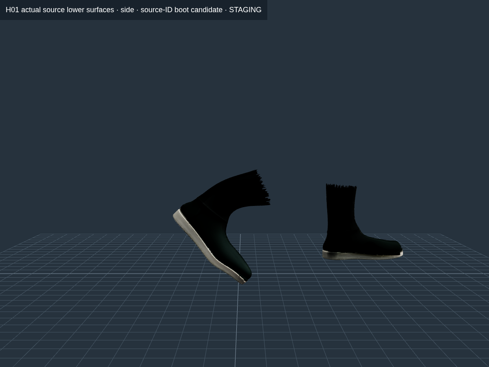
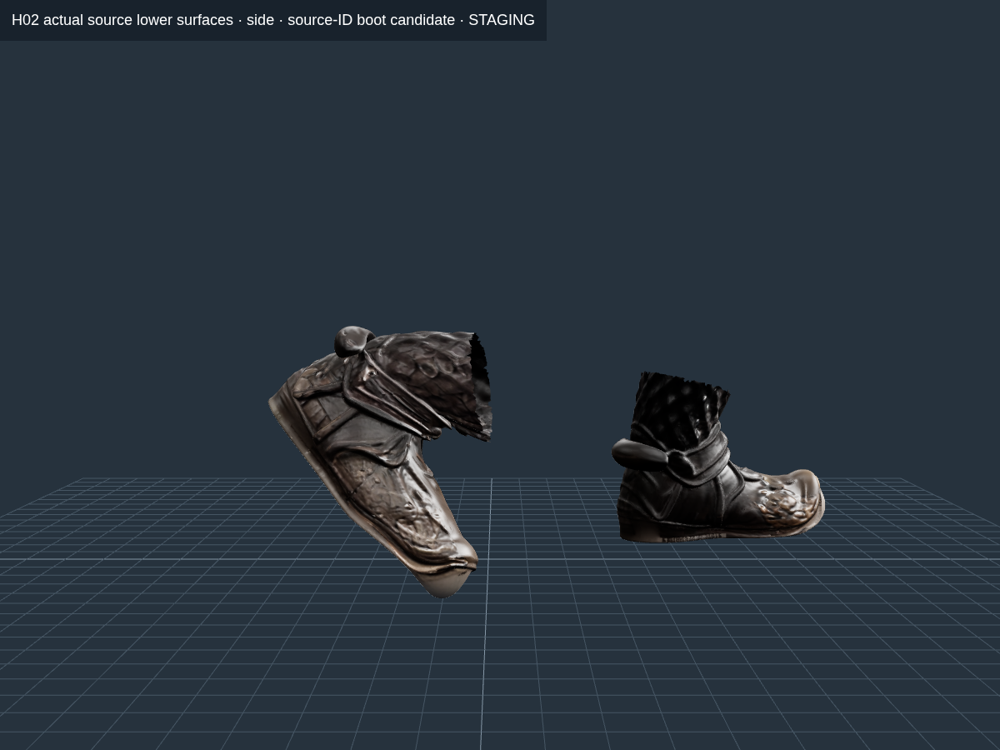

# Vòng tiếp: bề mặt ủng, cổ tay và weight trên source thật

**Chưa nghiệm thu rig/animation; APK vẫn là bản cũ.** Đây là phần nền rig theo mục13 đã duyệt, không phải bản đã thay vào game. Không sửa source GLB, texture/UV/normal/index, luật chơi hoặc tay áo H01 ở runtime.

## Lỗi tiếp xúc sàn đã sửa trong key-pose staging

Phép kiểm joint Foot trước đây bỏ sót đỉnh ủng thật xuống dưới sàn. Bản sửa phân bố lại weight ở các component source phía dưới 220mm, không lấy toàn bộ vùng thấp làm “chân”. Phần đế dưới80mm dùng Foot/ToeBase; nối C1 về field cha tại220mm. Ngón chân phải phối hợp20° trong giới hạn cũ; fit lại chain chân từ **minimumY của bề mặt thật**, không nâng cả nhân vật hay đổi chiều dài bone.

| Phép đo cloud / source key-pose | H01 | H02 |
| --- | ---: | ---: |
| MinY toàn mesh trước vòng sửa | −9,429mm | −37,032mm |
| MinY toàn mesh sau fit sàn | xấp xỉ0mm | xấp xỉ0mm |
| p99,9 cạnh chạm vùng ủng dưới220mm, sau CP650 | 1,366786× | 1,482883× |
| Max cạnh chạm vùng này | 1,489890× | 1,489893× |

Nguồn: [đỉnh gây lỗi](lowest-source-vertices.json), [H01 fit sàn](H01-crouch-floor-v1.json), [H02 fit sàn](H02-crouch-floor-v1.json), [H01 kiểm lại source ủng](H01-floor-cp-v1-boot-contact.json), [H02 kiểm lại](H02-floor-cp-v1-boot-contact.json). Kiểm cạnh gồm cả triangle hàng xóm chạm biên vùng chọn; toàn thân vẫn được đo riêng, không bỏ vùng trượt khỏi gate.

Chân trước đặt phẳng, chân sau nhón nên không yêu cầu toàn bộ mặt đế sau cùng nằm trên sàn. “Sole y≤3mm” trong selection là patch nguồn phẳng ban đầu; nó không mô tả toàn bộ mặt đế cong ở mũi ủng. MinY toe-contact không chứng minh foot slide, áp lực bàn chân, góc pháp tuyến tiếp xúc hoặc cả chuỗi chuyển động đã đạt. Selection220mm cũng chưa là mask toàn bộ ủng. Vì vậy **cổng FEET toàn chuỗi vẫn bị khóa**.

| H01, phần source ủng cô lập | H02, phần source ủng cô lập |
| --- | --- |
|  |  |

Đường răng cưa phía trên trong ảnh là biên crop **chỉ để xem**, không phải cắt hỏng file GLB. Ảnh context trước/bên/sau và manifest cạnh ảnh được giữ đầy đủ.

## Cổ tay và solver

- Field xoay cẳng tay đã có support thật. Kiểm source-edge độc lập phát hiện một số cạnh lỗi quanh vùng tham chiếu cổ tay/ngón cái và sự chuyển giao Hand/ForearmPronation. Tên influence là dữ liệu chẩn đoán, không tự chứng nhận mask giải phẫu.
- Lần chuyển ownership bằng hardcrop tạo lỗi biên: H01 max46,491522×; H02 max17,865206×. Bản này **bị loại**. Receipt, ảnh và log không bị xóa.
- Thay hardcrop bằng chuyển tiếp C1 về field cha; giữ support ngoài vùng tác động và seed nguồn. Vòng CP tiếp kiểm đồng thời crouch tay mở và stress ngón45/60/40°. Stress này không phải nắm cán đã đạt.
- Bộ bước primal/dual mới dùng Jacobian của **biến tự do**. Các joint-slot của seed bị khóa chỉ tạo hằng số; tính chúng vào norm làm bước lặp quá nhỏ. Kiểm SVD độc lập xác nhận bước nằm dưới giới hạn ổn định; kiểm cả pose thứ hai bất khả thi, không được bỏ qua pose để nhận đạt.
- Thử cone cục bộ chỉ sửa các cạnh còn vượt max, ràng buộc mọi cạnh chạm patch ở cả hai pose. Target1,95 nằm dưới gate max2; cạnh vốn≤1,49 vẫn phải≤1,49. Percentile-tail không được xấu hơn. Đây không phải nới ngưỡng p99,9=1,5 của validator cuối.
- Có lựa chọn thử thay **ID của slot weight bằng đúng0** bằng joint thật cùng chuỗi tay/ngón, tránh để optimizer dùng Hips/Spine ngẫu nhiên ở ngón. Mọi ID có weight cha dương phải giữ nguyên. Lựa chọn này chỉ là không gian support cho thử nghiệm; output vẫn cần đọc lại GLB, đo và xem đầy đủ.

Bind identity được khóa bằng thứ tự joint, inverse-bind, hierarchy và cả transform của ancestor/mesh. Thay weight không làm pose cũ thành stale bind; thay root hoặc inverse-bind thì bị từ chối. Seed ID được truy qua chuỗi receipt khóa SHA rồi kiểm lại influence ngay trên GLB hiện tại. Đế ủng đã fit và seed ngón giữ nguyên trong các vòng fit tiếp.

## Ảnh phải kiểm trong context

[Ảnh tay cô lập](wrist-review/capture-manifest.json) chỉ phục vụ nhìn field; không chứng nhận không xuyên áo. [Ảnh toàn mesh thật](wrist-uncropped-review/capture-manifest.json) dùng toàn bộ triangle nguồn và có assert số triangle đã render. Ảnh uncropped cho thấy tay H01 còn bị áo che/xuyên; ảnh full-body H02 cũng còn vấn đề vạt áo. **Không chấp nhận silhouette/contact chỉ vì strain giảm.**

Lượt `wrist-context-review` đầu có lỗi không chuyển flag từ Node sang browser, thực tế vẫn là crop. Manifest đã đánh dấu thất bại; ảnh và timestamp được giữ làm lịch sử, không dùng làm chứng cứ uncropped. Lượt đúng nằm ở `wrist-uncropped-review`. Mọi ảnh mới được đăng nguyên byte vào [conver10](../../../picture/conver10/online-pic.md); giờ chụp và giờ đăng ký được phân biệt.

## Khóa xuất bản

Các bảng đầy đủ và số đo GLB đọc lại ở [STAGING-MEASUREMENTS.md](STAGING-MEASUREMENTS.md). [Goal mới nhất](goal-latest.json) chạy trên source fingerprint ổn định và giữ nguyên23 cổng. Chưa có full Entrance/Hold/combat mới được nghiệm thu; chưa có surface grip/finger/garment/collision toàn chuỗi đạt. Không tích hợp GLB staging vào runtime, không đổi tên APK cũ thành bản mới.

Mỗi thư mục CP đã lưu trạng thái có một ZIP chỉ chứa **trạng thái số của optimizer** theo cách lossless, đã đối chiếu SHA từng `.npy` trước khi dọn bản tạm để đủ đĩa. Không nén/đổi texture hay model. Lệnh khôi phục và hash nằm trong `state-archive.json` của receipt, các model/weight thử vẫn giữ riêng.

Chưa có điện thoại Android thật kết nối. Các số60/120Hz là tần số lấy mẫu toán học; ảnh SwiftShader cloud không phải FPS hoặc nghiệm thu Android. Riêng tay áo H01 vẫn làm sau APK rig/animation theo đúng thứ tự đã duyệt.
