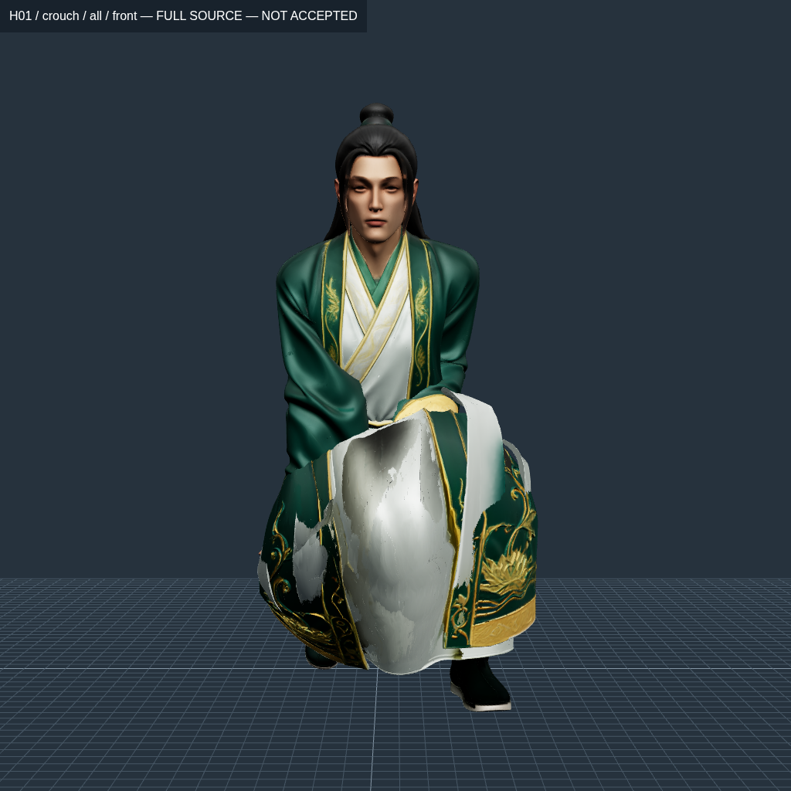
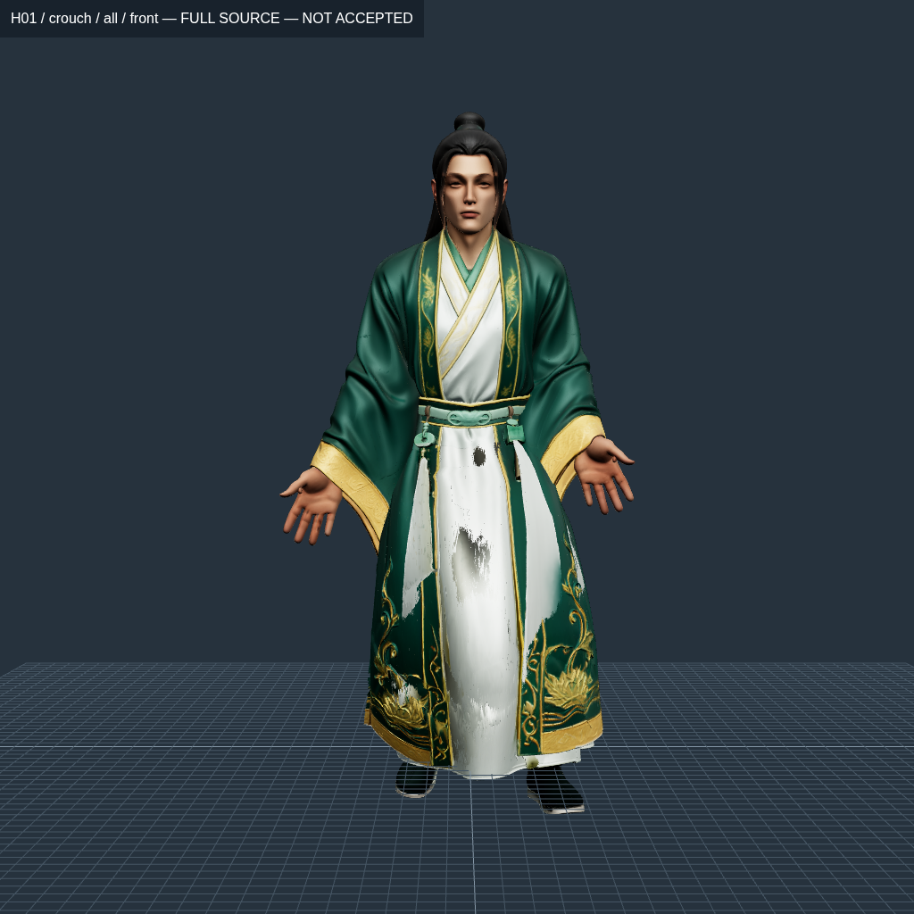
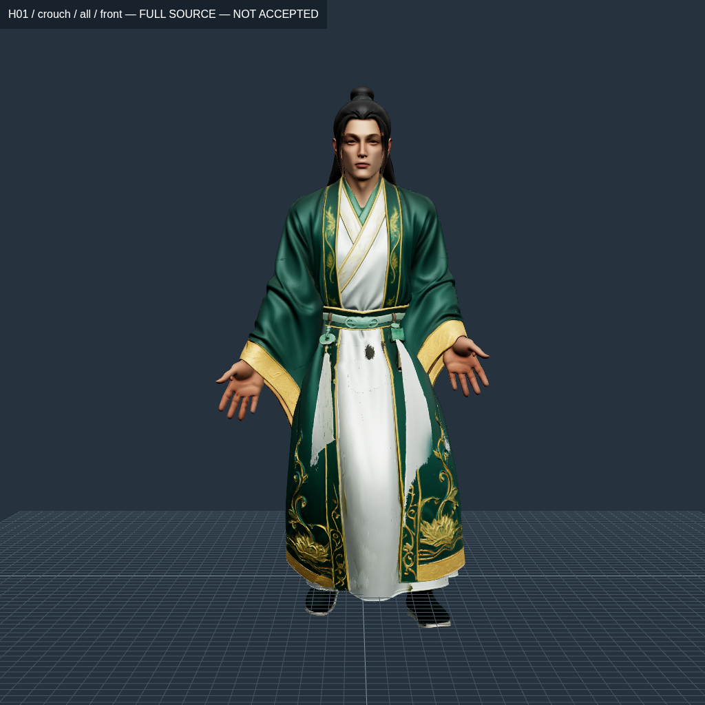
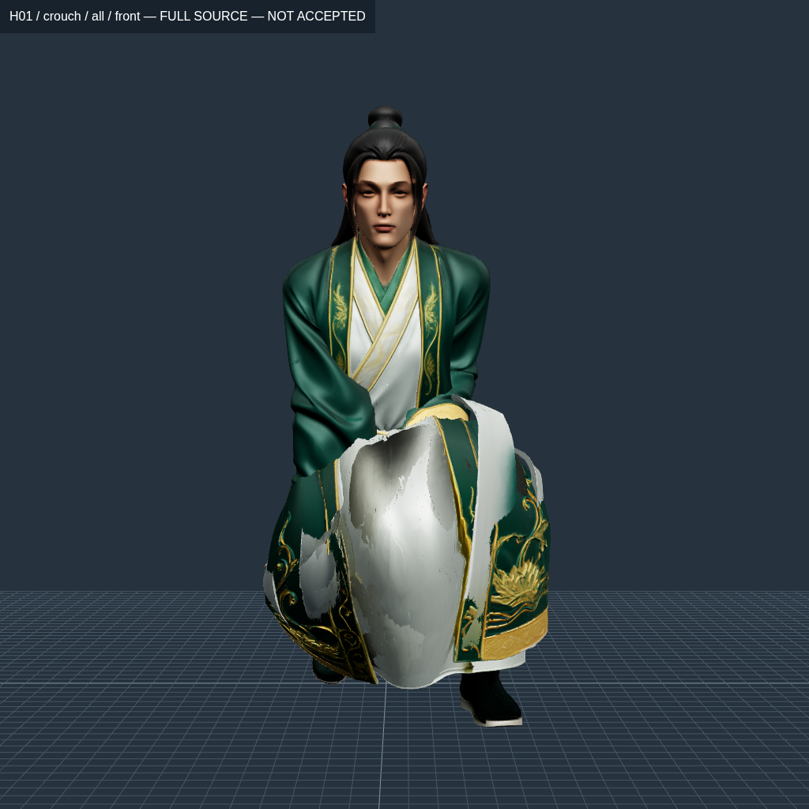
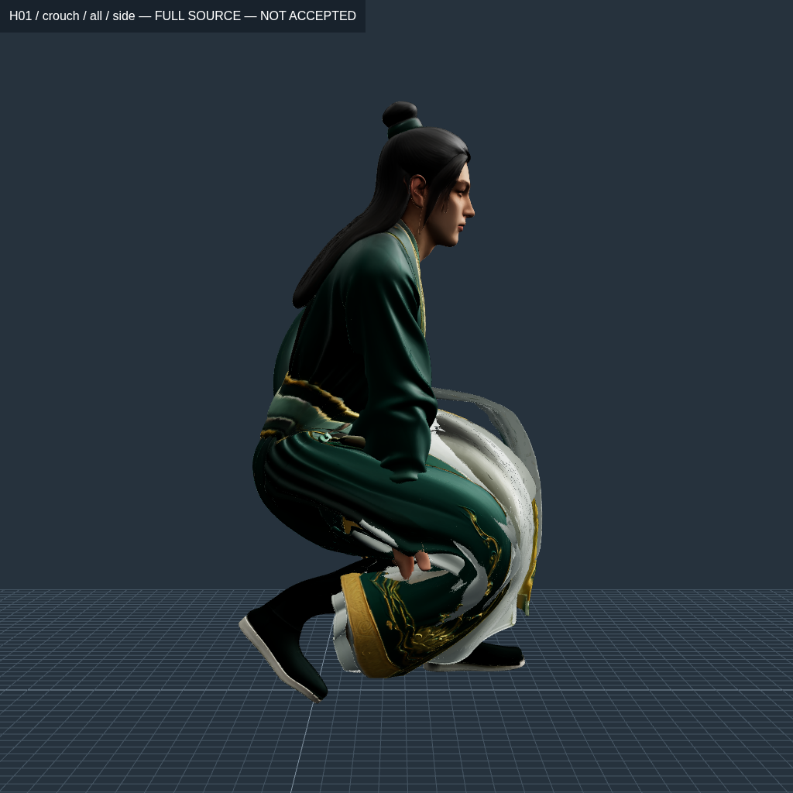

# Kiểm chuyển động và rút support vạt áo — 23/10/2026

Vòng tiếp mới nhất: [ownership bàn tay và cuff](HAND-OWNERSHIP.md). Các số đo/goal trong bài dưới đây là checkpoint trước; mọi candidate vẫn chưa nghiệm thu.

**Chưa đạt rig/animation; không thay vào runtime, chưa có APK mới.** Vòng này phát hiện việc giữ đúng điểm ở một pose có thể làm hỏng chuyển động ở giữa. Đã sửa cách chọn bốn support và chuyển sang fit đồng thời nhiều pose, vẫn giữ nguyên ngưỡng kiểm. Toàn bộ kết quả ở đây đo trên cloud, không phải điện thoại.

## Phạm vi và điều kiện không đổi

Giữ source H01 `292c2631…`, đủ1.499.726 triangle và4.499.178 corner gốc. Không đổi registry/runtime/GDD/ví/kho/vault/HMAC. Không chỉnh riêng thiết kế tay áo; việc đó vẫn sau APK rig+animation. Hai vạt/các lớp lót chỉ là cut proposal4416 source-edge đã ghi SHA, chưa được nghiệm thu pattern. H02 chưa có sửa asset trong vòng này và vẫn phải qua toàn bộ cổng của nó.

Parent54 là `approved-source-panels-h01-v2`, SHA `38fb63d0e5c53f86a1318071634cc95057ad488c4e8908cf69e7b66ec7ce3c58`. Target86 có thêm32 joint vải là gridv6, SHA `33836c20a5bb08a0e3f5ada8ce466d8b4ebabd53beea07cd65a79ce03f6fa8fb`, đã bị loại trong [vòng trước](GARMENT-PANELS.md). Không dùng weight thân/biên eo lỗi của target thay vào parent.

## Kết quả cùng tư thế ngồi

Chỉ pure panel fan được dịch chuyển; body, tay/ngón, ủng, sleeve và fan dùng chung với body giữ nguyên IDs/weights byte-for-byte so với parent54. Scalar α bị chặn bởi sàn thực của đỉnh và các cạnh nguồn. Bộ giải CP400 chỉ giữ được meanα0,0145102, tức1,451% tiến về guide, không phải sửa xong dáng áo.

| Mẫu thực đã xuất GLB | p99,9 lớn nhất của8 primitive vạt | Max cạnh vạt | Min Y vạt (mm) | Kept seam (mm) | Cặp giao cắt | New opposed toàn source |
| --- | ---: | ---: | ---: | ---: | ---: | ---: |
| [Parent54 / cutv2](H01-blend-baseline-normal-diagnostic.json) | 1.489914 | 1.494244 | 35.966 | 0 | 72,063 | 66,571 |
| [Null-space v1](H01-cloth-blend-v1-diagnostic.json) | 1.489449 | 1.498996 | 36.727 | 0 | 67,727 | 67,606 |
| [Nearest coefficient v5](H01-cloth-blend-v5-diagnostic.json) | 1.489455 | 1.498992 | 36.727 | 0 | 67,730 | 66,246 |

Kept seam0 có nghĩa các seam chưa cắt không hở ở pose này; không công nhận mọi đường cắt4416 cạnh là hợp lệ. Giao cắt là số cặp triangle không kề nhau sau bộ lọc nguồn, chưa đo sâu xuyên3mm. `newOpposed` đếm face có authored-normal cùng hướng trong bind nhưng shader-normal đối hướng geometric-normal sau pose; không phải một chứng nhận normal-map hoặc ΔE.

V1 SHA `b817696126764e2be1f1461413e884246da6ea76500470ad3d7e7d31e84ac58b`; v5 SHA `f330a1e0d22c9e1cbdf244300b82125a20e5ae90c25528b6245b59bf3bcc075b`. UV/NORMAL/source corner và ảnh nhúng được so độc lập với source. Không suy diễn điều này thành nghiệm thu PBR/render. Cả hai còn max toàn model2,561535× ở Remaining_Source. Ảnh cho thấy áo còn phồng/chặn tay, nên dù cả8 primitive vạt qua upper-strain ở pose ngồi vẫn bị loại.



Giờ chụp/SHA/camera trong [manifest](cloth-blend-v5-review/capture-manifest.json); ảnh nguyên byte và thời gian đăng ký trong [conver10](../../../picture/conver10/online-pic.md).

## Lỗi giữa hai pose và nguyên nhân

Carathéodory null-space giữ tổng weight và một điểm3D nhưng không giữ ma trận quay blend, normal hoặc quỹ đạo các bone. Hai quaternion/bone có thể đưa một đỉnh tới cùng vị trí ở cuối mà đi qua các đường khác nhau ở giữa. Bỏ ảnh hưởng bằng null-space tại cuối làm hệ số thay đổi rất nhiều, ngay cả khi α rất nhỏ. Test mới có hai đầu surface đạt nhưng ở giữa bị collapse; test khác giữ nguyên triangle position mà normal bị lật.

Đã đo GLB đọc lại tại21 mẫu t=0…1, bước0,05. Đây là SLERP local joint và nội suy Hips từ bind sang crouch để chẩn đoán, **không phải timeline Gemini/clip Entrance, không phải60/120FPS**. Các bone còn lại giữ nguyên local translation; không stretch xương. [84 dòng đo](cloth-transition-measurements.json) và báo cáo mọi primitive lưu bên cạnh.

| GLB | Max cạnh vạt trên21 mẫu | p99,9 lớn nhất trong một primitive | Cạnh tệ nhất: gốc → sau pose (mm) | Mẫu toàn model đạt |
| --- | ---: | ---: | ---: | ---: |
| [Parent54](H01-panels-baseline-transition-surface.json) | 7.345743× | 1.777265× | 0.844 → 6.201 | 1/21 |
| [Null-space v1](H01-cloth-blend-v1-transition-surface.json) | 84.755715× | 22.704220× | 0.635 → 53.822 | 1/21 |
| [Nearest v5](H01-cloth-blend-v5-transition-surface.json) | 22.788745× | 5.860225× | 0.695 → 15.841 | 1/21 |
| [Multi-pose350 vòng](H01-cloth-motion-v2-transition-surface.json) | 2.036974× | 1.531489× | 1.175 → 2.393 | 15/21 |

V5 giảm lỗi do rút support nhưng vẫn xấu hơn parent ở giữa chuyển động; không gọi84,76→22,79 là cải thiện APK. Chỉ bind đạt toàn model;20 mẫu còn lại đều trượt. Mức giãn này là trên cạnh thực dài0,6–0,8mm, không phải cả nhân vật cao lên84 lần. Các kẽ rách có thể nhỏ trên ảnh toàn thân nhưng vẫn là lỗi thật, không được bỏ vì ảnh nhìn xa.

| t=0,5, null-space v1, bị loại | t=0,5, nearest v5, vẫn bị loại |
| --- | --- |
|  |  |

Chữ `crouch` trên hai ảnh là tên nhóm pose cố định của công cụ chụp; input thực là `pose-010.json`, t=0,5, có SHA trong các manifest. Không coi đây là ảnh cuối ngồi hoặc timestamp0,5s. Camera tự fit cùng bounds toàn source, không crop để giấu lỗi.

## Kiểm thêm Hàn Trạch

Đã đo độc lập H02 parent54/cổ tay CP600, SHA `28183bce82c7b7b9e0f2eda33b968e6c0d05a6e27d0a8d3d04c4bc761cfd6668`, trên21 interpolant tương tự: **4/21** mẫu toàn model qua upper-strain, max3.551960×, p99,9 lớn nhất1.499581×. [Mọi primitive và pose](H02-parent54-transition-surface.json). Mẫu ngồi cuối vẫn max3,241141×, chưa đạt. Chưa thay asset hoặc animation H02.

MinY toàn surface của đoạn nội suy là-131.117mm, không được gọi là số đo sole/foot-contact vì chưa phân loại đỉnh thấp nhất. Root tuyến tính + SLERP không giải tiếp xúc sàn; đây là phép stress để bác bỏ giả định “đúng pose cuối thì clip đúng”, không là clip Gemini đã author. Cần giải contact theo từng phase trước khi đánh giá animation phát hành.

## Sửa công cụ và các lần thử bị loại

- `reduce_four_stable` xét mọi tập1–4 trong8 candidate, giải đúng point/sum và chọn nghiệm gần hệ số weight ban đầu nhất. Merge chỉ theo JOINT ID, không merge hai bone chỉ vì cùng tới một điểm. Có test đối chiếu lời giải độc lập của70 tetrahedron và trường hợp support trùng vị trí. V5 dùng đúng α đã khóa SHA của v1 để tách tác động của cách rút support. Chế độ `--reduction nullspace` giữ nhánh legacy không coalesce ID để có thể dựng lại numerical trial cũ; `nearest` mới merge theo ID. V5 lịch sử ghi tham số CP mặc định nhưng thực tế chỉ reuse α, không chạy thêm400 vòng; scope/reuse receipt phân biệt điều đó. CLI hiện ghi rõ `algorithm=reused-alpha`, `iterations=0` cho những lần tái dùng sau.
- `measureSkinNormalAgreement` so geometric-normal sau biến dạng với shader-normal bốn weight, tách lỗi sẵn ở bind. `pose-transition` yêu cầu đủ bone, quaternion hợp lệ, không scale hoặc translation lạ. Tất cả vẫn chỉ diagnostic.
- CP400+100 repair (v2) cuối chỉ meanα0,00576846; split-box ADMM100 (v3) chỉ0,00351265 sau safeguard. Không lấy α raw trước safeguard để quảng cáo đạt. Không xuất hai mẫu này ra runtime.
- Bounded-Newton ADMM100 (v4) dừng bằng SIGTERM sau779,33s, trước khi có kết quả; log và stopped-run receipt được giữ. Lý do: kiểm chuyển tiếp đã bác bỏ bước rút support dùng chung, tăng số vòng scalar không khắc phục được lỗi đó. Không gọi lần dừng này là hội tụ hoặc chứng minh bài toán bất khả thi.

## Fit đồng thời nhiều pose

Đã chạy150 vòng trên parent54 với t=0,2/0,4/0,6/0,8/1. Trên các cạnh source-fan toàn mesh, max7.231743→2.788937×; p99,9 1.518134→1.494053×, vẫn chưa đạt. Đây là số đo pooled trong solver, không thay được p99,9 riêng từng primitive của GLB. 1801 edge-pose đã trượt trong vùng khóa, vẫn được giữ trong báo cáo. Chỉ348.887 pure panel fan được thay weight, core54 IDs/bind không đổi; không dùng grid86/rút8→4 để né lỗi chuyển tiếp.

Đã hoàn tất thêm200 vòng từ đúng primal/dual NPZ đã kiểm SHA, trong thư mục v2 mới, tổng350 vòng. [Script continuation](reproduce/continue-motion-fit.py) copy riêng numerical state và giữ nguyên trial v1. Đã xuất/đọc lại GLB SHA `fbadcb142dd0117d0fd3b7ad7c357e3cff70a2909bf6cdf4af1bd8a9094a3fd4` rồi đo đủ21 mẫu, gồm các mẫu không dùng fit. Không lấy chỉ số pooled của solver để chấp nhận GLB.

Kết quả độc lập: **15/21** mẫu toàn model qua upper-strain, so với1/21 của parent; **162/168** primitive-pose vạt qua. Max vạt trên đoạn giảm7,345744→2.036974×, nhưng p99,9 của `H01_Robe_Right`, primitive2 vẫn lên1.531489×. Sáu mẫu t=0,75…1 của lớp này trượt. Điểm t=1 còn max2,036974× ở cặp vertex66700/66709 của primitive này. Torso khóa trượt p99,9 ở t=0,75…0,9 và Remaining_Source khóa còn max2,561535× cuối pose. Các lỗi được giữ đủ trong [báo cáo](H01-cloth-motion-v2-transition-surface.json).

Đây là **đánh đổi chưa chấp nhận**: vạt ở cuối pose đã xấu hơn parent (max1,494244→2,036974; p99,9 1.489914→1,531489) trong khi đoạn giữa tốt hơn. Không tích hợp hoặc giảm ngưỡng để nhận đạt. Source core54/IDs/UV/normal/ảnh/legacy clip payload giữ nguyên; giữ payload clip không có nghĩa đã retarget đúng các clip đó lên rig mới.

[Kiểm full source cuối pose](H01-cloth-motion-v2-diagnostic.json): kept seam0mm; giao cắt71,634 cặp (parent72.063); new opposed66,589 (parent66.571); min Y vạt35.966mm. Trên toàn đoạn nội suy, minY riêng vạt=-22.601mm; đây là surface vạt, không phải test sole/FEET hoặc contact toàn clip. Chỉ số giao cắt gần như không cải thiện và hình dáng vẫn không tự nhiên. Không dùng việc giảm upper-strain để nói đã giải drape/collision/contact.

| Multi-pose350, cuối ngồi, chưa đạt | Góc bên: tay còn bị vạt che/xuyên |
| --- | --- |
|  |  |

[Manifest12 ảnh mới](cloth-motion-v2-review/capture-manifest.json) ghi camera/giờ chụp/source triangle/pose SHA. 60 ảnh chụp mới trong vòng này đã vào conver10 nguyên byte; [kiểm byte](gallery-validation.json) đối chiếu đủ190 PNG hiện có của báo cáo, gồm ảnh cũ và mới. Không nhận đây là toàn chuỗi clip hoặc motion/contact Gemini đã author.

[Đọc trực tiếp support hai cạnh lỗi](cloth-motion-v2-worst-edge-probes.json) đã xác định điểm cần sửa tiếp:

- Lớp lót phải: source weld722631/722630, y≈0,597m. Cả bốn slot chỉ là `RightLeg/RightUpLeg/LeftLeg/LeftUpLeg`, không có Hip/cloth joint; vẫn còn khoảng15–16% weight sang chân bên kia. Đây là support đang đọc được, chưa phải phán quyết anatomy/pattern được duyệt. Đổi tỉ lệ bốn chân không thể mặc nhiên cho drape tự nhiên.
- Cạnh cổ tay trái: source weld843091/843086. Một đầu còn2,36% `Hips` và8,49% `LeftArm`; đầu sát bên có `LeftHand/Thumb2/Pronation/Thumb1`. Tập support đổi mạnh trong2,36mm nguồn, đầu sau giãn tới6,04mm. Cần sửa ownership/support cuff–palm–thumb trên source, không chỉ tiếp tục fit cùng IDs hoặc nới max2×.

**Bước sửa tiếp:** xử lý ownership và support của lớp lót phải cùng biên eo, sửa vùng cổ tay/thumb/body khóa trên source, rồi guide/collision cho vạt để lộ tay đúng silhouette. Fit weight đơn thuần không chữa áo phồng hoặc tiếp xúc grip. Phải kiểm lại normal/compression/giao cắt và pose thực có IK/contact, sau đó đủ Entrance/Hold/combat60/120Hz; không chỉ tăng thêm vòng CP rồi tự nhận xong.


## Chạy lại và giới hạn

Các thử nghiệm nằm trong `.local/rig-candidates/`, không phải GLB đang phát hành. Recipe/hash/log nằm trong [experiments](experiments/index.json) và `logs/`. Để dựng lại cần dựng đúng các parent của [GARMENT-PANELS.md](GARMENT-PANELS.md), không trỏ thư mục sang GLB legacy cùng tên.

```bash
node tools/rig/prepare-pose-transition.mjs CANDIDATE_GLB CROUCH_JSON UNUSED_LOCAL_DIR 20
node tools/rig/measure-staging-poses.mjs CANDIDATE_GLB REPORT_JSON UNUSED_LOCAL_DIR/pose-*.json
node tools/rig/measure-cut-cloth.mjs CANDIDATE_DIR CROUCH_JSON REPORT_JSON
npm run goal:animation
```

Đã thêm lưu continuation NPZ lossless cho state của solver để giảm dung lượng local, kèm SHA và test resume/tamper; không nén hoặc giảm texture/GLB. Một bản trích xuất APK cache530 file được bỏ sau khi so từng byte với APK gốc còn giữ nguyên; [receipt khôi phục](reproduce/extracted-apk-cache-restore.json). Một số state/model thử cũ cũng có ZIP lossless và restore receipt, không đụng source/canonical/runtime.

Goal mới nhất có source fingerprint `a5230a4a691edbc53aa78a82aae0d564bcd97891ce226959a9010d542a282ed5`, stableSource=true, [log đầy đủ](iterations/2026-10-23T00-53-42-071Z/goal.json). `npm test`346/346, `npm run test:master`215/215; `npm run verify:master`0/37 (fail), `goal:rig` bị khóa, `goal:animation`INCOMPLETE. Chỉ SOURCES/RUNTIME_MODES qua phạm vi validator đăng ký;17 scope còn blocked và4 failed. Không sửa/hạ ngưỡng để có pass. Bộ focused23/23 còn chạy8 Python case cho pose-fit và12 Python case cho blend trong các wrapper. Test resume NPZ mới đã bắt một nhánh max trên tập rỗng khi không có fixed rows; đã sửa với identity0 và kiểm lại cả SHA/tamper/resume, không nới tolerance. APK vẫn2.5.ba97bec3, SHA `52aeeea29c319b5f8b66224ed1c46ae74890254924de2cdcc8d2104ae92b4c7c`; chưa build hoặc gắn nhãn APK rig mới. Không có điện thoại Android kết nối, chưa chứng nhận contact toàn clip,60FPS hay mỹ thuật trên thiết bị.
