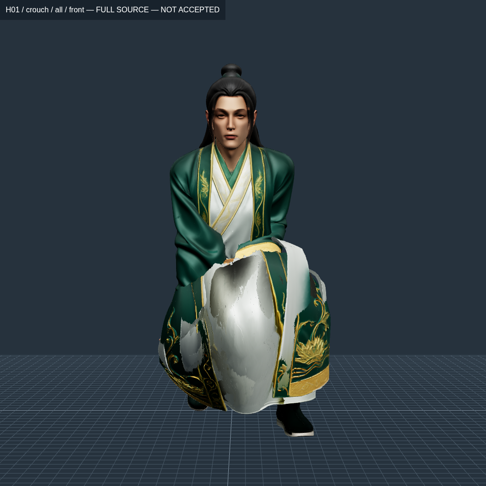
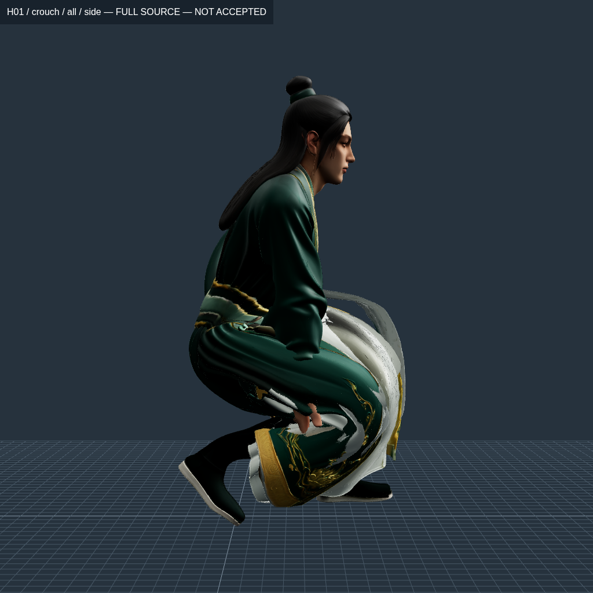
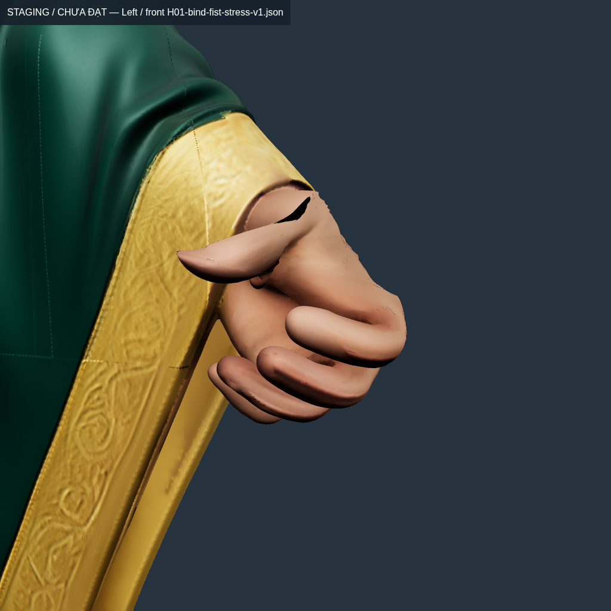

# Conver10 — giải đồng thời bàn tay/cuff và kiểm lỗi bị che bởi primitive lớn

Vòng tiếp: [giữ ô xương ngón và kiểm hình dáng](HAND-SHAPE.md); V11 vẫn bị loại, không thay runtime/APK.

**Chưa nghiệm thu, chưa thay runtime, chưa có APK rig mới.** Bản v9 đã giải được upper-strain của ba primitive lớn qua23mẫu, nhưng kiểm **riêng từng bàn tay** vẫn thất bại khi nắm. Kiểm hình dáng/normal/giao cắt cũng thất bại. Không dùng số23/23 như chứng nhận FINGERS hoặc toàn bộ rig.

Tiếp từ commit26f74e0 và [báo cáo ownership](HAND-OWNERSHIP.md). Giữ nguồn GLB, UV/ảnh4096,54joint/core bind và6clip legacy; không thay gameplay/GDD/ví/kho/vault/HMAC/reconnect. Chỉ thử trọng số rig quanh đường nối, chưa thực hiện giai đoạn thiết kế/tách riêng tay áo H01 vốn phải sau APK rig+animation.

## Nguyên nhân được kiểm bằng source

[Probe vòng trước](hand-islands-sleeve-edge-probes.json) cho thấy hai đầu cạnh cuff ngắn0,34–0,77mm có support gần giống nhau, nhưng slot thứ tư chuyển giữa `UpLeg` và một ngón tay. Khoảng1–3% mass đó tạo sai biệt hàng mm khi xương đùi chuyển động cách xa bàn tay. Trên outer boundary45mm, off-chain mass còn tới6,66% bên trái/5,43% bên phải. Kéo rộng harmonic rồi lấy4weight lớn nhất đã lan ảnh hưởng sai và tạo giật support.

V8 xác định từng miền bằng source-geodesic từ field tay đã khóa SHA, không theo tên Sleeve hoặc hộp tọa độ. Trong150mm, mass của joint ngoài chuỗi tay được chuyển sang forearm-pronation đúng bên. Từ150→250mm giảm dần C1 về field cũ để giữ liên tục với vùng không sửa. Hai miền trái/phải phải không chồng nhau; giữ nguyên384seed đã đo. Đã xử lý30.197fan trái/29.164fan phải, mass chuyển lớn nhất20,34%/19,38%. Vành ngoài vẫn giữ một phần field cũ: không tuyên bố mọi ảnh hưởng chân trên toàn áo đã bị xóa.

V8 giảm max sleeve cuối crouch xuống2,915401/2,483017×, nhưng p99,9=2,248666/1,799530, còn trượt. Nắm tay trái có max3,687071×. Vì vậy giải tiếp **cùng lúc hand và cuff**, không pin toàn bàn tay rồi đẩy lỗi sang mép áo.

## Solver và kiểm không làm mất điều kiện biên

`source-support-layout` là layout numerical mới của `pose_weight_fit.py`, tách khỏi layout chỉ-fit-vạt cũ. Nó dùng mask bảo vệ tường minh thay vì gán vai trò giả cho hand/cuff. Các giới hạn nghiệm thu1,5/2 và mọi test cũ giữ nguyên.

- Lấy **toàn bộ triangle kề fan cần sửa**, bao gồm neighbor ngoài miền bị giữ cố định. Không cắt bỏ cạnh băng qua biên.
- 83.042fan,165.118triangle numerical từ nguồn1.499.726triangle.81.687fan tự do;384seed palm/finger được giữ. Đây chỉ là mô hình numerical; GLB xuất vẫn chứa đủ nguồn.
- Mọi bản copy của fan được kiểm position và tổng influence theo joint phải giống hệt trước compaction; không ghép theo khoảng cách. [Audit tái tạo](coupled-input-audit.json) xác nhận tất cả binary input giống trial gốc.
- 28.228slot weight0 được trỏ về joint tay hợp lệ đã có, tránh optimizer biến slot Hips trống thành ảnh hưởng xa mới. Các slot đang có weight và pose ban đầu không đổi vì bước này. Không đổi policy slot0 giữa lúc resume.
- Fit4pose: midpoint, crouch, crouch+nắm và bind-body+nắm; target nội bộ1,45 chặt hơn giới hạn1,5/2. Chạy250vòng rồi resume600vòng trong thư mục mới bằng state NPZ khóa SHA. Không dùng kết quả đó thay kiểm GLB.
- Xuất v9, đọc lại, đối chiếu payload; truyền weight tới mọi bản copy của kept fan. Chỉ model này được dùng cho số đo/ảnh v9 dưới đây.

SHA GLB v9: `ab464ae930752c651224d680f15b6281cbc0ba8fb2b818104b371d54e7fc7726`. Các thông số harmonic/mass trong `additionalFanField` của receipt là bước proposal trước fit; số đo cuối phải lấy từ các báo cáo native/normal/giao cắt, không lấy chúng làm chứng nhận field cuối.

## Kết quả native — chỉ upper-strain của từng primitive lớn

[Đủ23mẫu trên GLB](H01-hand-islands-v9-transition-surface.json), bao gồm21interpolant bind→crouch và2stress nắm. Không phải timeline Gemini hoặc phép kiểm60/120Hz toàn clip.

| Primitive | Qua upper-strain | Max trên21interpolant | p99,9 lớn nhất trên21interpolant |
| --- | ---: | ---: | ---: |
| Remaining_Source — chứa cả đầu/ủng/tay |23/23|1,582824|1,487151|
| Sleeve_Left — chứa cuff/áo nguồn |23/23|1,489968|1,486552|
| Sleeve_Right — chứa cuff/áo nguồn |23/23|1,504086|1,482945|

Cuối crouch max sleeve trái/phải=1,489968/1,489602×. Crouch+nắm Remaining max1,886357/p99,9=1,490615. Các con số theo primitive lớn này **không đủ để kết luận ngón tay đạt**.

Toàn model chỉ **16/23** mẫu qua upper-strain. Sáu interpolant t0,75…1 và crouch+nắm vẫn trượt lớp lót `H01_Robe_Right`, primitive2, max2,036974/p99,9=1,531489. Torso còn trượt t0,75…0,9. Không bỏ các primitive đó khỏi mẫu số.

## Kiểm riêng bàn tay — kết quả thất bại phải giữ

Để đầu/ủng và các cạnh khác không làm loãng p99,9 ngón, đã đo lại trên hai component nguồn chứa toàn seed từng bên. Mask/touched/position/fan khóa SHA, không dùng bounding-box;12.349vertex tay phải,11.877vertex tay trái trong Remaining. Seed palm trái ở Sleeve vẫn được giữ riêng; mask này chưa được duyệt giải phẫu hoặc contact toàn clip.

[Dữ liệu](H01-hand-islands-v9-per-hand.json), [script đọc GLB thật](reproduce/per-hand-source-diagnostic.mjs):

| Pose / tay | p99,9 | Max | Kết quả |
| --- | ---: | ---: | --- |
| Midpoint / phải |1,000023|1,000058|Qua upper-strain|
| Midpoint / trái |1,000024|1,000061|Qua upper-strain|
| Crouch mở / phải |1,000013|1,000028|Qua upper-strain|
| Crouch mở / trái |1,000016|1,000042|Qua upper-strain|
| Crouch+nắm / phải |**1,603501**|1,796604|**Trượt**|
| Crouch+nắm / trái |**1,623311**|1,886358|**Trượt**|
| Bind-body+nắm / phải |**1,603502**|1,796602|**Trượt**|
| Bind-body+nắm / trái |**1,623320**|1,886358|**Trượt**|

Đã [đo riêng hai tay trên đủ23mẫu](H01-hand-islands-v9-per-hand-transition.json):42/46lượt qua,4lượt nắm vẫn trượt. Bảng trên chọn4pose đại diện, không bỏ các interpolant còn lại.

Do đó số23/23 ở bảng primitive không thể dùng để nói “bàn tay đã sửa xong”. Mục FINGERS vẫn chưa có bằng chứng hoàn chỉnh; các mẫu nắm cục bộ đã có witness fail thực. Không nới1,5 hoặc giấu kết quả trong p99,9 của một primitive lớn hơn.

## Hình dáng, nén, normal và collision — vẫn chưa đạt

[Oracle full source](H01-hand-islands-v9-diagnostic.json) kiểm1.499.726triangle/4.499.178corner, position/UV/normal/ảnh nguồn và cut-fan độc lập. Kept seam=0mm trên144.721pair. Không tạo khe mới hoặc giảm texture để đạt.

Tuy nhiên, source được bảo toàn và seam0 không chứng minh tư thế đẹp:

| Diagnostic cuối crouch | V7 | V9 |
| --- | ---: | ---: |
| Cặp triangle giao cắt |72.181|**76.417**|
| Triangle mới có geometric-normal ngược shader-normal |66.291|**85.166**|

Riêng sleeve trái/phải có26.779/22.225new-opposed triangle. Minimum edge ratio=0,030353/0,011299; minimum area ratio=0,005201/0,001059. Chưa collapse đúng0 nhưng có nén mạnh và fold; không nhận đạt chỉ vì chưa chạm ngưỡng số học1e-12. Normal diagnostic so hướng geometric/shader normal, không phải phép đo normal-map hoặc thể tích cơ thể.

Ảnh thấy vạt trước phồng, trắng lót lật/rối, bàn tay còn bị che; tư thế toàn thân và tiếp xúc chưa đạt Gemini. Upper-bound-only weight fitting chưa bảo toàn hình dáng/diện tích hoặc giải cloth collision. **V9 bị loại khỏi diện tích hợp. Không tiếp tục tăng số vòng cùng objective rồi gọi là sửa mỹ thuật.**

| Toàn thân source v9 — chưa đạt | Góc bên — áo che/xuyên tay |
| --- | --- |
|  |  |

| Bind-body+nắm — ngón vẫn trượt cục bộ |
| --- |
|  |

20rawPNG mới, gồm12toàn thân/vạt và8cận tay, được giữ nguyên byte trong [conver10](../../../picture/conver10/online-pic.md). Camera, SHA và giờ chụp UTC có trong hai `capture-manifest.json`; giờ đăng ký sổ ảnh tách riêng. Không giấu mesh hoặc dùng ảnh nhìn đẹp ở bind thay ảnh crouch. Hai công cụ chụp được tách cache Vite riêng để tránh va chạm cache với nhau/goal; không thay code render của game.

## Kiểm hồi quy và goal

Đã thêm kiểm complete source-star giữ cạnh qua biên, từ chối fan có geometry/influence mâu thuẫn, không nhập cut trùng vị trí. Unit mới cho source-support-layout buộc giữ neighbor/seed cố định, không bỏ pose thứ hai bất khả thi và từ chối protected-mask bị sửa hash. Unit locality giữ mass/ngón đúng bên, không sửa row ngoài miền.

Vòng chốt [2026-10-23T05-04-49-304Z](iterations/2026-10-23T05-04-49-304Z/goal.json), fingerprint `69627ad89abadf2933f38239b4e64dcf97f575db7ff4954e91d619156e101df3`, stableSource=true:

- `npm test`: **353/353**.
- `npm run test:master`: **215/215**.
- `npm run verify:master`: **0/37**, không hạ ngưỡng.
- `goal:animation`: **INCOMPLETE**,2scope passed/4failed/17blocked. Đây là goal trên runtime đang phát hành, không phải scope thử v9.

Đã sửa bootstrap fixture để chạy không cần `.local` có sẵn; [kiểm từ thư mục sạch](clean-fixture-bootstrap.json) chạy10case Python thật, giữ nguyên mọi assertion/ngưỡng. Vòng goal trước69bd6ca1… và toàn bộ log thất bại vẫn được giữ trong lịch sử.

H02 chưa có asset sửa mới trong vòng này; các lỗi của H02 và toàn Entrance/Hold/combat vẫn phải xử lý. APK vẫn2.5.ba97bec3, SHA `52aeeea29c319b5f8b66224ed1c46ae74890254924de2cdcc8d2104ae92b4c7c`. Chưa chạy build/APK mới vì điều kiện rig toàn bộ chưa đạt; chưa có Android vật lý để xác minh FPS/mỹ thuật.

## Tái lập và hướng sửa tiếp

CLI mới: `prepare-coupled-hand-fit.mjs`, `assemble-coupled-hand-fit.mjs`; layout numerical và source-star không làm đổi topology GLB xuất. Recipe/hashes/state/iterations thật được lưu trong [experiments](experiments/index.json) và `logs/`; dùng thư mục mới khi chạy lại. [Audit input](coupled-input-audit.json) tái tạo đúng input bản được giải, kể cả policy slot0; trial audit chọn strongest-slot khác trước đó được giữ riêng, không tráo thành input đã dùng.

```bash
node tools/rig/prepare-coupled-hand-fit.mjs CANDIDATE GEOMETRY_LAYOUT NEW_INPUT MIDPOINT CROUCH CROUCH_FIST BIND_FIST
python3 tools/rig/pose_weight_fit.py NEW_INPUT NEW_NUMERICAL --whole-body --cut-fans --iterations 250 --ratio 1.45 --archive-state
python3 docs/anim-report/conver10-approved-repair-2026-10-21/reproduce/continue-motion-fit.py NEW_NUMERICAL NEW_CONTINUATION --iterations 600
node tools/rig/assemble-coupled-hand-fit.mjs NEW_CONTINUATION NEW_FIELD
node tools/rig/export-source-hand-islands.mjs NEW_FIELD
```

Đây là recipe trial thất bại về chất lượng, không phải bản được khuyến nghị tích hợp. Bước tiếp phải kiểm lại pivot/ownership quanh từng khớp ngón trên source, thêm mục tiêu bảo toàn hình dáng/normal/diện tích và contact/drape cho vạt; giữ kiểm riêng hand/cuff bên cạnh mọi primitive. Chỉ chuyển sang author/kiểm toàn clip và APK khi các vùng đó đạt, vẫn giữ giai đoạn thiết kế riêng tay áo sau APK rig+animation.
