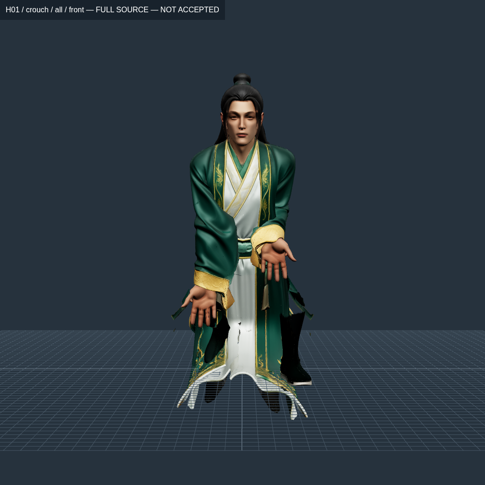
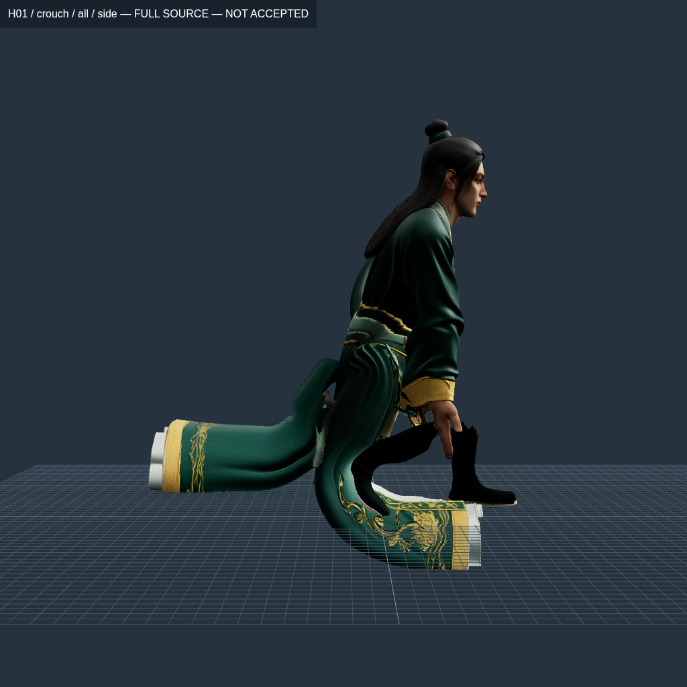

# Hai vạt áo H01 — vòng source mesh ngày 22/10/2026

**Chưa đạt, chưa tích hợp runtime, chưa có APK mới.** Vòng này thực hiện phần nền của mục13B đã duyệt: phân quyền chuyển động cho áo thật. Không nghiệm thu chỉ vì bàn tay đã lộ ra hoặc số giao cắt giảm. H02 vẫn ở checkpoint ủng/cổ tay trước; chưa có bản áo H02 mới trong vòng này.

## Kết quả có thể kiểm lại

So cùng crouch cơ thể `H01-crouch-floor-v1.json`, cùng source và cùng proposal đường cắt:

| Phép đo trên GLB xuất thật | Trước: CP600, chỉ phân vùng/cắt | Sau: grid v6 |
| --- | ---: | ---: |
| Mặt nguồn được giữ | 1.499.726 | 1.499.726 |
| Source corner đối chiếu oracle độc lập | 4.499.178 | 4.499.178 |
| Cặp tam giác áo giao cắt, loại hàng xóm theo cùng cut fan | 72.063 | 6.568 |
| Khe hở lớn nhất trên đường **còn khâu** | 0 mm | 0 mm |
| Max giãn của toàn bộ các primitive | 2,561535× | **3,317729× — xấu hơn** |
| MinY toàn mesh | xấp xỉ 0 m | **−0,165084 m — áo xuyên sàn** |
| Nghiệm thu | Không | Không |

Nguồn số: [baseline](H01-panels-v2-baseline-diagnostic.json) và [v6](H01-panel-cloth-v6-diagnostic.json). Mỗi báo cáo ghi SHA model/pose/source/cut và file nhị phân chứa ID từng cặp giao cắt. Đây là đếm giao cắt tam giác, **không phải phép đo độ xuyên 3 mm**, độ dày hay chứng nhận collision toàn chuỗi. Không dùng việc giảm giao cắt để che việc strain/floor còn trượt.

V6 kiểm 144.721 cặp bản sao đỉnh thuộc 121.693 fan còn khâu, không có vị trí vô hạn và max gap bằng0. Đường cắt là proposal chưa được chấp nhận: registry `data/rig/garment-patterns/index.json` vẫn rỗng. Số0 này không tự cho phép bỏ kiểm source seam trong cổng nghiệm thu.

## Những gì đã thay ở staging

1. **Mang phân vùng nguồn sang bind hiện tại.** `rebase-source-garment.mjs` lấy mặt/UV/normal/ảnh từ source thật và trọng số từ CP600 hiện tại. Không chép weight52bone cũ vào bind54bone. Đọc lại GLB, đối chiếu mọi attribute, từng góc tam giác, skin bind và tên/nội dung clip. Toàn bộ ảnh texture vẫn nguyên byte; không giảm kích thước, không sửa màu/vật liệu để che lỗi.
2. **Mở liên kết giữa hai vạt dưới.** Proposal bổ sung1.502 cạnh dưới eo860mm trên giao diện sở hữu trái/phải. Dựng lại fan bằng union-find và oracle sparse graph độc lập. Đường nối này dài10,338m và còn ngoằn ngoèo; topology khớp không có nghĩa đường may đã tự nhiên.
3. **Tách lớp rủ trước/sau.** Bản đầu vẫn nối các lớp trước/sau nên hai chuỗi rủ đối nghịch kéo căng cùng một chu vi. Proposal v2 bổ sung1.356 cạnh dưới750mm. Phân lớp theo mặt nguồn/z là giả thuyết phải xem hình, chưa phải mask trang phục đã duyệt. Không xóa mặt hoặc dựng thân người ở dưới áo.
4. **Bỏ rút tám support xuống bốn ở mẫu grid.** Grid tạo tối đa bốn support ngay từ đầu; lớp trước/sau đã tách nhận đúng chuỗi riêng. Ba hàng đầu giữ cùng phép biến đổi skin với hông. Dải nối eo dùng slot sẵn có hoặc slot thật sự có weight0; thiếu slot thì dừng, không tự vứt influence khác.
5. **Bảo vệ lịch sử thử.** Tool từ chối ghi vào thư mục đã có GLB, receipt hoặc biên nhận model đã lưu trữ, kể cả symlink hỏng. Có kiểm hồi quy thực thi bốn CLI và xác nhận dữ liệu cũ nguyên byte sau khi bị từ chối.

V6 có54joint cơ thể/helper giữ nguyên bind và32joint vải bổ sung, link vải dài cố định130mm. Các clip legacy chỉ được bảo toàn, **chưa được retarget hoặc thêm track vải để nghiệm thu chuyển động**. Không kéo dài xương cơ thể hoặc scale vũ khí theo frame.

Proposal mới không thêm cạnh tay áo: kế thừa các proposal giao diện áo/ủng cũ để chẩn đoán phần vạt. Chưa mở đợt dựng/tách lại riêng tay áo H01, vẫn làm sau APK rig/animation theo thứ tự người dùng yêu cầu.

## Vòng sửa và mẫu bị loại

Số p99,9 dưới đây là giá trị lớn nhất của các primitive áo được đo **riêng**, không gộp lớp lót để làm loãng lỗi vạt ngoài. Các mẫu dùng cùng pose cơ thể; phần điều khiển vải thay theo từng guide.

| Mẫu | p99,9 primitive áo xấu nhất | Max cạnh áo | MinY áo | Kết luận |
| --- | ---: | ---: | ---: | --- |
| v1 — blend/reduction cũ | 41,444127× | 53,173485× | −0,046581 m | Loại |
| v2 — đổi góc rủ | 30,375369× | 35,031103× | −0,069831 m | Loại |
| v3 — grid nhưng lớp trước/sau còn nối | 23,725953× | 27,630664× | −0,132464 m | Loại |
| v4 — mở lớp, bridge360mm | Không xuất GLB | Không xuất GLB | Không xuất GLB | Dừng vì source fan12000 hết slot root |
| v5 — mở lớp, bridge240mm | Không xuất GLB | Không xuất GLB | Không xuất GLB | Dừng vì source fan48119 hết slot root |
| v6 — mở lớp, bridge120mm | **2,364238×** | **2,544466×** | **−0,165084 m** | Vẫn loại: ngưỡng1,5×/2× và sàn chưa đạt |

[Số đo JSON](panel-trials-summary.json), [v1](H01-panel-cloth-v1-surface.json), [v2](H01-panel-cloth-v2-surface.json), [v3](H01-panel-cloth-v3-surface.json), [các biên nhận gồm lỗi](experiments/index.json).

Một thử CP150 trên v1 cũng không cứu được support set đó: solver báo p99,9 26,981035×, max102,454965×. Exporter đã kiểm byte trọng số sau khi xuất, nhưng **không có kiểm mesh/ảnh độc lập cho GLB CP150 này**, không được đưa vào bảng đọc lại LBS ở trên. Nó không được kích hoạt. Không suy ra toàn bộ bài toán rig bất khả thi từ lần fit thất bại đó.

Dải nối eo của grid v6 còn làm một phần thân xấu hơn baseline: Remaining max3,317729×; Torso max2,960986×. Hai primitive tay áo giữ số đo parent, không phải tay áo đã sửa xong. Bàn tay còn cần sửa hướng/palm/finger contact; ảnh mở tay này không chứng minh nắm trượng.

## Hình ảnh thật và giới hạn

Ảnh SwiftShader trên cloud, không phải điện thoại. Toàn bộ1.499.726 mặt được render ở các ảnh context. Từ v2, camera được fit theo bounding box **sau skinning**, có xác nhận các góc box nằm trong ảnh. V1 dùng camera cố định nên có ảnh vạt áo vươn ra ngoài khung; giữ lại ảnh đó làm bằng chứng thất bại, không dùng làm nghiệm thu toàn thân.

| V6 trước | V6 nghiêng |
| --- | --- |
|  |  |

Ảnh cho thấy tay đã lộ nhưng vạt vẫn cong cứng, xuyên nền, có phần biên mở/rách quanh eo. **Không chấp nhận silhouette này.** Chưa có trượng trong các ảnh kiểm áo; không coi đây là pose xuất hiện hoàn chỉnh.

48 PNG mới được giữ nguyên byte ở bốn bộ12ảnh: v1/v2/v3/v6, mỗi bộ gồm trước/sau hai vạt tại bind, toàn thân bốn góc tại crouch và hai vạt trước/sau tại crouch. Timestamp, camera, model SHA và map dimensions nằm trong `capture-manifest.json` từng bộ. [Sổ conver10](../../../picture/conver10/online-pic.md) có ảnh và giờ bên dưới; [kiểm byte gallery](gallery-validation.json) xác nhận130 PNG của toàn thư mục sửa, gồm82ảnh trước đó.

## Kiểm thử và bản dựng

Vòng goal `2026-10-22T23-12-36-675Z`, source fingerprint `4964f8963f78a697a40487476dd5faea3e2dcc433637a678312cfc202bddf387`, `stableSource:true`:

- `npm test`: **340/340**.
- `npm run test:master`: **215/215**.
- `npm run verify:master`: **0/37, NOT100%**.
- `npm run goal:animation`: **INCOMPLETE**. SOURCES/RUNTIME_MODES qua phạm vi validator hiện có; skin/timing/regression trượt,17 scope khác còn bị khóa/thiếu kiểm đầy đủ.

[Log và trạng thái từng gate](iterations/2026-10-22T23-12-36-675Z/goal.json). Có kiểm mới cho biên cắt/UV fan, bridge không bỏ influence, grid bốn support liên tục, root vải đồng biến đổi hông và chống ghi đè staging. Không hạ bất kỳ ngưỡng strain/contact/seam nào.

Không chạy build hoặc `android:apk` trong vòng này vì điều kiện rig trước phát hành còn trượt. APK vẫn là **2.5.ba97bec3**, SHA256 `52aeeea29c319b5f8b66224ed1c46ae74890254924de2cdcc8d2104ae92b4c7c`. Không có thay đổi `src/`, `public/`, `assets/`, `data/` hoặc luật gameplay. Chưa kiểm trên Android thật.

Một số model và mảng số của **mẫu local bị loại** được lưu ZIP lossless để đủ dung lượng làm tiếp; SHA dữ liệu sau giải nén đã được đối chiếu trước khi bỏ bản raw local. Biên nhận `model-archive.json`, `state-archive.json` và `numerical-arrays-archive.json` ghi cách khôi phục. Đây không phải nén/giảm chất lượng asset trong game hoặc thay đổi file nguồn/APK.

## Tiếp tục vòng sửa

Ưu tiên tiếp: sửa biên/pattern quanh eo, bridge torso và drape chạm sàn; đo compression/normal/penetration trên source thật. Chỉ sau khi mặt áo và thân qua kiểm mới dựng toàn chuyển động theo contact, retarget combat cho cả H01/H02, kiểm main/worker/production rồi xuất APK. Không dùng lại các guide thất bại như preset mặc định.

Các CLI mới: `open-source-panel-seams.py`, `open-source-panel-layers.py`, `rebase-source-garment.mjs`, `stage-secondary-cloth.mjs` với `SECONDARY_CLOTH_WEIGHT_ENGINE=grid` và guide JSON, `measure-cut-cloth.mjs`, `capture-source-garment.mjs`. Source, SHA parent, guide và đường dẫn số liệu cụ thể có trong từng receipt. Mỗi revision phải dùng thư mục đầu ra mới; khôi phục ZIP nếu muốn đọc lại trial local đã lưu trữ. Các công cụ này không tự sửa registry model hoặc cho phép phát hành.
