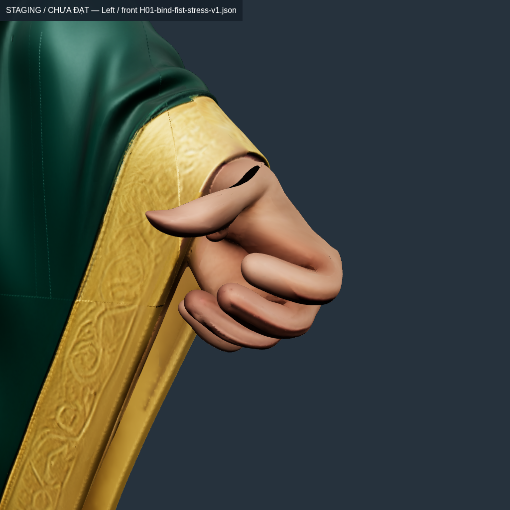
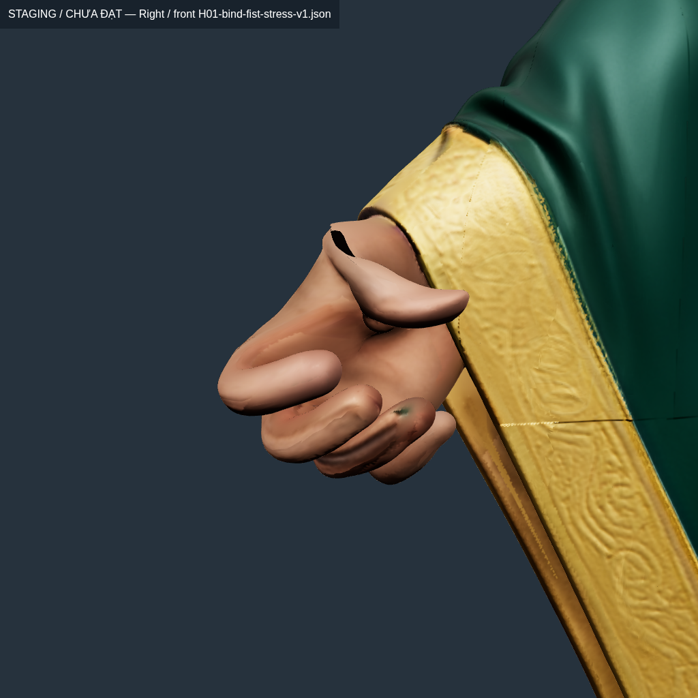

# Conver10 — sửa lỗi bị che khi co nhiều ngón cùng lúc

**Rig vẫn chưa đạt; không kích hoạt V12 và chưa có APK animation mới.** Có sửa công cụ và chạy lại fit thật trên14pose, không chỉ kiểm cài đặt Studio.8/10phép co từng ngón V12 qua upper-strain, nhưng hai thumb cùng tư thế nắm cả bàn tay còn trượt. Toàn model V12 chỉ15/23pose diagnostic qua, giảm so16/23của V9. Không đổi kết quả này thành nghiệm thu.

## Phát hiện mới trên cùng mesh xuất ra

V9 được fit chủ yếu trên tư thế nắm cả năm ngón. Tách từng chuỗi ngón và giữ các xương còn lại đúng bind cho thấy biến dạng nặng hơn nhiều. Ví dụ cùng vùng source có Index3 ảnh hưởng lên cạnh gần gốc ngón và Thumb1/Index1 trộn nhau. Khi hai chuỗi cùng xoay, các tác động có thể che nhau; bản thân các chỉ số nắm cả bàn tay chưa mô tả hết lỗi.

`audit-finger-isolation.mjs` khóa asset/solve/mask theo SHA, đo bằng native LBS và miền source-fan đã ghi nhận, không dùng đầu/ủng để làm loãng percentile. Mỗi phép thử co đúng3đốt một ngón với góc stress cũ45/60/40°. Mọi xương thân/ngón khác giữ bind. Phép thử nắm toàn bộ cũ vẫn được chạy và báo riêng.

| Phép co / cùng miền source | V9 p99,9 | V9 max | V12 p99,9 | V12 max | V12 qua1,5/2 |
| --- | ---: | ---: | ---: | ---: | --- |
| LeftThumb | 2.474587 | 3.668667 | 1.653808 | 1.843811 | Không |
| LeftIndex | 2.181678 | 3.171220 | 1.430819 | 1.484727 | Có |
| LeftMiddle | 1.672939 | 2.209087 | 1.376724 | 1.452307 | Có |
| LeftRing | 1.649134 | 1.913116 | 1.446839 | 1.485064 | Có |
| LeftPinky | 1.553607 | 1.706029 | 1.385390 | 1.452365 | Có |
| RightThumb | 2.407282 | 3.304638 | 1.693887 | 1.871994 | Không |
| RightIndex | 1.884488 | 2.950339 | 1.421703 | 1.476468 | Có |
| RightMiddle | 1.677595 | 1.941308 | 1.433165 | 1.483328 | Có |
| RightRing | 1.596064 | 2.118214 | 1.448441 | 1.462654 | Có |
| RightPinky | 1.479599 | 1.727236 | 1.364547 | 1.466411 | Có |

[Baseline V9](H01-v9-finger-isolation.json), [V12](H01-v12-finger-isolation.json) lưu từng witness, source-fan, ID/weight và góc quaternion.3test mới kiểm thân/ngón khác giữ bind, input không bị sửa, pose thiếu/xấu bị từ chối; fixture LBS chứng minh nắm đồng loạt có thể qua nhưng co riêng thất bại trên cùng ngưỡng. Đây là tăng độ sát phép kiểm, không nới ngưỡng hoặc thay mẫu cũ.

## Sửa và thử thật

1. Tạo layout14pose: giữ nguyên4pose cũ, thêm10pose độc lập. Giữ support đã khôi phục, seed/cuff fixed cùng source-star, không cắt thêm áo hay đổi source geometry. Fit proper-rotation ARAP có trần nội bộ1,45 trong400CP iterations. Trần trong solver chưa được thỏa hoàn toàn: còn2.945cặp cạnh–pose vượt trần nội bộ ở cuối; không gọi kết quả hội tụ hoặc đạt.
2. Xuất V12 ra GLB mới, đọc lại và chạy riêng mỗi tay, normal, giao cắt, rồi12primitive trên23pose. Receipt xác nhận geometry/UV/images/bind lõi và6clip legacy giữ nguyên; điều này không chứng nhận clip54bone hoặc timing Gemini.
3. Thử reassign distal influence nằm hơn5mm phía sau joint tới ancestor cùng ngón, coalesce mass và giữ seed/ngoài miền byte-exact.2test Python kiểm mass, đối xứng và joint blend zone. Sau400vòng với14pose, max numerical vẫn2,0015×, thumb còn trượt. Proposal bị loại ở numerical, không xuất GLB hoặc thay field mặc định.
4. Thử mặt phẳng CMC hướng tới palm đo được, giữ đúng45° và các rotation/translation khác. Same V9 thumb riêng tăng max lên4,29885/4,97892×; toàn fist tăng5,48894× bên trái. Bị loại. Không sửa bind/pivot/chiều dài xương hoặc calibration đang chạy chỉ để lấy số đẹp.

400iteration là phép thử bị chặn hữu hạn, không phải cứ tăng vòng tới khi đạt. [Log fit14pose](logs/independent-finger-h01-v1.log), [log support-proposal](logs/proximal-finger-h01-v1.log); các receipt trong experiments có accepted=false/activated=false.

## Hình dáng, normal và toàn model

Ở fist cũ, V12 phải/trái: p99,9 **1,664573/1,680437**, max **2,030015/1,931717**. So V9, percentile xấu hơn. Cặp self-cross giảm148/116→65/84, new-opposed normal giảm404/415→369/340; vẫn không đạt hình dáng. Không suy số cặp BVH thành độ sâu xuyên3mm hoặc contact5mm.

Ảnh PBR thật còn thấy vùng tối/rỗng dưới gốc thumb, nếp da/khối ngón bị nén và tay bị cuff che ở phía sau; từ ảnh này không xác định tất cả vùng tối là lỗ topology. Cần kết hợp normal, backface, source-boundary và giao cắt trước khi quyết định sửa. Không tạo mặt thân/da giả để lấp. Camera đóng khung theo posed hand, **không phải ảnh khóa camera để so pixel**.

| Trái, mặt lòng bàn tay | Phải, mặt lòng bàn tay |
| --- | --- |
|  |  |

4PNG1024px được xem và đăng nguyên byte vào [conver10](../../../picture/conver10/online-pic.md); giờ chụp nằm trong capture-manifest, khác giờ đăng ký Git. Hai ảnh phía sau giữ toàn bộ model visible để thấy occlusion. [23pose/12primitive](H01-v12-all-primitives-transition.json): **15/23**qua upper-strain. Chưa phải Entrance/Hold/combat60/120Hz.

[Path-bound seed](H01-independent-finger-seed-bounds.json) cho lower bound lớn nhất1,324930 trong các phép co riêng. Đây chỉ là điều kiện cần cho các pin/path đã chọn, không chứng minh toàn field khả thi, không biện hộ thay pivot theo phỏng đoán.

## Công cụ Blender đã dùng vào game asset

Studio0.6.4 qua MCP `blender_inspect_asset` đã import GLB V9 thật trong Blender4.3.2:54bone,6action,6mesh object sau import và3ảnh PBR nhúng; GLB/native audit vẫn kiểm đủ12primitive. [Báo cáo](studio-h01-v9-inspection.json). `hard_gate_pass=true` của inspector chỉ nói kiểm static/import của Studio; không thay23cổng rig, strain, collision, timing hay kiểm điện thoại. Không dùng scene hộp smoke-test làm model người/vũ khí.

Đọc lại workflow character/animation/asset-validation của Studio và animation/vfx-fx đã cài. VFX chưa được sửa trong vòng này vì impact/grip còn chưa có contact đạt; không giả nhận đã sửa VFX bằng việc đọc skill. Quy tắc sleeves-last, ModeB tay trái H02, ẩn/xuất hiện/apex/damping/giữ/đứng và các nguồn Gemini vẫn giữ.

## Hồi quy và checkpoint

Goal [2026-10-23T12-43-55-898Z](iterations/2026-10-23T12-43-55-898Z/goal.json), source `98c399b5f9dbd850135b5f646ef56cfcacf5aa9f659eb2b2af27377817d2f6ed`, stableSource=True.:

- npm test: **359/359**, exit0.
- npm run test:master: **215/215**, exit0.
- npm run verify:master: **0/37**, exit1.
- Python ARAP10/10 và proximal-support2/2: PASS.
- goal:rig exit1; goal:animation **INCOMPLETE**,2passed/4failed/17blocked.

Runtime legacy vẫn trượt toàn bộ mẫu visible:374ở60Hz và748ở120Hz trên mỗi hero; max H01=109,274336×, H02=53,147904×. Không đóng APK hoặc gắn V12 vào runtime khi staging còn trượt. APK giữ2.5.ba97bec3; chưa đo trên Android thật.

## Tiếp theo

Không tiếp tục fit cùng objective14pose với support cố định rồi gọi đạt. Ưu tiên điều tra các triangle mới đảo normal và vùng source quanh CMC/web bằng source-ID, mặt trước/sau/side cùng contact cán thật; quyết định lại support/điều khiển deformation có thể kiểm độc lập. Cần giải đồng thời shape/normal/collision và các pose riêng lẻ + toàn bàn tay, rồi cả hand/cuff/áo/thân. H02 phải có miền source riêng và qua cùng cổng, không sao chép mask H01. Sau skin mới hoàn thiện timeline/combat, xuất APK rig+animation, cuối cùng mới chỉnh tay áo Lâm Dật.

V12 GLB đã archive lossless XOR+gzip, SHA `5eac702f5fa2660010cdcd8409a208a7b138f1808e3aeb6aeb0e2de4d1e918a4`, parent V9 giữ raw. Đã phục hồi kiểm SHA và chạy audit23pose thật trước khi bỏ lại bản raw cache. V8 cùng5hardlink cache cũng được archive/kiểm phục hồi để có chỗ chạy. Nguồn/runtime/APK không bị xóa hoặc nén. Mọi archive/restore có biên nhận.

### Tái lập (staging riêng)

```bash
node tools/rig/audit-finger-isolation.mjs .local/rig-candidates/approved-source-hand-islands-h01-v9 docs/anim-report/conver10-approved-repair-2026-10-21/H01-bind-fist-stress-v1.json NEW_REPORT.json
node tools/rig/prepare-finger-isolation-layout.mjs .local/rig-candidates/approved-source-restored-slots-hand-h01-input docs/anim-report/conver10-approved-repair-2026-10-21/H01-bind-fist-stress-v1.json .local/rig-candidates/NEW-LAYOUT
python3 tools/rig/arap_weights.py .local/rig-candidates/NEW-LAYOUT .local/rig-candidates/NEW-FIT --bounded --iterations 400
```

Đổi NEW-LAYOUT/NEW-FIT sang tên chữ thường chưa tồn tại. Các dependency staging của checkpoint trước cần có hoặc restore từ receipt trước khi chạy; đây không phải lệnh kích hoạt. Generator/inspector từ chối ghi đè kết quả cũ. Không bỏ các validator fail hoặc điều kiện thiết bị thật.
