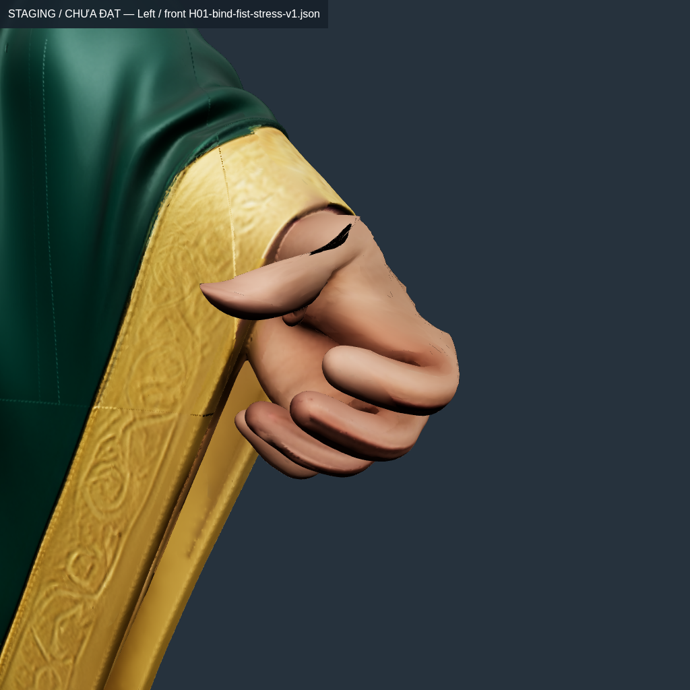
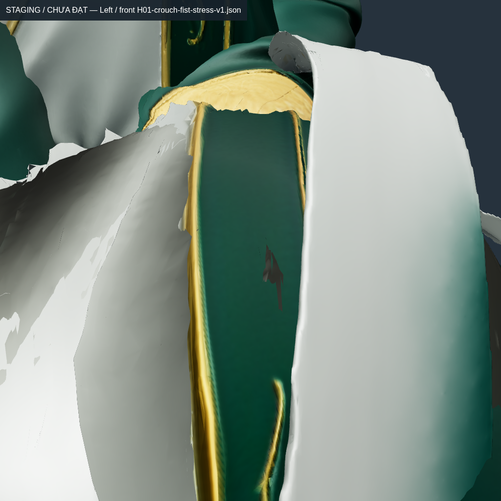

# Conver10 — ownership bàn tay và chuyển tiếp cổ tay trên source

**Chưa đạt nghiệm thu. Không thay model/animation runtime, không xuất APK rig mới.** Đây là phần B của phương án13 đã duyệt. Giữ nguyên mọi ngưỡng, hình học, UV, normal nguồn, ảnh4096, bind, GDD và dữ liệu tài sản. Không thực hiện giai đoạn thiết kế/tách riêng tay áo H01 trước APK rig+animation.

## Lỗi đã truy tới source

“Cạnh cổ tay” ở vòng trước thực ra gần gốc ngón cái: hai source weld843091/843086 cách nhau2,359803mm, ở khoảng `[0,554;1,043;0,147]m`, cách wrist khoảng87mm. Một đầu còn `LeftForearmPronation=0,891497`, `LeftArm=0,084866`, `Hips=0,023637`; đầu kia nhận `LeftHand/Thumb1/Thumb2/Pronation`. Cuối crouch cạnh giãn6,044719mm, tỷ lệ2,561535×.

Crop landmark±22mm cùng fade22mm của thử nghiệm cũ cắt ngang vùng thumb phía trên: bề mặt ở y1,043 chỉ cách mép crop khoảng4mm. Không tiếp tục sửa bằng cách giữ nguyên tập support đó rồi tăng số vòng fit.

Đồ thị **cut-fan trong `H01_Remaining_Source`** có hai mảng chứa các seed tay đã khóa SHA: phải10.929fan/12.349vertex, trái10.371fan/11.877vertex. Đây chưa phải mask giải phẫu được duyệt. Boundary của chúng có cả vùng bên ngón, không được gọi toàn bộ là wrist rim. Khi nối theo original source-weld trên toàn model, cả tay và áo thuộc cùng component749.845fan: chỉ dùng connected-component của Remaining_Source chưa đủ để giải cuff.

Một seed lòng bàn tay trái, source837953 tại `[0.5147482,0.9930841,0.1097656]`, lại nằm trong `H01_Sleeve_Left`, vertex80112, fan4353144. Nó đang pure `LeftHand`, được kiểm tọa độ/ID/weight và giữ nguyên; không bỏ seed thiếu khỏi báo cáo hoặc tự xem tên node là giải phẫu đúng.

## Các thử nghiệm thật và kết quả bị loại

Các số dưới đây đo trên cloud bằng native bốn-weight LBS của GLB đã xuất/đọc lại. “Remaining” bao gồm phần source còn lại, không phải riêng bàn tay và không đại diện cả nhân vật. Pose crouch/stress là diagnostic, **chưa phải timeline Gemini**, không thay nghiệm thu60/120Hz.

| Bản GLB | Remaining cuối crouch: max | Remaining crouch+nắm: max / p99,9 | Kept seam cuối crouch | Max sleeve trái / phải cuối crouch |
| --- | ---: | ---: | ---: | ---: |
| [Parent motion-v2](H01-cloth-motion-v2-transition-surface.json) | 2,561535 | [3,019788 / 1,654539](H01-hand-parent-fist-surface.json) | 0mm | ≤2 / ≤2 |
| [Hand-v2, screen6mm](H01-hand-islands-v2-transition-surface.json) | 1,491040 | [3,637515 / 1,924361](H01-hand-islands-v2-fist-surface.json) | Chưa đo | ≤2 / ≤2 |
| [Hand-v3, screen2mm](H01-hand-islands-v3-transition-surface.json) | 1,491040 | 3,807214 / 1,910527 | [22,048534mm](H01-hand-islands-v3-diagnostic.json) | ≤2 / ≤2 |
| [Hand-v4, CP950 + propagate fan](H01-hand-islands-v4-transition-surface.json) | 1,491040 | 1,838533 / **1,500557 — trượt** | [0mm](H01-hand-islands-v4-diagnostic.json) | **24,056308 / 28,093522** |
| [Hand-v6, cuff45mm](H01-hand-islands-v6-transition-surface.json) | 1,491040 | 1,838533 / **1,500557 — trượt** | [0mm](H01-hand-islands-v6-diagnostic.json) | **7,279650 / 5,985530** |
| [Hand-v7, CP450 target1,45 + cuff90mm](H01-hand-islands-v7-transition-surface.json) | 1,491040 | **1,911374 / 1,498372** | [0mm](H01-hand-islands-v7-diagnostic.json) | **20,906939 / 29,610777** |

Giới hạn vẫn p99,9≤1,5×, max≤2×; seam≤0,001mm. Không làm tròn1,500557 thành1,50 để nhận đạt. Parent và v2/v3 chỉ thay Remaining nên sleeve cũ còn qua upper-strain nhưng xuất hiện hở seam: đó là lỗi, không là phương án tốt hơn.

V7 Remaining qua **23/23** mẫu:21 interpolant bind→crouch,1 crouch+nắm,1 bind-body+nắm. Max của hai bài nắm lần lượt1,911374/1,911368; p99,9=1,498372/1,498368. Điều này **không cấp chứng nhận FINGERS hoặc SKIN_ALL_FRAMES**: sleeve vẫn biến dạng, thumb còn vấn đề hình dáng, các clip thực/combat/contact chưa qua kiểm. Lớp lót phải vẫn max2,036974/p99,9=1,531489, không đổi so với parent.

Giao cắt cuối cùng: parent71.634cặp, v3=71.694, v4=71.756, v6=71.739, v7=72.181. Không diễn giải thay đổi trọng số thành cải thiện collision/drape. Các giá trị nằm trong báo cáo full-source, không bỏ giao cắt để lấy upper-strain riêng phần.

## Vì sao có các vòng này

1. Field Dirichlet thuần trên toàn đảo tay (v1, chưa xuất GLB) làm thất thoát tới51,77% mass khi chọn4weight; bị loại. Bản screened giữ prior ngón, chuyển ảnh hưởng ngoài tay về Hand, pin seed nguồn và chỉ pin boundary gần palm theo geodesic. Mức6mm/2mm giảm mass mất nhưng chưa giải mọi pose.
2. CP150+500+300 giải đồng thời midpoint, crouch và crouch+nắm trên support cố định; giữ toàn bộ row ngoài tay và row pure đã đo. V4 đã giảm max nắm nhưng p99,9 vẫn trượt. Không tái khởi động state với tham số khác rồi gọi là resume.
3. Chỉ sửa row trong Remaining tạo hở22mm ở các bản copy cùng **kept source fan** bên Sleeve. `replaceSourceFanSkin` hiện truyền cùng field sang mọi bản copy, giữ nguyên các fan cắt độc lập. Khe hở về0mm, nhưng cạnh áo sát đó bị kéo24–28×; không xem seam0 là đủ.
4. V5 dừng ở numerical proposal chưa giữ external seed; v6 bổ sung pin fan4353144 trước export. Dirichlet continuation45mm giải7.636fan cuff trên cạnh source thật; max sleeve còn~7,28/5,99×. Bản90mm giải17.647fan nhưng chọn4support làm mass mất tới4,06%, sleeve xấu hơn. **Không chọn bản90mm để phát hành.**
5. Numeric hand-support-v4 chạy mới450vòng với target chặt hơn1,45, không nới ngưỡng nghiệm thu1,5/2. Native GLB v7 xác nhận Remaining qua hai bài nắm, nhưng lỗi quanh cuff/robe và silhouette còn nguyên nên cả candidate bị loại.

Source/cut/pose/GLB SHA, hai đỉnh và support các cạnh sleeve xấu nhất v4/v6/v7 nằm ở [probe](hand-islands-sleeve-edge-probes.json). Các scope này là evidence về source, chưa là phê duyệt pattern4416edge-cut. Những receipt có tiền tố `approved-` đặt theo phương án làm việc đã duyệt, không phải asset đã nghiệm thu.

## Ảnh trên mesh thật

Mọi mesh/material vẫn bật, GLTFLoader thật, PBR/ảnh nguồn giữ nguyên; không giấu áo để giả bàn tay đã lộ trong crouch. Góc crouch cho thấy áo đang che bàn tay nên không đủ để chấm ngón. Bài bind-body+nắm bổ sung tách việc nhìn ngón khỏi lỗi che khuất đó.

| V6 bind-body+nắm, phía trước — chưa đạt mỹ thuật | Crouch của V4 bị áo che — chưa đạt |
| --- | --- |
|  |  |

Các manifest `hand-islands-v4-review`, `hand-islands-v6-review`, `hand-islands-v7-review` ghi camera, source triangle, giờ chụp UTC và SHA. [Sổ ảnh conver10](../../../picture/conver10/online-pic.md) ghi thời gian đăng ký riêng, giữ nguyên byte ảnh; không gọi thời gian Git/đăng ký là giờ chụp. Lần chụp v7 đầu lỗi fetch module của Vite khi chạy song song goal, không tạo ảnh. Log lỗi được giữ; ảnh chỉ được tính sau lần chụp lại thành công.

## Bảo toàn và tái lập

Full-source oracle kiểm **1.499.726triangle / 4.499.178corner**, tất cả position/UV/normal/ảnh nguồn và fan. Exporter so payload trước/sau, IBM/core54 và mọi channel/keyframe của6clip legacy, cả các row không thuộc fan sửa. Giữ clip payload không có nghĩa đã retarget/author clip54bone đúng Gemini. Source H01 vẫn SHA `292c2631c63aa4f29dda978cd0441bea0a732034a570b5ce44d1ef462763f37b`.

Input cuff được kiểm lại từng position/index/fan và skin field so với GLB v4:886.671vertex,1.499.726triangle; [log audit](logs/approved-hand-cuff-input-audit.log). Không chép layout cũ rồi mặc định là còn đúng.

Các CLI mới trong `tools/rig/`: `source-hand-islands.py`, `export-source-hand-islands.mjs`, `prepare-hand-support-fit.mjs`, `assemble-hand-support-fit.mjs`, `prepare-hand-cuff-input.mjs`, `source-hand-cuff-continuation.py`, `capture-hand-support.mjs`. Tất cả chỉ xuất staging, giữ `accepted=false/activated=false`. Dùng thư mục mới khi chạy lại; không ghi đè một trial đã có receipt/GLB/archive. Parent đã archive phải restore theo `model-archive.json` trước.

```bash
python3 tools/rig/source-hand-islands.py HAND_INPUT NEW_FIELD --canonical CANONICAL_SOURCE --seeds HASH_BOUND_SEEDS
node tools/rig/export-source-hand-islands.mjs NEW_FIELD
node tools/rig/prepare-hand-support-fit.mjs CANDIDATE NEW_FIT_INPUT MIDPOINT_JSON CROUCH_JSON FIST_JSON
python3 tools/rig/pose_weight_fit.py NEW_FIT_INPUT NEW_NUMERICAL --whole-body --iterations 450 --ratio 1.45 --archive-state
node tools/rig/assemble-hand-support-fit.mjs CANDIDATE NEW_NUMERICAL NEW_FIELD_PROPOSAL
node tools/rig/prepare-hand-cuff-input.mjs BASE_CANDIDATE NEW_CUFF_INPUT GEOMETRY_LAYOUT
python3 tools/rig/source-hand-cuff-continuation.py NEW_CUFF_INPUT NEW_COUPLED --extension 0.045 --hand-proposal NEW_FIELD_PROPOSAL
node tools/rig/export-source-hand-islands.mjs NEW_COUPLED
```

Đây là recipe staging, **không phải lệnh tích hợp bản đã đạt**. Hash/đường dẫn/iteration/state thật của từng trial nằm trong [experiments](experiments/index.json) và `logs/`. Các raw trial cache được archive XOR+gzip lossless có kiểm SHA khôi phục trước khi xóa bản dư; [biên nhận](reproduce/rejected-model-cache-archives.json). Không nén/giảm texture hoặc asset runtime.

## Goal và phần phải làm tiếp

Vòng [2026-10-23T04-20-42-261Z](iterations/2026-10-23T04-20-42-261Z/goal.json), fingerprint `98d25cb1295c3347afed2c03e953e08370eb010b7508eab6d05fdedffbe78d70`, stableSource=true: **npm test350/350, test:master215/215, verify:master0/37**; goal INCOMPLETE. Chỉ SOURCES/RUNTIME_MODES qua scope hiện có;4gate failed,17blocked. Kiểm hồi quy thêm source connectivity, seed/UV-copy identity, tamper, continuation có nghiệm arclength độc lập và copy fan qua primitive; không thay test bằng kiểm flag tự khai.

Hướng sửa tiếp là phân biệt bề mặt skin/cuff và support chuyển tiếp trên source, kiểm pivot/forearm frame rồi fit có ràng buộc trên **cả cạnh hand lẫn cuff**, không chỉ kéo rộng bán kính harmonic hoặc bảo vệ vùng fail. Cần giữ silhouette, nén/normal/collision, sửa lớp lót và guide/drape trước khi author/chứng nhận toàn Entrance/Hold/combat. H02 vẫn phải sửa và qua đủ các cổng, không dùng số đo H01 thay H02.

APK vẫn2.5.ba97bec3, SHA `52aeeea29c319b5f8b66224ed1c46ae74890254924de2cdcc8d2104ae92b4c7c`. Không có APK animation mới, không có điện thoại vật lý kết nối, chưa xác minh FPS/contact/mỹ thuật trên thiết bị.
