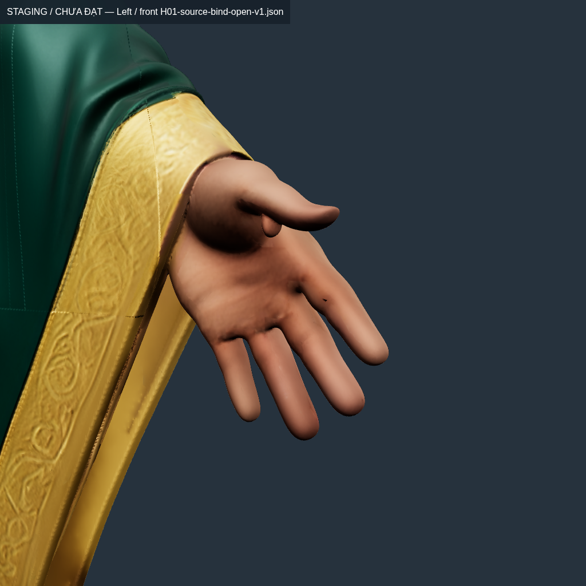
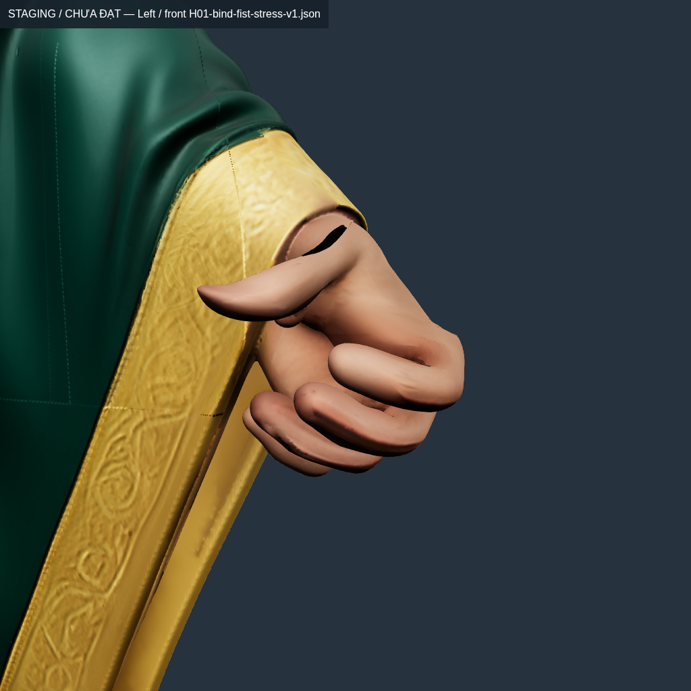

# Conver10 — giữ ô xương ngón và kiểm hình dáng bàn tay

**Đã sửa lỗi chuẩn bị support; rig vẫn chưa đạt, chưa thay runtime và chưa có APK animation mới.** V11 giảm nhẹ p99,9 và giảm giao cắt ngón, nhưng bốn lượt nắm vẫn trượt. Số normal ngược tăng và một số triangle bị nén diện tích mạnh hơn. Không kích hoạt model từ các cải thiện riêng lẻ.

Tiếp `e9a3a7c` và [vòng hand/cuff](COUPLED-HAND-CUFF.md). Giữ nguồn hình học/UV/normal, ảnh4096,54joint,6clip legacy và GDD/ví/kho/vault/HMAC/reconnect. Chưa thực hiện giai đoạn thiết kế/tách riêng tay áo H01 phải sau APK rig+animation. Giữ clip payload không có nghĩa đã retarget/author đúng54bone hoặc Gemini.

## Lỗi có bằng chứng và sửa thật

`prepare-coupled-hand-fit.mjs` từng đổi **mọi ID có weight0** sang ID đầu tiên. Bước bỏ Hips/UpLeg khỏi ô trống đã bỏ cả xương ngón cùng bên hợp lệ. Weight0 vẫn là lựa chọn optimizer có thể sử dụng.

Ví dụ source fan4328075 tại `[0.583361745,0.995299876,0.121105567]m`, gốc ngón trỏ trái:

- V8: `[LeftHand,LeftHandIndex1,LeftHandIndex3,LeftHandIndex2]`, weight `[0.942659,0,0.057341,0]`.
- V9: `[LeftHand,LeftHand,LeftHandIndex3,LeftHand]`, weight `[0.943041,0.002301,0.052357,0.002301]`.

Đổi ô0 không đổi vị trí ban đầu nhưng làm mất quyền dùng Index1/Index2 khi fit. Đây chưa được chứng minh là nguyên nhân duy nhất của biến dạng.

PolicyV2 giữ ID0 tay/ngón cùng bên, chỉ đổi ID0 ngoài chuỗi/khác bên. Row không có ô trống và influence đang dùng giữ nguyên. [Audit trên cùng V8/geometry/4pose](hand-empty-slot-policy-v2-audit.json): **chỉ `result-ids.bin` khác**, giữ lại1.243ô local từng bị đổi sai; neutralized28.228→26.985. Position, topology, matrices, weights và protected-mask giống byte.

Với input numerical tạo từ V9 bằng policy cũ, `hand_support_slots.py` gộp mass ID trùng rồi khôi phục ô0 từ V8 khóa SHA:1.426ô/1.170fan trong **input đó**. Đây khác mẫu số audit V8 ở trên. Sai số coalesced mass lớn nhất2,980232e-8; ngoài miền tay và seed bảo vệ giữ byte. Starting deformation giữ trong sai số float32, không nói raw weight giống byte sau gộp.

## Các lần thử và kết quả native

ARAP tìm proper local rotation và bốn weight không âm/tổng1, phạt cả cạnh ngắn đi. Không dùng reflection. Cạnh qua biên vẫn có neighbor cố định. Nó không bảo đảm thể tích/collision/contact.

- ARAP không có trần cạnh: max numerical khoảng2,57–2,60×, bị loại.
- Đổi toàn bộ support theo nearest source-geodesic seed: max numerical83,23×, bị loại, **không xuất GLB**; không dùng làm pipeline mặc định.
- V10: support khôi phục,1.500CP iteration, ARAP target mỗi100vòng, trần nội bộ1,45; xuất/đọc GLB rồi kiểm độc lập.
- V11: support khôi phục,15local/global iteration × tối đa400ADMM, Jacobi/rho0,5/trần1,45; xuất/đọc GLB rồi kiểm. Residual cuối0,425224: **subproblem chưa hội tụ**. Có constraint trong thuật toán không có nghĩa output thỏa constraint.

Bảng lấy từ **GLB/native LBS, riêng từng bàn tay**, cùng SHA `H01-bind-fist-stress-v1.json`. Không lấy p99,9 primitive chứa đầu/ủng thay ngón.

| Mẫu / tay | p99,9 | Max cạnh | Min cạnh | Min diện tích | Qua1,5/2 |
| --- | ---: | ---: | ---: | ---: | --- |
| V9 / phải |1,603502|1,796602|0,041734|0,013049|Không|
| V10 / phải |1,613491|1,776082|0,229148|0,081528|Không|
| V11 / phải |1,578524|1,882572|0,215944|0,082128|Không|
| V9 / trái |1,623320|1,886358|0,052012|0,032182|Không|
| V10 / trái |1,625179|1,907431|0,204075|0,054177|Không|
| V11 / trái |1,600990|1,880181|0,236113|**0,004751**|Không|

Min cạnh V11 tốt hơn nhưng **min diện tích trái và max cạnh phải xấu hơn V9**. [Bảng máy đọc](hand-shape-comparison.json), [V10](H01-hand-islands-v10-per-hand.json), [V11 đủ23pose](H01-hand-islands-v11-per-hand-transition.json).

V11 chỉ **42/46lượt tay** qua:21interpolant mở qua cả hai tay, hai pose nắm trượt cả hai tay. Toàn model **16/23pose** qua upper-strain, lớp lót phải/torso còn trượt. Đây là diagnostic, chưa là timeline Gemini/toàn Entrance/Hold/combat hoặcFPS.

## Kiểm normal và ngón tự xuyên

`measure-hand-quality.mjs` dùng cùng mask source-fan/component/seed khóa SHA với phép strain; không dùng hộp tọa độ. So geometric normal với native four-weight shader normal. BVH kiểm cặp triangle không kề, loại source-weld neighbors; coplanar/point-touch ghi riêng. Không suy ra độ sâu xuyên3mm, containment, thể tích hoặc contact cán vũ khí từ số cặp giao cắt.

Bind mở hai tay đều0new-opposed/0self-crossings. Cùng pose nắm:

| Mẫu / tay | Triangle mới có normal ngược | Cặp tự giao cắt |
| --- | ---: | ---: |
| V9 / phải |404|148|
| V10 / phải |477|63|
| V11 / phải |**513**|65|
| V9 / trái |415|116|
| V10 / trái |442|86|
| V11 / trái |**474**|89|

Giảm giao cắt không đồng nghĩa hình dáng đạt. [V9](H01-hand-islands-v9-hand-quality.json), [V10](H01-hand-islands-v10-hand-quality.json), [V11](H01-hand-islands-v11-hand-quality.json) giữ witness/assetSHA. Domain chỉ gồm tay trong Remaining_Source, chưa gồm cuff copies, seed palm ngoài node, va chạm áo hoặc toàn animation. BVH dùng float32; LBS/strain dùng float64. Không nghiệm thu skeleton từ diagnostic này.

## Bảo toàn, pin và ảnh

[Đường đi source giữa seed](H01-hand-seed-path-bound.json) cho necessary lower bound lúc nắm phải1,133852/trái1,140135. Nó chưa chứng minh toàn field khả thi và **không chứng minh rig bất khả thi**. Chưa có bằng chứng đủ để quy toàn lỗi cho chiều dài/pivot ngón hoặc tự sửa chúng theo phỏng đoán.

SHA V10: `76959051af4a1d6f4c3e86a69446b843ec412b14af36697021031aa2d690ba53`.

SHA V11: `b9aa9f26a16633768e86412bdc9fe9c84f87765eafbf03b72ad97ec7b551c5d1`.

[Oracle V11](H01-hand-islands-v11-diagnostic.json):1.499.726triangle/4.499.178corner, source attributes/images và fan độc lập giữ nguyên; kept seam0mm trên144.721pair. Crouch mở còn76.417cặp crossing liên quan vạt; không dùng kiểm tay để che lỗi áo/thân.

| Source mở | V9 nắm, chưa đạt | V11 nắm, chưa đạt |
| --- | --- | --- |
|  |  |  |

Mọi mesh/PBR nguồn visible. Camera đóng khung theo posed bounds, ghi trong capture-manifest: **không phải cùng camera để so pixel/ΔE**.12PNG mới gồm4source mở/4V10/4V11 đã đăng nguyên byte vào [conver10](../../../picture/conver10/online-pic.md). UTC chụp trong manifest khác giờ đăng ký/Git. [Kiểm byte](gallery-validation.json) xác nhận246rawPNG của vòng sửa đều có trong sổ.

## Hồi quy và goal

Test mới bắt mất ID ngón0; giữ influence đang dùng; coalesced skin cho cùng kết quả qua7bộ transform độc lập; Jacobian giữ neighbor cố định qua nhiều pose; proper rotation không nhận reflection; repair compression/KKT prox ball; support bất khả thi không được che bằng simplex hợp lệ; mask từ chối seed thiếu/khác component/hai tay chồng nhau. Không đổi ngưỡng nghiệm thu.

Vòng [2026-10-23T08-25-56-842Z](iterations/2026-10-23T08-25-56-842Z/goal.json), fingerprint `1ae98b1efd070b45bf6ebf479ebd03692ab932dcc46e804ffce2a58f7f1ddc5e`, stableSource=true:

- `npm test`: **356/356**, exit0.
- `npm run test:master`: **215/215**, exit0.
- `npm run verify:master`: **0/37**, exit1.
- `goal:rig`: exit1; `goal:animation`: **INCOMPLETE**,2scopepassed/4failed/17blocked.
- Build/APK chưa chạy lại vì rig chưa đạt. Chưa có Android vật lý, không cóFPS/contact/kiểm mỹ thuật Android mới.

Runtime legacy vẫn trượt mọi mẫu visible Entrance/Hold60/120Hz. H02 chưa có asset sửa mới vòng này. V11 không đăng ký hoặc đóng APK. APK vẫn **2.5.ba97bec3**,303.180.784byte, SHA `52aeeea29c319b5f8b66224ed1c46ae74890254924de2cdcc8d2104ae92b4c7c`.

## Tái lập và bước tiếp

[119biên nhận](experiments/index.json) và `logs/` ghi input/output/SHA/iteration thật, kể cả thất bại. `hand_geodesic_support.py` là proposal bị loại, không phải default. Mọi model mới chỉ ở staging, accepted=false/activated=false.

```bash
python3 tools/rig/hand_support_slots.py OLD_LAYOUT V8_SOURCE_FIELD NEW_LAYOUT
python3 tools/rig/arap_weights.py NEW_LAYOUT NEW_NUMERICAL --constrained-admm --iterations 15 --inner-iterations 400 --rho 0.5 --metric jacobi
node tools/rig/assemble-coupled-hand-fit.mjs NEW_NUMERICAL NEW_FIELD
node tools/rig/export-source-hand-islands.mjs NEW_FIELD
node tools/rig/measure-hand-quality.mjs NEW_FIELD REPORT BIND_POSE FIST_POSE
```

Recipe này **chưa đạt**, không là lệnh tích hợp. Input V9 cũ đã qua zero-slot policy cũ; preparer mới trên V8 có hash khác và audit riêng, không tráo chúng thành cùng trial. Tên `fixedCuffAndSeedsByteExact` trong receipt numerical chỉ nói neighbor ngoài miền hand numerical giữ nguyên; kept-fan copies bên Sleeve vẫn được exporter truyền cùng field, không có nghĩa toàn cuff chưa đổi.

Một số cache GLB thử bị loại được archiveXOR+gzip lossless; kiểm SHA khôi phục trước khi bỏ bản dư. [Biên nhận](reproduce/rejected-model-cache-archives.json) ghi parent/restore, cả các hardlink. Không nén/xóa nguồn, runtime hoặcAPK.

Bước tiếp cần kiểm trực tiếp ownership/CMC-MCP và chuyển tiếp tay–cuff trên source; giải hình dáng/normal/diện tích/collision cùng contact. Không tăng số vòng với residual đứng yên rồi gọi đạt. Sau skin mới author/kiểm đủ54track, Entrance/Hold/combat của cảH01/H02 và APK; tay áo H01 vẫn sau APK rig+animation.
