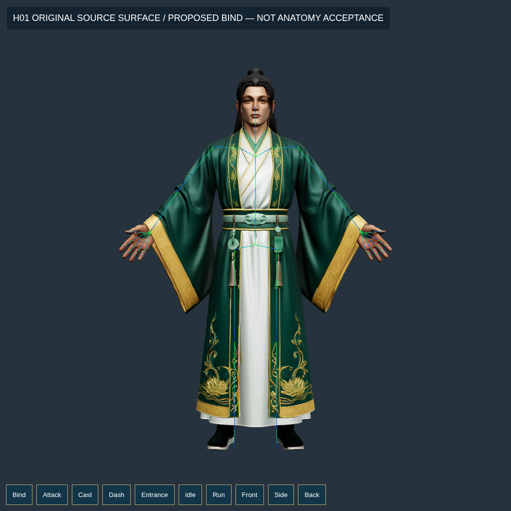
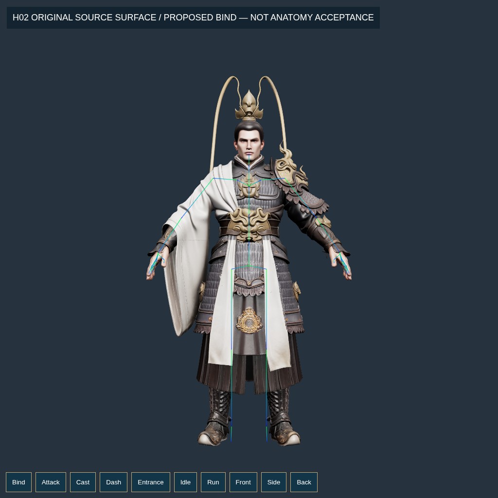
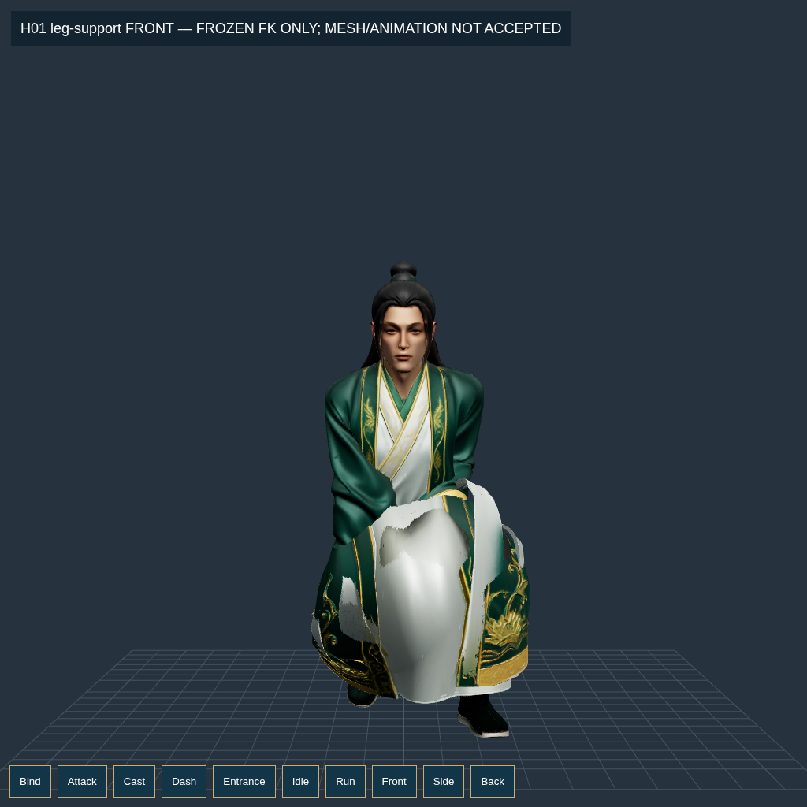
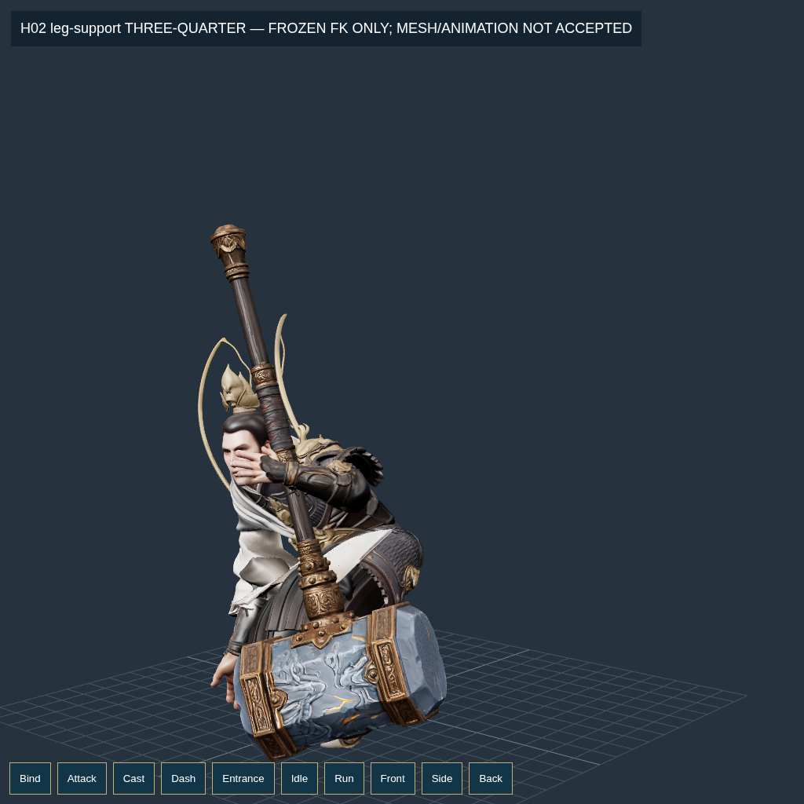

# Sửa rig và animation H01/H02 — phương án mục 13 đã được phê duyệt

**Vòng mới nhất — [ô xương ngón và hình dáng bàn tay](HAND-SHAPE.md):** sửa policy làm mất ID ngón có weight0; audit input thật giữ lại1.243ô local. Giữ hình dáng giảm một phần giao cắt nhưng normal/diện tích vẫn lỗi,4/46lượt tay trượt. Không kích hoạt model/APK.12ảnh mới, test356/356, master215/215, verify0/37; goal INCOMPLETE.

**Đang thực hiện, chưa nghiệm thu rig, chưa có APK rig/animation mới.** Những ảnh và GLB staging trong vòng này là mẫu thử, gồm cả mẫu bị loại. Không coi `passed` của một phép IK hoặc tính hợp lệ của weight là đã hết biến dạng.

[Goal chi tiết](../../../goal/rig-animation.md) · [23 cổng và nguồn SHA](../../../acceptance/goals/rig-animation-gemini.json) · [Kết quả goal gần nhất](goal-latest.json) · [65 yêu cầu → cổng kiểm](REQUIREMENT-GATES.md) · [Quyết định kỹ thuật](DECISIONS.md) · [Ảnh nguyên byte trên Git](../../../picture/conver10/online-pic.md).

**Vòng trước — [giải đồng thời hand/cuff và kiểm riêng bàn tay](COUPLED-HAND-CUFF.md):** đã xử lý influence xương đùi lọt vào cuff và fit trên toàn edge-star nguồn. Primitive lớn qua23mẫu nhưng kiểm riêng hai bàn tay vẫn trượt khi nắm (p99,9≈1,60/1,62); normal/giao cắt/hình dáng còn lỗi. Không nghiệm thu hoặc thay APK.20ảnh mới, test353/353, master215/215, verify0/37; goal INCOMPLETE.

**Vòng trước — [ownership bàn tay và cuff](HAND-OWNERSHIP.md):** đã bỏ crop cắt ngang thumb, giữ seed nguồn và đồng bộ các bản copy kept-fan qua mesh. Remaining_Source bản thử qua23/23 mẫu, gồm hai bài nắm; chưa là nghiệm thu ngón hay nhân vật. Cuff/áo vẫn trượt nặng, mọi candidate bị loại và runtime/APK chưa thay.24ảnh mới cùng log thất bại được giữ trong conver10. Goal mới: test350/350, master215/215, verify0/37, INCOMPLETE. Số đo vạt áo ở đoạn trước là checkpoint cũ.

**Vòng trước — [kiểm chuyển động và fit vạt áo](CLOTH-MOTION.md):** đã sửa cách rút support vốn chỉ giữ đúng một pose và chạy fit nhiều pose. GLB đọc lại cho max vạt7,35→2,04× trên21 mẫu diagnostic; toàn model15/21 mẫu qua upper-strain (parent1/21). Lớp lót phải/thân/cổ tay còn trượt; ảnh vẫn thấy áo phồng/chặn tay, nên không thay vào game hoặc xuất APK. H02 parent54 mới được kiểm21 mẫu, chỉ4/21 qua.60ảnh chụp mới đã vào conver10; dữ liệu thất bại và [cut/grid](GARMENT-PANELS.md), [ủng/cổ tay](BOOT-WRIST.md) được giữ nguyên.

## Phạm vi và nguồn

Tiếp tục từ `bbef21f36c7324d005b851f4a92fac54a0f81981`, sau khi người dùng duyệt mục 13 của [audit](../conver10-gemini-audit-2026-10-21/README.md). Hai DOCX gốc được giữ nguyên để có thể chạy lại kiểm SHA trên một checkout mới:

- [Lâm Dật](../../requests/gemini-animation-2026-10-21/Lam-Dat.docx), SHA `d29514af20f7d2665aa480fd595eed759125622c4349e5eb166ff877f30df629`.
- [Chùy 1,75 m / ngữ cảnh Hàn Trạch](../../requests/gemini-animation-2026-10-21/Chuy-175m.docx), SHA `c729606f4dda827343e07ca5b655e17ea31ff4e77a9d99d353941558cdcedeea`.

Không sửa GLB gốc, texture/UV, registry model đang chạy, GDD, gameplay, ví/kho/vault/HMAC hoặc cơ chế nối lại online. Mọi GLB thử mới nằm trong `.local/rig-candidates/`; chưa chuyển sang `public/` hoặc đóng APK. Việc riêng tay áo H01 vẫn chờ sau APK rig/animation theo thứ tự đã duyệt.

## Sửa đã có kiểm hồi quy

1. **Nút MODEL GỐC / HOẠT ẢNH truyền đúng tới worker.** Có setter chung và lệnh worker. Phép kiểm đọc mesh thực đang visible, số triangle, map và local pose của skeleton, không lấy nhãn tải tài nguyên làm bằng chứng. Chạy cả backend worker mặc định và main, cả H01/H02, replay, toàn thân/cận mặt, đổi chế độ ba lần. Các cặp pose được so trực tiếp; kiểm thêm build fingerprint để không thử nhầm `dist` cũ.
2. **Cache clip theo đúng payload.** Cache cũ chỉ dùng mã hero nên dữ liệu khác của cùng hero có thể bị phát bằng clip cũ. Test tạo hai payload khác nhau, đo `Hips.position`: thất bại trước sửa, qua sau sửa. Cache mới dùng identity của dữ liệu; replay vẫn dùng lại mixer/action.
3. **Giải phẫu không đồng nhất A-pose với góc khớp bằng 0.** Bộ thử có góc nghỉ khuỷu và neutral basis riêng cho vai/cổ tay. Không nới các giới hạn khuỷu, cổ tay hoặc ngón hiện hành.
4. **Hai helper xoay cẳng tay thật.** Bản bind thử có 52 xương lõi và 2 helper radioulnar pronation. Có kiểm hierarchy offset bằng 0, giới hạn riêng và vận tốc của helper. Thiếu lịch sử helper bị từ chối; không âm thầm bỏ nó khỏi kiểm vận tốc. Đây chưa phải bằng chứng skin cẳng tay đã đạt.
5. **Kiểm LBS độc lập trên mọi primitive.** Decode đúng accessor normalized, inverse-bind và quantization; kiểm tất cả cạnh và triangle, ở 60/120 Hz. Chưa hỗ trợ đánh giá morph hoặc influence bổ sung thì từ chối, không bỏ qua để nhận đạt.

Các thay đổi trên không tự nghiệm thu pose/skin/finger contact. Chứng cứ thực thi ở các thư mục `iterations/` và log kèm theo.

## Rig và weight đang thử

Bind mới giữ nguyên payload position/normal/UV/index/image; vị trí nguồn của tay và ngón được giữ. Phần thân/chân được hiệu chỉnh ở staging, sau đó tính lại weight từ mesh nguồn. Tiền tố `approved-` trong thư mục thử chỉ nói phương án công việc đã được người dùng duyệt; không có nghĩa asset đã được chấp nhận. Các phép heat dùng proxy voxel tạo từ chính source rồi chuyển weight trở lại source; không xuất người/vũ khí primitive.

Đã thử và giữ kết quả thất bại của heat trực tiếp, proxy 4 mm, nội suy vùng thiếu weight, smoothing không gian, proxy 8 mm, diffusion trên cạnh nguồn, weight ngón theo geodesic và tối ưu weight trên nhiều pose. [Biên nhận thử nghiệm](experiments/index.json) lưu cả mẫu bị loại. `weightsValid` chỉ có nghĩa weight có giá trị hữu hạn, không âm, tổng phù hợp; nó không có nghĩa skin đạt.

Phép geodesic mới ghi rõ các source vertex ID cho palm và 30 đoạn ngón, giải trường trên cạnh thật, không nối các lớp áo chỉ vì chúng ở gần nhau. Các mask này **chưa được nghiệm thu giải phẫu/contact**. Cả hai Hồn Sư đã được tạo trường thử; không thay bằng mask theo tên node.

Bộ fit weight kiểm đồng thời crouch tay mở và một pose nắm 45/60/40 độ để bắt việc sửa pose này rồi làm hỏng pose khác. Pose stress không phải động tác Gemini hoàn chỉnh. Test độc lập buộc solver phải tính cả pose thứ hai, kể cả trường hợp pose đó bất khả thi; kiểm projection có metric chéo bằng điều kiện KKT. Không giảm ngưỡng strain để xuất bản mẫu thử.

## Đối chiếu bind trên source A-pose

Đã chụp trước/bên/3/4, có và không overlay xương, cho cả hai Hồn Sư. Tọa độ các joint, camera, hash GLB và giờ chụp có trong [manifest](source-bind-review/capture-manifest.json). Hình cho thấy điểm xương và bề mặt nguồn ở trạng thái nghỉ; chưa đủ để chứng nhận vị trí giải phẫu ẩn dưới áo hoặc mọi trục khớp. Phép lấy mẫu màu ấm trong `source-warm-albedo-samples.json` chỉ phục vụ chẩn đoán, không được coi là mask mặt/tay đã duyệt.

| H01 | H02 |
| --- | --- |
|  |  |

Hai helper đã có weight **trong GLB thực sau reduction**, không chỉ có node: H01 trái/phải 94.199/94.143 đỉnh; H02 34.710/153.784 đỉnh ở ngưỡng weight > 0,00001. [Biên nhận sparse](sparse-pronation-support.json). Số đỉnh không phải tỷ lệ đạt hoặc chứng nhận vùng giải phẫu; field vẫn cần ghép và tối ưu với các mask nguồn đã kiểm.

## Số đo và giới hạn diễn giải

[Bảng đo staging](STAGING-MEASUREMENTS.md) chỉ so các file/pose/hash được ghi rõ. Không dùng số đo staging toàn bộ source 1,5 triệu triangle để nói APK legacy 30k/60k triangle đã được sửa. Runtime hiện vẫn trượt trên mọi mẫu nhìn thấy ở phép kiểm Entrance/Hold. Kiểm combat, contact tay thật, foot slide, giao cắt và toàn bộ chuỗi clip vẫn chưa được chứng nhận.

Các ảnh dưới đây dùng texture nguyên byte, camera kiểm tra và source mesh đầy đủ. Mẫu có áo gãy, bàn tay che mặt hoặc vạt áo đè chân vẫn bị loại dù IK trả kết quả đạt:

| H01 — mẫu bị loại | H02 — mẫu bị loại |
| --- | --- |
|  |  |

Giờ chụp từng ảnh nằm trong `capture-manifest.json` cạnh ảnh; giờ đăng ký ảnh trên Git được ghi riêng trong sổ conver10. Chưa thực hiện một phép so ΔE hoặc nghiệm thu mỹ thuật từ các ảnh này.

## Chạy lại

```bash
npm run goal:animation
npm run test:showcase-modes
SHOWCASE_PRODUCTION=1 npm run test:showcase-modes
```

Chạy `npm run build` trước phép kiểm production; test sẽ từ chối bundle có source fingerprint cũ. Goal chạy lại test, test:master, verify:master và goal:rig gốc, giữ riêng log mỗi iteration. Các scope chưa có validator đầy đủ vẫn **BLOCKED**; hiện chưa có 23 validator hoàn chỉnh. Thiếu chứng cứ không được tính là đạt.

Để dựng lại mẫu bind, dùng `HERO=H01 node tools/rig/rebuild-source-bind.mjs` và tương tự H02. Pipeline heat/diffusion/seed/fit có CLI trong `tools/rig/`; recipe và SHA đầu vào nằm trong [biên nhận](experiments/index.json). Blender 4.3.2 được dùng cho các mẫu heat ở đây. Python dùng `tools/rig/requirements-surface.txt`. Thử nghiệm SOCP trong `reproduce/` dùng riêng CVXPY 1.7.3 và Clarabel 0.11.1; nó thất bại và không xuất weight, không phải phụ thuộc runtime/build game. Các GLB staging thất bại không được đưa vào bản phát hành.

## Việc còn phải qua trước APK

- Chốt mask bàn tay/30 đoạn ngón, cổ tay/cẳng tay, ủng và thân/áo trên source; kiểm cả xoay cẳng tay lẫn đóng/mở ngón bằng bề mặt thật.
- Sửa skin và áo để qua các giới hạn hiện hành, kiểm thêm nén, normal, seam và giao cắt. Fit vài pose không thay thế kiểm toàn chuỗi.
- Dựng lại apex/landing/dip/crouch/rise/grip/hold và nhịp gõ; giải contact chân, đầu ngón, palm và vũ khí sau mọi interpolation.
- Bake đủ các track của rig mới: 54 rotation + Hips.position cho Entrance/Hold; không tái dùng nguyên payload 53 track của rig 52 xương. Retarget đủ các clip combat, kiểm sảnh và Idle/Run/Attack/Cast/Dash. H02 dùng tay trái nhất quán.
- Kiểm production/offline/source fidelity, rồi mới đóng APK rig/animation. Sau đó mới làm riêng tay áo H01.
- Chưa có điện thoại Android vật lý kết nối; các mẫu 60/120 Hz ở đây là tần số lấy mẫu toán học, không phải FPS điện thoại.

## Checkpoint: co ngón độc lập trên source

Xem [HAND-ISOLATION.md](HAND-ISOLATION.md): fit14pose tăng8/10phép co từng ngón qua upper-strain nhưng fist/thumb và toàn model còn trượt, V12 bị loại. Test359/359/master215/215/verify0/37; goalINCOMPLETE, chưa APK mới.
