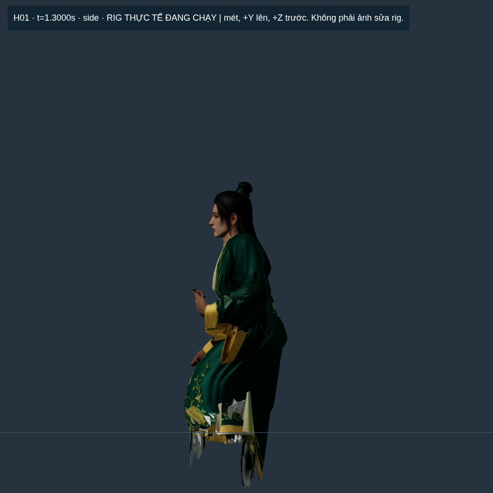
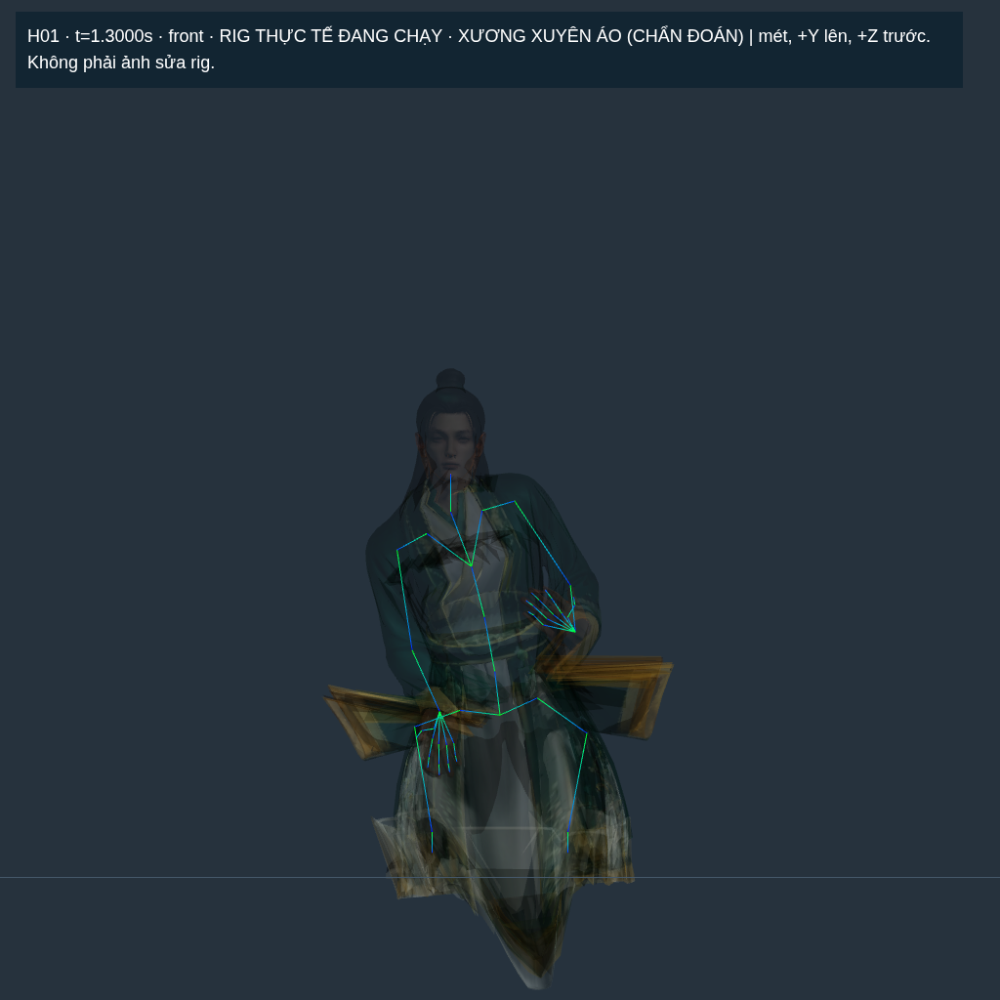
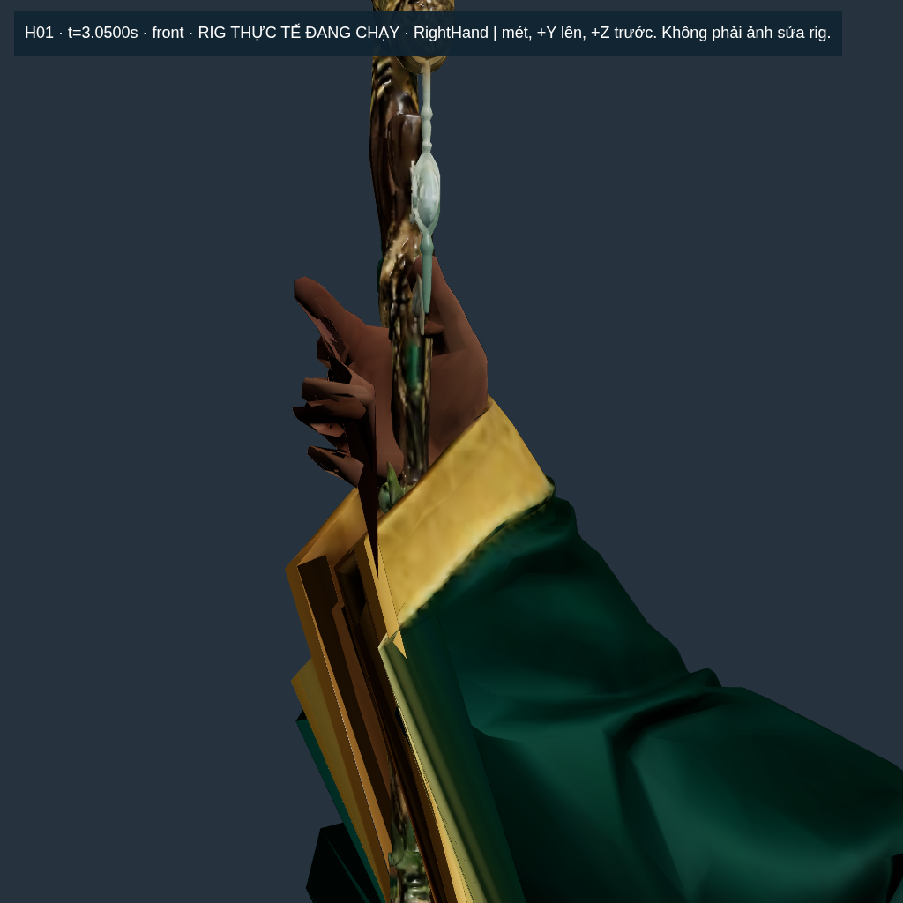
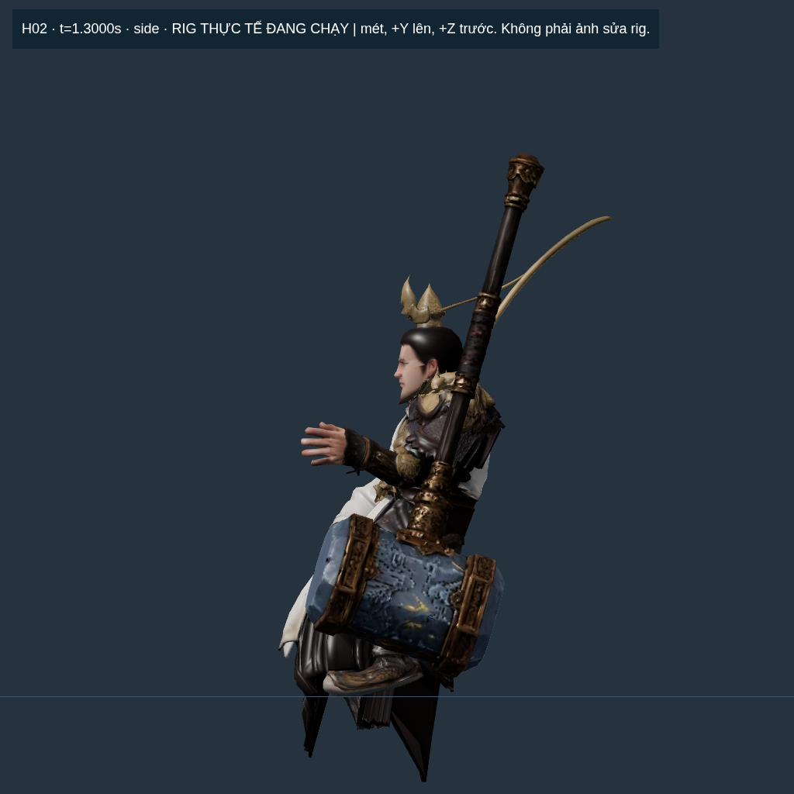
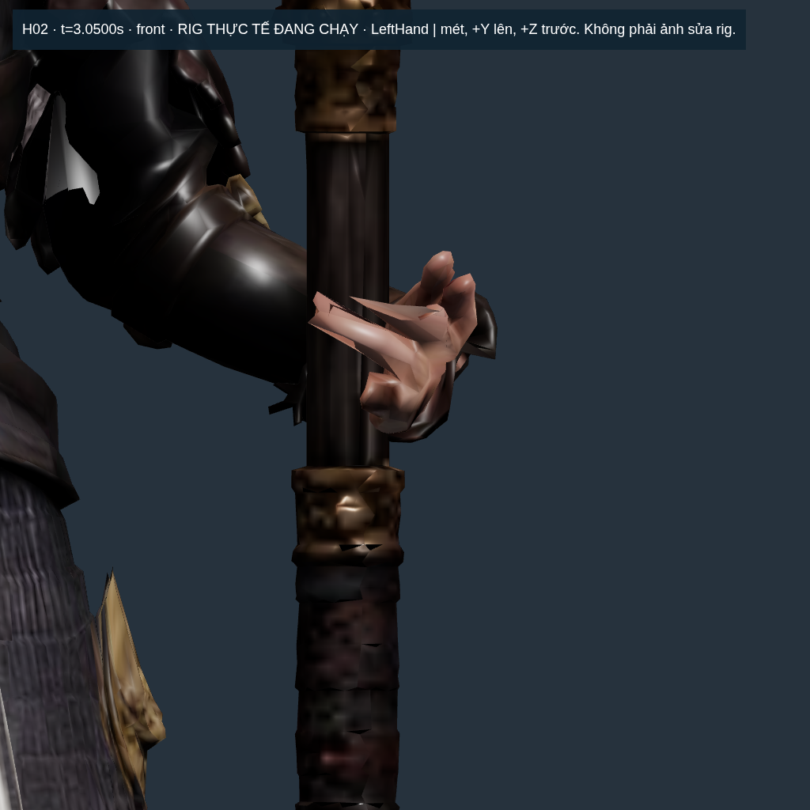
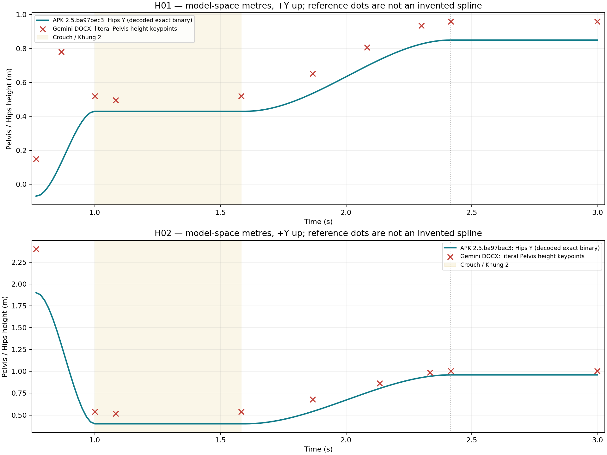

# Kiểm tra animation H01/H02 so với hai báo cáo Gemini — APK 2.5.ba97bec3

**Kết luận: CHƯA ĐẠT. Animation hiện tại chưa giống đầy đủ mô tả Gemini; biến dạng bề mặt là lỗi thực, không chỉ do góc camera. Chưa đủ điều kiện nghiệm thu rig hoặc tuyên bố hoàn thành conver10.**

Phạm vi lượt này là điều tra, đo và lập báo cáo. **Chưa sửa rig, trọng số, chuyển động, render hoặc gameplay; chưa đóng APK mới. Chờ người dùng duyệt phương án ở phần 13 trước khi khắc phục.** Tin nhắn “Tiếp” được hiểu là tiếp tục công việc báo cáo đang được giao.

## 1. Kết quả quan trọng nhất

| Mức | Phát hiện | Bằng chứng và tác động |
| --- | --- | --- |
| P0 | Skin thực đang kéo méo nghiêm trọng ở cả hai nhân vật | Tất cả **374/374 mẫu có nhân vật hiển thị** của mỗi hero trong phép đo 0–7 giây trượt ngưỡng strain hiện có. H01 cạnh tệ nhất dài **109,27 lần**, H02 **53,15 lần** so với bind. Xương không dài ra tương ứng; lỗi nằm ở bề mặt chịu skinning. |
| P0 | Điểm nắm ảo khớp không bảo đảm bàn tay thật nắm cán | Điểm neo dùng trong builder gần như trùng hoàn toàn do cùng công thức đặt vũ khí; điểm neo legacy đã được dùng để kiểm bàn tay lệch **34,28 mm H01 / 69,23 mm H02**. Ảnh cận cho thấy ngón bị kéo thành các mảnh tam giác. |
| P0 | Nút hoạt ảnh không truyền chế độ sang render worker | UI đổi trạng thái nhưng gói lệnh/appearance không có trường hay setter cho `showcaseAnimationMode`. Kiểm lại cả H01/H02 sau khi **đúng hero và cả source đều tải xong** vẫn xác nhận thiếu đồng bộ. Kiểm trước đây ép `renderer=main` đã bỏ sót đường mặc định này. |
| P1 | H01 thiếu bật lên parabol và nhún tiếp đất | Ở frame52, DOCX yêu cầu pelvis cao **0,780 m**; APK chỉ **0,12679 m**. Tại 1,00 và 1,0833 giây pelvis giữ **0,430 m**, không có nhịp nén như mô tả. |
| P1 | H02 không nắm chùy trái liên tục từ lúc đáp | DOCX phương án B yêu cầu tay trái giữ từ khoảng **1,00 giây**; dữ liệu hiện đánh dấu grab **1,60 giây**, rồi mới blend bám đến 2,4167 giây. Trong trận còn dùng socket tay **phải** của bộ cũ. |
| P1 | Tư thế xổm, đứng dậy và kết thúc khác tham chiếu | Hai chân gần đối xứng thay vì chênh gối/chân có chủ ý. Pelvis kết thúc H01 **0,850 m** so với **0,960 m**; H02 **0,960 m** so với **1,005 m**. |
| P1 | Cảnh tĩnh và cảnh động dùng mesh khác nhau | Sau intro, chế độ mặc định thay body động thấp chi tiết bằng GLB gốc **không có skin/clip**. Metadata có thể vẫn ghi `IDLE_HOLD` hoặc `4096` dù mesh động bị ẩn. Một ảnh đẹp ở chế độ gốc không chứng minh rig tốt. |
| P1 | Sửa sảnh chưa đi vào combat | Player Gemini chỉ tạo cho `actor.id === 'preview'`. Run/Attack/Cast/Dash trong trận vẫn theo clip và IK cũ. |
| P2 | VFX/camera chưa được ràng buộc đầy đủ với tiếp xúc thật | Dây leo và nứt đất vẫn đi qua remap/tọa độ emitter của hệ cũ. Có VFX không đồng nghĩa vật thể đã chạm sàn hay bàn tay đã giữ được cán. |

Không quy đổi các kết quả này thành “đạt X%”. Có những cổng chặn bắt buộc đang thất bại; cộng số test/file không cho ra phần trăm hoàn thành có ý nghĩa.

## 2. Đúng bản nào được kiểm tra?

| Thuộc tính | Giá trị |
| --- | --- |
| Commit mã nguồn được kiểm | `bb68cf31f1a574487f701c4fe7f1b846da0f43ec` |
| Phiên bản APK | **2.5.ba97bec3**, debug đã ký, versionCode **214719383** |
| Dung lượng APK | **303.180.784 byte**; không gọi nhầm là bản APK mới sau audit |
| SHA-256 APK | `52aeeea29c319b5f8b66224ed1c46ae74890254924de2cdcc8d2104ae92b4c7c` |
| Fingerprint nội dung game | `ba97bec347eb754beeaf31054d14867c723aad0b35b2a6e4e35709547d35d53d` |
| Nơi đo hình/pose | Cloud Linux, Chromium **154.0.8037.57**, WebGL SwiftShader |
| Android thật | **Chưa có thiết bị kết nối; chưa kiểm chứng trên điện thoại** |

Đã trích đúng **530 file** `assets/public/` từ APK, tổng **373.500.862 byte** chưa nén, rồi phục vụ các file đó bằng HTTP cục bộ để kiểm runtime. [apk-inputs.json](apk-inputs.json) chứa hash từng file. Browser xác nhận fingerprint trùng APK; không dùng một bản dev tự suy đoán là tương đương.

H01 motion SHA: `bfa58f56e1785281186b6c8ad91335cdb50448b8b6c3cd29cb6ba605bc416c8b`.

H02 motion SHA: `9b19150cc36d16c5c039d46a19c0b119fb3a7929f2c9400138943120d302b7f1`.

## 3. Đã đọc tài liệu nào và đọc đầy đủ đến đâu?

Hai DOCX gốc từ thư mục Drive đã được đọc lại toàn bộ XML văn bản/bảng, đối chiếu với bản trích đầy đủ:

| Tài liệu | Đoạn có chữ | Bảng / hàng XML / ô | SHA-256 |
| --- | ---: | --- | --- |
| [Lâm Dật](../../requests/gemini-animation-2026-10-21/Lam-Dat.md) | 942 | 12 / 143 / 894 | `d29514af20f7d2665aa480fd595eed759125622c4349e5eb166ff877f30df629` |
| [Chùy 1,75 m](../../requests/gemini-animation-2026-10-21/Chuy-175m.md) | 784 | 11 / 120 / 738 | `c729606f4dda827343e07ca5b655e17ea31ff4e77a9d99d353941558cdcedeea` |

Không có đoạn chữ nào bị thiếu sau khi chuẩn hóa khoảng trắng và ký tự ngăn bảng. **14 ảnh gốc** đã có trong [bản trích tài liệu](../../requests/gemini-animation-2026-10-21/README.md) và sổ conver10. Điều này chứng minh độ đầy đủ của phần trích, không khẳng định mọi con số trong DOCX đều đúng vật lý.

Tài liệu chùy ghi nhầm tên Lâm Dật ở một số chỗ. Theo vũ khí và yêu cầu dự án, đối chiếu nó với **H02 Hàn Trạch**, giữ **phương án B: tay trái giải phẫu giữ chùy** đã chọn ở lượt trước. Không âm thầm đổi sang phương án A để thuận code đang chạy.

[REFERENCE-MATRIX.md](REFERENCE-MATRIX.md) bóc tách **65 yêu cầu**, toàn bộ **23 bảng**, **244 hàng dữ liệu ngoài header**, và **17 mâu thuẫn nguồn**. Đây là phụ lục chi tiết từng yêu cầu; [requirements.json](requirements.json) giữ dữ liệu máy đọc. Phần chính dưới đây tổng hợp kết quả đã được đo trên runtime, không thay thế phụ lục.

### Quy ước tránh so sai

DOCX Blender dùng +Z hướng lên, mặt hướng −Y. Báo cáo dùng Three model-space: **`(x,y,z)Blender → (x,z,−y)Three`**, +Y hướng lên, +Z hướng trước. Tay phải giải phẫu ở phía trái ảnh chính diện.

Đã bỏ scale/yaw/vị trí trưng bày sảnh trước khi đo mét. Scale sảnh 2,4 và dịch cao bệ không phải thay đổi chiều cao giải phẫu. Ví dụ dịch người 0,45 m sẽ thành 1,08 đơn vị hiển thị; không gọi đó là lỗi nhân đôi root motion.

`Head` là gốc/điểm neo xương đầu trong rig đang đo, **không phải đỉnh đầu hay tâm mặt**. `Hand` là gốc xương bàn tay, **không phải đầu ngón hay điểm nắm trên bề mặt**. Không lấy các đại lượng khác nhau để tạo một kết luận “chạm” giả.

## 4. Thực chất đang hiển thị những mesh nào?

| Đường chạy | Body thực | Rig/clip | Vũ khí và hệ quả |
| --- | --- | --- | --- |
| Sảnh trong Entrance | Legacy animated high: H01 **60.000 tam giác**, H02 **30.000** | 52 xương; player Gemini điều khiển rotation và Hips | Trượng/chùy driver dùng motion mới; skin vẫn là trọng số cũ |
| Sảnh sau 3 giây, chế độ gốc | GLB nguồn Hunyuan khoảng **1,5 triệu tam giác/body**, texture 4096 | Nguồn **0 skin / 0 animation** | Vũ khí gốc được đặt theo transform driver; body gốc không tự có tư thế nắm mới |
| Sảnh bật hoạt ảnh, renderer main | Legacy body động tiếp tục hiển thị | Entrance → blend → IDLE_HOLD | Đây mới là đường cần dùng để đánh giá skin trong chuỗi mới |
| Sảnh bật hoạt ảnh, worker mặc định | Cờ chế độ chưa tới World trong worker | Player có thể chạy ngầm nhưng chế độ hiển thị không đổi đúng UI | Phải sửa đồng bộ state trước khi coi kiểm thử main đại diện Android |
| Trong trận offline | Legacy body/weapon và bộ runtime cũ | Idle/Run/Attack/Cast/Dash cũ, IK cũ | H02 vẫn gắn `RightHand_WeaponSocket`; chưa kế thừa lựa chọn trái của Gemini |
| Full-resolution rig trong `assets/rigged/` | Asset staging khác | Không phải body animated đang thấy trong APK này | **Không được đóng trong APK**; không dùng báo cáo staging để nghiệm thu runtime |

Texture thực của body động cũng khác source tĩnh: H01 albedo **2048**, normal/metal-roughness **1024**; H02 cả ba map **1024**. Trượng động ba map **1024**, chùy động ba map **512**. Đây là **hiện trạng bản được audit**, không phải lượt này giảm texture. Không thể đọc metadata `sourceFidelity.textureResolution=4096` rồi kết luận body đang chuyển động cũng là bản 4096.

Mỗi body runtime high chỉ có **1 mesh / 1 primitive / 1 material, 0 morph target**. Chưa có mesh tay áo/vạt áo độc lập trong body này. Những lần tách áo ở staging chưa đồng nghĩa runtime đã nhận đúng phiên bản.

Chi tiết đường dẫn/hash/LOD/bind/đóng gói: [RUNTIME-AND-PROVENANCE.md](RUNTIME-AND-PROVENANCE.md), [provenance.json](provenance.json). Điểm code trực tiếp: [H01 chuyển sang nguồn tĩnh](../../../src/manual-hero.js#L28), [H02 chuyển nguồn](../../../src/manual-h02.js#L16), [tạo player chỉ cho preview H01](../../../src/manual-hero.js#L91), [H02](../../../src/manual-h02.js#L67).

## 5. Lâm Dật — đối chiếu từng pha

Các mốc frame được tính theo frame/60; chênh làm tròn .76/.77 trong DOCX được ghi nhận riêng, không dùng sai khác 0,01 giây để kết luận lỗi.

| Pha | Gemini yêu cầu | Bản APK hiện tại | Đánh giá |
| --- | --- | --- | --- |
| 0–0,75 s: dây leo trước, chưa có người | Người ẩn, dây leo mở từ đất và tăng chiều cao | Body được ẩn trước khoảng 0,7667 s; VFX dây leo tồn tại | **Đúng cấu trúc ẩn/hiện**, chưa đủ để công nhận hình dạng/số nhánh/morph đúng |
| Frame46 / 0,7667 s: trồi lên | Pelvis cao 0,150 m | Hips khoảng **−0,070 m** | Khác độ cao bắt đầu |
| Frame52 / 0,8667 s: đỉnh bật | Pelvis 0,780 m rồi hạ xuống lúc đáp | **0,12679 m**, vẫn đang tăng đơn điệu về crouch | **Không có apex/nhánh đi xuống theo DOCX**, sai khoảng **653 mm** ở mốc này |
| 1,00 s: tiếp đất | Pelvis 0,520 m | **0,430 m** | Thấp hơn **90 mm** |
| 1,0833 s: giảm chấn | Pelvis hạ tạm từ .520 xuống .495 rồi trở lại | Vẫn **.430 m**, pose giữ như lúc đáp | **Thiếu nén–hồi tiếp đất** |
| 1,00–1,5833 s: xổm | Cấu trúc chân bất đối xứng; gối phải khoảng .30 m, trái .62 m | Gối phải **.399 m**, trái **.3821 m** ở 1,3 s; hai chân cùng y .12/z .12 | Hai gối gần ngang nhau, silhouette khác; áo sụp/xuyên mặt chuẩn |
| Tay trong crouch | DOCX mới ghi wrist phải .400 m, tail bàn tay .260 m; cẳng tay trái vắt trước gối trái, tay thả hờ | Wrist phải **.440 m**, trái **.650 m**; contact surface chưa đạt | Không gọi H01 “thiếu chống đất” theo DOCX mới: yêu cầu này khác ý tưởng cũ. Tay/áo vẫn méo thấy rõ |
| 1,6–2,4167 s: đứng, dịch phải, nhận trượng | Dịch root/pelvis về x +.45; tay mở trước khi nắm, ngón cuộn quanh cán | Dịch x cuối **+.45** có; ngón từ clip cũ được retarget; chưa nhập đúng chuỗi 30 đốt ngón nguồn | **Có dịch phải**, không đồng nghĩa đủ động tác nắm và không méo |
| Cuối pha | Pelvis .960; wrist phải(−.180,1.748,.035); trái(.680,.900,.010) | Pelvis **.850**; wrist phải **(−.1091,1.67245,.035)**; trái **(.690,.915,.040)** | Hông thấp **110 mm**, wrist phải lệch vị trí khoảng **104 mm** |
| Góc 35° | Vai → **tâm nắm**, chiều dài định nghĩa trong nguồn khoảng .598 m | Builder đặt vai → **cổ tay** với reach **.475 m** và 35° | Khác landmark và đoạn đo; test 35° nội bộ không chứng minh đạt yêu cầu này |
| Trượng kết thúc | Tip khoảng 2,350 m, dựng trượng rõ dáng | Source length metadata **2,0384 m**; cây theo điểm nắm mới nhưng chưa được chứng nhận contact đầu/đáy | Khác chiều dài danh định khoảng **13,26%**; chưa được coi khớp tuyệt đối |
| Sau 3 s | Giữ tư thế cuối, thở nhẹ và nắm trượng ổn định | Main động có IDLE_HOLD; default có thể chuyển nguồn tĩnh | Chỉ có loop đúng không đủ; vẫn thấy méo ngón/cổ tay và mesh áo |

### Ảnh H01: mặt bên và khung xương lúc xổm

Đây là **ảnh chẩn đoán** của mesh/pose thật lấy từ APK, đã bỏ transform bày sảnh và dùng đèn/camera trung tính để nhìn hình học. **Không phải render sửa lỗi, không phải bằng chứng màu/ánh sáng khớp Tencent.** Đường lưới là y=0 trong model-space.

Giờ chụp UTC: **2026-10-21T05:01:08.360Z**; thời gian chính xác của mọi file được lấy từ [visual-evidence.json](visual-evidence.json), không dùng giờ Git làm giờ chụp.

Giờ chụp UTC: **2026-10-21T05:01:40.408Z**.

Khung xương xuyên áo chỉ là overlay chẩn đoán. Áo kéo xuống dưới mặt chuẩn và các vùng cổ tay/viền áo bị kéo gấp; không thể chữa bằng tăng ánh sáng hoặc tăng độ phân giải texture.

Giờ chụp UTC: **2026-10-21T05:02:48.169Z**.

Các mảnh nhọn trên bàn tay là bề mặt đang skin, không phải một ngón tay nắm tự nhiên. Điểm neo nắm trùng không loại được lỗi này.

## 6. Hàn Trạch — đối chiếu từng pha

| Pha | Gemini yêu cầu | Bản APK hiện tại | Đánh giá |
| --- | --- | --- | --- |
| 0–.30 s: chùy rơi trước | Chùy từ phía trên/góc phải rơi, nhân vật chưa xuất hiện | Weapon có trước người, code impact mốc .30 | **Có cấu trúc chùy trước người**; chưa chứng minh đáy đầu chùy chạm đúng emitter |
| .30–.75 s | Chùy cắm nghiêng, nứt đất/bụi; chưa có người | VFX nứt/bụi theo module cũ được remap | Có hiệu ứng; chưa ràng buộc vị trí/khối lượng với tiếp xúc geometry thật |
| .7667–1.00 s: lao xuống | Pelvis bắt đầu 2,400 m rồi đáp; camera chuyển về front | Pelvis bắt đầu khoảng **1,900 m**; có hạ xuống/di chuyển ngang | Khác quỹ đạo/độ cao; camera sảnh vẫn preset chung |
| 1.00 s: tiếp đất | Pelvis .540 m; tay phải chống đất; tay trái đã giữ cán theo Mode B | Pelvis **.400 m**; wrist phải **.42908 m**, tay trái **.80012 m** | Thấp hơn **140 mm**; ảnh cho thấy tay phải chưa có dáng chống sàn |
| 1.0833 s: giảm chấn | Pelvis .518 m, tay chống tiếp tục ổn định | Pelvis giữ **.400 m**, không dip riêng | **Thiếu nén–hồi tiếp đất** |
| 1.00–1.5833 s: xổm | Chân chịu lực bất đối xứng, tay trái khóa cán liên tục | Hai gối .3906/.3983 m, hai bàn chân cùng y≈.12/z≈.06; grab chưa tới | Tư thế gần đối xứng; chưa đạt continuity nắm chùy |
| Bắt và nâng chùy | Đã nắm từ 1.00 s; cán theo tay suốt quá trình đứng | Event grab **1.60 s** nhưng virtual palm còn cách grip point **45,06 cm** ở mốc đó; blend kéo tới **2.4167 s** | **Trễ ít nhất .60 s ở mốc đánh dấu**, và chỉ marker bám không chứng minh mặt ngón |
| Cuối pha | Giữ Mode B tay trái; đầu chùy ngang tầm đầu/mặt; mặt rộng đồng hướng mặt | Tay trái được chọn trong report preview; target wrist dùng grid IK; pelvis **.960 m** | Chưa có constraint đo head plane/tâm mặt thực; chưa được công nhận đạt |
| 2,8 s: gõ đuôi cán trong code hiện tại | Ý tưởng người dùng trước có gõ cán/nứt nhẹ; **DOCX không đặt mốc 2,8 s**, còn giữ K3 và đuôi cán cao .115 m | VFX stamp ở vị trí cố định cũ; có mốc logic | Chưa có chứng cứ tiếp xúc thật; không tính mốc này là phần đã khớp Gemini. Cần dung hòa yêu cầu gõ và giữ pose khi sửa |
| Sau 3 s / replay | Giữ đúng tay, không giật/đổi người/vũ khí | Còn chuyển source/driver; worker thiếu cờ chế độ | Phải kiểm cả hiển thị và state, không chỉ clip đang được tick |
| Trong trận | Rig và tay cầm nhất quán với bộ đã duyệt | Weapon parent **RightHand_WeaponSocket**, runtime IK tay phải | **Chưa tích hợp sửa sảnh vào combat** |

Không lấy x final +.180 của **Mode A** trong một bảng rồi tự kết luận Mode B phải có cùng x hoặc phải phản chiếu toàn bộ camera. Nhưng các độ cao .540/.518/1.005 và yêu cầu continuity nắm trái vẫn là đối chiếu có ý nghĩa.

### Ảnh H02: xổm mặt bên và cận bàn tay

Giờ chụp UTC: **2026-10-21T05:05:22.584Z**.

Pose thực tại 1,3 s: tay giơ phía trước, áo/chân bị ép và kéo dưới mặt chuẩn. Đây là ảnh chẩn đoán model-space; không phải ảnh chứng nhận ánh sáng mỹ thuật.

Giờ chụp UTC: **2026-10-21T05:06:35.895Z**.

Ngón/tam giác da bị kéo chéo quanh cán. Có 15 xương ngón phía trái và quaternion chuyển động không tự bảo đảm skin ở đây đúng.

## 7. “Xương biến dạng” thực chất là gì? Đã loại trừ đo nhầm ra sao?

### 7.1. Đo trên skin thật, có xử lý quantization

Donor trong APK mã hóa POSITION bằng **Int16 normalized**, WEIGHTS bằng **Uint8 normalized**; inverse bind matrices có thành phần quy đổi quantization. Audit đọc accessor đã chuẩn hóa và tính vị trí vật lý qua **4-weight linear blend skinning**. Nếu lấy thẳng số Int16 hoặc giả IBM là identity thì strain sẽ sai; lượt này không dùng cách đó.

Mỗi hero có đối chứng bind không animation: **p99,9 = 1,000 và max = 1,000**. Đã dựng `THREE.SkinnedMesh` với đúng attribute/Skeleton/IBM để kiểm độc lập **576 điểm/hero**; sai khác giữa tính tay và `getVertexPosition()` là **0 m** trong số mẫu đó. Không dựa riêng vào AABB hay vị trí vài bone.

Đã kiểm clone dùng chụp chẩn đoán sau khi cập nhật world matrix: 128 vertex/hero, sai số tối đa H01 **1,11×10⁻¹⁵ m**, H02 **6,66×10⁻¹⁶ m**. Xem [followup-evidence.json](followup-evidence.json). Điều này chỉ xác nhận clone không làm đổi pose mẫu; không phải chứng nhận tất cả vertex/khung hình đều đẹp.

### 7.2. Số đo bề mặt

Ngưỡng hiện có được giữ nguyên: **strain p99,9 ≤ 1,5×, maximum ≤ 2×; contact 5 mm**. Strain ở đây là `độ dài cạnh sau pose / độ dài cạnh bind`, không phải phần trăm số cạnh bị lỗi.

| Chỉ số | H01 | H02 | Cách hiểu |
| --- | ---: | ---: | --- |
| Vertex / tam giác được đo | 45.257 / 60.000 | 31.814 / 30.000 | Body high animated đang dùng |
| Mẫu hiển thị 60 Hz trượt strain | **374 / 374** | **374 / 374** | Phép quét 0–7 s bao gồm cả chuyển Entrance→Hold; không phải số frame GPU đã đo FPS |
| p99,9 tệ nhất | **16,8589×** | **20,6283×** | Vượt ngưỡng 1,5× rất nhiều |
| Cạnh dài nhất theo tỷ lệ | **109,2743×** | **53,1479×** | Ngưỡng 2× |
| Độ dài cạnh minh họa bind → posed | **6,308 → 689,276 mm** | **5,918 → 314,520 mm** | Cạnh thật, không cạnh nối bone |
| Thời điểm cạnh tệ nhất | **6,000 s** | **1,600 s** | H01 trong Hold, H02 lúc bắt đầu đứng |
| Sai số chiều dài xương tương đối lớn nhất | **2,32×10⁻⁷** | **3,50×10⁻⁷** | Gần nhiễu số; không có bằng chứng bone bị kéo dài |
| Sai số scale xương so với 1 | **0** | **0** | Vẫn có thể shear/collapse skin dù scale=1 |
| MinY toàn mesh sau đáp | **−0,2990 m** | **−0,2855 m** | Bao gồm áo; **không gọi là độ xuyên sàn của bàn chân** |
| Số mẫu sau đáp có geometry dưới −5 mm | **78 / 361** | **74 / 361** | Là toàn thân/áo, không chứng nhận contact giày |

Cạnh lỗi H01 nối vertex **3976–4132**: đầu A chịu gần 50/50 `RightHand`/`RightForeArm`, đầu B chịu `Hips`/`RightUpLeg`/`RightLeg`, dù chúng chỉ cách nhau 6,3 mm ở bind. Khi tay giơ lên mà phía áo vẫn theo hông/chân, cạnh bị xé dài. Đây là bằng chứng trực tiếp của phân vùng weight không phù hợp với chuyển động.

Cạnh lỗi H02 **24415–24419** nằm vùng thấp, hai đầu có phân bố weight hông/cẳng chân/bàn chân khác nhau; tại 1,6 s cạnh 5,9 mm kéo thành 314,5 mm. Không thể sửa bằng đổi tên clip, khóa bone scale hoặc làm mượt camera.

### 7.3. Bind và ngón tay

Cùng 52 tên xương không có nghĩa cùng bind. H01 có **30 local translation** khác giữa rig tham chiếu và donor; H02 **32**, gồm các đốt ngón và hai Hand. Local rotation của 30 đốt ngón cũng khác. Khác hướng world ở con cháu có thể lan từ cha nên không cộng số world khác thành số xương lỗi độc lập.

Retarget hiện tại có xử lý bind-world; **audit không kết luận công thức retarget world/local sai chỉ từ việc đọc biểu thức**. Với parent mapping phù hợp, biểu thức đó rút gọn đúng. Các vấn đề đã chứng minh là trọng số/mesh legacy không chịu được pose, bind hình học và độ dài ngón khác, điểm nắm chuyển từ canonical sang legacy chưa được xác thực trên bề mặt, và constraint sau clamp chưa được kiểm lại đầy đủ.

Các chẩn đoán giới hạn khớp dựa trên trục canonical được vận chuyển sang legacy chưa phải một bộ giải phẫu legacy được duyệt độc lập. Vì vậy không dùng kết quả “0 violation” để nói khớp đạt giải phẫu, cũng không áp thẳng local Euler canonical rồi tạo lỗi giả.

### 7.4. Grip thực và giới hạn phép đo

Điểm `localPalm` dùng tạo weapon và điểm dùng test cùng xuất phát từ một công thức. Sai số neo chỉ cỡ 10⁻⁸ m là điều có thể dự đoán từ cách đặt; nó không kiểm mặt da ôm cán. Điểm neo legacy riêng lệch **34,28/69,23 mm**, vượt ngưỡng 5 mm.

Phép lọc vertex vùng đầu ngón theo weight cho thấy một số vùng còn cách shaft khoảng **50–80 mm**. Đây chỉ là **chẩn đoán vùng đã chọn**: có nhóm không chọn được vertex (đặc biệt thumb), không phải phép chứng nhận mọi đầu ngón hay toàn bộ bề mặt cán. Ảnh cận đã đủ xác nhận hình dạng tay thất bại; cần mặt nạ giải phẫu được duyệt để kiểm contact đầy đủ khi sửa.

### 7.5. Không đổ toàn bộ lỗi lên clip mới

Đối chứng **clip nhúng cũ thô**, không có runtime IK/VFX/chuyển source, cũng đã trượt strain: H01 Idle p99,9 khoảng **3,19×**, max **18,42×**; H02 Idle khoảng **2,30× / 7,50×**. Vì vậy donor/weight đã có lỗi từ trước; motion mới làm lộ và tăng nhiều biến dạng trong pose lớn.

Đối chứng này **không phải đo lại APK cũ hoàn chỉnh**. Không suy ra “APK cũ đã tốt” hay mức cải thiện/xấu đi FPS từ các mẫu clip thô. Phương pháp, thống kê từng frame, edge IDs và toàn bộ dữ liệu nằm ở [MOTION-MATH.md](MOTION-MATH.md), [motion-metrics.json](motion-metrics.json).

## 8. Chuyển động có mượt về số học không?

Một số phần kỹ thuật đã làm được: binary có SHA ràng buộc donor, Entrance 3 s, Hold 4 s, quaternion hữu hạn/đơn vị/cùng bán cầu, replay tái dùng mixer/action, lấy mẫu 60 và 120 Hz cho pose cuối nhất quán.

Nhưng clamp tối đa **8°/mẫu thân, 16°/mẫu ngón ở 60 Hz** không phải lời bảo đảm chuyển động tự nhiên. H01 còn đạt khoảng **480°/s thân, 960°/s ngón**, gia tốc góc cực đại khoảng **19.554°/s² / 54.172°/s²** trong mẫu. H02 khoảng **389,5°/s / 656,6°/s**. Đây là thống kê quaternion local, không phải góc gập giải phẫu hay tốc độ xoay toàn người.

Việc giới hạn chênh quaternion từng frame không khôi phục apex, nén tiếp đất, trọng lượng cơ thể, giữ chân, tiếp xúc đầu ngón hoặc sửa edge strain. Cần sửa theo landmark/contact/skin thực và kiểm đạo hàm chuyển động quanh mốc, thay vì coi clip 3 giây và quaternion liên tục là nghiệm thu.

## 9. Worker, chế độ nguồn tĩnh và combat

### Worker: lỗi đồng bộ đã chứng minh, ảnh tải dở không dùng làm lỗi

UI [src/main.js](../../../src/main.js#L416) đổi `world.showcaseAnimationMode` và duyệt `world.preview`. Đối tượng main World có preview; RenderThread proxy không cung cấp preview thật hoặc setter truyền cờ. [RenderThread.flush](../../../src/render-thread.js#L38) chỉ gửi hero/branch/skin/costume/rings/bones; whitelist [render-worker.js](../../../src/render-worker.js) không có lệnh chế độ này.

[worker-verified-evidence.json](worker-verified-evidence.json) ghi đúng H01/H02, `status=loaded`, `sourceFidelity.status=loaded`, `loadingCharacter=false`, backend worker, nút UI đổi thành MODEL GỐC, nhưng không có cờ/lệnh chế độ trong thông điệp đã gửi. Điều này giải thích vì sao kiểm ép main có thể thấy một hành vi khác đường mặc định.

**Giới hạn của lượt chụp đầu:** `worker-H02-*.png` trong [additional-evidence.json](additional-evidence.json) bắt trúng lúc H02 còn `preparing`, vì điều kiện chờ ban đầu nhận metadata cũ H01. Không dùng ảnh chỉ có búa đó để kết luận body biến mất do lỗi rig. Đã sửa **riêng script audit**, đợi đúng ID và trạng thái tải, chụp lại thành `worker-verified-H02-*.png`. Không sửa game để tạo kết quả này.

### Combat

Đã vào trận offline bằng UI thực, không thay luật hay actor để ép pose. H01 weapon parent `RightHand_WeaponSocket`; H02 cũng `RightHand_WeaponSocket`. Code vẫn gọi nhánh clip/IK cũ. Ảnh `combat-H02-run/Q` được đặt tên theo **thao tác đầu vào tại lúc chụp**, không phải lời bảo đảm đúng clip đã được lấy ở frame đó; metadata bất đồng bộ có thể đi sau. Không dùng tên ảnh hay snapshot lệch nhịp để kết luận Q không hoạt động.

Lượt chạy bổ sung đầu dừng trước trận H02 do modal bản lưu offline cũ chặn click; đây là timeout của kịch bản kiểm tra, không ghi thành lỗi animation. Đã chạy lại bằng context mới, [followup-evidence.json](followup-evidence.json) có H02 thật và `complete=true, errors=[]`.

## 10. Dây leo, vũ khí và VFX còn khác gì?

H01 vẫn dùng carrier mesh/shader dây leo và timeline remap cũ. Biến hình hội tụ về trục cố định trong shader; trượng mới được dịch để theo điểm lòng bàn tay. Chưa có chứng minh hai trục/hình dạng khớp nhau ở pha biến hình, nên có thể nhìn như một vật tắt và vật khác bật thay vì dây leo thực sự tụ thành đúng cây đang nắm.

Không thấy một hệ 6 nhánh `Vine_Branch` điều khiển riêng như mô tả, hoặc đủ bộ 120 viên đá theo đúng bảng Gemini trong module hiện tại. Có sóng/sigil/lá và VFX tăng trưởng; đánh giá là **một phần**, không viết “chưa có VFX” khi thực tế đã có.

H02 impact/stamp lấy vị trí emitter cố định của module cũ. Mốc `.3` và `2.8` là cờ logic; chưa phải ray/contact test đáy đầu chùy hoặc đuôi cán với sàn. Nhánh report mới còn return trước đoạn áp `stampLift` của bộ cũ, nên vết nứt ở 2,8 s không bảo đảm có nhấc/gõ chuôi tương ứng. Góc mặt chùy phải so bằng normal của mặt rộng thật với hướng mặt thật, không chỉ Euler root=0 hay bounding box.

Camera có preset toàn thân/cận cảnh chung; chưa có chuỗi góc nghiêng → chính diện riêng theo DOCX chùy. Chi tiết code và pha nằm trong phụ lục [runtime](RUNTIME-AND-PROVENANCE.md) và [ma trận V-003, H01/H02](REFERENCE-MATRIX.md).

## 11. Mâu thuẫn tài liệu phải giải quyết khi sửa

Tài liệu Gemini là mô tả mục tiêu hữu ích, nhưng không thể sao toàn bộ tọa độ/Euler thành rig cứng mà vẫn đúng giải phẫu. Ví dụ:

1. H01 nói 6 nhánh nhưng bảng chỉ liệt kê 5 `Vine_Branch_01…05`.
2. Hand H01 ở một pose có head–tail dài khoảng .1418 m, trong khi rest khai báo .085 m; không thể ép cả hai đúng bằng xương cứng.
3. Cẳng tay H02 khai báo rest .270 m nhưng một bảng xổm đòi khoảng .400 m, bảng đứng có đoạn chỉ .107 m.
4. Hai đầu landmark chùy ở mốc 1,87 s chỉ cách nhau khoảng .418 m, trong khi span nội bộ mô tả là 1,630 m. Không được scale co giãn một cây chùy cứng để thỏa bảng đó.
5. Bảng tọa độ/góc/cột mô tả có chỗ khác nhau; root và pelvis có chỗ cùng dịch nên cần phân biệt world/local trước khi áp.
6. Văn bản chùy giữ tay trái nhưng một ảnh/một bảng theo phương án tay phải. Đã chọn Mode B; phải đối chiếu bên giải phẫu, không tráo tay theo phía ảnh.

Ngoài mâu thuẫn nội bộ DOCX, còn khác biệt với mô tả người dùng trước: yêu cầu gõ cán có tiếp xúc sàn, trong khi DOCX chùy giữ đuôi cán lơ lửng .115 m ở K3. Mốc gõ 2,8 s thuộc runtime hiện tại, không phải keyframe được Gemini đặc tả. Phương án sửa phải giữ ý tưởng người dùng và bố trí nhịp gõ riêng rồi trở lại hold, không tuyên bố cả hai trạng thái xảy ra cùng lúc.

Danh sách đầy đủ 17 mục, số dòng và phép tính nằm trong [REFERENCE-MATRIX.md](REFERENCE-MATRIX.md). Những mâu thuẫn này **không miễn trừ lỗi skin đang thấy**. Khi được duyệt sửa, ưu tiên ý nghĩa động tác, tỷ lệ thân thật, vũ khí cứng, contact và silhouette; ghi sai khác mục tiêu bất khả thi thay vì bẻ xương cho khớp bảng.

## 12. Kiểm thử: cái gì đã qua, cái gì chưa được chứng minh?

Kết quả chạy lại hiện trạng trong lượt audit được lưu ở [validation.json](validation.json) và log đi kèm. Không sửa hay hạ bất kỳ ngưỡng test nào.

| Kiểm tra | Kết quả / phạm vi |
| --- | --- |
| `npm test` | **313/313 PASS**, exit 0 |
| `npm run test:master` | **215/215 PASS**, exit 0 |
| `npm run verify:master` | **BLOCKED, 0/37**, exit 1; chưa có đủ evidence hợp lệ ràng buộc fingerprint hiện tại |
| Browser từ APK, renderer main | 46 state, 66 ảnh, hai hero; `complete=true`, không page error |
| Worker, điều kiện chờ đã sửa đúng hero | Hai hero đã tải xong, capture default/animation; kết quả và messages trong worker-verified-evidence |
| Skin CPU | Quét 0–7 s/60 Hz, 374 mẫu hiển thị/hero, cả hai **FAIL** strain |
| Đối chứng Three LBS | 576 điểm/hero, sai số 0 m với phép tính audit |
| Clone chụp chẩn đoán | 128 điểm/hero, sai số ≤1,12×10⁻¹⁵ m |
| Điện thoại Android thật | **Chưa kiểm**: FPS, nhiệt, bộ nhớ, input, xem chuỗi thật trên APK |
| Va chạm đầy đủ bề mặt ngón/cán, tay/áo, đầu/chùy | **Chưa đủ mặt nạ/kiểm định để chứng nhận**; ảnh đã thấy lỗi rõ |
| Joint limits giải phẫu của donor legacy | Chưa có calibration độc lập được duyệt; không gọi kết quả correspondence là nghiệm thu |
| So FPS/APK 445 MB với 300 MB | Lượt này không đo lại hai APK trên điện thoại, không đưa ra tỷ lệ cải thiện giả |

`verify:master` dùng biên nhận acceptance đã lưu và hash nguồn; chạy unit trực tiếp không tự phát hành lại toàn bộ evidence. **0/37 ở đây là 37 cổng chưa đủ bằng chứng hợp lệ**, không phải đo thấy 37 tính năng đều hỏng. Lượt audit không tạo bằng chứng Android giả hoặc sửa receipt để đổi kết quả.

`npm test` và `test:master` chủ yếu kiểm cấu trúc/công thức/fixture/pose controller. Ví dụ [test grip](../../../tests/report-entrance.test.js#L155) tạo weapon bằng `Group`, kiểm marker, không kiểm mesh đầu ngón. Vì thế PASS tự động không phủ định ảnh và phép đo skin thất bại. Ngưỡng rig toàn dự án vẫn phải giữ chặn; không đổi tên báo cáo thành “đạt” để qua cổng.

## 13. Phương án khắc phục đề nghị — CHƯA THỰC HIỆN, chờ duyệt

### Bước A: Chốt một bộ runtime có nguồn gốc rõ và điểm kiểm thực

- Khóa hash body/weapon/skin/clip cho cả main và worker; expose tên mesh đang **thực sự visible**, không chỉ metadata source đã tải.
- Đồng bộ mode gốc/động/replay/view qua command state của worker, rồi kiểm hai backend tương đương bằng cùng pose/time/asset hash.
- Giữ nguyên GLB gốc, texture/UV/độ phân giải và gameplay. Không dùng source tĩnh phủ lên để che thất bại rig động.

### Bước B: Sửa nền skin/giải phẫu trước, không chỉ thay keyframe

- Rà mask thật cho cơ thể, cổ tay, 30 đốt ngón, chân và áo; loại weight nhảy giữa tay–vạt áo–hông trên các cạnh liền nhau như edge đã chỉ ra.
- Dùng một bind đã kiểm đúng cho body và palm/finger surface; retarget theo bind đó, đo trên asset **sẽ đóng APK**. Không activation rig staging còn trượt gate.
- Giữ chiều dài xương thật và vũ khí cứng. Không tạo thân người giả ở phần GLB thiếu bên dưới áo; nếu thiếu bề mặt phải báo rõ phương án dựng/bổ sung riêng.

### Bước C: Dựng lại động tác theo thứ tự tiếp xúc

- H01: dây leo trước → xuất hiện/bật lên đúng apex → đáp và nén → xổm bất đối xứng → đứng/dịch phải → mở tay → chạm cán bằng bề mặt → cuộn ngón → giữ/thở. Chốt nhất quán DOCX mới với ý tưởng cũ thay vì trộn tư thế chống tay của H02 vào H01.
- H02: chùy rơi và tiếp xúc thật → người hạ từ cùng hướng → tay phải chống đất/tay trái đã nắm → nén → giữ contact khi nâng người/chùy → dựng mặt rộng đồng hướng mặt, đầu chùy đúng cao → gõ đuôi cán theo tiếp xúc thật.
- Giải chân/tay có giới hạn sau retarget và sau mọi thao tác smoothing/clamp; kiểm lại surface thay vì dừng ở solver trả `passed`.

### Bước D: Kiểm toàn bộ chuỗi sử dụng và xuất APK rig/animation

- Kiểm mọi mẫu chuyển động/hold/loop/replay/đổi hero/view, phía trước–bên–sau–3/4 và cận tay/mặt.
- Giữ các gate hiện tại: strain/contact/joint/clip/normal/quaternion/provenance; không nới ngưỡng để kích hoạt.
- Nối bộ đã đạt vào cả sảnh lẫn Idle/Run/Attack/Cast/Dash trong trận, nhất quán tay cầm H02; không sửa luật chơi, tốc độ di chuyển hay hitbox để làm animation trông đúng.
- Chỉ đóng APK mới sau khi kiểm mesh runtime và production/offline. Ghi version/fingerprint/hash và ảnh minh chứng đúng bản.

### Bước E: Tay áo Lâm Dật làm cuối theo yêu cầu trước

Sau khi rig + animation được sửa, kiểm và có **APK mới**, mới xử lý riêng tay áo H01. Được sửa weight nền để rig không xé mesh trong các bước trước; không mở đợt tách/thiết kế lại tay áo trước mốc APK rig/animation. Khi tách phải trên surface thật, giữ UV/texture, không giả node rỗng hoặc giả phần thân thiếu.

### Điều kiện nghiệm thu đề nghị

| Cổng | Chứng cứ phải có khi sửa xong |
| --- | --- |
| Đúng mô tả động tác | Từng mốc trong ma trận có số đo/ảnh hoặc giải thích sai khác bất khả thi của nguồn |
| Không méo | Skin thực của đúng hash runtime qua ngưỡng strain hiện có; không dùng pass bone length thay thế |
| Nắm/chống/đáp thật | Khoảng cách và penetration surface có mask giải phẫu được duyệt, test cả hold và chuyển tiếp |
| Worker/main và sảnh/trận | Cùng mode/pose/contact; kiểm mặc định, không chỉ query ép main |
| Hình ảnh | Không hạ độ nét/texture; body động không bị đánh tráo bởi body tĩnh để nghiệm thu |
| Gói phát hành | APK có version/hash mới, kiểm nội dung đóng gói, log test thật; Android thật ghi rõ đã/chưa đo |

**Đây là phương án chờ duyệt, chưa phải danh sách việc đã sửa.** Không đặt ngày hoàn thành hoặc phần trăm mỹ thuật khi chưa giải xong các cổng P0.

## 14. Hồ sơ ảnh, dữ liệu và cách tái lập

- [Chỉ mục 79 ảnh mới và giờ chụp UTC](IMAGE-INDEX.md); thêm 1 biểu đồ khoa học. Các ảnh nằm trong cả hồ sơ và sổ gallery, giữ byte gốc.
- [Sổ ảnh conver10](../../../picture/conver10/online-pic.md): ảnh giữ nguyên byte; dưới ảnh là giờ đăng ký/lưu Git theo đúng nhãn, không tự nhận là giờ chụp.
- [visual-evidence.json](visual-evidence.json): 46 pose, 66 ảnh sảnh/chẩn đoán, timestamp chụp, tọa độ 52 bone, visibility.
- [worker-verified-evidence.json](worker-verified-evidence.json): bộ worker có điều kiện đúng ID và tải xong; ưu tiên bộ này khi kết luận về H02 worker.
- [additional-evidence.json](additional-evidence.json): lượt bổ sung ban đầu, gồm giới hạn đã nêu ở phần 9; không coi là toàn bộ kịch bản đều hoàn tất.
- [followup-evidence.json](followup-evidence.json): H02 combat context mới và kiểm clone đã cập nhật matrix.
- [Biểu đồ pelvis](hip-height-reference-vs-apk.png), [CSV](hip-height-keypoints.csv): đường APK giải trực tiếp từ binary; dấu x là keypoint DOCX, **không bịa spline nguồn**.
- [MOTION-MATH.md](MOTION-MATH.md), [RUNTIME-AND-PROVENANCE.md](RUNTIME-AND-PROVENANCE.md), [REFERENCE-MATRIX.md](REFERENCE-MATRIX.md): ba phụ lục kỹ thuật.
- [reproduce/](reproduce/): script chẩn đoán/đo, không nằm trong code runtime hoặc APK. Hướng dẫn và giới hạn từng script ghi trong thư mục này.

Biểu đồ được tạo từ binary trong APK và các điểm nguồn ngày audit 2026-10-21; đây là hình đo trên cloud, không phải ảnh chụp điện thoại. Giai đoạn bôi vàng là crouch; không có nén riêng ở đường APK.

**Trạng thái bàn giao: đã báo cáo lỗi, chưa khắc phục; chờ duyệt phương án phần 13.**
