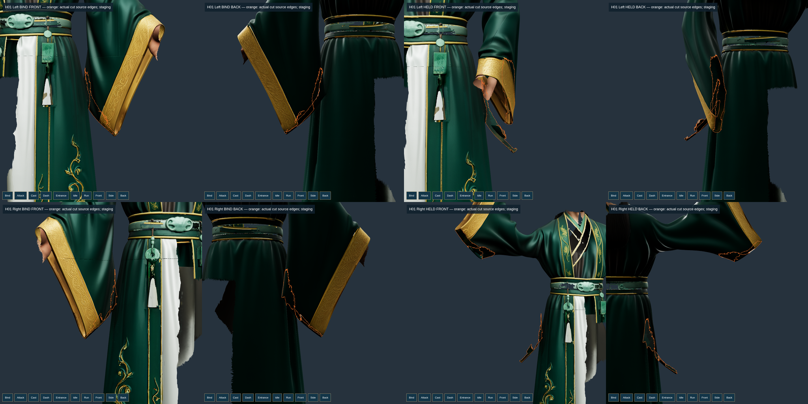

# Tách áo và kiểm định tiếp — 20/10/2026

**Chưa hoàn thành sáu phần và chưa thay rig trong game/APK.** Các file GLB thử nằm ở `.local/rig-candidates/`, không được đóng thêm vào bản game mặc định. Không giảm texture, pixelRatio hoặc thay ánh sáng sản xuất; không sửa GDD, ví/kho/vault/HMAC.

## Kết quả trên mesh Lâm Dật

| Bản thử, cùng tư thế nâng tay | Primitive đạt giới hạn kéo giãn | Kết luận |
| --- | ---: | --- |
| V7 trước tách liên kết | 3/8 | Còn dải kéo tay áo–eo |
| Tách 948 cạnh, giải FEM trên các nhóm đỉnh sau cắt | 6/8 | Thân áo, tay áo phải còn lỗi |
| Chỉnh trọng số theo pose, giữ bốn ID xương | 8/8 | Đạt kéo giãn ở một pose; đường cắt chưa duyệt |
| Khép mép bằng mặt vải mới, chọn đường chéo theo pose | 14/14 | Chưa đạt giao cắt và mỹ thuật; chưa kích hoạt |

Giới hạn vẫn là p99.9 ≤ 1,5 và maximum ≤ 2,0. Ở bản khép mép cuối, p99.9 lớn nhất **1,485014**, maximum **1,829409**. Không lấy kết quả một pose làm chứng nhận cả hoạt ảnh, tiết diện khớp hay thể tích. Xem [báo cáo 14 primitive](coat-closed-v3/held-all-mesh.json).

948 cạnh cắt được định danh từ mesh nguồn. Bộ biên dịch dùng union-find; kiểm độc lập dùng connected components trên graph thưa. Cả **4.499.178 góc tam giác** khớp, không mất/đảo mặt nguồn. Sau chỉnh trọng số, các đường may giữ kín đo **0 mm**; dung sai vẫn **0,001 mm**. Khoảng hở của đường nối cũ bị chủ động cắt vẫn được giữ trong báo cáo, không được gọi là seam cũ đạt.

Registry pattern tin cậy hiện rỗng. Chỉ thêm một boolean `approved` vào sidecar không thể vượt kiểm định. Test vẫn từ chối sai nguồn, sai cạnh, giả nhóm đỉnh, thiếu duyệt và khe hở 2 µm trên đường may phải kín.

Hai vạt giữ đủ **1.499.726 tam giác gốc**, UV/ảnh nguồn, skeleton 52 xương và clip cũ. Bản khép mép thêm **1.884 tam giác vải được khai báo là mặt mới**, không giả chúng là tam giác Tencent gốc và không tạo thân người ẩn. Kiểm độc lập đối chiếu từng vị trí/UV/trọng số với mép thực và xác nhận mọi nửa cạnh bị cắt được khép đúng một lần.

Ảnh Chromium/SwiftShader cloud, không phải điện thoại. Đường cam là overlay kiểm tra. Vẫn còn dải vải thừa và biên chưa tự nhiên; hình chưa được nghiệm thu.

## UV/PBR của mặt vải mới

Nội suy trực tiếp UV giữa các đảo atlas gây sọc. Đã thử lấy texture từ toàn model nhưng có nguy cơ lấy nhầm lớp phía sau. Lượt mới chỉ lấy từ **các mặt nguồn chạm đúng mép của cùng mảnh áo**, lưu hash lựa chọn. Chi tiết normal được chuyển sang hệ tiếp tuyến và pháp tuyến của mặt vải mới.

- Ba ảnh nguồn **4096 × 4096** và UV của tất cả mặt gốc giữ nguyên byte.
- Ba atlas mới cũng **4096 × 4096**, chỉ dành cho mặt khép mép; không thay texture gốc.
- Bake thực **7.211.952 texel**, **24,796 giây trên CPU cloud**, không chạy trong game.
- Ba PNG mới tổng **2.496.460 byte**; kích thước PNG không phải bộ nhớ GPU. Có thêm texture allocation nên chưa có kết luận hiệu năng Android.
- Manifest ảnh có `renderer.info` và kích thước texture thực. Một cảnh cô lập đo 9 calls, 767.897 triangles, 15 geometries, 8 textures tính cả tài nguyên môi trường; không phải số đo sảnh đầy đủ hay FPS điện thoại.

[Biên nhận bake và hash](coat-closed-pbr-v3/receipt.json). GLB staging cuối có SHA256 `c997bd0a7d97cd78a7a22e8b92283ab35eeadbbfabc10e51a70a4921b576c900`.

## Vì sao chưa đưa áo vào runtime

Đạt kéo giãn chưa đủ: [kiểm giao cắt](coat-closed-v3/closure-audit/audit.json) đếm **476 → 754** cặp mặt giao nhau sau khép mép. Đây là đếm giao cắt bề mặt, chưa đo độ sâu xuyên, khoảng cách lớp hay chứng nhận thể tích. Lượt làm ngắn đường cắt trong dải 25 mm thay 4.133 nhãn mặt, từ 948 xuống 479 cạnh, nhưng bản khép mép tương ứng tăng **475 → 785** cặp; cũng chưa được duyệt.

Đã lưu cả hai kết quả xấu. Không thêm seam exception, không bỏ các mặt lỗi, không chuyển trạng thái goal thành hoàn thành. Cần sửa biên/dải vải thừa, kiểm độ sâu xuyên, tiết diện và toàn bộ chuyển động trước khi tích hợp.

## Hàn Trạch: tiếp xúc và chuyển động

Thử trục ngón cái đo từ mặt phẳng lòng bàn tay và bảy vị trí nắm mới đều chưa đạt toàn bộ điều kiện ngón. Kết quả trong [h02-grip-retries](h02-grip-retries/), không thay chứng nhận palm-contact cũ sang pose mới.

Đã xác định chỗ chuyển giới hạn cổ tay chống đất từ 80° về 70° tạo bước nhảy gần 10°. Thử nhả cổ tay trước khi đứng và giới hạn vận tốc ngay trong phép giải, giữ chế độ thử mặc định tắt.

| Đo trên 452 frame FK H02 ở cloud | Trước, full-v6 | Thử velocity-v2 |
| --- | ---: | ---: |
| Frame vi phạm giới hạn khớp | 0 | 0 |
| Frame có chuỗi IK không đạt | 176 | 201 |
| Lệch tâm nắm sau grab lớn nhất | 505,464 mm | 140,962 mm |
| Sai số endpoint IK lớn nhất | 553,010 mm | 58,096 mm |

**Cả hai vẫn fail**, không coi số giảm là đã cầm đúng. Kiểm AnimationMixer độc lập của v2 còn **170 frame lỗi tiếp xúc mesh chân**, xuyên đế lớn nhất **16,299 mm**, lệch đế phẳng **57,930 mm**; yêu cầu vẫn 5 mm. Lượt v3 bỏ ép về một nhánh pose đứng khác còn bị controller từ chối vì `IDLE_HOLD loop is not closed: LeftArm.quaternion`; giữ log lỗi.

Ảnh cho thấy tư thế ngồi và quỹ đạo búa còn sai tham chiếu. Không gọi zero joint-limit violations là đúng giải phẫu/mỹ thuật.

## Sáu phần còn tiếp tục

1. Tách áo: đã có cắt thực, khép mép và PBR thử; còn biên/dải thừa/giao cắt.
2. Skin thân/vai/giày: pose nâng tay tiến bộ; chân chạm sàn, tiết diện và tư thế ngồi chưa đạt.
3. Tay/ngón/vũ khí: chưa đạt toàn bộ điều kiện và toàn chuỗi.
4. Entrance/IDLE_HOLD: đã có thử đủ thời lượng; chưa được nghiệm thu.
5. Runtime: giữ actor đang chạy, chưa kích hoạt rig bị chặn.
6. APK: chưa xuất APK rig mới; file 445 MB vẫn là artifact lịch sử. Không có điện thoại kết nối để kiểm tra Android thật.

Ảnh nguyên bản và thời gian: [picture/conver10/online-pic.md](../../../picture/conver10/online-pic.md). Kết quả kiểm thử hiện hành: [checks/latest-checks.json](checks/latest-checks.json).

## Kiểm thử cuối lượt

| Lệnh | Kết quả thật trên cloud |
| --- | --- |
| `npm test` | 284/284 pass, exit 0 |
| `npm run test:master` | 215/215 pass, exit 0 |
| `npm run verify:master` | BLOCKED 0/37, exit 1 |
| `npm run goal:rig` | BLOCKED, exit 1 |

Source fingerprint trước/sau kiểm thử không đổi: `ed8cf9984a68b5398b5a175f0fcf583bc30223d01670489367fc1957f4bdd9aa`. Log nguyên byte, mã thoát và SHA256 trong `checks/latest-checks.json`. Đã đối chiếu đủ 444 file ảnh của conver10 với Git blob; riêng 60 PNG áo mới được đối chiếu trực tiếp với bản sao gallery, không lệch byte. Ảnh H02 cũng đã đăng. Chưa chạy build/APK cho rig chưa đạt, không nhận bản 445 MB cũ là bản mới.
