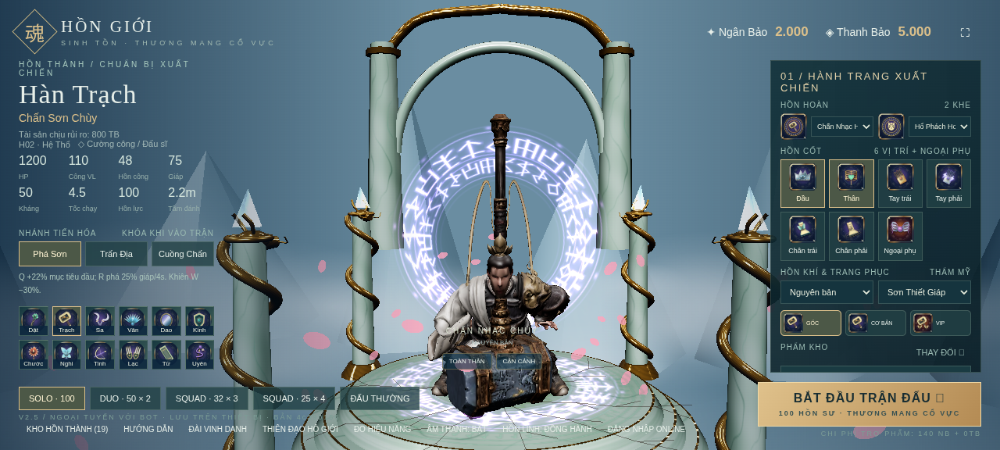

# Chuyển động theo báo cáo Gemini — 21/10/2026

Đây là **bản thử motion mới trên rig đang phát hành**, chưa phải thay thế rig toàn độ phân giải đã nghiệm thu. Các trọng số staging bị lỗi vẫn bị chặn. Nút **HOẠT ẢNH** ở sảnh giữ model có rig hiển thị qua cả idle; **MODEL GỐC** trở lại GLB Tencent nguyên bản tĩnh. Hai chế độ khác nhau về mesh: không dùng ảnh model tĩnh để chứng minh rig đã xong, cũng không gọi model hoạt ảnh legacy là model 1,5 triệu mặt.

[Hai tài liệu đã đọc, đầy đủ bảng và 14 ảnh](../../../requests/gemini-animation-2026-10-21/README.md). [Sổ ảnh conver10](../../../../picture/conver10/online-pic.md).

## Quyết định và thay đổi

- H01: intro 3 giây, khung tham chiếu 60 Hz; tăng chiều cao tư thế thấp cho phù hợp tỷ lệ thật, giải xương chân lại, chuyển thân sang phải 0,45 m và giơ tay phải theo hướng 35°. Vũ khí rời đi theo đường chuyển động tới tay phải, không đổi tay.
- H02: tay phải thả thấp, tay trái giữ chùy; chùy rơi trước, nhân vật xuất hiện sau và đứng lên. Chiều dài instance chùy 1,75 m, giữ nguyên hình học/PBR nguồn. Không chép bảng vị trí khiến tay dài/ngắn bất thường.
- Mỗi clip: 52 track quaternion + 1 track Hips; Entrance 181 mẫu, idle 241 mẫu. Idle 4 giây, blend 0,3 giây. Giới hạn vận tốc 8°/frame cho thân, 16°/frame cho ngón ở 60 Hz. Mixer/actions dùng lại qua replay/seek; dữ liệu nhị phân tải một lần khi cần, kiểm SHA-256, không nhét mảng JSON lớn vào bundle khởi động.
- Chỉ chuyển kênh motion từ ứng viên FK sang bind của rig đã phát hành. Không chuyển mesh, skin weights hoặc texture của ứng viên. Bản motion nguồn nhỏ nằm trong `data/hero-entrance/gemini-input`; build lại không cần các GLB tạm trong `.local`. `npm run assets:entrances:report` xuất hai binary dùng offline trong APK.
- Không sửa luật chơi, ví/kho/vault/HMAC, đường khôi phục trận, shader/PBR nguồn hoặc kích thước texture. [Hash nguồn không đổi](unchanged-assets.json).
- **Chưa sửa tay áo H01**, đúng thứ tự người dùng yêu cầu. Không dùng bản sửa áo thất bại để che lỗi.

## Kết quả và giới hạn

| Mục | Trước | Bản này |
|---|---|---|
| Runtime entrance H01 / H02 | 4,2 s / 5,6 s, IK cũ | 3,0 s / 3,0 s, FK đã bake trên rig legacy |
| H02 tay cầm trong intro | phải | trái, liên tục |
| Chiều dài chùy instance | 1,90 m | 1,75 m |
| Xem idle hoạt ảnh ở sảnh | bị model gốc tĩnh che | nút HOẠT ẢNH giữ model rig hiển thị |
| Dữ liệu motion thêm | không có | khoảng 747 KiB, tải cục bộ và cache |
| Runtime skin nguồn mới | chưa kích hoạt | vẫn chưa kích hoạt |
| `npm test` | 308 test | 313/313 qua |
| `test:master` | 215 test | 215/215 qua |
| Browser motion | chưa có | 12 trạng thái qua, 10 ảnh cloud |
| `verify:master` | blocked | 0/37, vẫn blocked |
| `goal:rig` | blocked | vẫn blocked |

Xem [motion-build.json](motion-build.json), [after-browser.json](after-browser.json), và biên nhận đóng gói đi kèm. Kiểm tra vòng idle, Entrance→Idle, replay và nhịp 60/120 Hz đã qua; đó là kiểm tra tính đúng của bộ phát, **không phải số FPS Android**.

Vẫn có lỗi chưa đạt: FK chân trước retarget có 11 mẫu H01 và 24 mẫu H02 trượt kiểm vị trí/hướng nghiêm ngặt; H02 sai số điểm chân tối đa khoảng 7,82 mm so với giới hạn 5 mm. Độ bám từng ngón trên bề mặt thật, tự xuyên/biến dạng vải và rig toàn độ phân giải chưa được nghiệm thu. Tư thế thấp retarget không khẳng định lòng bàn tay đã chống sàn đúng yêu cầu cũ. Không hạ ngưỡng hoặc đổi báo cáo blocked thành pass. Chưa có điện thoại thật để kiểm FPS, RAM, cảm ứng và phát hoạt ảnh trong WebView.

## Ảnh trong game (cloud)

H01 trước — tư thế bị hạ quá sâu:

Chụp: 2026-10-21T03:42:16.905Z

H01 sau — tư thế thấp và giữ trượng:

Chụp: 2026-10-21T04:01:22.583Z

Chụp: 2026-10-21T04:01:27.491Z

H02 trước và sau:

Chụp: 2026-10-21T03:42:33.971Z

Chụp: 2026-10-21T04:02:02.438Z

Ảnh PNG nguyên vẹn, không resize. Thời gian chụp trong các JSON browser; bản lưu kèm thời gian tại sổ ảnh conver10. Cloud dùng Chromium ANGLE SwiftShader, DPR 1; không suy ra chất lượng hoặc tốc độ trên điện thoại.

## Thử APK

Chọn Lâm Dật hoặc Hàn Trạch → **HOẠT ẢNH**. Bấm lại thẻ tướng để phát lại intro; dùng **TOÀN THÂN / CẬN CẢNH** để kiểm tay và vũ khí. **MODEL GỐC** dùng để đối chiếu nguyên bản tĩnh. Không coi bản thử này là hoàn tất mục tiêu rig 100%.

## APK đã đóng

- Bản `2.5.ba97bec3` / versionCode `214719383`.
- SHA-256 `52aeeea29c319b5f8b66224ed1c46ae74890254924de2cdcc8d2104ae92b4c7c`.
- 303180784 byte (303,18 MB), so với APK cũ 445.435.506 byte. Bớt bản sao rig-review không dùng; không giảm texture hay mesh gốc. Không suy ra FPS từ kích thước APK.
- [Biên nhận kiểm nội dung APK](apk-contents.json), [kiểm production đúng fingerprint của APK](production-browser.json), [log kiểm tra thật](checks/checks.json).
- Production cũng qua 12 trạng thái, không page/console error, không request ngoài host cục bộ. Lượt harness đầu chặn Service Worker nên chờ khởi động và timeout; đã sửa cấu hình harness cho web production và chạy lại. Không sửa cơ chế khởi động của game để ép pass.
