# Nhiệm vụ 1: Kiểm tra mỹ thuật và giao diện game

[Danh sách nhiệm vụ](../README.md)

Ảnh được giữ nguyên dữ liệu. Thời gian ảnh cũ là lúc lưu trên Git, không phải giờ chụp đã xác minh.

## Ảnh 1

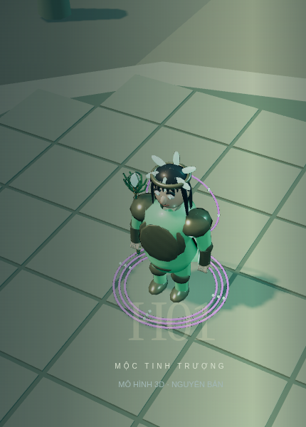

**Thời gian lưu trên Git: 2026-10-14 18:03:55 UTC+07:00**

Nguồn: `docs/visual-review/H01.png`

[Commit lưu ảnh](https://github.com/oree-nguyen/Tutien/commit/f487d06123aecf1c9cdceae533a627907ab581eb)

## Ảnh 2

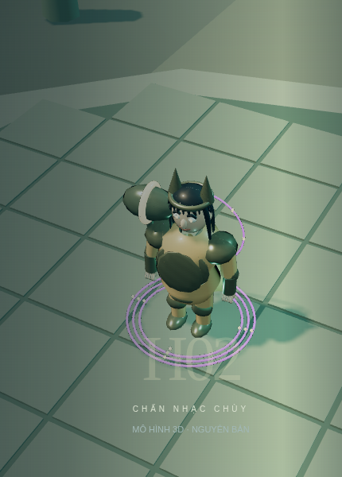

**Thời gian lưu trên Git: 2026-10-14 18:03:55 UTC+07:00**

Nguồn: `docs/visual-review/H02.png`

[Commit lưu ảnh](https://github.com/oree-nguyen/Tutien/commit/f487d06123aecf1c9cdceae533a627907ab581eb)

## Ảnh 3

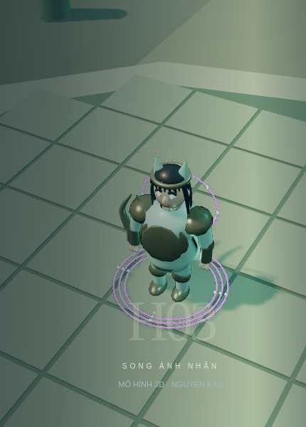

**Thời gian lưu trên Git: 2026-10-14 18:03:55 UTC+07:00**

Nguồn: `docs/visual-review/H03.png`

[Commit lưu ảnh](https://github.com/oree-nguyen/Tutien/commit/f487d06123aecf1c9cdceae533a627907ab581eb)

## Ảnh 4

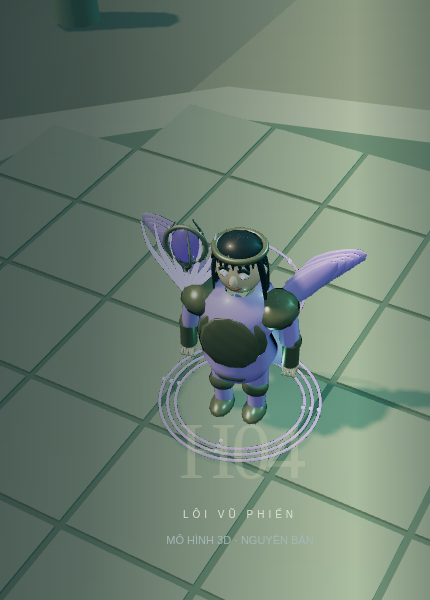

**Thời gian lưu trên Git: 2026-10-14 18:03:55 UTC+07:00**

Nguồn: `docs/visual-review/H04.png`

[Commit lưu ảnh](https://github.com/oree-nguyen/Tutien/commit/f487d06123aecf1c9cdceae533a627907ab581eb)

## Ảnh 5

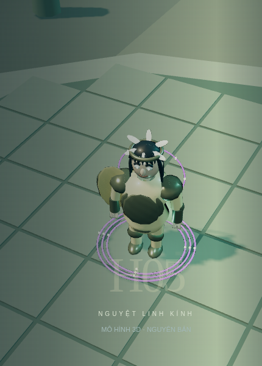

**Thời gian lưu trên Git: 2026-10-14 18:03:55 UTC+07:00**

Nguồn: `docs/visual-review/H05.png`

[Commit lưu ảnh](https://github.com/oree-nguyen/Tutien/commit/f487d06123aecf1c9cdceae533a627907ab581eb)

## Ảnh 6

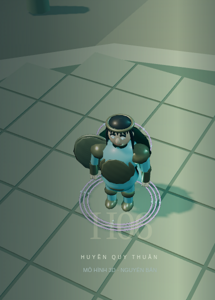

**Thời gian lưu trên Git: 2026-10-14 18:03:55 UTC+07:00**

Nguồn: `docs/visual-review/H06.png`

[Commit lưu ảnh](https://github.com/oree-nguyen/Tutien/commit/f487d06123aecf1c9cdceae533a627907ab581eb)

## Ảnh 7

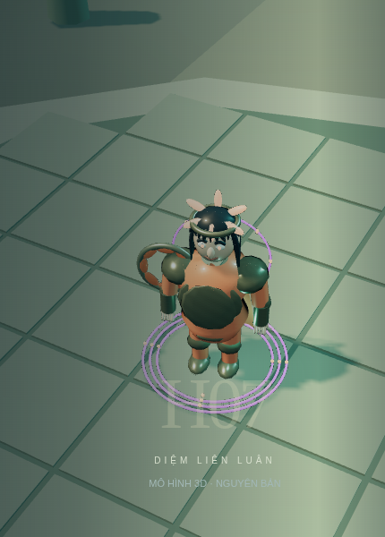

**Thời gian lưu trên Git: 2026-10-14 18:03:55 UTC+07:00**

Nguồn: `docs/visual-review/H07.png`

[Commit lưu ảnh](https://github.com/oree-nguyen/Tutien/commit/f487d06123aecf1c9cdceae533a627907ab581eb)

## Ảnh 8

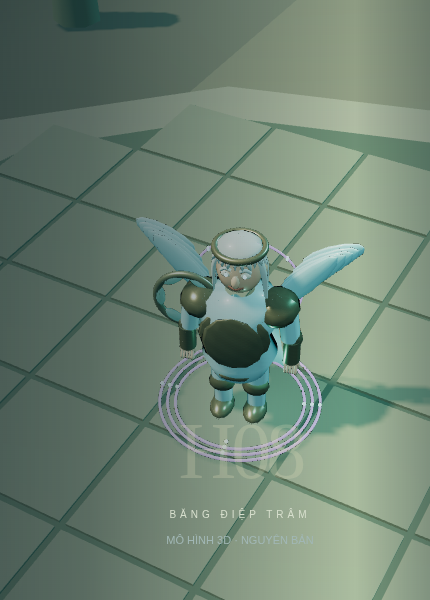

**Thời gian lưu trên Git: 2026-10-14 18:03:55 UTC+07:00**

Nguồn: `docs/visual-review/H08.png`

[Commit lưu ảnh](https://github.com/oree-nguyen/Tutien/commit/f487d06123aecf1c9cdceae533a627907ab581eb)

## Ảnh 9

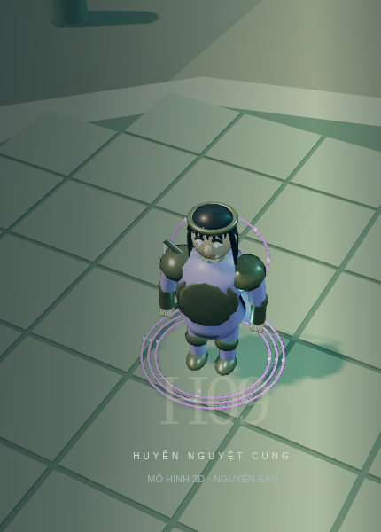

**Thời gian lưu trên Git: 2026-10-14 18:03:55 UTC+07:00**

Nguồn: `docs/visual-review/H09.png`

[Commit lưu ảnh](https://github.com/oree-nguyen/Tutien/commit/f487d06123aecf1c9cdceae533a627907ab581eb)

## Ảnh 10

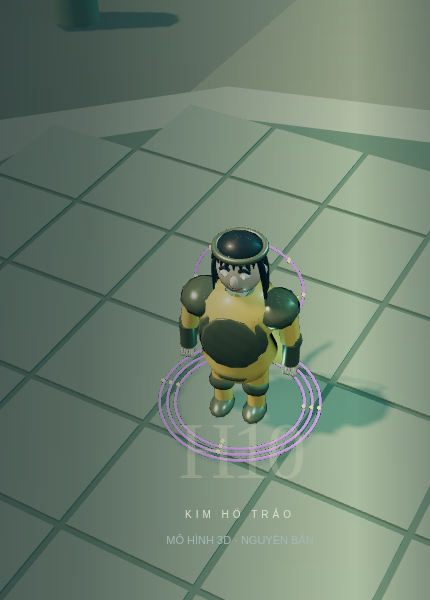

**Thời gian lưu trên Git: 2026-10-14 18:03:55 UTC+07:00**

Nguồn: `docs/visual-review/H10.png`

[Commit lưu ảnh](https://github.com/oree-nguyen/Tutien/commit/f487d06123aecf1c9cdceae533a627907ab581eb)

## Ảnh 11

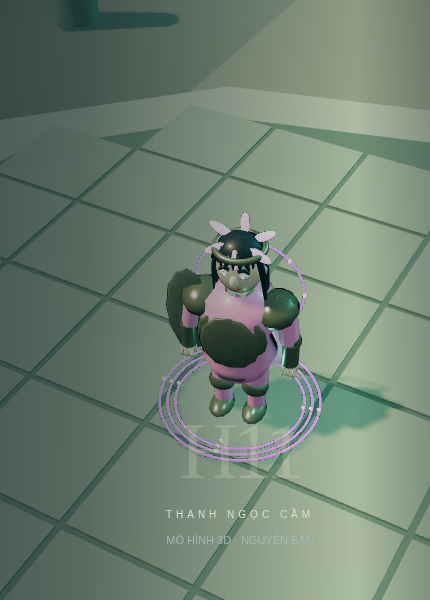

**Thời gian lưu trên Git: 2026-10-14 18:03:55 UTC+07:00**

Nguồn: `docs/visual-review/H11.png`

[Commit lưu ảnh](https://github.com/oree-nguyen/Tutien/commit/f487d06123aecf1c9cdceae533a627907ab581eb)

## Ảnh 12

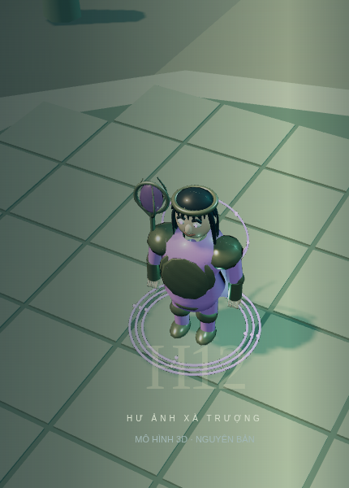

**Thời gian lưu trên Git: 2026-10-14 18:03:55 UTC+07:00**

Nguồn: `docs/visual-review/H12.png`

[Commit lưu ảnh](https://github.com/oree-nguyen/Tutien/commit/f487d06123aecf1c9cdceae533a627907ab581eb)

## Ảnh 13

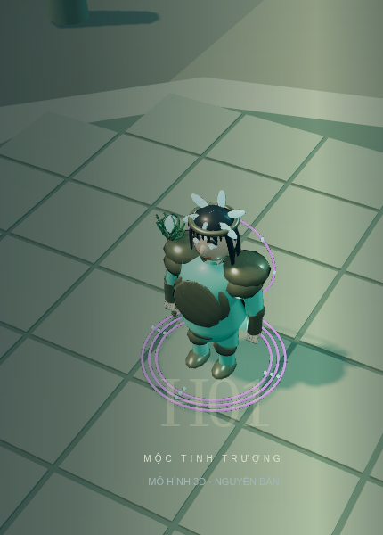

**Thời gian lưu trên Git: 2026-10-14 18:03:55 UTC+07:00**

Nguồn: `docs/visual-review/costume-1.png`

[Commit lưu ảnh](https://github.com/oree-nguyen/Tutien/commit/f487d06123aecf1c9cdceae533a627907ab581eb)

## Ảnh 14

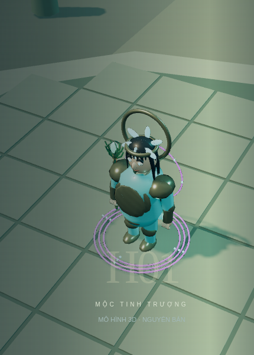

**Thời gian lưu trên Git: 2026-10-14 18:03:55 UTC+07:00**

Nguồn: `docs/visual-review/costume-2.png`

[Commit lưu ảnh](https://github.com/oree-nguyen/Tutien/commit/f487d06123aecf1c9cdceae533a627907ab581eb)

## Ảnh 15

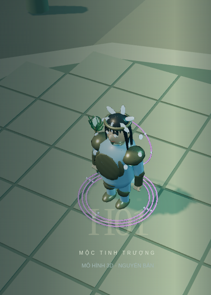

**Thời gian lưu trên Git: 2026-10-14 18:03:55 UTC+07:00**

Nguồn: `docs/visual-review/costume-3.png`

[Commit lưu ảnh](https://github.com/oree-nguyen/Tutien/commit/f487d06123aecf1c9cdceae533a627907ab581eb)

## Ảnh 16

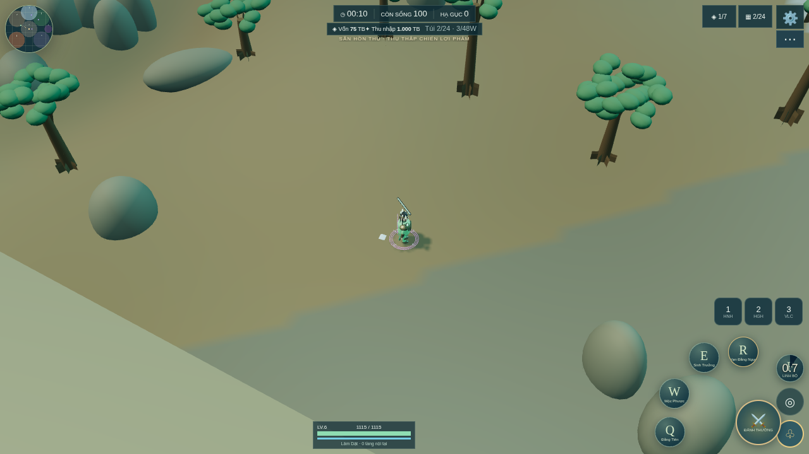

**Thời gian lưu trên Git: 2026-10-14 18:03:55 UTC+07:00**

Nguồn: `docs/visual-review/hud-1280.png`

[Commit lưu ảnh](https://github.com/oree-nguyen/Tutien/commit/f487d06123aecf1c9cdceae533a627907ab581eb)

## Ảnh 17

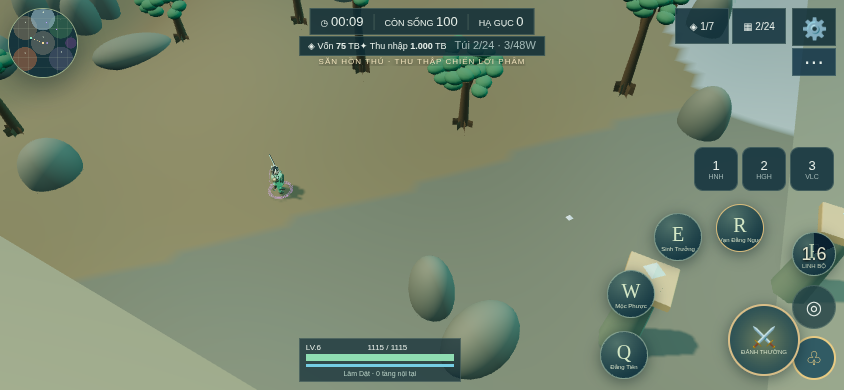

**Thời gian lưu trên Git: 2026-10-14 18:03:55 UTC+07:00**

Nguồn: `docs/visual-review/hud-844.png`

[Commit lưu ảnh](https://github.com/oree-nguyen/Tutien/commit/f487d06123aecf1c9cdceae533a627907ab581eb)

## Ảnh 18

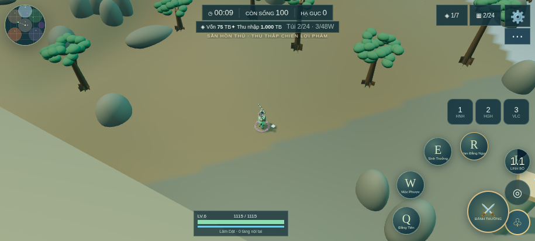

**Thời gian lưu trên Git: 2026-10-14 18:03:55 UTC+07:00**

Nguồn: `docs/visual-review/hud-915.png`

[Commit lưu ảnh](https://github.com/oree-nguyen/Tutien/commit/f487d06123aecf1c9cdceae533a627907ab581eb)

## Ảnh 19

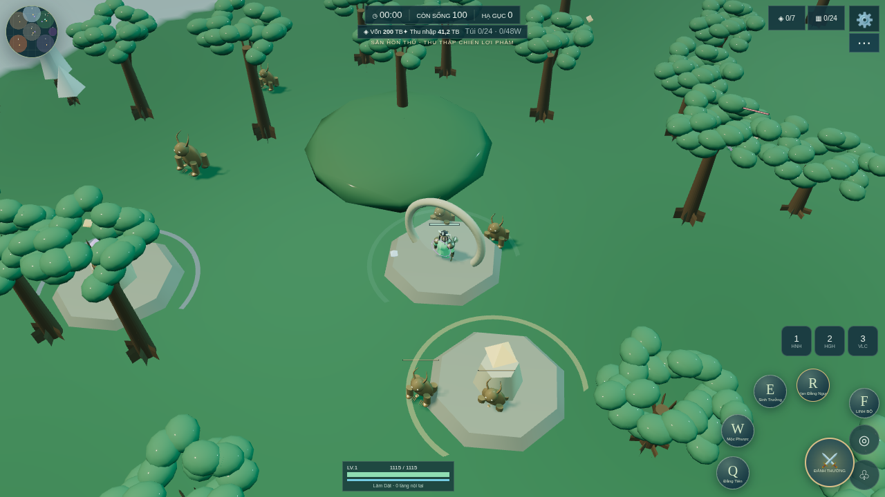

**Thời gian lưu trên Git: 2026-10-14 18:03:55 UTC+07:00**

Nguồn: `docs/visual-review/region-1.png`

[Commit lưu ảnh](https://github.com/oree-nguyen/Tutien/commit/f487d06123aecf1c9cdceae533a627907ab581eb)

## Ảnh 20

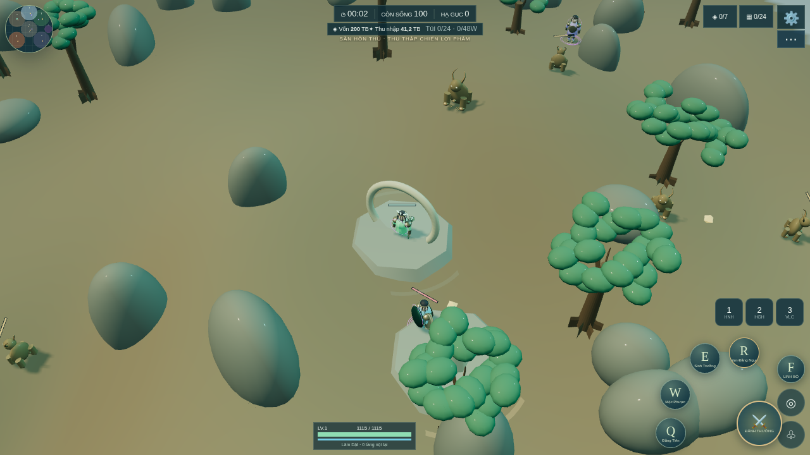

**Thời gian lưu trên Git: 2026-10-14 18:03:55 UTC+07:00**

Nguồn: `docs/visual-review/region-2.png`

[Commit lưu ảnh](https://github.com/oree-nguyen/Tutien/commit/f487d06123aecf1c9cdceae533a627907ab581eb)

## Ảnh 21

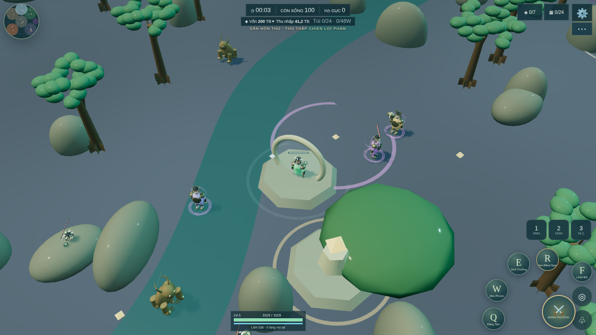

**Thời gian lưu trên Git: 2026-10-14 18:03:55 UTC+07:00**

Nguồn: `docs/visual-review/region-3.png`

[Commit lưu ảnh](https://github.com/oree-nguyen/Tutien/commit/f487d06123aecf1c9cdceae533a627907ab581eb)

## Ảnh 22

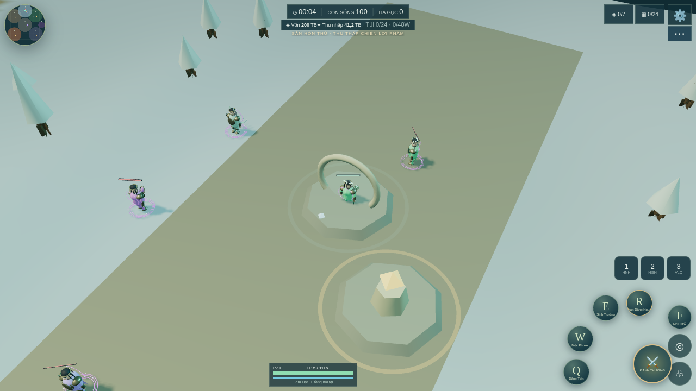

**Thời gian lưu trên Git: 2026-10-14 18:03:55 UTC+07:00**

Nguồn: `docs/visual-review/region-4.png`

[Commit lưu ảnh](https://github.com/oree-nguyen/Tutien/commit/f487d06123aecf1c9cdceae533a627907ab581eb)

## Ảnh 23

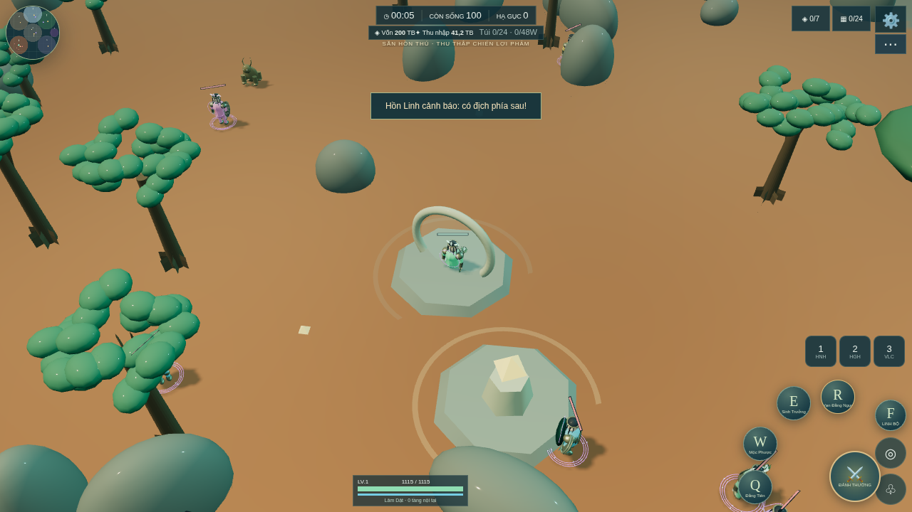

**Thời gian lưu trên Git: 2026-10-14 18:03:55 UTC+07:00**

Nguồn: `docs/visual-review/region-5.png`

[Commit lưu ảnh](https://github.com/oree-nguyen/Tutien/commit/f487d06123aecf1c9cdceae533a627907ab581eb)

## Ảnh 24

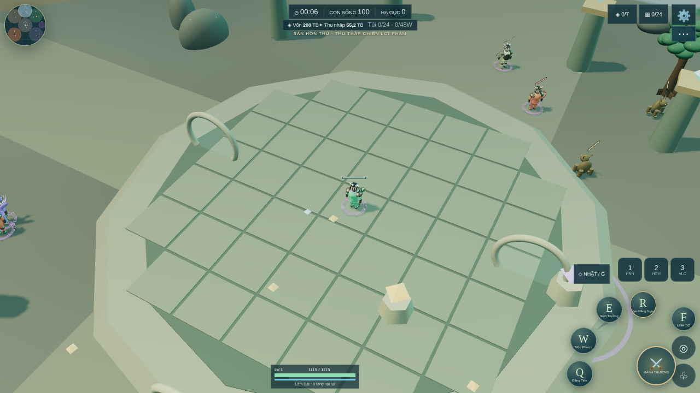

**Thời gian lưu trên Git: 2026-10-14 18:03:55 UTC+07:00**

Nguồn: `docs/visual-review/region-6.png`

[Commit lưu ảnh](https://github.com/oree-nguyen/Tutien/commit/f487d06123aecf1c9cdceae533a627907ab581eb)

## Ảnh 25

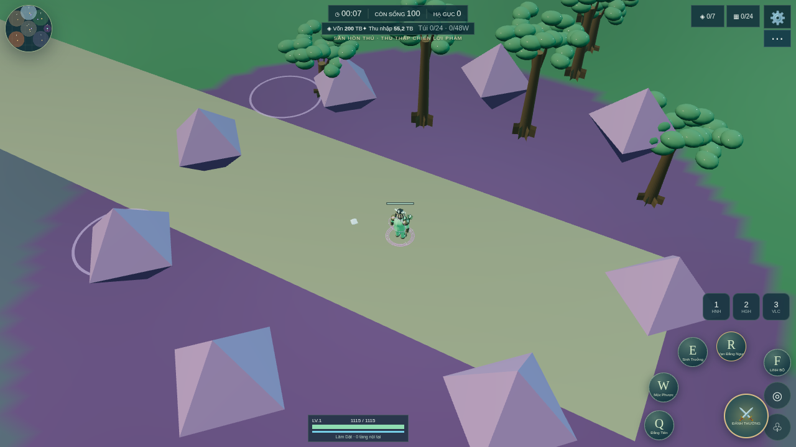

**Thời gian lưu trên Git: 2026-10-14 18:03:55 UTC+07:00**

Nguồn: `docs/visual-review/region-7.png`

[Commit lưu ảnh](https://github.com/oree-nguyen/Tutien/commit/f487d06123aecf1c9cdceae533a627907ab581eb)

## Ảnh 26

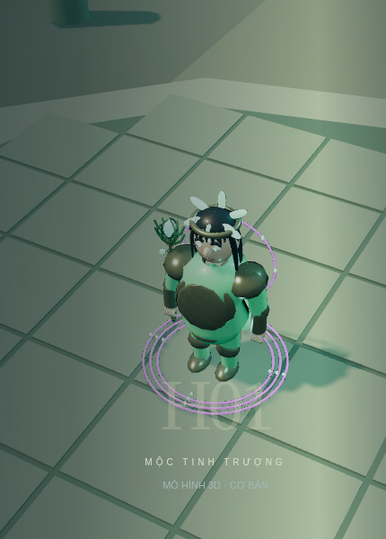

**Thời gian lưu trên Git: 2026-10-14 18:03:55 UTC+07:00**

Nguồn: `docs/visual-review/skin-1.png`

[Commit lưu ảnh](https://github.com/oree-nguyen/Tutien/commit/f487d06123aecf1c9cdceae533a627907ab581eb)

## Ảnh 27

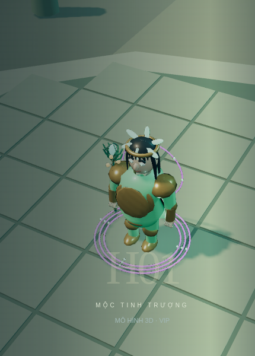

**Thời gian lưu trên Git: 2026-10-14 18:03:55 UTC+07:00**

Nguồn: `docs/visual-review/skin-2.png`

[Commit lưu ảnh](https://github.com/oree-nguyen/Tutien/commit/f487d06123aecf1c9cdceae533a627907ab581eb)

## Ảnh 28

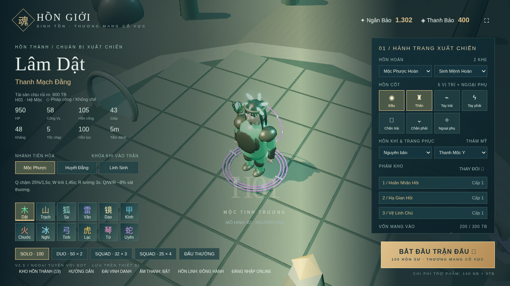

**Thời gian lưu trên Git: 2026-10-14 18:03:55 UTC+07:00**

Nguồn: `docs/visual-review/ultra.png`

[Commit lưu ảnh](https://github.com/oree-nguyen/Tutien/commit/f487d06123aecf1c9cdceae533a627907ab581eb)

## Ảnh 29

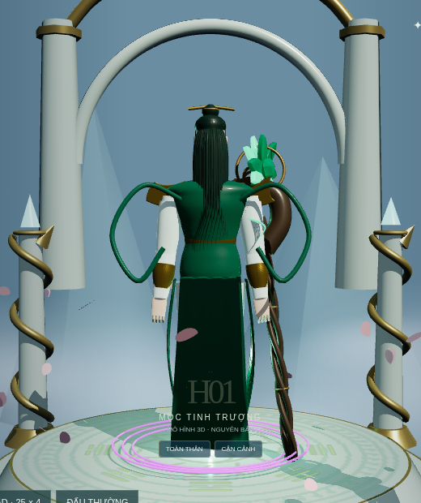

**Thời gian lưu trên Git: 2026-10-15 06:48:23 UTC+07:00**

Nguồn: `docs/visual-review/H01-back.png`

[Commit lưu ảnh](https://github.com/oree-nguyen/Tutien/commit/7f4a2e624b9367cf6a4dc8a37a1028eaa653c4a2)

## Ảnh 30

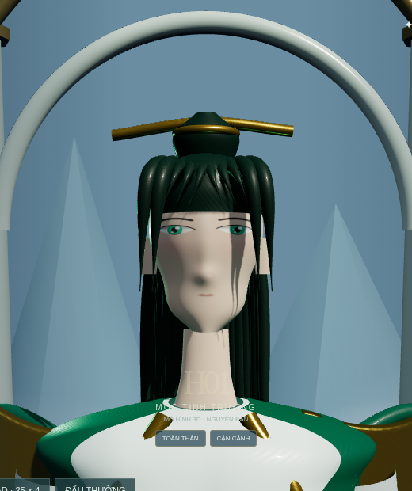

**Thời gian lưu trên Git: 2026-10-15 06:48:23 UTC+07:00**

Nguồn: `docs/visual-review/H01-face.png`

[Commit lưu ảnh](https://github.com/oree-nguyen/Tutien/commit/7f4a2e624b9367cf6a4dc8a37a1028eaa653c4a2)

## Ảnh 31

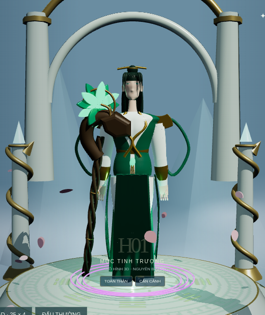

**Thời gian lưu trên Git: 2026-10-15 06:48:23 UTC+07:00**

Nguồn: `docs/visual-review/H01.png`

[Commit lưu ảnh](https://github.com/oree-nguyen/Tutien/commit/7f4a2e624b9367cf6a4dc8a37a1028eaa653c4a2)

## Ảnh 32

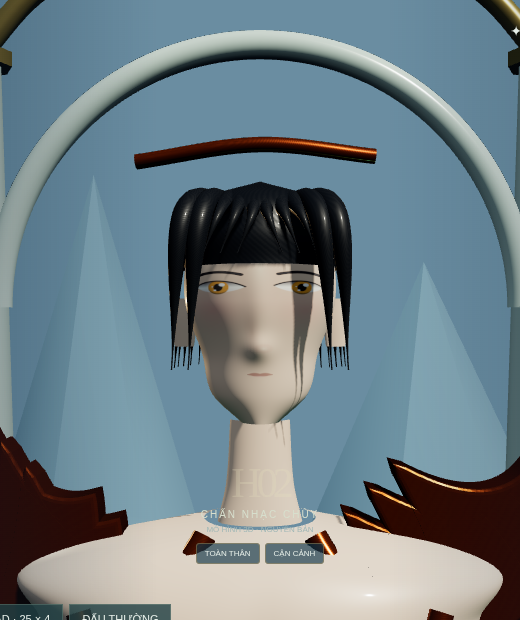

**Thời gian lưu trên Git: 2026-10-15 06:48:23 UTC+07:00**

Nguồn: `docs/visual-review/H02-face.png`

[Commit lưu ảnh](https://github.com/oree-nguyen/Tutien/commit/7f4a2e624b9367cf6a4dc8a37a1028eaa653c4a2)

## Ảnh 33

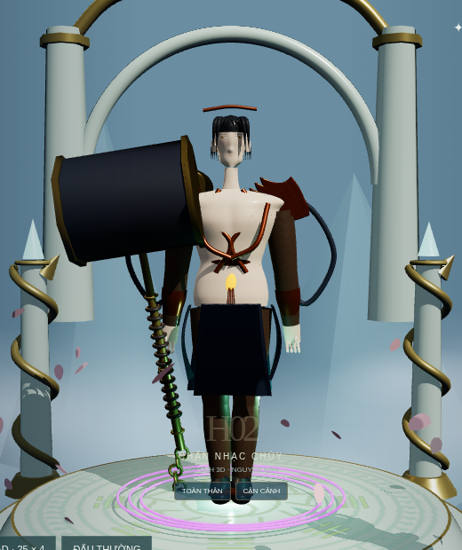

**Thời gian lưu trên Git: 2026-10-15 06:48:23 UTC+07:00**

Nguồn: `docs/visual-review/H02.png`

[Commit lưu ảnh](https://github.com/oree-nguyen/Tutien/commit/7f4a2e624b9367cf6a4dc8a37a1028eaa653c4a2)

## Ảnh 34

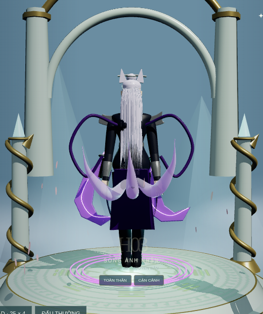

**Thời gian lưu trên Git: 2026-10-15 06:48:23 UTC+07:00**

Nguồn: `docs/visual-review/H03-back.png`

[Commit lưu ảnh](https://github.com/oree-nguyen/Tutien/commit/7f4a2e624b9367cf6a4dc8a37a1028eaa653c4a2)

## Ảnh 35

**Thời gian lưu trên Git: 2026-10-15 06:48:23 UTC+07:00**

Nguồn: `docs/visual-review/H03-face.png`

[Commit lưu ảnh](https://github.com/oree-nguyen/Tutien/commit/7f4a2e624b9367cf6a4dc8a37a1028eaa653c4a2)

## Ảnh 36

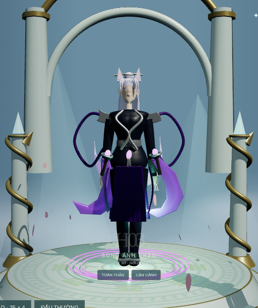

**Thời gian lưu trên Git: 2026-10-15 06:48:23 UTC+07:00**

Nguồn: `docs/visual-review/H03.png`

[Commit lưu ảnh](https://github.com/oree-nguyen/Tutien/commit/7f4a2e624b9367cf6a4dc8a37a1028eaa653c4a2)

## Ảnh 37

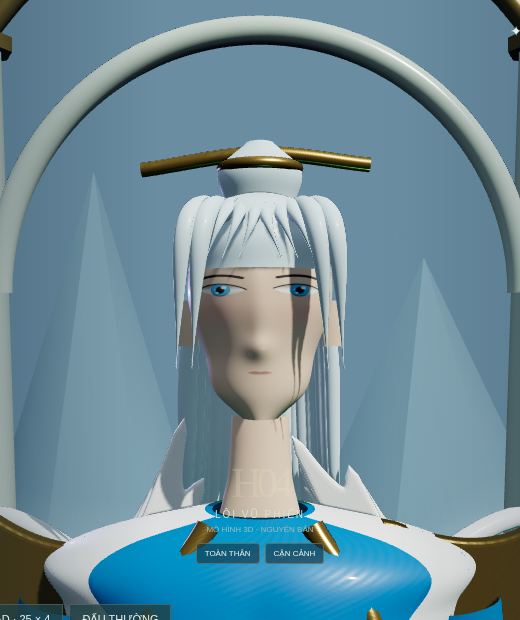

**Thời gian lưu trên Git: 2026-10-15 06:48:23 UTC+07:00**

Nguồn: `docs/visual-review/H04-face.png`

[Commit lưu ảnh](https://github.com/oree-nguyen/Tutien/commit/7f4a2e624b9367cf6a4dc8a37a1028eaa653c4a2)

## Ảnh 38

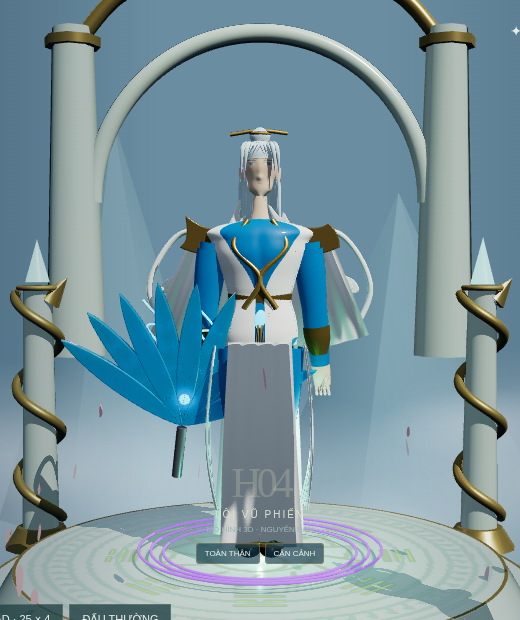

**Thời gian lưu trên Git: 2026-10-15 06:48:23 UTC+07:00**

Nguồn: `docs/visual-review/H04.png`

[Commit lưu ảnh](https://github.com/oree-nguyen/Tutien/commit/7f4a2e624b9367cf6a4dc8a37a1028eaa653c4a2)

## Ảnh 39

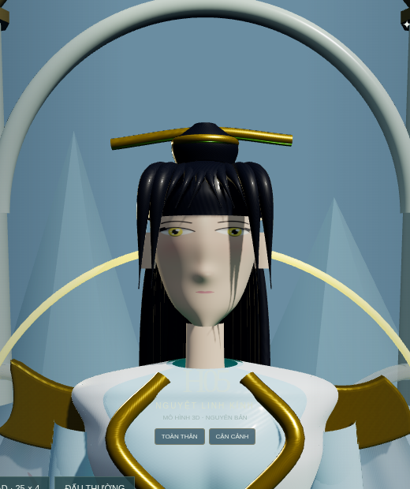

**Thời gian lưu trên Git: 2026-10-15 06:48:23 UTC+07:00**

Nguồn: `docs/visual-review/H05-face.png`

[Commit lưu ảnh](https://github.com/oree-nguyen/Tutien/commit/7f4a2e624b9367cf6a4dc8a37a1028eaa653c4a2)

## Ảnh 40

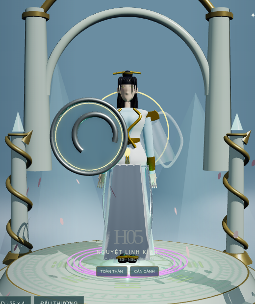

**Thời gian lưu trên Git: 2026-10-15 06:48:23 UTC+07:00**

Nguồn: `docs/visual-review/H05.png`

[Commit lưu ảnh](https://github.com/oree-nguyen/Tutien/commit/7f4a2e624b9367cf6a4dc8a37a1028eaa653c4a2)

## Ảnh 41

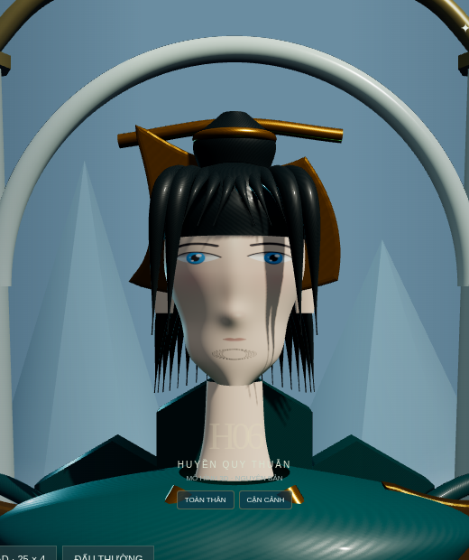

**Thời gian lưu trên Git: 2026-10-15 06:48:23 UTC+07:00**

Nguồn: `docs/visual-review/H06-face.png`

[Commit lưu ảnh](https://github.com/oree-nguyen/Tutien/commit/7f4a2e624b9367cf6a4dc8a37a1028eaa653c4a2)

## Ảnh 42

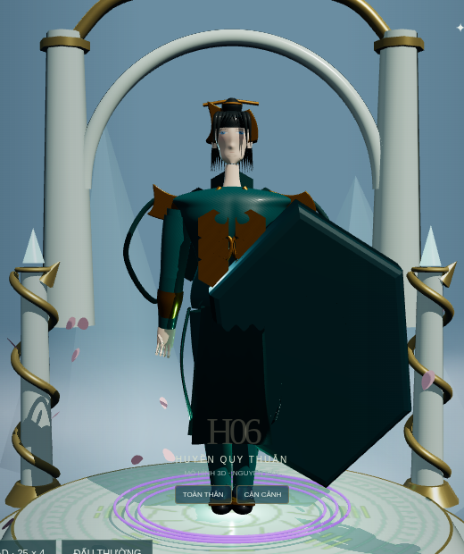

**Thời gian lưu trên Git: 2026-10-15 06:48:23 UTC+07:00**

Nguồn: `docs/visual-review/H06.png`

[Commit lưu ảnh](https://github.com/oree-nguyen/Tutien/commit/7f4a2e624b9367cf6a4dc8a37a1028eaa653c4a2)

## Ảnh 43

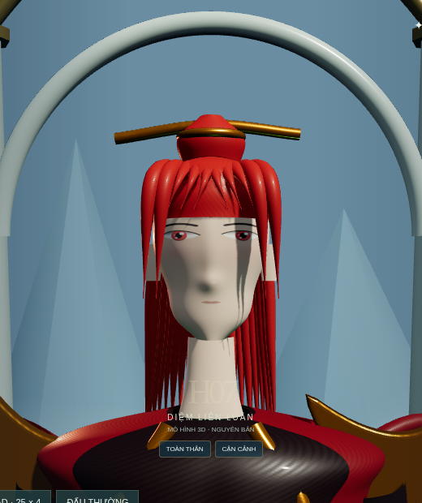

**Thời gian lưu trên Git: 2026-10-15 06:48:23 UTC+07:00**

Nguồn: `docs/visual-review/H07-face.png`

[Commit lưu ảnh](https://github.com/oree-nguyen/Tutien/commit/7f4a2e624b9367cf6a4dc8a37a1028eaa653c4a2)

## Ảnh 44

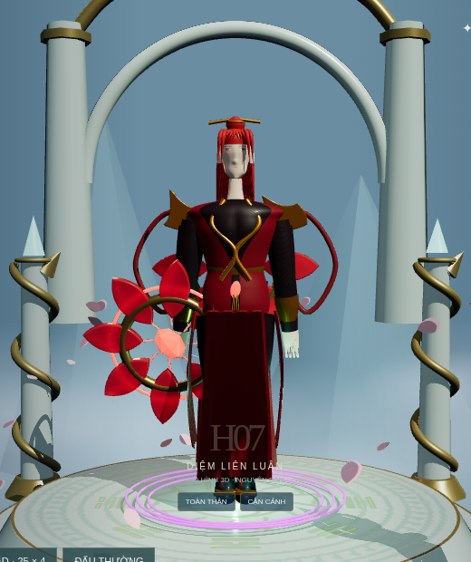

**Thời gian lưu trên Git: 2026-10-15 06:48:23 UTC+07:00**

Nguồn: `docs/visual-review/H07.png`

[Commit lưu ảnh](https://github.com/oree-nguyen/Tutien/commit/7f4a2e624b9367cf6a4dc8a37a1028eaa653c4a2)

## Ảnh 45

**Thời gian lưu trên Git: 2026-10-15 06:48:23 UTC+07:00**

Nguồn: `docs/visual-review/H08-face.png`

[Commit lưu ảnh](https://github.com/oree-nguyen/Tutien/commit/7f4a2e624b9367cf6a4dc8a37a1028eaa653c4a2)

## Ảnh 46

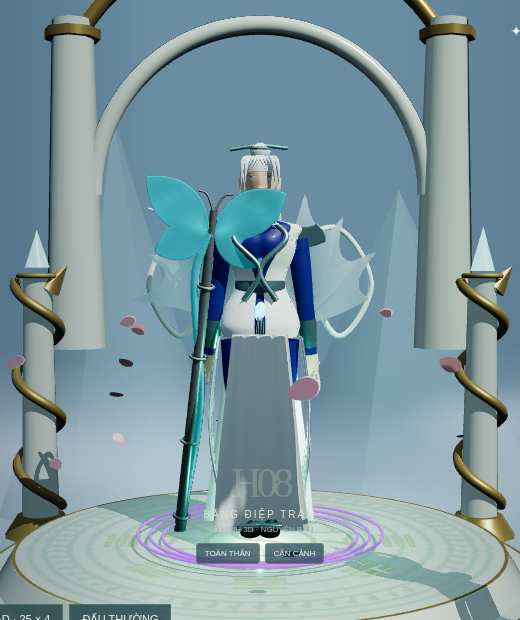

**Thời gian lưu trên Git: 2026-10-15 06:48:23 UTC+07:00**

Nguồn: `docs/visual-review/H08.png`

[Commit lưu ảnh](https://github.com/oree-nguyen/Tutien/commit/7f4a2e624b9367cf6a4dc8a37a1028eaa653c4a2)

## Ảnh 47

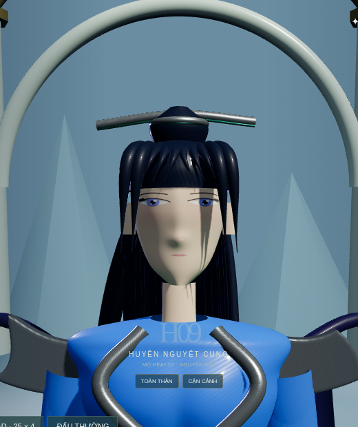

**Thời gian lưu trên Git: 2026-10-15 06:48:23 UTC+07:00**

Nguồn: `docs/visual-review/H09-face.png`

[Commit lưu ảnh](https://github.com/oree-nguyen/Tutien/commit/7f4a2e624b9367cf6a4dc8a37a1028eaa653c4a2)

## Ảnh 48

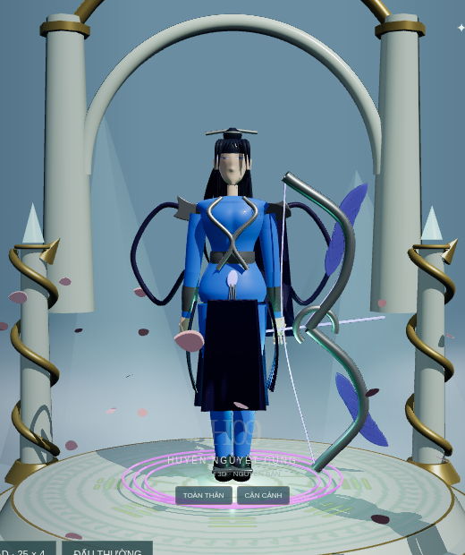

**Thời gian lưu trên Git: 2026-10-15 06:48:23 UTC+07:00**

Nguồn: `docs/visual-review/H09.png`

[Commit lưu ảnh](https://github.com/oree-nguyen/Tutien/commit/7f4a2e624b9367cf6a4dc8a37a1028eaa653c4a2)

## Ảnh 49

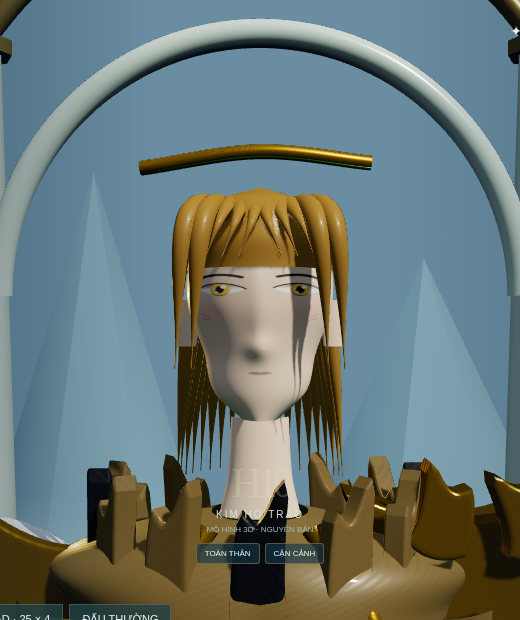

**Thời gian lưu trên Git: 2026-10-15 06:48:23 UTC+07:00**

Nguồn: `docs/visual-review/H10-face.png`

[Commit lưu ảnh](https://github.com/oree-nguyen/Tutien/commit/7f4a2e624b9367cf6a4dc8a37a1028eaa653c4a2)

## Ảnh 50

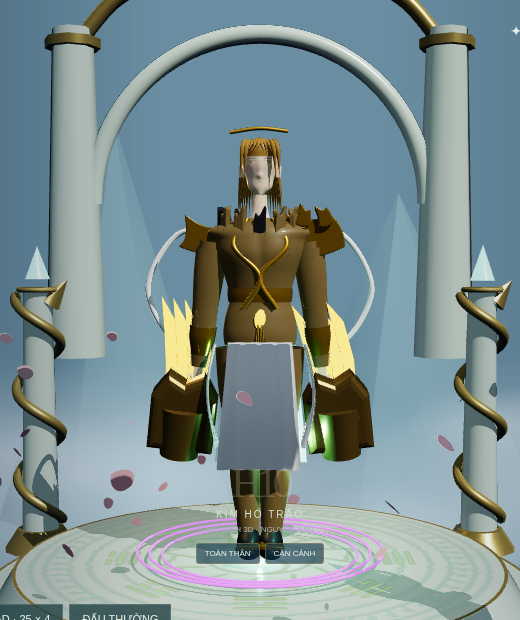

**Thời gian lưu trên Git: 2026-10-15 06:48:23 UTC+07:00**

Nguồn: `docs/visual-review/H10.png`

[Commit lưu ảnh](https://github.com/oree-nguyen/Tutien/commit/7f4a2e624b9367cf6a4dc8a37a1028eaa653c4a2)

## Ảnh 51

**Thời gian lưu trên Git: 2026-10-15 06:48:23 UTC+07:00**

Nguồn: `docs/visual-review/H11-face.png`

[Commit lưu ảnh](https://github.com/oree-nguyen/Tutien/commit/7f4a2e624b9367cf6a4dc8a37a1028eaa653c4a2)

## Ảnh 52

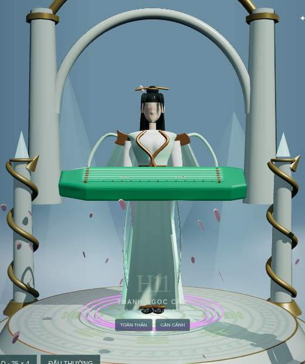

**Thời gian lưu trên Git: 2026-10-15 06:48:23 UTC+07:00**

Nguồn: `docs/visual-review/H11.png`

[Commit lưu ảnh](https://github.com/oree-nguyen/Tutien/commit/7f4a2e624b9367cf6a4dc8a37a1028eaa653c4a2)

## Ảnh 53

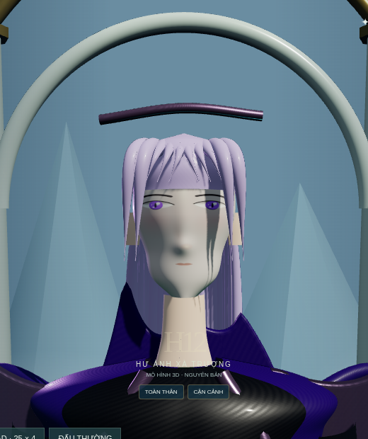

**Thời gian lưu trên Git: 2026-10-15 06:48:23 UTC+07:00**

Nguồn: `docs/visual-review/H12-face.png`

[Commit lưu ảnh](https://github.com/oree-nguyen/Tutien/commit/7f4a2e624b9367cf6a4dc8a37a1028eaa653c4a2)

## Ảnh 54

**Thời gian lưu trên Git: 2026-10-15 06:48:23 UTC+07:00**

Nguồn: `docs/visual-review/H12.png`

[Commit lưu ảnh](https://github.com/oree-nguyen/Tutien/commit/7f4a2e624b9367cf6a4dc8a37a1028eaa653c4a2)

## Ảnh 55

**Thời gian lưu trên Git: 2026-10-15 06:48:23 UTC+07:00**

Nguồn: `docs/visual-review/costume-1.png`

[Commit lưu ảnh](https://github.com/oree-nguyen/Tutien/commit/7f4a2e624b9367cf6a4dc8a37a1028eaa653c4a2)

## Ảnh 56

**Thời gian lưu trên Git: 2026-10-15 06:48:23 UTC+07:00**

Nguồn: `docs/visual-review/costume-2.png`

[Commit lưu ảnh](https://github.com/oree-nguyen/Tutien/commit/7f4a2e624b9367cf6a4dc8a37a1028eaa653c4a2)

## Ảnh 57

**Thời gian lưu trên Git: 2026-10-15 06:48:23 UTC+07:00**

Nguồn: `docs/visual-review/costume-3.png`

[Commit lưu ảnh](https://github.com/oree-nguyen/Tutien/commit/7f4a2e624b9367cf6a4dc8a37a1028eaa653c4a2)

## Ảnh 58

**Thời gian lưu trên Git: 2026-10-15 06:48:23 UTC+07:00**

Nguồn: `docs/visual-review/creature-ape.png`

[Commit lưu ảnh](https://github.com/oree-nguyen/Tutien/commit/7f4a2e624b9367cf6a4dc8a37a1028eaa653c4a2)

## Ảnh 59

**Thời gian lưu trên Git: 2026-10-15 06:48:23 UTC+07:00**

Nguồn: `docs/visual-review/creature-dragon.png`

[Commit lưu ảnh](https://github.com/oree-nguyen/Tutien/commit/7f4a2e624b9367cf6a4dc8a37a1028eaa653c4a2)

## Ảnh 60

**Thời gian lưu trên Git: 2026-10-15 06:48:23 UTC+07:00**

Nguồn: `docs/visual-review/creature-firebird.png`

[Commit lưu ảnh](https://github.com/oree-nguyen/Tutien/commit/7f4a2e624b9367cf6a4dc8a37a1028eaa653c4a2)

## Ảnh 61

**Thời gian lưu trên Git: 2026-10-15 06:48:23 UTC+07:00**

Nguồn: `docs/visual-review/creature-icebutterfly.png`

[Commit lưu ảnh](https://github.com/oree-nguyen/Tutien/commit/7f4a2e624b9367cf6a4dc8a37a1028eaa653c4a2)

## Ảnh 62

**Thời gian lưu trên Git: 2026-10-15 06:48:23 UTC+07:00**

Nguồn: `docs/visual-review/creature-kirin.png`

[Commit lưu ảnh](https://github.com/oree-nguyen/Tutien/commit/7f4a2e624b9367cf6a4dc8a37a1028eaa653c4a2)

## Ảnh 63

**Thời gian lưu trên Git: 2026-10-15 06:48:23 UTC+07:00**

Nguồn: `docs/visual-review/creature-rhino.png`

[Commit lưu ảnh](https://github.com/oree-nguyen/Tutien/commit/7f4a2e624b9367cf6a4dc8a37a1028eaa653c4a2)

## Ảnh 64

**Thời gian lưu trên Git: 2026-10-15 06:48:23 UTC+07:00**

Nguồn: `docs/visual-review/creature-wolf.png`

[Commit lưu ảnh](https://github.com/oree-nguyen/Tutien/commit/7f4a2e624b9367cf6a4dc8a37a1028eaa653c4a2)

## Ảnh 65

**Thời gian lưu trên Git: 2026-10-15 06:48:23 UTC+07:00**

Nguồn: `docs/visual-review/hud-1280.png`

[Commit lưu ảnh](https://github.com/oree-nguyen/Tutien/commit/7f4a2e624b9367cf6a4dc8a37a1028eaa653c4a2)

## Ảnh 66

**Thời gian lưu trên Git: 2026-10-15 06:48:23 UTC+07:00**

Nguồn: `docs/visual-review/hud-844.png`

[Commit lưu ảnh](https://github.com/oree-nguyen/Tutien/commit/7f4a2e624b9367cf6a4dc8a37a1028eaa653c4a2)

## Ảnh 67

**Thời gian lưu trên Git: 2026-10-15 06:48:23 UTC+07:00**

Nguồn: `docs/visual-review/hud-915.png`

[Commit lưu ảnh](https://github.com/oree-nguyen/Tutien/commit/7f4a2e624b9367cf6a4dc8a37a1028eaa653c4a2)

## Ảnh 68

**Thời gian lưu trên Git: 2026-10-15 06:48:23 UTC+07:00**

Nguồn: `docs/visual-review/hud-master.png`

[Commit lưu ảnh](https://github.com/oree-nguyen/Tutien/commit/7f4a2e624b9367cf6a4dc8a37a1028eaa653c4a2)

## Ảnh 69

**Thời gian lưu trên Git: 2026-10-15 06:48:23 UTC+07:00**

Nguồn: `docs/visual-review/icons-149.png`

[Commit lưu ảnh](https://github.com/oree-nguyen/Tutien/commit/7f4a2e624b9367cf6a4dc8a37a1028eaa653c4a2)

## Ảnh 70

**Thời gian lưu trên Git: 2026-10-15 06:48:23 UTC+07:00**

Nguồn: `docs/visual-review/loot-appraisal.png`

[Commit lưu ảnh](https://github.com/oree-nguyen/Tutien/commit/7f4a2e624b9367cf6a4dc8a37a1028eaa653c4a2)

## Ảnh 71

**Thời gian lưu trên Git: 2026-10-15 06:48:23 UTC+07:00**

Nguồn: `docs/visual-review/region-1.png`

[Commit lưu ảnh](https://github.com/oree-nguyen/Tutien/commit/7f4a2e624b9367cf6a4dc8a37a1028eaa653c4a2)

## Ảnh 72

**Thời gian lưu trên Git: 2026-10-15 06:48:23 UTC+07:00**

Nguồn: `docs/visual-review/region-2.png`

[Commit lưu ảnh](https://github.com/oree-nguyen/Tutien/commit/7f4a2e624b9367cf6a4dc8a37a1028eaa653c4a2)

## Ảnh 73

**Thời gian lưu trên Git: 2026-10-15 06:48:23 UTC+07:00**

Nguồn: `docs/visual-review/region-3.png`

[Commit lưu ảnh](https://github.com/oree-nguyen/Tutien/commit/7f4a2e624b9367cf6a4dc8a37a1028eaa653c4a2)

## Ảnh 74

**Thời gian lưu trên Git: 2026-10-15 06:48:23 UTC+07:00**

Nguồn: `docs/visual-review/region-4.png`

[Commit lưu ảnh](https://github.com/oree-nguyen/Tutien/commit/7f4a2e624b9367cf6a4dc8a37a1028eaa653c4a2)

## Ảnh 75

**Thời gian lưu trên Git: 2026-10-15 06:48:23 UTC+07:00**

Nguồn: `docs/visual-review/region-5.png`

[Commit lưu ảnh](https://github.com/oree-nguyen/Tutien/commit/7f4a2e624b9367cf6a4dc8a37a1028eaa653c4a2)

## Ảnh 76

**Thời gian lưu trên Git: 2026-10-15 06:48:23 UTC+07:00**

Nguồn: `docs/visual-review/region-6.png`

[Commit lưu ảnh](https://github.com/oree-nguyen/Tutien/commit/7f4a2e624b9367cf6a4dc8a37a1028eaa653c4a2)

## Ảnh 77

**Thời gian lưu trên Git: 2026-10-15 06:48:23 UTC+07:00**

Nguồn: `docs/visual-review/region-7.png`

[Commit lưu ảnh](https://github.com/oree-nguyen/Tutien/commit/7f4a2e624b9367cf6a4dc8a37a1028eaa653c4a2)

## Ảnh 78

**Thời gian lưu trên Git: 2026-10-15 06:48:23 UTC+07:00**

Nguồn: `docs/visual-review/skin-1.png`

[Commit lưu ảnh](https://github.com/oree-nguyen/Tutien/commit/7f4a2e624b9367cf6a4dc8a37a1028eaa653c4a2)

## Ảnh 79

**Thời gian lưu trên Git: 2026-10-15 06:48:23 UTC+07:00**

Nguồn: `docs/visual-review/skin-2.png`

[Commit lưu ảnh](https://github.com/oree-nguyen/Tutien/commit/7f4a2e624b9367cf6a4dc8a37a1028eaa653c4a2)

## Ảnh 80

**Thời gian lưu trên Git: 2026-10-15 06:48:23 UTC+07:00**

Nguồn: `docs/visual-review/ultra.png`

[Commit lưu ảnh](https://github.com/oree-nguyen/Tutien/commit/7f4a2e624b9367cf6a4dc8a37a1028eaa653c4a2)

## Ảnh 81

**Thời gian lưu trên Git: 2026-10-15 23:58:39 UTC+07:00**

Nguồn: `docs/visual-review/H01-back.png`

[Commit lưu ảnh](https://github.com/oree-nguyen/Tutien/commit/a94717b997048cbeb120d2b8a9ec60ef74c01825)

## Ảnh 82

**Thời gian lưu trên Git: 2026-10-15 23:58:39 UTC+07:00**

Nguồn: `docs/visual-review/H01-face.png`

[Commit lưu ảnh](https://github.com/oree-nguyen/Tutien/commit/a94717b997048cbeb120d2b8a9ec60ef74c01825)

## Ảnh 83

**Thời gian lưu trên Git: 2026-10-15 23:58:39 UTC+07:00**

Nguồn: `docs/visual-review/H01.png`

[Commit lưu ảnh](https://github.com/oree-nguyen/Tutien/commit/a94717b997048cbeb120d2b8a9ec60ef74c01825)

## Ảnh 84

**Thời gian lưu trên Git: 2026-10-15 23:58:39 UTC+07:00**

Nguồn: `docs/visual-review/H02-face.png`

[Commit lưu ảnh](https://github.com/oree-nguyen/Tutien/commit/a94717b997048cbeb120d2b8a9ec60ef74c01825)

## Ảnh 85

**Thời gian lưu trên Git: 2026-10-15 23:58:39 UTC+07:00**

Nguồn: `docs/visual-review/H02.png`

[Commit lưu ảnh](https://github.com/oree-nguyen/Tutien/commit/a94717b997048cbeb120d2b8a9ec60ef74c01825)

## Ảnh 86

**Thời gian lưu trên Git: 2026-10-15 23:58:39 UTC+07:00**

Nguồn: `docs/visual-review/H03-back.png`

[Commit lưu ảnh](https://github.com/oree-nguyen/Tutien/commit/a94717b997048cbeb120d2b8a9ec60ef74c01825)

## Ảnh 87

**Thời gian lưu trên Git: 2026-10-15 23:58:39 UTC+07:00**

Nguồn: `docs/visual-review/H03-face.png`

[Commit lưu ảnh](https://github.com/oree-nguyen/Tutien/commit/a94717b997048cbeb120d2b8a9ec60ef74c01825)

## Ảnh 88

**Thời gian lưu trên Git: 2026-10-15 23:58:39 UTC+07:00**

Nguồn: `docs/visual-review/H03.png`

[Commit lưu ảnh](https://github.com/oree-nguyen/Tutien/commit/a94717b997048cbeb120d2b8a9ec60ef74c01825)

## Ảnh 89

**Thời gian lưu trên Git: 2026-10-15 23:58:39 UTC+07:00**

Nguồn: `docs/visual-review/H04-face.png`

[Commit lưu ảnh](https://github.com/oree-nguyen/Tutien/commit/a94717b997048cbeb120d2b8a9ec60ef74c01825)

## Ảnh 90

**Thời gian lưu trên Git: 2026-10-15 23:58:39 UTC+07:00**

Nguồn: `docs/visual-review/H04.png`

[Commit lưu ảnh](https://github.com/oree-nguyen/Tutien/commit/a94717b997048cbeb120d2b8a9ec60ef74c01825)

## Ảnh 91

**Thời gian lưu trên Git: 2026-10-15 23:58:39 UTC+07:00**

Nguồn: `docs/visual-review/H05-face.png`

[Commit lưu ảnh](https://github.com/oree-nguyen/Tutien/commit/a94717b997048cbeb120d2b8a9ec60ef74c01825)

## Ảnh 92

**Thời gian lưu trên Git: 2026-10-15 23:58:39 UTC+07:00**

Nguồn: `docs/visual-review/H05.png`

[Commit lưu ảnh](https://github.com/oree-nguyen/Tutien/commit/a94717b997048cbeb120d2b8a9ec60ef74c01825)

## Ảnh 93

**Thời gian lưu trên Git: 2026-10-15 23:58:39 UTC+07:00**

Nguồn: `docs/visual-review/H06-face.png`

[Commit lưu ảnh](https://github.com/oree-nguyen/Tutien/commit/a94717b997048cbeb120d2b8a9ec60ef74c01825)

## Ảnh 94

**Thời gian lưu trên Git: 2026-10-15 23:58:39 UTC+07:00**

Nguồn: `docs/visual-review/H06.png`

[Commit lưu ảnh](https://github.com/oree-nguyen/Tutien/commit/a94717b997048cbeb120d2b8a9ec60ef74c01825)

## Ảnh 95

**Thời gian lưu trên Git: 2026-10-15 23:58:39 UTC+07:00**

Nguồn: `docs/visual-review/H07-face.png`

[Commit lưu ảnh](https://github.com/oree-nguyen/Tutien/commit/a94717b997048cbeb120d2b8a9ec60ef74c01825)

## Ảnh 96

**Thời gian lưu trên Git: 2026-10-15 23:58:39 UTC+07:00**

Nguồn: `docs/visual-review/H07.png`

[Commit lưu ảnh](https://github.com/oree-nguyen/Tutien/commit/a94717b997048cbeb120d2b8a9ec60ef74c01825)

## Ảnh 97

**Thời gian lưu trên Git: 2026-10-15 23:58:39 UTC+07:00**

Nguồn: `docs/visual-review/H08-face.png`

[Commit lưu ảnh](https://github.com/oree-nguyen/Tutien/commit/a94717b997048cbeb120d2b8a9ec60ef74c01825)

## Ảnh 98

**Thời gian lưu trên Git: 2026-10-15 23:58:39 UTC+07:00**

Nguồn: `docs/visual-review/H08.png`

[Commit lưu ảnh](https://github.com/oree-nguyen/Tutien/commit/a94717b997048cbeb120d2b8a9ec60ef74c01825)

## Ảnh 99

**Thời gian lưu trên Git: 2026-10-15 23:58:39 UTC+07:00**

Nguồn: `docs/visual-review/H09-face.png`

[Commit lưu ảnh](https://github.com/oree-nguyen/Tutien/commit/a94717b997048cbeb120d2b8a9ec60ef74c01825)

## Ảnh 100

**Thời gian lưu trên Git: 2026-10-15 23:58:39 UTC+07:00**

Nguồn: `docs/visual-review/H09.png`

[Commit lưu ảnh](https://github.com/oree-nguyen/Tutien/commit/a94717b997048cbeb120d2b8a9ec60ef74c01825)

## Ảnh 101

**Thời gian lưu trên Git: 2026-10-15 23:58:39 UTC+07:00**

Nguồn: `docs/visual-review/H10-face.png`

[Commit lưu ảnh](https://github.com/oree-nguyen/Tutien/commit/a94717b997048cbeb120d2b8a9ec60ef74c01825)

## Ảnh 102

**Thời gian lưu trên Git: 2026-10-15 23:58:39 UTC+07:00**

Nguồn: `docs/visual-review/H10.png`

[Commit lưu ảnh](https://github.com/oree-nguyen/Tutien/commit/a94717b997048cbeb120d2b8a9ec60ef74c01825)

## Ảnh 103

**Thời gian lưu trên Git: 2026-10-15 23:58:39 UTC+07:00**

Nguồn: `docs/visual-review/H11-face.png`

[Commit lưu ảnh](https://github.com/oree-nguyen/Tutien/commit/a94717b997048cbeb120d2b8a9ec60ef74c01825)

## Ảnh 104

**Thời gian lưu trên Git: 2026-10-15 23:58:39 UTC+07:00**

Nguồn: `docs/visual-review/H11.png`

[Commit lưu ảnh](https://github.com/oree-nguyen/Tutien/commit/a94717b997048cbeb120d2b8a9ec60ef74c01825)

## Ảnh 105

**Thời gian lưu trên Git: 2026-10-15 23:58:39 UTC+07:00**

Nguồn: `docs/visual-review/H12-face.png`

[Commit lưu ảnh](https://github.com/oree-nguyen/Tutien/commit/a94717b997048cbeb120d2b8a9ec60ef74c01825)

## Ảnh 106

**Thời gian lưu trên Git: 2026-10-15 23:58:39 UTC+07:00**

Nguồn: `docs/visual-review/H12.png`

[Commit lưu ảnh](https://github.com/oree-nguyen/Tutien/commit/a94717b997048cbeb120d2b8a9ec60ef74c01825)

## Ảnh 107

**Thời gian lưu trên Git: 2026-10-15 23:58:39 UTC+07:00**

Nguồn: `docs/visual-review/costume-1.png`

[Commit lưu ảnh](https://github.com/oree-nguyen/Tutien/commit/a94717b997048cbeb120d2b8a9ec60ef74c01825)

## Ảnh 108

**Thời gian lưu trên Git: 2026-10-15 23:58:39 UTC+07:00**

Nguồn: `docs/visual-review/costume-2.png`

[Commit lưu ảnh](https://github.com/oree-nguyen/Tutien/commit/a94717b997048cbeb120d2b8a9ec60ef74c01825)

## Ảnh 109

**Thời gian lưu trên Git: 2026-10-15 23:58:39 UTC+07:00**

Nguồn: `docs/visual-review/costume-3.png`

[Commit lưu ảnh](https://github.com/oree-nguyen/Tutien/commit/a94717b997048cbeb120d2b8a9ec60ef74c01825)

## Ảnh 110

**Thời gian lưu trên Git: 2026-10-15 23:58:39 UTC+07:00**

Nguồn: `docs/visual-review/creature-ape.png`

[Commit lưu ảnh](https://github.com/oree-nguyen/Tutien/commit/a94717b997048cbeb120d2b8a9ec60ef74c01825)

## Ảnh 111

**Thời gian lưu trên Git: 2026-10-15 23:58:39 UTC+07:00**

Nguồn: `docs/visual-review/creature-dragon.png`

[Commit lưu ảnh](https://github.com/oree-nguyen/Tutien/commit/a94717b997048cbeb120d2b8a9ec60ef74c01825)

## Ảnh 112

**Thời gian lưu trên Git: 2026-10-15 23:58:39 UTC+07:00**

Nguồn: `docs/visual-review/creature-firebird.png`

[Commit lưu ảnh](https://github.com/oree-nguyen/Tutien/commit/a94717b997048cbeb120d2b8a9ec60ef74c01825)

## Ảnh 113

**Thời gian lưu trên Git: 2026-10-15 23:58:39 UTC+07:00**

Nguồn: `docs/visual-review/creature-icebutterfly.png`

[Commit lưu ảnh](https://github.com/oree-nguyen/Tutien/commit/a94717b997048cbeb120d2b8a9ec60ef74c01825)

## Ảnh 114

**Thời gian lưu trên Git: 2026-10-15 23:58:39 UTC+07:00**

Nguồn: `docs/visual-review/creature-kirin.png`

[Commit lưu ảnh](https://github.com/oree-nguyen/Tutien/commit/a94717b997048cbeb120d2b8a9ec60ef74c01825)

## Ảnh 115

**Thời gian lưu trên Git: 2026-10-15 23:58:39 UTC+07:00**

Nguồn: `docs/visual-review/creature-rhino.png`

[Commit lưu ảnh](https://github.com/oree-nguyen/Tutien/commit/a94717b997048cbeb120d2b8a9ec60ef74c01825)

## Ảnh 116

**Thời gian lưu trên Git: 2026-10-15 23:58:39 UTC+07:00**

Nguồn: `docs/visual-review/creature-wolf.png`

[Commit lưu ảnh](https://github.com/oree-nguyen/Tutien/commit/a94717b997048cbeb120d2b8a9ec60ef74c01825)

## Ảnh 117

**Thời gian lưu trên Git: 2026-10-15 23:58:39 UTC+07:00**

Nguồn: `docs/visual-review/hud-1280.png`

[Commit lưu ảnh](https://github.com/oree-nguyen/Tutien/commit/a94717b997048cbeb120d2b8a9ec60ef74c01825)

## Ảnh 118

**Thời gian lưu trên Git: 2026-10-15 23:58:39 UTC+07:00**

Nguồn: `docs/visual-review/hud-844.png`

[Commit lưu ảnh](https://github.com/oree-nguyen/Tutien/commit/a94717b997048cbeb120d2b8a9ec60ef74c01825)

## Ảnh 119

**Thời gian lưu trên Git: 2026-10-15 23:58:39 UTC+07:00**

Nguồn: `docs/visual-review/hud-915.png`

[Commit lưu ảnh](https://github.com/oree-nguyen/Tutien/commit/a94717b997048cbeb120d2b8a9ec60ef74c01825)

## Ảnh 120

**Thời gian lưu trên Git: 2026-10-15 23:58:39 UTC+07:00**

Nguồn: `docs/visual-review/hud-master.png`

[Commit lưu ảnh](https://github.com/oree-nguyen/Tutien/commit/a94717b997048cbeb120d2b8a9ec60ef74c01825)

## Ảnh 121

**Thời gian lưu trên Git: 2026-10-15 23:58:39 UTC+07:00**

Nguồn: `docs/visual-review/icons-149.png`

[Commit lưu ảnh](https://github.com/oree-nguyen/Tutien/commit/a94717b997048cbeb120d2b8a9ec60ef74c01825)

## Ảnh 122

**Thời gian lưu trên Git: 2026-10-15 23:58:39 UTC+07:00**

Nguồn: `docs/visual-review/loot-appraisal.png`

[Commit lưu ảnh](https://github.com/oree-nguyen/Tutien/commit/a94717b997048cbeb120d2b8a9ec60ef74c01825)

## Ảnh 123

**Thời gian lưu trên Git: 2026-10-15 23:58:39 UTC+07:00**

Nguồn: `docs/visual-review/region-1.png`

[Commit lưu ảnh](https://github.com/oree-nguyen/Tutien/commit/a94717b997048cbeb120d2b8a9ec60ef74c01825)

## Ảnh 124

**Thời gian lưu trên Git: 2026-10-15 23:58:39 UTC+07:00**

Nguồn: `docs/visual-review/region-2.png`

[Commit lưu ảnh](https://github.com/oree-nguyen/Tutien/commit/a94717b997048cbeb120d2b8a9ec60ef74c01825)

## Ảnh 125

**Thời gian lưu trên Git: 2026-10-15 23:58:39 UTC+07:00**

Nguồn: `docs/visual-review/region-3.png`

[Commit lưu ảnh](https://github.com/oree-nguyen/Tutien/commit/a94717b997048cbeb120d2b8a9ec60ef74c01825)

## Ảnh 126

**Thời gian lưu trên Git: 2026-10-15 23:58:39 UTC+07:00**

Nguồn: `docs/visual-review/region-4.png`

[Commit lưu ảnh](https://github.com/oree-nguyen/Tutien/commit/a94717b997048cbeb120d2b8a9ec60ef74c01825)

## Ảnh 127

**Thời gian lưu trên Git: 2026-10-15 23:58:39 UTC+07:00**

Nguồn: `docs/visual-review/region-5.png`

[Commit lưu ảnh](https://github.com/oree-nguyen/Tutien/commit/a94717b997048cbeb120d2b8a9ec60ef74c01825)

## Ảnh 128

**Thời gian lưu trên Git: 2026-10-15 23:58:39 UTC+07:00**

Nguồn: `docs/visual-review/region-6.png`

[Commit lưu ảnh](https://github.com/oree-nguyen/Tutien/commit/a94717b997048cbeb120d2b8a9ec60ef74c01825)

## Ảnh 129

**Thời gian lưu trên Git: 2026-10-15 23:58:39 UTC+07:00**

Nguồn: `docs/visual-review/region-7.png`

[Commit lưu ảnh](https://github.com/oree-nguyen/Tutien/commit/a94717b997048cbeb120d2b8a9ec60ef74c01825)

## Ảnh 130

**Thời gian lưu trên Git: 2026-10-15 23:58:39 UTC+07:00**

Nguồn: `docs/visual-review/skin-1.png`

[Commit lưu ảnh](https://github.com/oree-nguyen/Tutien/commit/a94717b997048cbeb120d2b8a9ec60ef74c01825)

## Ảnh 131

**Thời gian lưu trên Git: 2026-10-15 23:58:39 UTC+07:00**

Nguồn: `docs/visual-review/skin-2.png`

[Commit lưu ảnh](https://github.com/oree-nguyen/Tutien/commit/a94717b997048cbeb120d2b8a9ec60ef74c01825)

## Ảnh 132

**Thời gian lưu trên Git: 2026-10-15 23:58:39 UTC+07:00**

Nguồn: `docs/visual-review/ultra.png`

[Commit lưu ảnh](https://github.com/oree-nguyen/Tutien/commit/a94717b997048cbeb120d2b8a9ec60ef74c01825)
