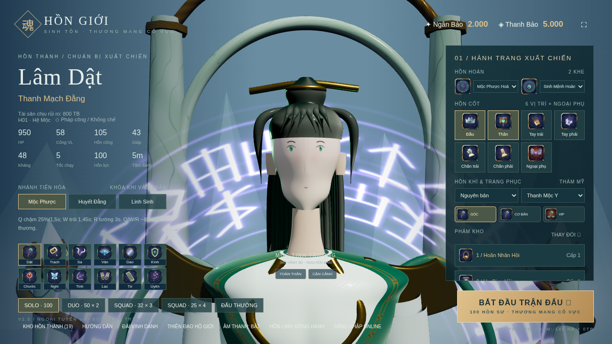
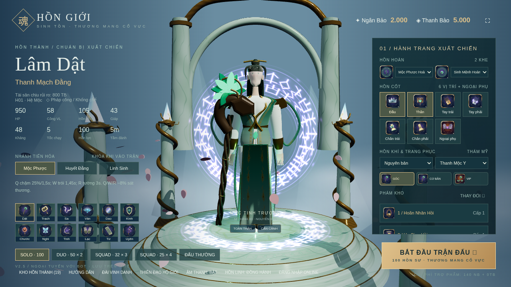
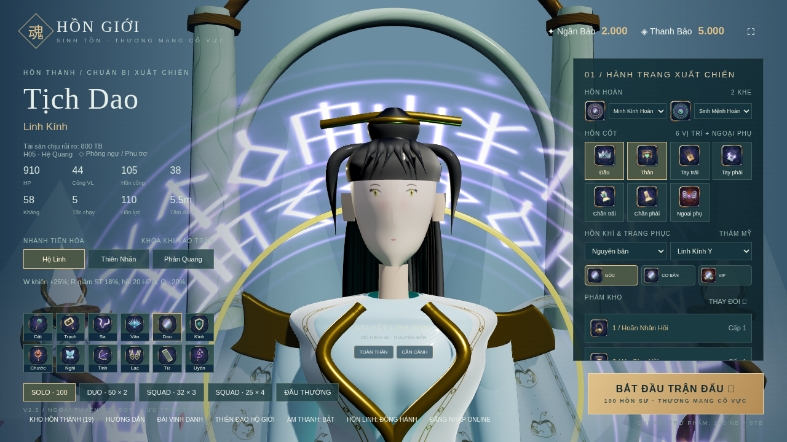
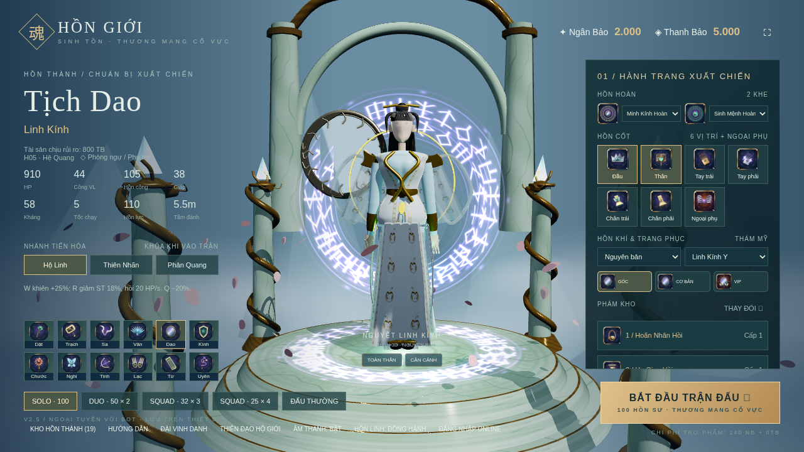
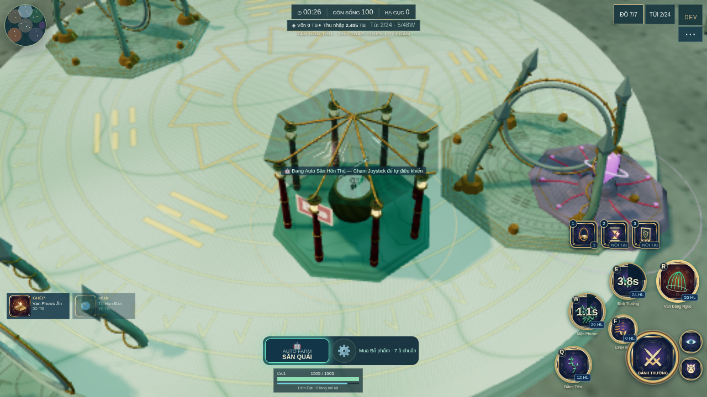
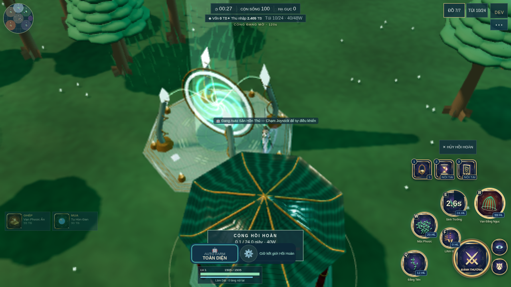
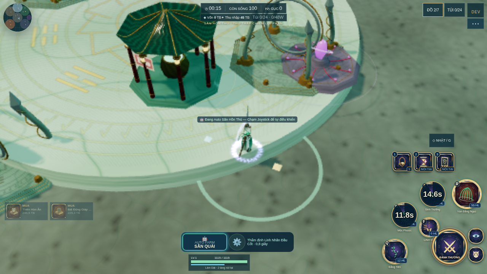
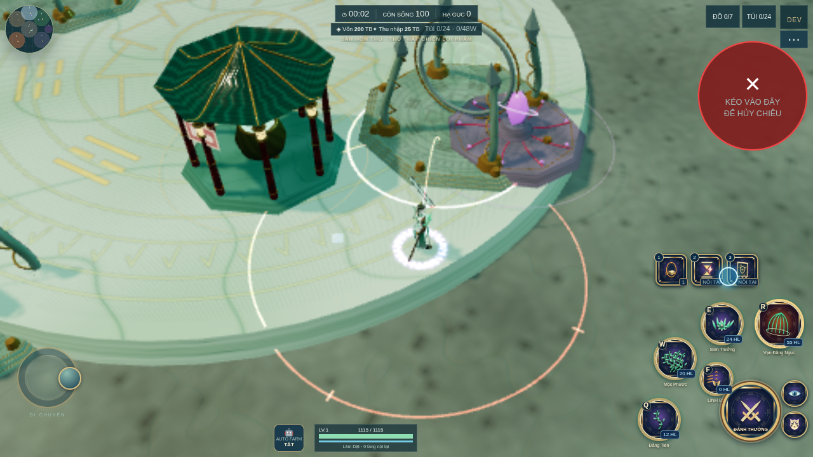
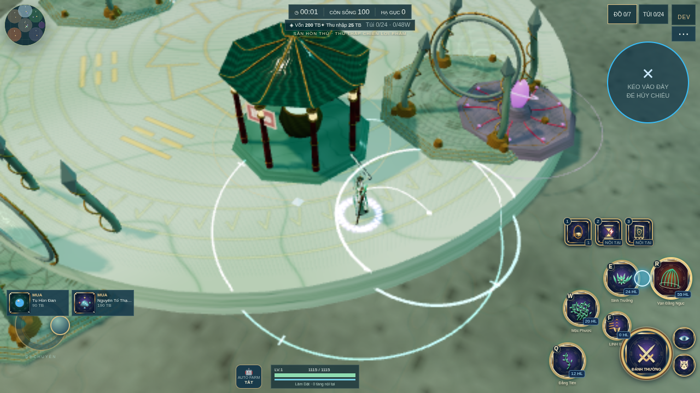

# Nhiệm vụ 2: Đại tu đồ họa và điều khiển

[Danh sách nhiệm vụ](../README.md)

Ảnh được giữ nguyên dữ liệu. Thời gian ảnh cũ là lúc lưu trên Git, không phải giờ chụp đã xác minh.

## Ảnh 1

**Thời gian lưu trên Git: 2026-10-15 23:58:39 UTC+07:00**

Nguồn: `docs/visual-review/overhaul-H01-face-front.png`

[Commit lưu ảnh](https://github.com/oree-nguyen/Tutien/commit/a94717b997048cbeb120d2b8a9ec60ef74c01825)

## Ảnh 2

**Thời gian lưu trên Git: 2026-10-15 23:58:39 UTC+07:00**

Nguồn: `docs/visual-review/overhaul-H01-pbr-full.png`

[Commit lưu ảnh](https://github.com/oree-nguyen/Tutien/commit/a94717b997048cbeb120d2b8a9ec60ef74c01825)

## Ảnh 3

**Thời gian lưu trên Git: 2026-10-15 23:58:39 UTC+07:00**

Nguồn: `docs/visual-review/overhaul-H05-face-front.png`

[Commit lưu ảnh](https://github.com/oree-nguyen/Tutien/commit/a94717b997048cbeb120d2b8a9ec60ef74c01825)

## Ảnh 4

**Thời gian lưu trên Git: 2026-10-15 23:58:39 UTC+07:00**

Nguồn: `docs/visual-review/overhaul-H05-pbr-full.png`

[Commit lưu ảnh](https://github.com/oree-nguyen/Tutien/commit/a94717b997048cbeb120d2b8a9ec60ef74c01825)

## Ảnh 5

**Thời gian lưu trên Git: 2026-10-15 23:58:39 UTC+07:00**

Nguồn: `docs/visual-review/overhaul-auto-built-seven.png`

[Commit lưu ảnh](https://github.com/oree-nguyen/Tutien/commit/a94717b997048cbeb120d2b8a9ec60ef74c01825)

## Ảnh 6

**Thời gian lưu trên Git: 2026-10-15 23:58:39 UTC+07:00**

Nguồn: `docs/visual-review/overhaul-auto-extraction-channel.png`

[Commit lưu ảnh](https://github.com/oree-nguyen/Tutien/commit/a94717b997048cbeb120d2b8a9ec60ef74c01825)

## Ảnh 7

**Thời gian lưu trên Git: 2026-10-15 23:58:39 UTC+07:00**

Nguồn: `docs/visual-review/overhaul-auto-loot-appraisal.png`

[Commit lưu ảnh](https://github.com/oree-nguyen/Tutien/commit/a94717b997048cbeb120d2b8a9ec60ef74c01825)

## Ảnh 8

**Thời gian lưu trên Git: 2026-10-15 23:58:39 UTC+07:00**

Nguồn: `docs/visual-review/overhaul-cancel-warning-red.png`

[Commit lưu ảnh](https://github.com/oree-nguyen/Tutien/commit/a94717b997048cbeb120d2b8a9ec60ef74c01825)

## Ảnh 9

**Thời gian lưu trên Git: 2026-10-15 23:58:39 UTC+07:00**

Nguồn: `docs/visual-review/overhaul-simultaneous-movement-aoe.png`

[Commit lưu ảnh](https://github.com/oree-nguyen/Tutien/commit/a94717b997048cbeb120d2b8a9ec60ef74c01825)
