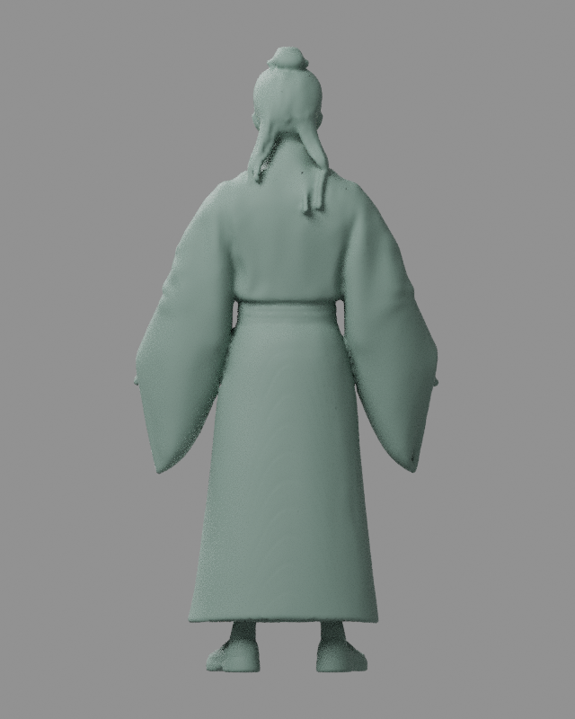
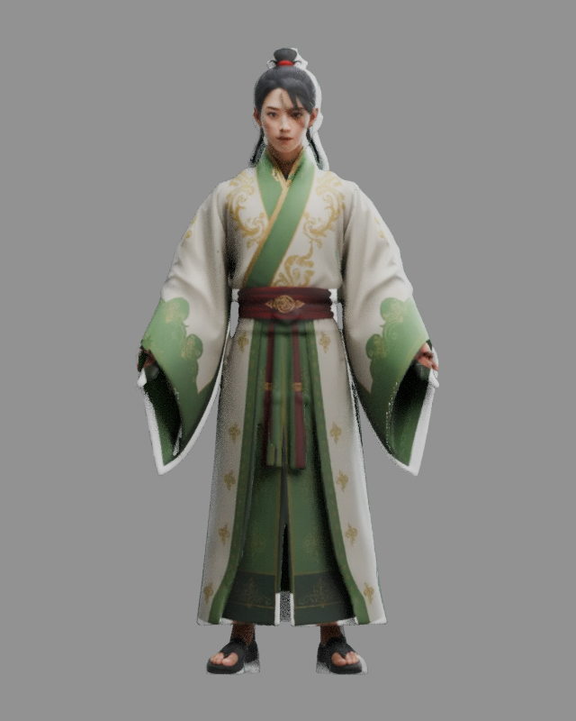

# Nhiệm vụ 3: Tencent: ảnh concept và tham chiếu

[Danh sách nhiệm vụ](../README.md)

Ảnh được giữ nguyên dữ liệu. Thời gian ảnh cũ là lúc lưu trên Git, không phải giờ chụp đã xác minh.

## Ảnh 1

**Thời gian lưu trên Git: 2026-10-16 06:50:17 UTC+07:00**

Nguồn: `assets/tencent/H01-C0/concept.webp`

[Commit lưu ảnh](https://github.com/oree-nguyen/Tutien/commit/fb12da19cd01cea33d4859c458f897cf75340bc7)

## Ảnh 2

**Thời gian lưu trên Git: 2026-10-16 06:50:17 UTC+07:00**

Nguồn: `assets/tencent/H01-C0/rejected-diagnostic-cropped.webp`

[Commit lưu ảnh](https://github.com/oree-nguyen/Tutien/commit/fb12da19cd01cea33d4859c458f897cf75340bc7)

## Ảnh 3

**Thời gian lưu trên Git: 2026-10-16 08:48:12 UTC+07:00**

Nguồn: `assets/tencent/H05-C0/concept.webp`

[Commit lưu ảnh](https://github.com/oree-nguyen/Tutien/commit/0475ce2b8a896ad29f6587d02b0d5bb9d3b6cdb2)

## Ảnh 4

**Thời gian lưu trên Git: 2026-10-16 09:16:17 UTC+07:00**

Nguồn: `assets/tencent/H01-C0/projection-back.png`

[Commit lưu ảnh](https://github.com/oree-nguyen/Tutien/commit/72b338f91a74748ff9dc57df1a752d6a543436eb)

## Ảnh 5

**Thời gian lưu trên Git: 2026-10-16 09:16:17 UTC+07:00**

Nguồn: `assets/tencent/H01-C0/projection-front.png`

[Commit lưu ảnh](https://github.com/oree-nguyen/Tutien/commit/72b338f91a74748ff9dc57df1a752d6a543436eb)
