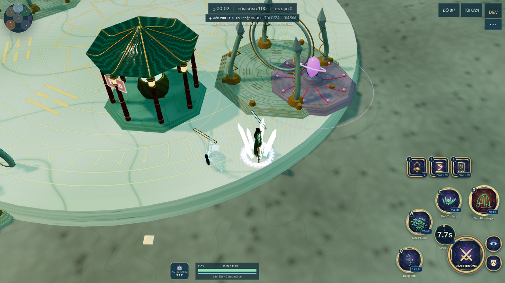
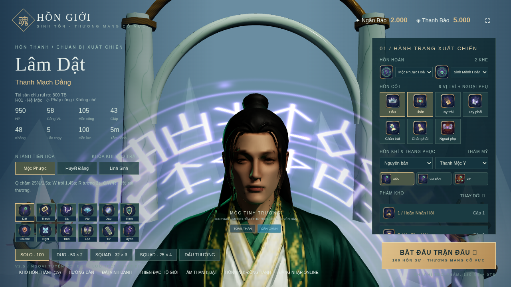
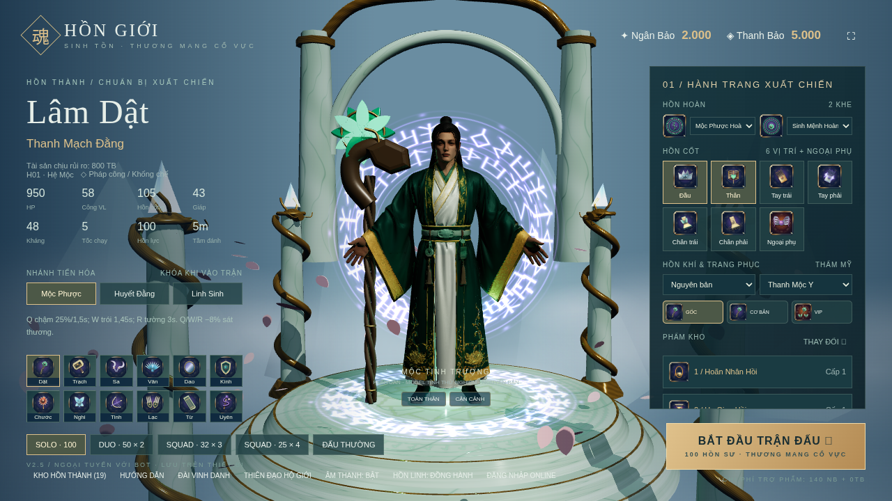
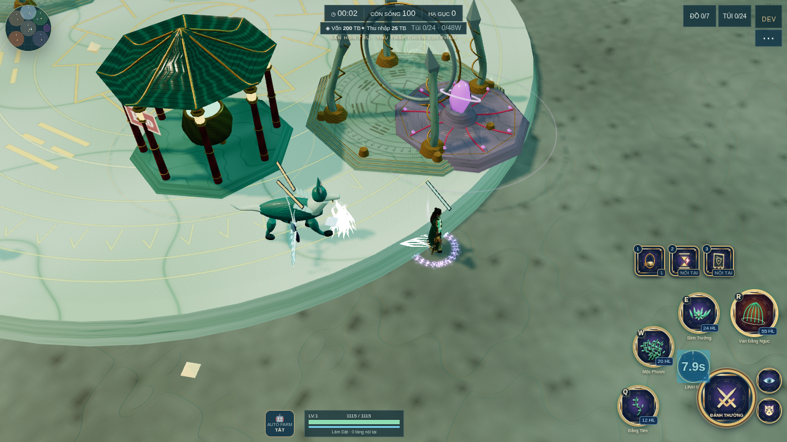
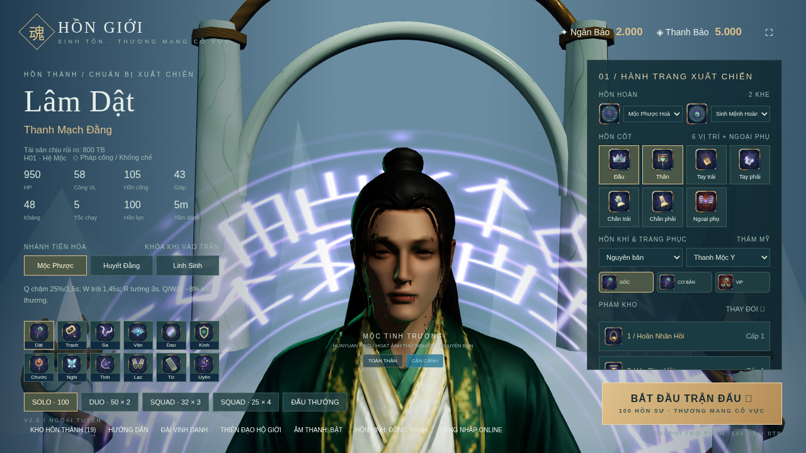
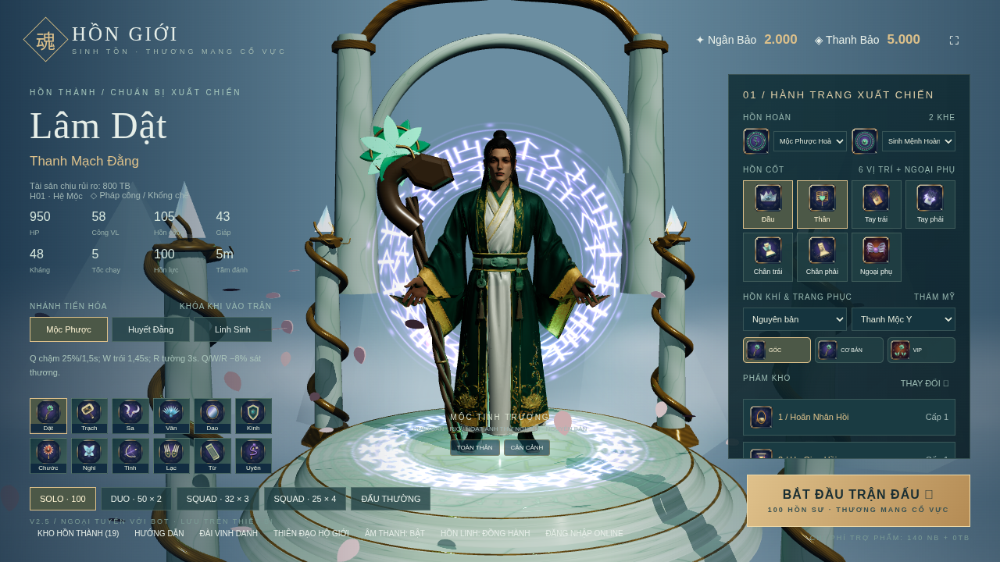
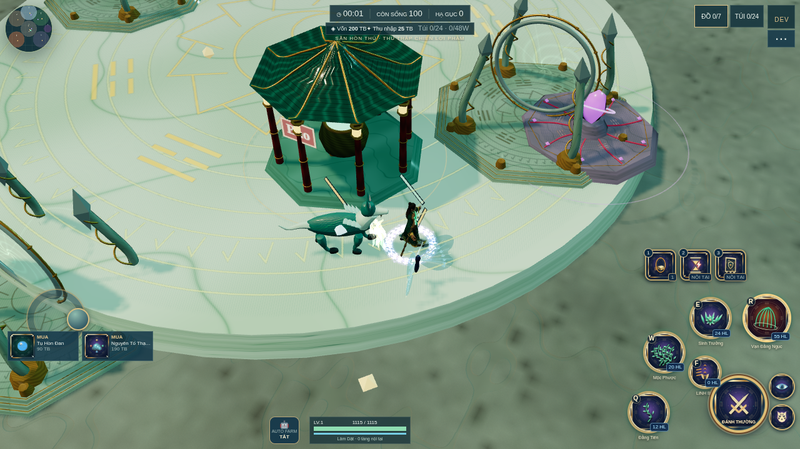
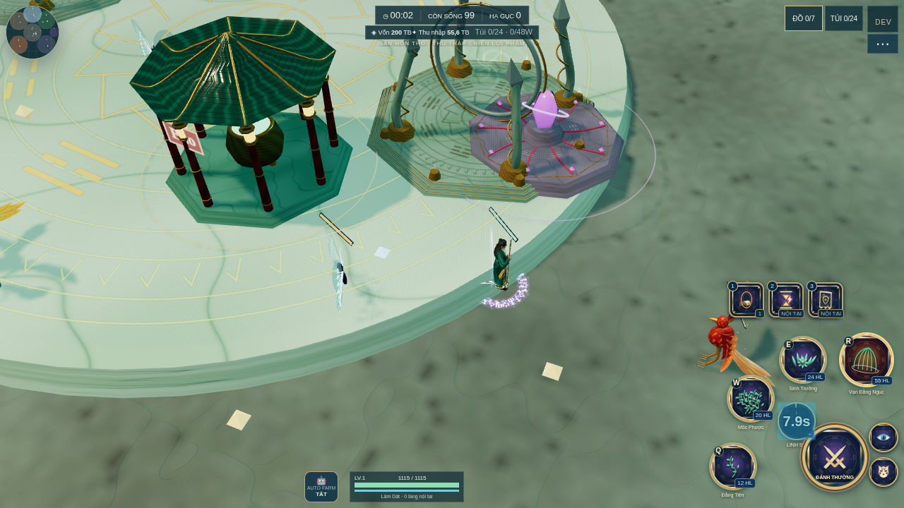
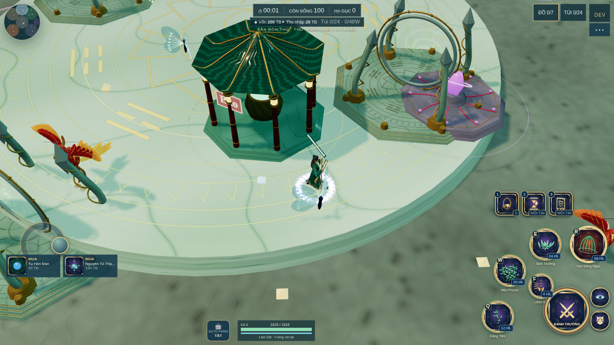

# Nhiệm vụ 4: Tích hợp model Lâm Dật

[Danh sách nhiệm vụ](../README.md)

Ảnh được giữ nguyên dữ liệu. Thời gian ảnh cũ là lúc lưu trên Git, không phải giờ chụp đã xác minh.

## Ảnh 1

**Thời gian lưu trên Git: 2026-10-16 13:48:50 UTC+07:00**

Nguồn: `docs/manual-assets/h01-c0/battle.png`

[Commit lưu ảnh](https://github.com/oree-nguyen/Tutien/commit/ee2662954ec33d6f769281ebf72628becab069e6)

## Ảnh 2

**Thời gian lưu trên Git: 2026-10-16 13:48:50 UTC+07:00**

Nguồn: `docs/manual-assets/h01-c0/hub-face.png`

[Commit lưu ảnh](https://github.com/oree-nguyen/Tutien/commit/ee2662954ec33d6f769281ebf72628becab069e6)

## Ảnh 3

**Thời gian lưu trên Git: 2026-10-16 13:48:50 UTC+07:00**

Nguồn: `docs/manual-assets/h01-c0/hub-full.png`

[Commit lưu ảnh](https://github.com/oree-nguyen/Tutien/commit/ee2662954ec33d6f769281ebf72628becab069e6)

## Ảnh 4

**Thời gian lưu trên Git: 2026-10-16 15:28:50 UTC+07:00**

Nguồn: `docs/manual-assets/h01-c0/battle.png`

[Commit lưu ảnh](https://github.com/oree-nguyen/Tutien/commit/1d6e1f8d101007f162e59686a8be3e18dc7e8138)

## Ảnh 5

**Thời gian lưu trên Git: 2026-10-16 15:28:50 UTC+07:00**

Nguồn: `docs/manual-assets/h01-c0/hub-face.png`

[Commit lưu ảnh](https://github.com/oree-nguyen/Tutien/commit/1d6e1f8d101007f162e59686a8be3e18dc7e8138)

## Ảnh 6

**Thời gian lưu trên Git: 2026-10-16 15:28:50 UTC+07:00**

Nguồn: `docs/manual-assets/h01-c0/hub-full.png`

[Commit lưu ảnh](https://github.com/oree-nguyen/Tutien/commit/1d6e1f8d101007f162e59686a8be3e18dc7e8138)

## Ảnh 7

**Thời gian lưu trên Git: 2026-10-16 15:28:50 UTC+07:00**

Nguồn: `docs/manual-assets/h01-c0/running.png`

[Commit lưu ảnh](https://github.com/oree-nguyen/Tutien/commit/1d6e1f8d101007f162e59686a8be3e18dc7e8138)

## Ảnh 8

**Thời gian lưu trên Git: 2026-10-16 23:07:45 UTC+07:00**

Nguồn: `docs/manual-assets/h01-c0/battle.png`

[Commit lưu ảnh](https://github.com/oree-nguyen/Tutien/commit/5ff80bdda488a611839dfcae6305b651695bb176)

## Ảnh 9

**Thời gian lưu trên Git: 2026-10-16 23:07:45 UTC+07:00**

Nguồn: `docs/manual-assets/h01-c0/hub-face.png`

[Commit lưu ảnh](https://github.com/oree-nguyen/Tutien/commit/5ff80bdda488a611839dfcae6305b651695bb176)

## Ảnh 10

**Thời gian lưu trên Git: 2026-10-16 23:07:45 UTC+07:00**

Nguồn: `docs/manual-assets/h01-c0/hub-full.png`

[Commit lưu ảnh](https://github.com/oree-nguyen/Tutien/commit/5ff80bdda488a611839dfcae6305b651695bb176)

## Ảnh 11

**Thời gian lưu trên Git: 2026-10-16 23:07:45 UTC+07:00**

Nguồn: `docs/manual-assets/h01-c0/running.png`

[Commit lưu ảnh](https://github.com/oree-nguyen/Tutien/commit/5ff80bdda488a611839dfcae6305b651695bb176)
