# Nhiệm vụ 5: Hoạt ảnh xuất hiện Lâm Dật

[Danh sách nhiệm vụ](../README.md)

Ảnh được giữ nguyên dữ liệu. Thời gian ảnh cũ là lúc lưu trên Git, không phải giờ chụp đã xác minh.

## Ảnh 1

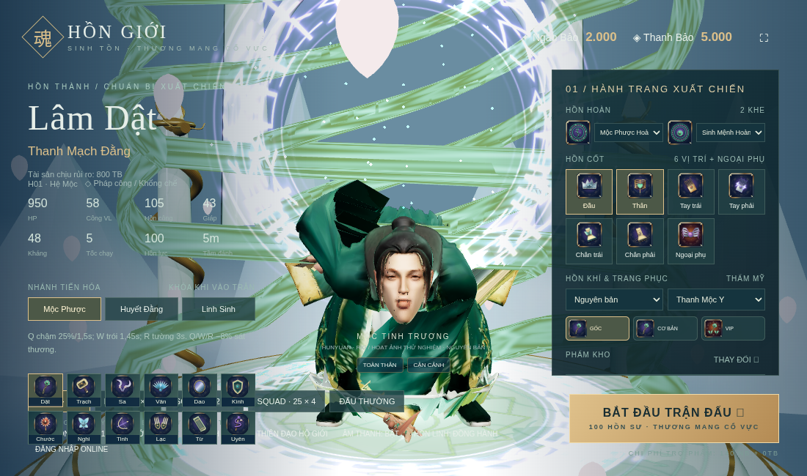

**Thời gian lưu trên Git: 2026-10-16 23:07:45 UTC+07:00**

Nguồn: `docs/manual-assets/h01-entrance/crouch-face.png`

[Commit lưu ảnh](https://github.com/oree-nguyen/Tutien/commit/5ff80bdda488a611839dfcae6305b651695bb176)

## Ảnh 2

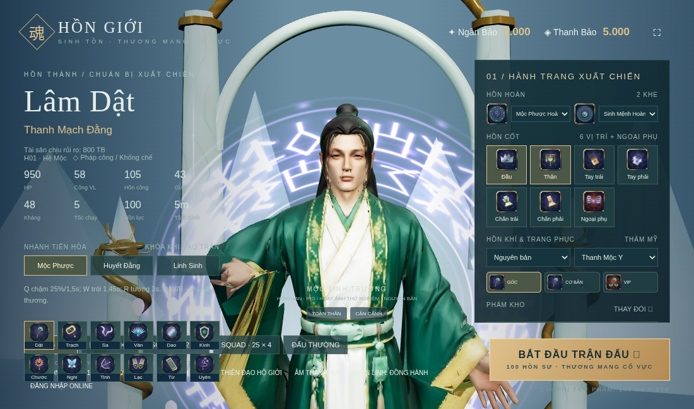

**Thời gian lưu trên Git: 2026-10-16 23:07:45 UTC+07:00**

Nguồn: `docs/manual-assets/h01-entrance/face.png`

[Commit lưu ảnh](https://github.com/oree-nguyen/Tutien/commit/5ff80bdda488a611839dfcae6305b651695bb176)

## Ảnh 3

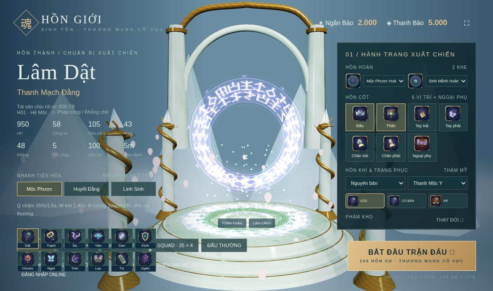

**Thời gian lưu trên Git: 2026-10-16 23:07:45 UTC+07:00**

Nguồn: `docs/manual-assets/h01-entrance/phase-0.00.png`

[Commit lưu ảnh](https://github.com/oree-nguyen/Tutien/commit/5ff80bdda488a611839dfcae6305b651695bb176)

## Ảnh 4

**Thời gian lưu trên Git: 2026-10-16 23:07:45 UTC+07:00**

Nguồn: `docs/manual-assets/h01-entrance/phase-1.45.png`

[Commit lưu ảnh](https://github.com/oree-nguyen/Tutien/commit/5ff80bdda488a611839dfcae6305b651695bb176)

## Ảnh 5

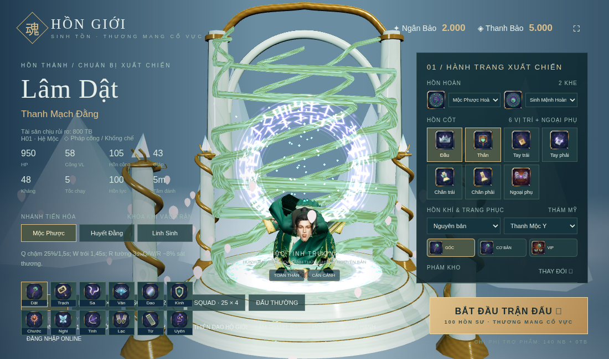

**Thời gian lưu trên Git: 2026-10-16 23:07:45 UTC+07:00**

Nguồn: `docs/manual-assets/h01-entrance/phase-1.85.png`

[Commit lưu ảnh](https://github.com/oree-nguyen/Tutien/commit/5ff80bdda488a611839dfcae6305b651695bb176)

## Ảnh 6

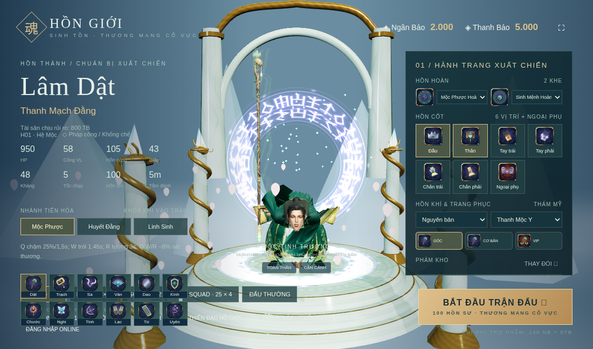

**Thời gian lưu trên Git: 2026-10-16 23:07:45 UTC+07:00**

Nguồn: `docs/manual-assets/h01-entrance/phase-2.50.png`

[Commit lưu ảnh](https://github.com/oree-nguyen/Tutien/commit/5ff80bdda488a611839dfcae6305b651695bb176)

## Ảnh 7

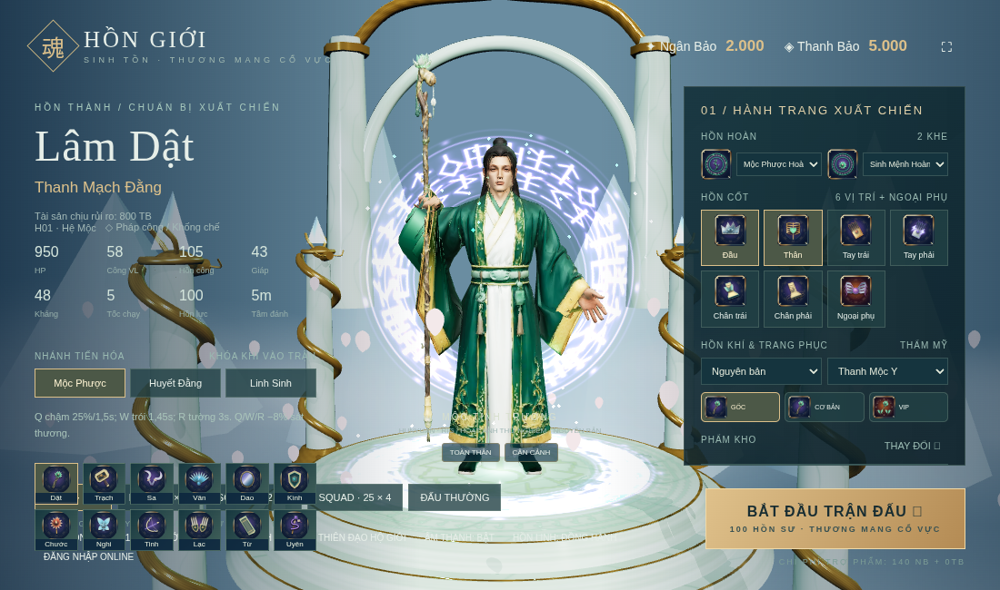

**Thời gian lưu trên Git: 2026-10-16 23:07:45 UTC+07:00**

Nguồn: `docs/manual-assets/h01-entrance/phase-3.05.png`

[Commit lưu ảnh](https://github.com/oree-nguyen/Tutien/commit/5ff80bdda488a611839dfcae6305b651695bb176)

## Ảnh 8

**Thời gian lưu trên Git: 2026-10-16 23:07:45 UTC+07:00**

Nguồn: `docs/manual-assets/h01-entrance/phase-3.55.png`

[Commit lưu ảnh](https://github.com/oree-nguyen/Tutien/commit/5ff80bdda488a611839dfcae6305b651695bb176)

## Ảnh 9

**Thời gian lưu trên Git: 2026-10-16 23:07:45 UTC+07:00**

Nguồn: `docs/manual-assets/h01-entrance/phase-4.30.png`

[Commit lưu ảnh](https://github.com/oree-nguyen/Tutien/commit/5ff80bdda488a611839dfcae6305b651695bb176)

## Ảnh 10

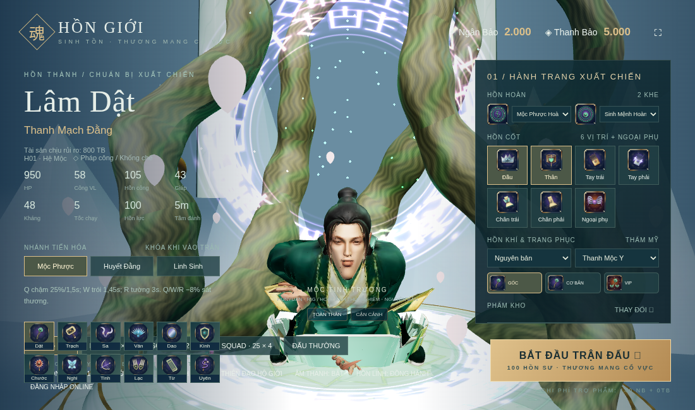

**Thời gian lưu trên Git: 2026-10-17 00:16:54 UTC+07:00**

Nguồn: `docs/manual-assets/h01-entrance/crouch-face.png`

[Commit lưu ảnh](https://github.com/oree-nguyen/Tutien/commit/6abe8381c80b82800e093b5fbe5451c8152d43e6)

## Ảnh 11

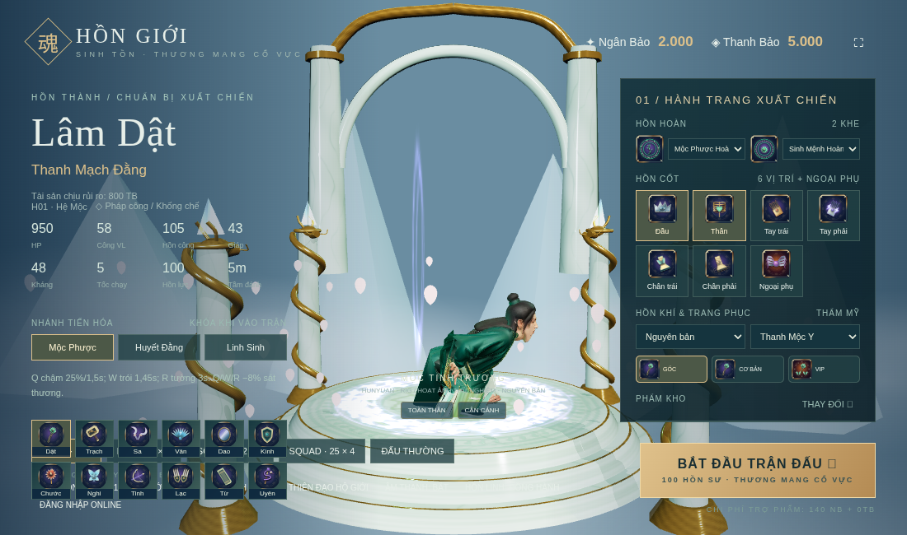

**Thời gian lưu trên Git: 2026-10-17 00:16:54 UTC+07:00**

Nguồn: `docs/manual-assets/h01-entrance/crouch-profile-pose.png`

[Commit lưu ảnh](https://github.com/oree-nguyen/Tutien/commit/6abe8381c80b82800e093b5fbe5451c8152d43e6)

## Ảnh 12

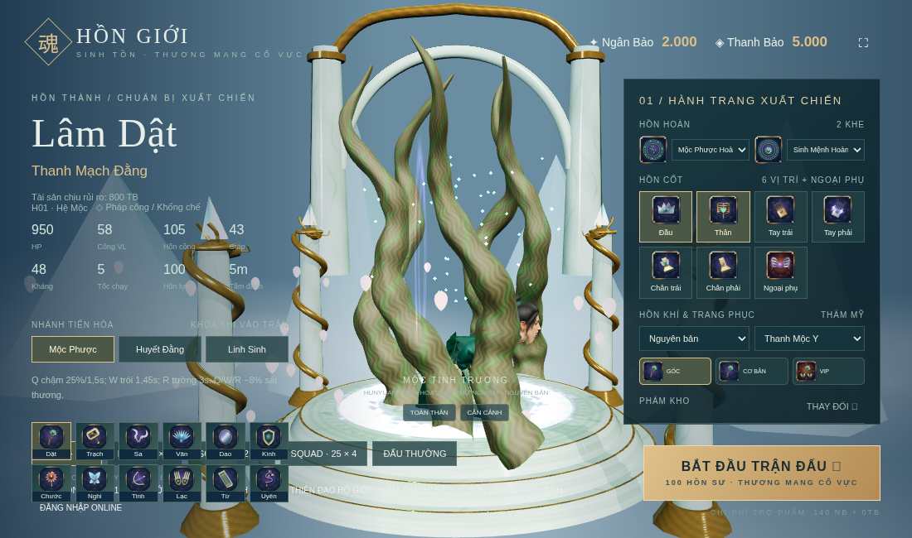

**Thời gian lưu trên Git: 2026-10-17 00:16:54 UTC+07:00**

Nguồn: `docs/manual-assets/h01-entrance/crouch-profile.png`

[Commit lưu ảnh](https://github.com/oree-nguyen/Tutien/commit/6abe8381c80b82800e093b5fbe5451c8152d43e6)

## Ảnh 13

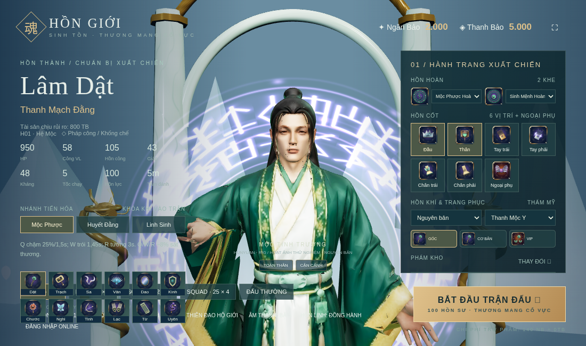

**Thời gian lưu trên Git: 2026-10-17 00:16:54 UTC+07:00**

Nguồn: `docs/manual-assets/h01-entrance/face.png`

[Commit lưu ảnh](https://github.com/oree-nguyen/Tutien/commit/6abe8381c80b82800e093b5fbe5451c8152d43e6)

## Ảnh 14

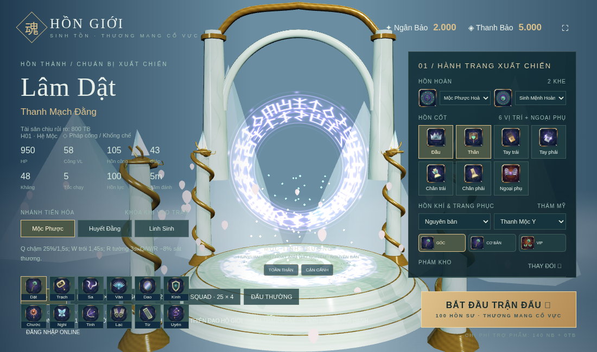

**Thời gian lưu trên Git: 2026-10-17 00:16:54 UTC+07:00**

Nguồn: `docs/manual-assets/h01-entrance/phase-0.00.png`

[Commit lưu ảnh](https://github.com/oree-nguyen/Tutien/commit/6abe8381c80b82800e093b5fbe5451c8152d43e6)

## Ảnh 15

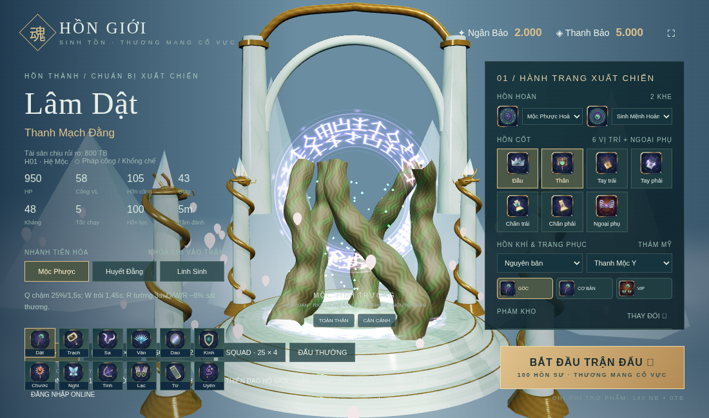

**Thời gian lưu trên Git: 2026-10-17 00:16:54 UTC+07:00**

Nguồn: `docs/manual-assets/h01-entrance/phase-0.60.png`

[Commit lưu ảnh](https://github.com/oree-nguyen/Tutien/commit/6abe8381c80b82800e093b5fbe5451c8152d43e6)

## Ảnh 16

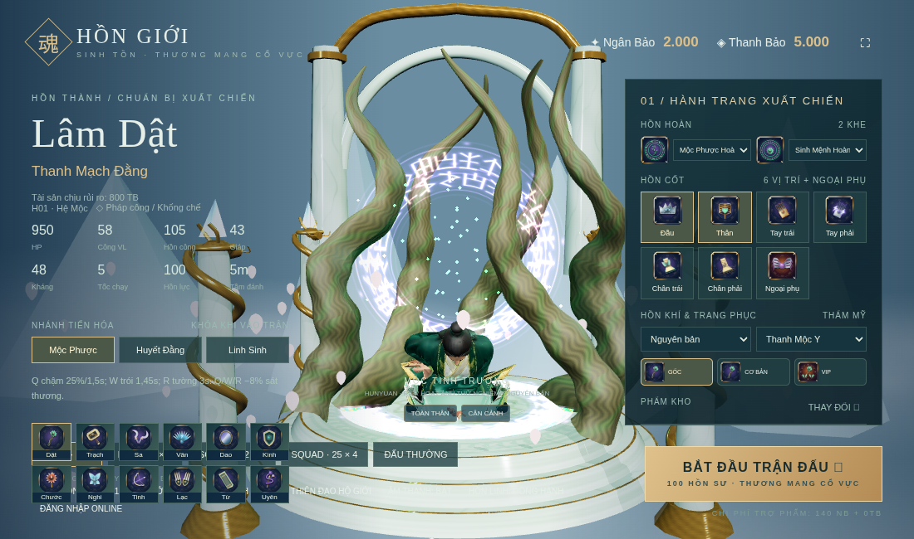

**Thời gian lưu trên Git: 2026-10-17 00:16:54 UTC+07:00**

Nguồn: `docs/manual-assets/h01-entrance/phase-1.45.png`

[Commit lưu ảnh](https://github.com/oree-nguyen/Tutien/commit/6abe8381c80b82800e093b5fbe5451c8152d43e6)

## Ảnh 17

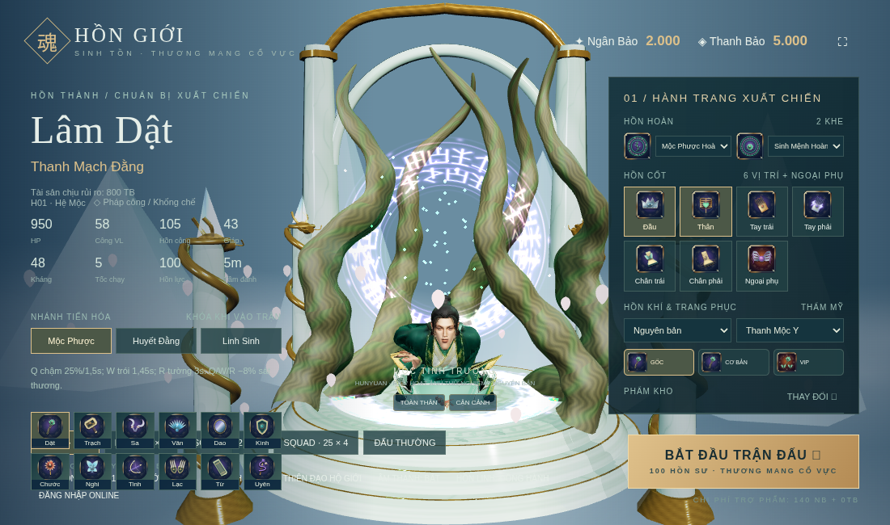

**Thời gian lưu trên Git: 2026-10-17 00:16:54 UTC+07:00**

Nguồn: `docs/manual-assets/h01-entrance/phase-1.85.png`

[Commit lưu ảnh](https://github.com/oree-nguyen/Tutien/commit/6abe8381c80b82800e093b5fbe5451c8152d43e6)

## Ảnh 18

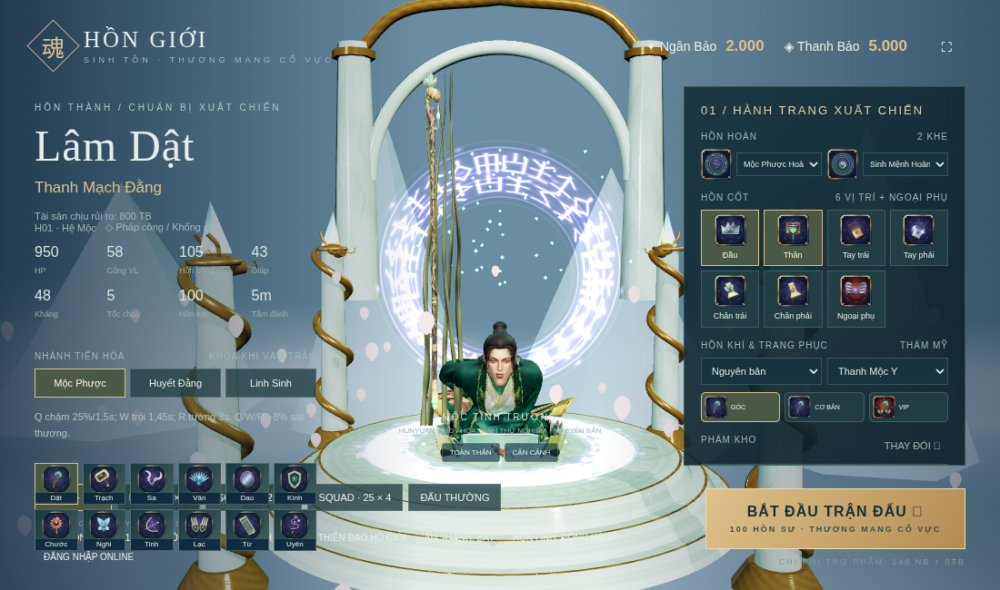

**Thời gian lưu trên Git: 2026-10-17 00:16:54 UTC+07:00**

Nguồn: `docs/manual-assets/h01-entrance/phase-2.50.png`

[Commit lưu ảnh](https://github.com/oree-nguyen/Tutien/commit/6abe8381c80b82800e093b5fbe5451c8152d43e6)

## Ảnh 19

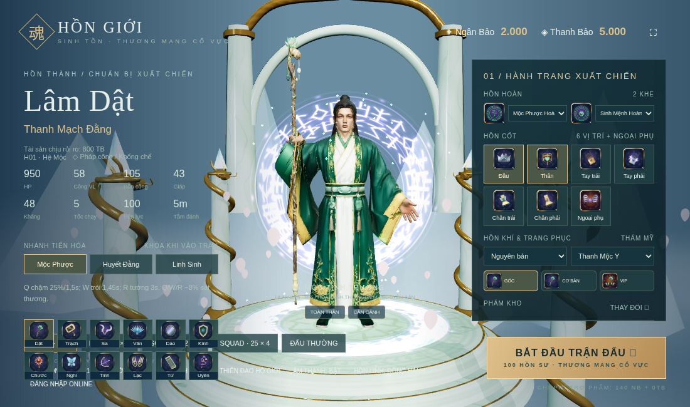

**Thời gian lưu trên Git: 2026-10-17 00:16:54 UTC+07:00**

Nguồn: `docs/manual-assets/h01-entrance/phase-3.05.png`

[Commit lưu ảnh](https://github.com/oree-nguyen/Tutien/commit/6abe8381c80b82800e093b5fbe5451c8152d43e6)

## Ảnh 20

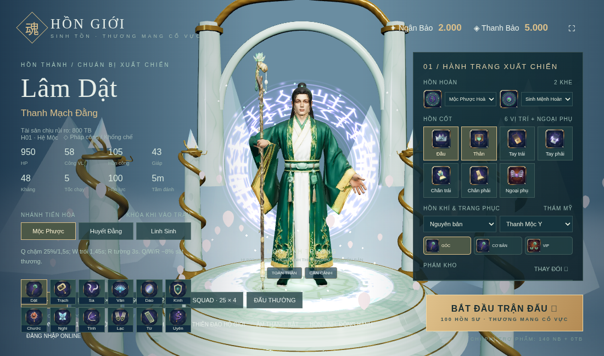

**Thời gian lưu trên Git: 2026-10-17 00:16:54 UTC+07:00**

Nguồn: `docs/manual-assets/h01-entrance/phase-3.55.png`

[Commit lưu ảnh](https://github.com/oree-nguyen/Tutien/commit/6abe8381c80b82800e093b5fbe5451c8152d43e6)

## Ảnh 21

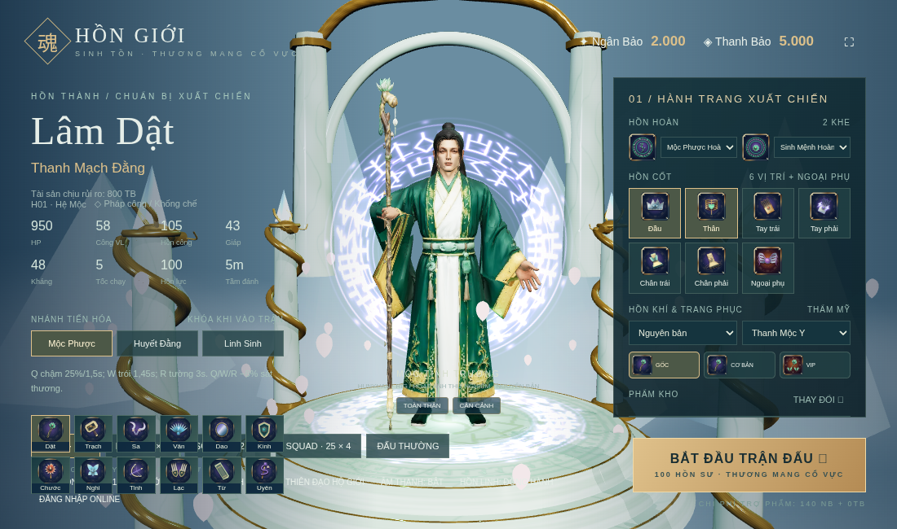

**Thời gian lưu trên Git: 2026-10-17 00:16:54 UTC+07:00**

Nguồn: `docs/manual-assets/h01-entrance/phase-4.30.png`

[Commit lưu ảnh](https://github.com/oree-nguyen/Tutien/commit/6abe8381c80b82800e093b5fbe5451c8152d43e6)
