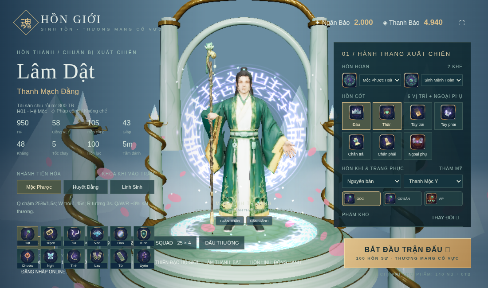
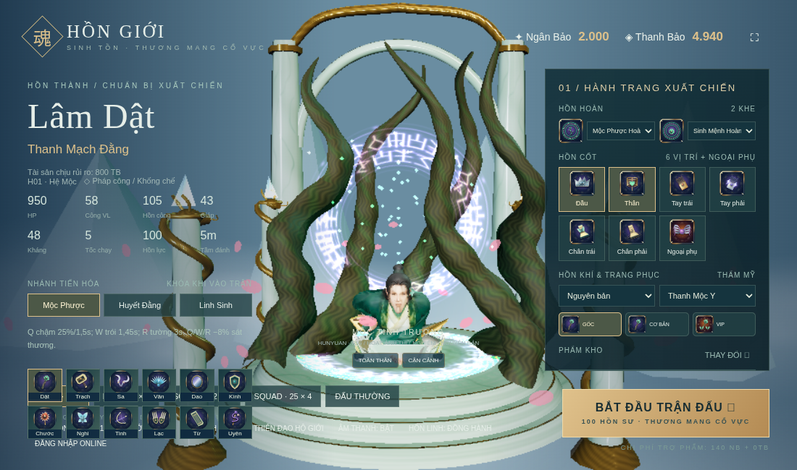

# Nhiệm vụ 6: Sửa vòng đời tải và hiển thị

[Danh sách nhiệm vụ](../README.md)

Ảnh được giữ nguyên dữ liệu. Thời gian ảnh cũ là lúc lưu trên Git, không phải giờ chụp đã xác minh.

## Ảnh 1

**Thời gian lưu trên Git: 2026-10-17 07:59:06 UTC+07:00**

Nguồn: `docs/boot-performance/lam-dat-impact.png`

[Commit lưu ảnh](https://github.com/oree-nguyen/Tutien/commit/ca1fec87fd90e10ea55254537cfa1c3564b4ca59)

## Ảnh 2

**Thời gian lưu trên Git: 2026-10-17 07:59:06 UTC+07:00**

Nguồn: `docs/boot-performance/lam-dat-squat.png`

[Commit lưu ảnh](https://github.com/oree-nguyen/Tutien/commit/ca1fec87fd90e10ea55254537cfa1c3564b4ca59)
