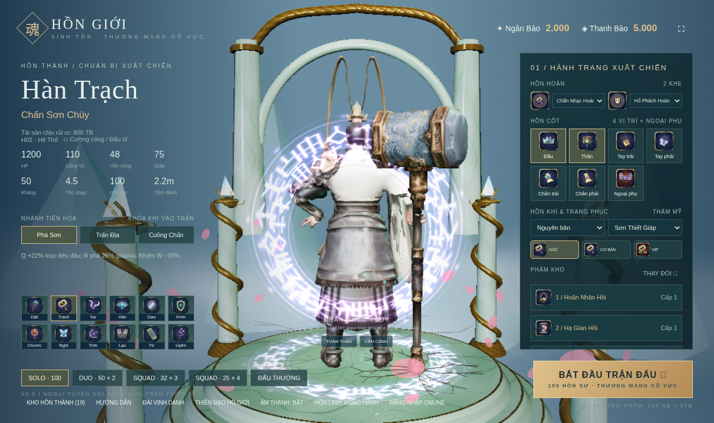
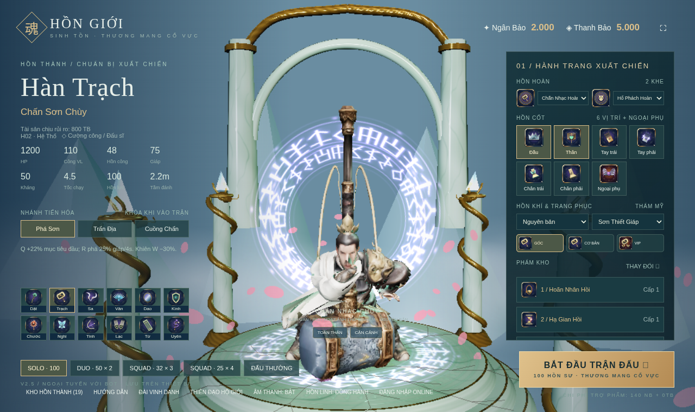
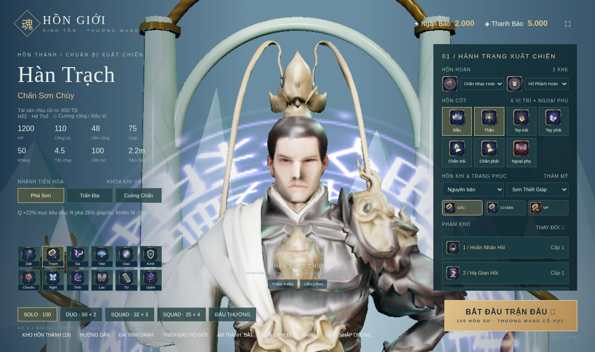
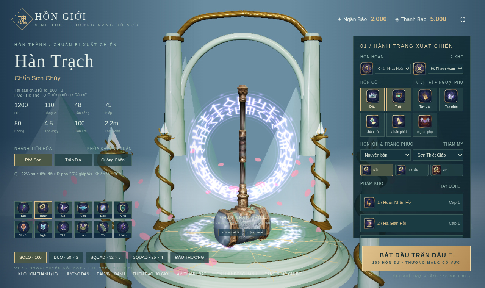
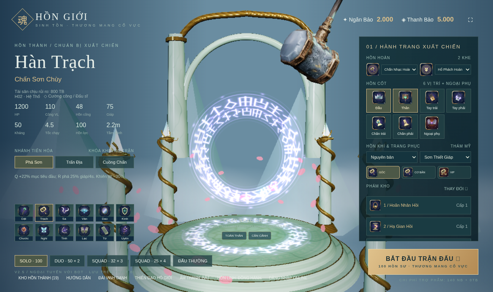
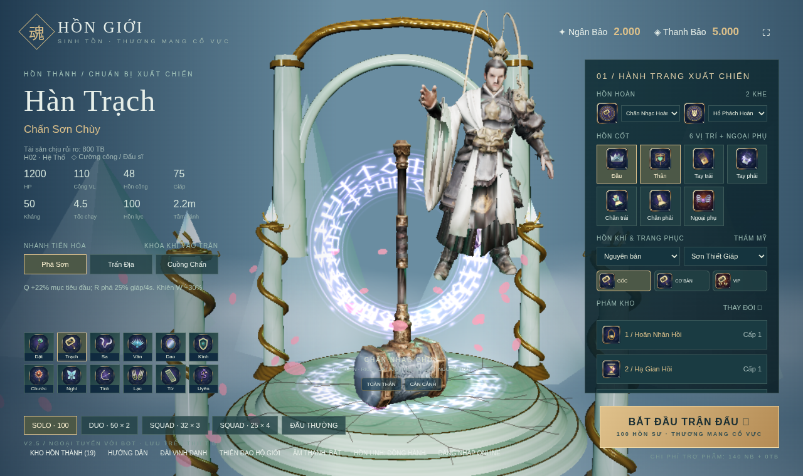
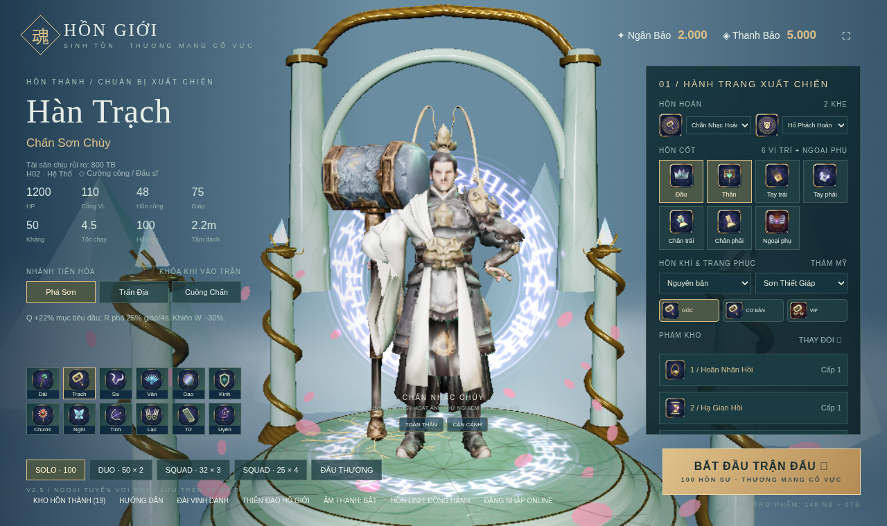

# Nhiệm vụ 7: Hoạt ảnh xuất hiện Hàn Trạch

[Danh sách nhiệm vụ](../README.md)

Ảnh được giữ nguyên dữ liệu. Thời gian ảnh cũ là lúc lưu trên Git, không phải giờ chụp đã xác minh.

## Ảnh 1

**Thời gian lưu trên Git: 2026-10-17 12:52:38 UTC+07:00**

Nguồn: `docs/manual-assets/h02-entrance/back.png`

[Commit lưu ảnh](https://github.com/oree-nguyen/Tutien/commit/01bb51b9e9751cecaf8e635d7d0faf30fbabb2de)

## Ảnh 2

**Thời gian lưu trên Git: 2026-10-17 12:52:38 UTC+07:00**

Nguồn: `docs/manual-assets/h02-entrance/crouch-pickup.png`

[Commit lưu ảnh](https://github.com/oree-nguyen/Tutien/commit/01bb51b9e9751cecaf8e635d7d0faf30fbabb2de)

## Ảnh 3

**Thời gian lưu trên Git: 2026-10-17 12:52:38 UTC+07:00**

Nguồn: `docs/manual-assets/h02-entrance/face.png`

[Commit lưu ảnh](https://github.com/oree-nguyen/Tutien/commit/01bb51b9e9751cecaf8e635d7d0faf30fbabb2de)

## Ảnh 4

**Thời gian lưu trên Git: 2026-10-17 12:52:38 UTC+07:00**

Nguồn: `docs/manual-assets/h02-entrance/first-impact.png`

[Commit lưu ảnh](https://github.com/oree-nguyen/Tutien/commit/01bb51b9e9751cecaf8e635d7d0faf30fbabb2de)

## Ảnh 5

**Thời gian lưu trên Git: 2026-10-17 12:52:38 UTC+07:00**

Nguồn: `docs/manual-assets/h02-entrance/hammer-descent.png`

[Commit lưu ảnh](https://github.com/oree-nguyen/Tutien/commit/01bb51b9e9751cecaf8e635d7d0faf30fbabb2de)

## Ảnh 6

**Thời gian lưu trên Git: 2026-10-17 12:52:38 UTC+07:00**

Nguồn: `docs/manual-assets/h02-entrance/hero-descent.png`

[Commit lưu ảnh](https://github.com/oree-nguyen/Tutien/commit/01bb51b9e9751cecaf8e635d7d0faf30fbabb2de)

## Ảnh 7

**Thời gian lưu trên Git: 2026-10-17 12:52:38 UTC+07:00**

Nguồn: `docs/manual-assets/h02-entrance/upright-stamp.png`

[Commit lưu ảnh](https://github.com/oree-nguyen/Tutien/commit/01bb51b9e9751cecaf8e635d7d0faf30fbabb2de)
