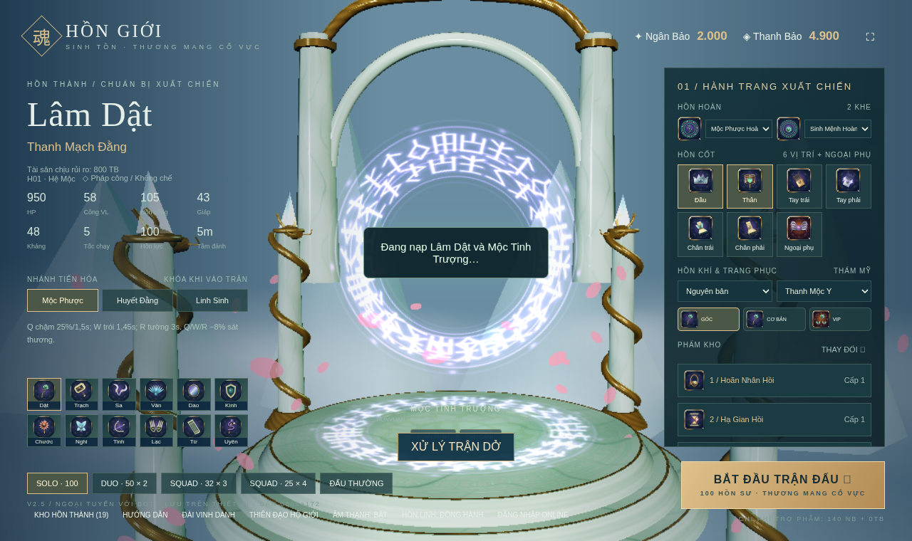
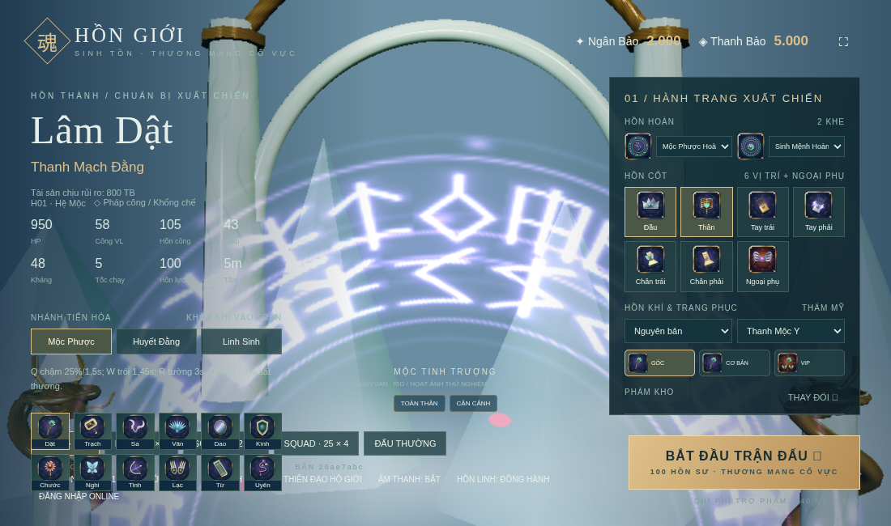
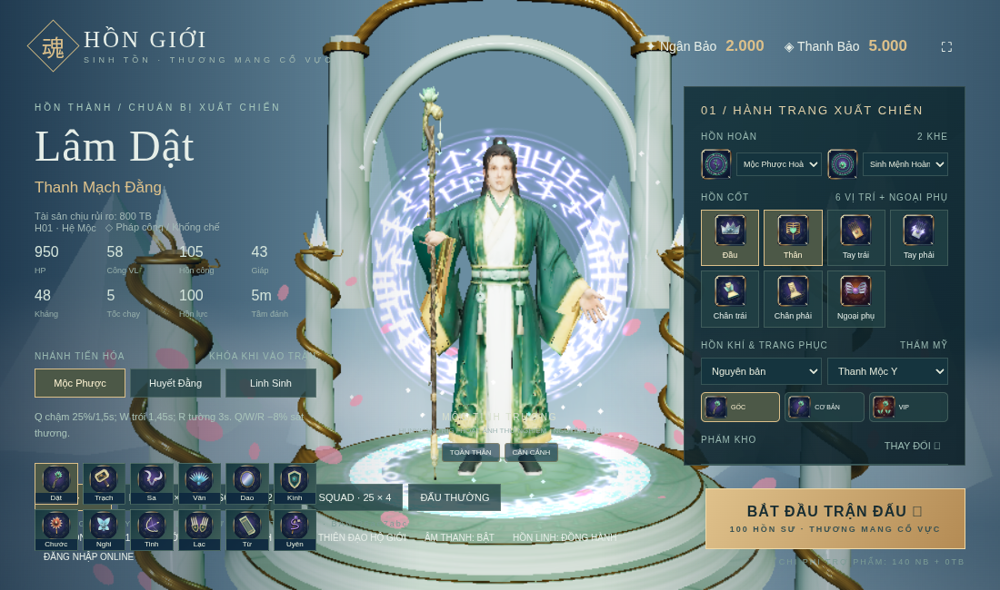
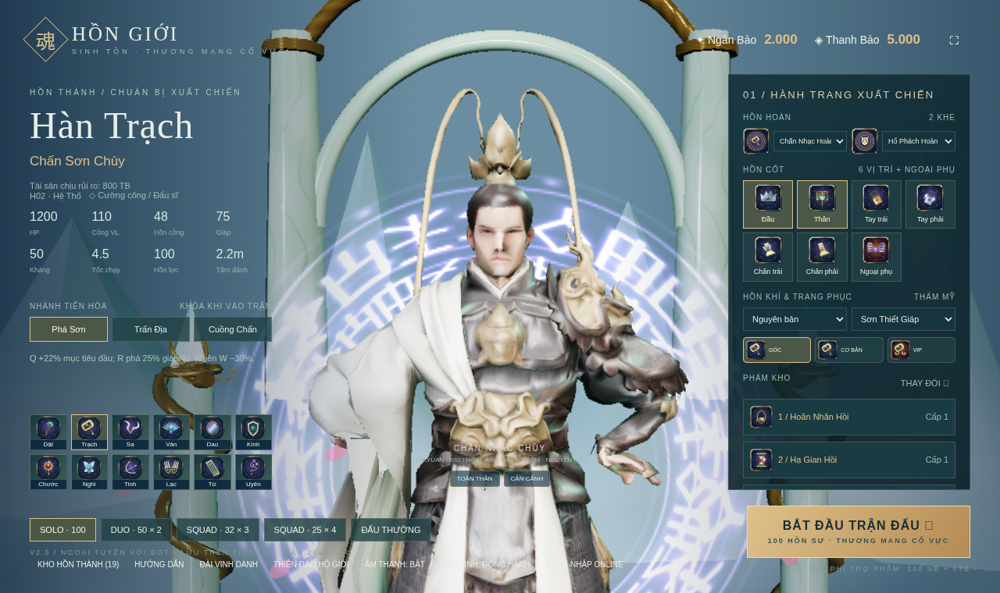
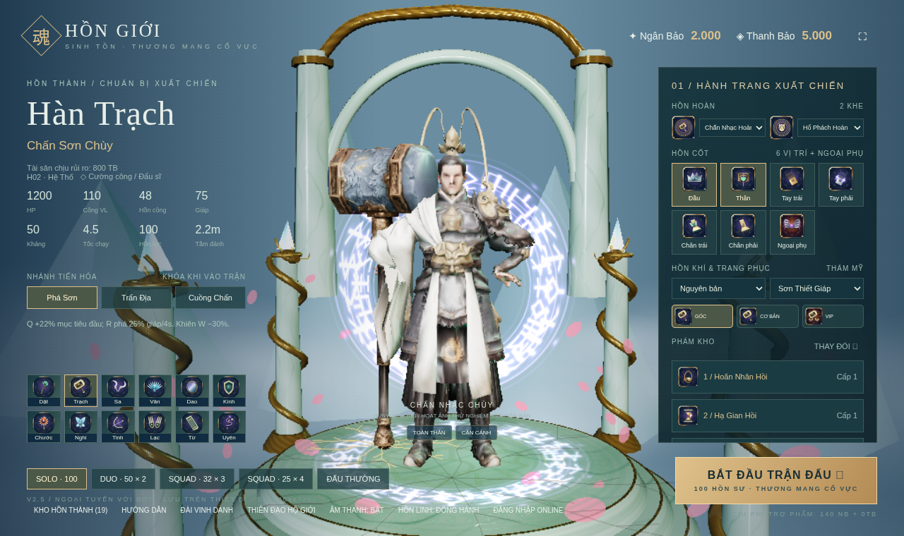
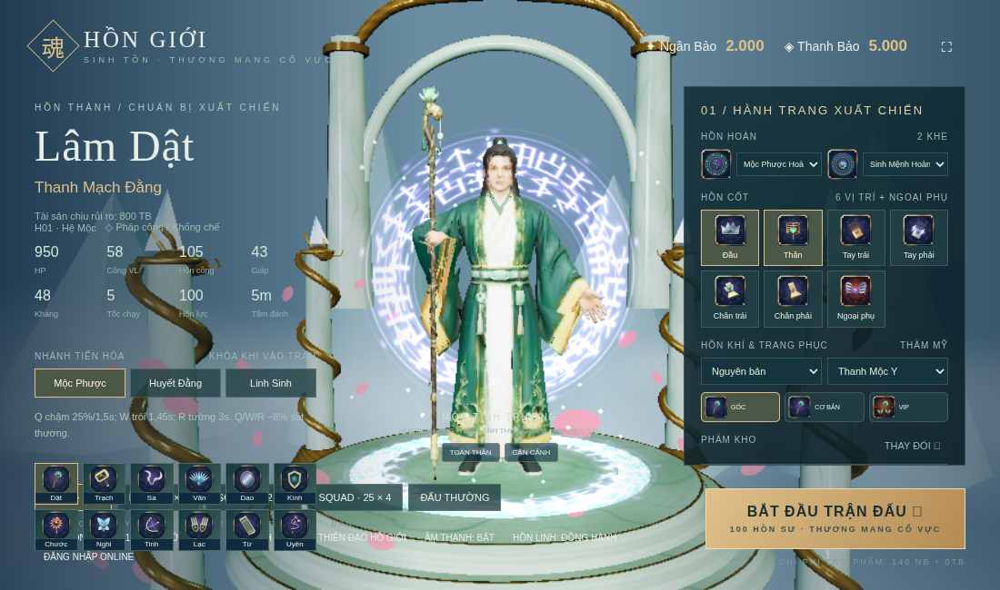
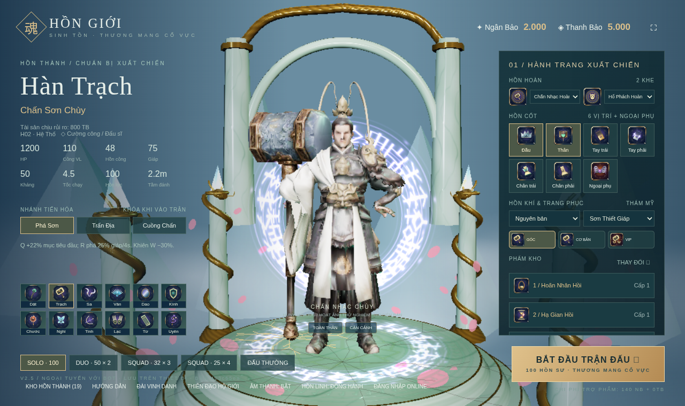
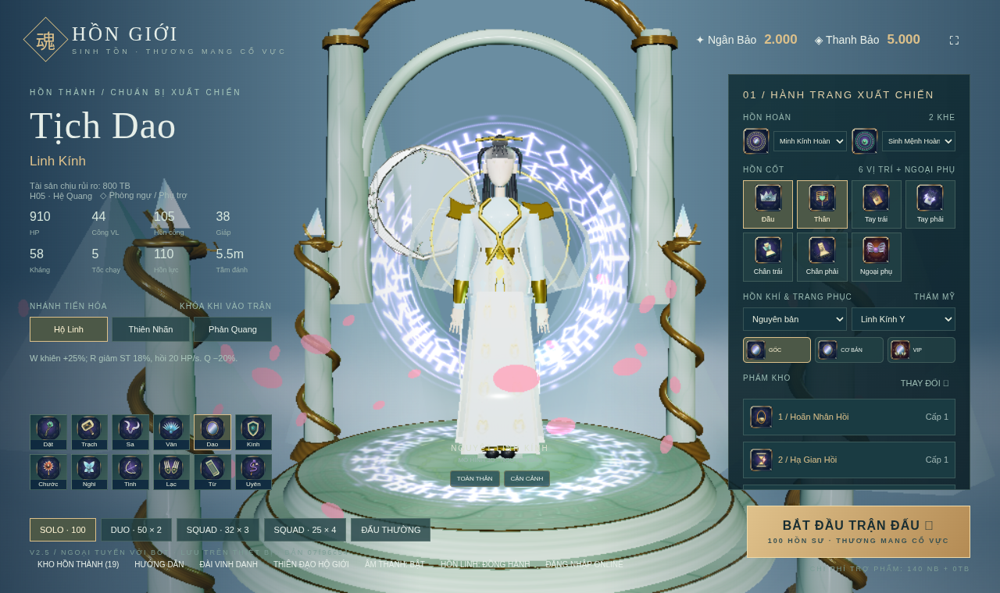
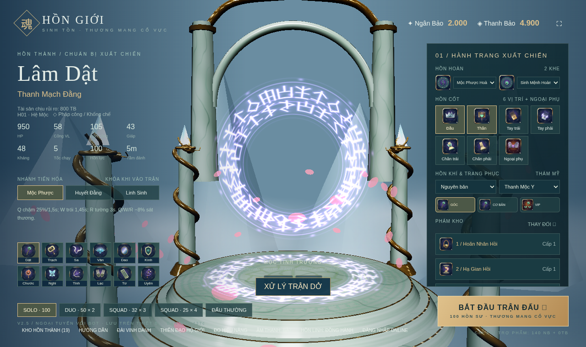

# Nhiệm vụ 8: Sửa khởi động và kiểm tra hiệu năng

[Danh sách nhiệm vụ](../README.md)

Ảnh được giữ nguyên dữ liệu. Thời gian ảnh cũ là lúc lưu trên Git, không phải giờ chụp đã xác minh.

## Ảnh 1

**Thời gian lưu trên Git: 2026-10-17 13:54:32 UTC+07:00**

Nguồn: `docs/perf-audit/boot-fix/blocked-model-lobby.png`

[Commit lưu ảnh](https://github.com/oree-nguyen/Tutien/commit/9a949405ce02dfd262d7bf1ef260acd0fc2459fe)

## Ảnh 2

**Thời gian lưu trên Git: 2026-10-17 14:05:50 UTC+07:00**

Nguồn: `docs/perf-audit/phase1/before/h01/face.png`

[Commit lưu ảnh](https://github.com/oree-nguyen/Tutien/commit/ed570380f4f3a5fc64e6f3543a9ca6f2cd165ee7)

## Ảnh 3

**Thời gian lưu trên Git: 2026-10-17 14:05:50 UTC+07:00**

Nguồn: `docs/perf-audit/phase1/before/h01/phase-3.55.png`

[Commit lưu ảnh](https://github.com/oree-nguyen/Tutien/commit/ed570380f4f3a5fc64e6f3543a9ca6f2cd165ee7)

## Ảnh 4

**Thời gian lưu trên Git: 2026-10-17 14:05:50 UTC+07:00**

Nguồn: `docs/perf-audit/phase1/before/h02/face.png`

[Commit lưu ảnh](https://github.com/oree-nguyen/Tutien/commit/ed570380f4f3a5fc64e6f3543a9ca6f2cd165ee7)

## Ảnh 5

**Thời gian lưu trên Git: 2026-10-17 14:05:50 UTC+07:00**

Nguồn: `docs/perf-audit/phase1/before/h02/phase-5.1.png`

[Commit lưu ảnh](https://github.com/oree-nguyen/Tutien/commit/ed570380f4f3a5fc64e6f3543a9ca6f2cd165ee7)

## Ảnh 6

**Thời gian lưu trên Git: 2026-10-17 14:12:25 UTC+07:00**

Nguồn: `docs/perf-audit/phase2/after/h01/phase-3.55.png`

[Commit lưu ảnh](https://github.com/oree-nguyen/Tutien/commit/af03c8b96187ec3c9d7d2fa3f9920e7395d3ec1a)

## Ảnh 7

**Thời gian lưu trên Git: 2026-10-17 14:12:25 UTC+07:00**

Nguồn: `docs/perf-audit/phase2/after/h02/phase-5.1.png`

[Commit lưu ảnh](https://github.com/oree-nguyen/Tutien/commit/af03c8b96187ec3c9d7d2fa3f9920e7395d3ec1a)

## Ảnh 8

**Thời gian lưu trên Git: 2026-10-17 14:22:29 UTC+07:00**

Nguồn: `docs/perf-audit/phase4-visual/after-ktx2.png`

[Commit lưu ảnh](https://github.com/oree-nguyen/Tutien/commit/5d6f0557c515042b26ee142107a0cd2a3c194224)

## Ảnh 9

**Thời gian lưu trên Git: 2026-10-17 14:22:29 UTC+07:00**

Nguồn: `docs/perf-audit/phase4-visual/before-procedural.png`

[Commit lưu ảnh](https://github.com/oree-nguyen/Tutien/commit/5d6f0557c515042b26ee142107a0cd2a3c194224)

## Ảnh 10

**Thời gian lưu trên Git: 2026-10-18 08:52:40 UTC+07:00**

Nguồn: `docs/perf-audit/boot-fix/blocked-model-lobby-final.png`

[Commit lưu ảnh](https://github.com/oree-nguyen/Tutien/commit/65741202b8cdacc9f2a21842dbc3bea927a9c942)
