# Nhiệm vụ 9: Đối chiếu chất lượng với GLB gốc

[Danh sách nhiệm vụ](../README.md)

Ảnh được giữ nguyên dữ liệu. Thời gian ảnh cũ là lúc lưu trên Git, không phải giờ chụp đã xác minh.

## Ảnh 1

**Thời gian lưu trên Git: 2026-10-18 08:07:31 UTC+07:00**

Nguồn: `docs/fidelity/after-native/h01-face-game.png`, `docs/fidelity/after-native/h01-face-reference.png`

[Commit lưu ảnh](https://github.com/oree-nguyen/Tutien/commit/982e9e042cabd0e49dc3086ea913c9b8e1c6c91d)

## Ảnh 2

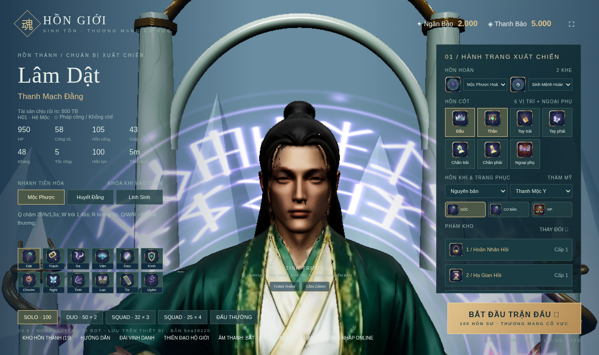

**Thời gian lưu trên Git: 2026-10-18 08:07:31 UTC+07:00**

Nguồn: `docs/fidelity/after-native/h01-face-lobby.png`

[Commit lưu ảnh](https://github.com/oree-nguyen/Tutien/commit/982e9e042cabd0e49dc3086ea913c9b8e1c6c91d)

## Ảnh 3

**Thời gian lưu trên Git: 2026-10-18 08:07:31 UTC+07:00**

Nguồn: `docs/fidelity/after-native/h01-face-mask.png`

[Commit lưu ảnh](https://github.com/oree-nguyen/Tutien/commit/982e9e042cabd0e49dc3086ea913c9b8e1c6c91d)

## Ảnh 4

**Thời gian lưu trên Git: 2026-10-18 08:07:31 UTC+07:00**

Nguồn: `docs/fidelity/after-native/h01-full-game.png`, `docs/fidelity/after-native/h01-full-reference.png`

[Commit lưu ảnh](https://github.com/oree-nguyen/Tutien/commit/982e9e042cabd0e49dc3086ea913c9b8e1c6c91d)

## Ảnh 5

**Thời gian lưu trên Git: 2026-10-18 08:07:31 UTC+07:00**

Nguồn: `docs/fidelity/after-native/h01-full-lobby.png`

[Commit lưu ảnh](https://github.com/oree-nguyen/Tutien/commit/982e9e042cabd0e49dc3086ea913c9b8e1c6c91d)

## Ảnh 6

**Thời gian lưu trên Git: 2026-10-18 08:07:31 UTC+07:00**

Nguồn: `docs/fidelity/after-native/h01-full-mask.png`

[Commit lưu ảnh](https://github.com/oree-nguyen/Tutien/commit/982e9e042cabd0e49dc3086ea913c9b8e1c6c91d)

## Ảnh 7

**Thời gian lưu trên Git: 2026-10-18 08:07:31 UTC+07:00**

Nguồn: `docs/fidelity/after-native/h02-face-game.png`, `docs/fidelity/after-native/h02-face-reference.png`

[Commit lưu ảnh](https://github.com/oree-nguyen/Tutien/commit/982e9e042cabd0e49dc3086ea913c9b8e1c6c91d)

## Ảnh 8

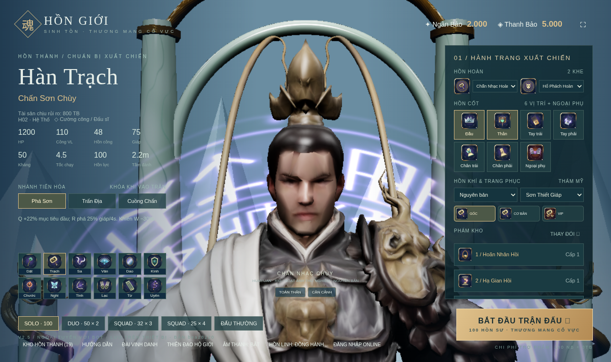

**Thời gian lưu trên Git: 2026-10-18 08:07:31 UTC+07:00**

Nguồn: `docs/fidelity/after-native/h02-face-lobby.png`

[Commit lưu ảnh](https://github.com/oree-nguyen/Tutien/commit/982e9e042cabd0e49dc3086ea913c9b8e1c6c91d)

## Ảnh 9

**Thời gian lưu trên Git: 2026-10-18 08:07:31 UTC+07:00**

Nguồn: `docs/fidelity/after-native/h02-face-mask.png`

[Commit lưu ảnh](https://github.com/oree-nguyen/Tutien/commit/982e9e042cabd0e49dc3086ea913c9b8e1c6c91d)

## Ảnh 10

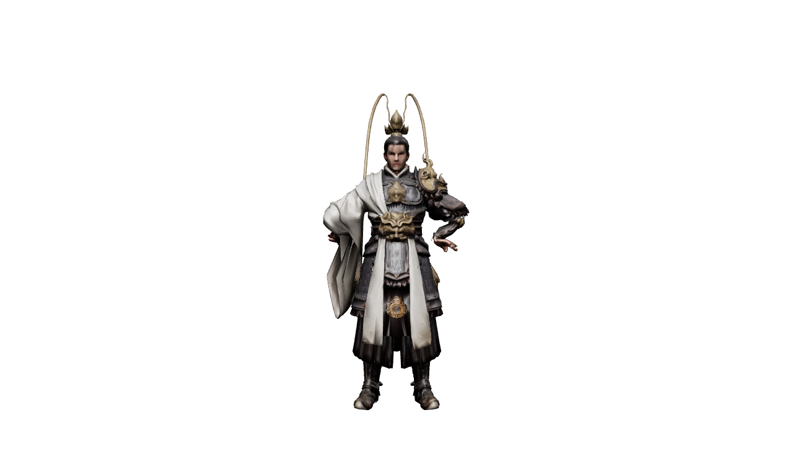

**Thời gian lưu trên Git: 2026-10-18 08:07:31 UTC+07:00**

Nguồn: `docs/fidelity/after-native/h02-full-game.png`, `docs/fidelity/after-native/h02-full-reference.png`

[Commit lưu ảnh](https://github.com/oree-nguyen/Tutien/commit/982e9e042cabd0e49dc3086ea913c9b8e1c6c91d)

## Ảnh 11

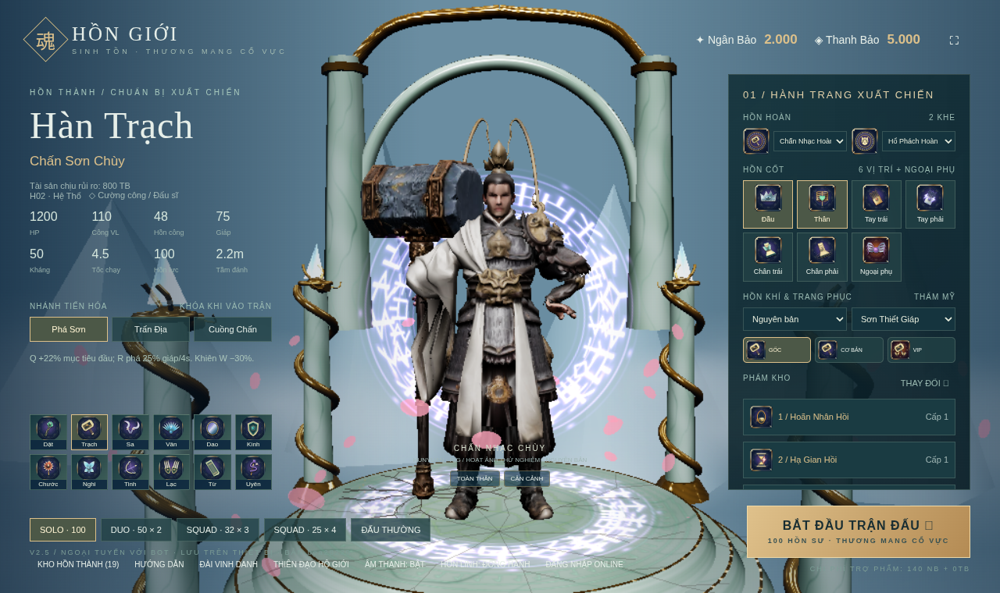

**Thời gian lưu trên Git: 2026-10-18 08:07:31 UTC+07:00**

Nguồn: `docs/fidelity/after-native/h02-full-lobby.png`

[Commit lưu ảnh](https://github.com/oree-nguyen/Tutien/commit/982e9e042cabd0e49dc3086ea913c9b8e1c6c91d)

## Ảnh 12

**Thời gian lưu trên Git: 2026-10-18 08:07:31 UTC+07:00**

Nguồn: `docs/fidelity/after-native/h02-full-mask.png`

[Commit lưu ảnh](https://github.com/oree-nguyen/Tutien/commit/982e9e042cabd0e49dc3086ea913c9b8e1c6c91d)

## Ảnh 13

**Thời gian lưu trên Git: 2026-10-18 08:07:31 UTC+07:00**

Nguồn: `docs/fidelity/after-uastc-checkpoint/h01-face-game.png`

[Commit lưu ảnh](https://github.com/oree-nguyen/Tutien/commit/982e9e042cabd0e49dc3086ea913c9b8e1c6c91d)

## Ảnh 14

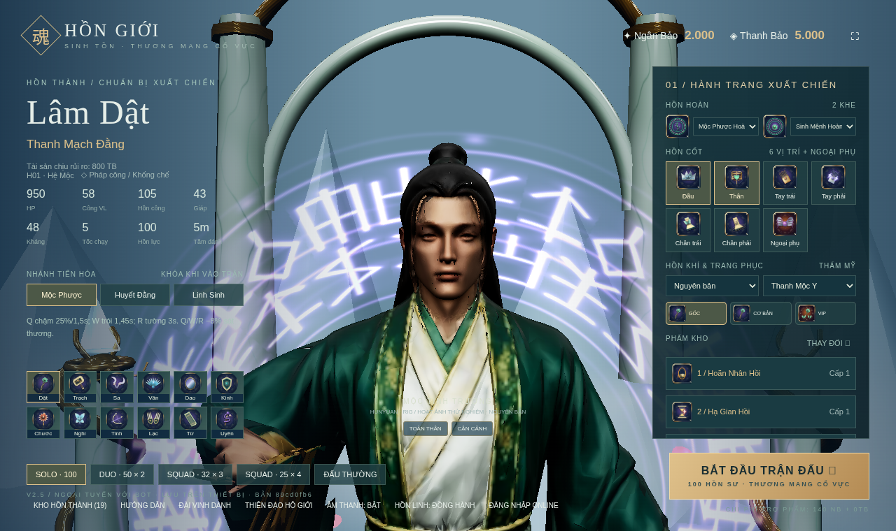

**Thời gian lưu trên Git: 2026-10-18 08:07:31 UTC+07:00**

Nguồn: `docs/fidelity/after-uastc-checkpoint/h01-face-lobby.png`

[Commit lưu ảnh](https://github.com/oree-nguyen/Tutien/commit/982e9e042cabd0e49dc3086ea913c9b8e1c6c91d)

## Ảnh 15

**Thời gian lưu trên Git: 2026-10-18 08:07:31 UTC+07:00**

Nguồn: `docs/fidelity/after-uastc-checkpoint/h01-face-mask.png`

[Commit lưu ảnh](https://github.com/oree-nguyen/Tutien/commit/982e9e042cabd0e49dc3086ea913c9b8e1c6c91d)

## Ảnh 16

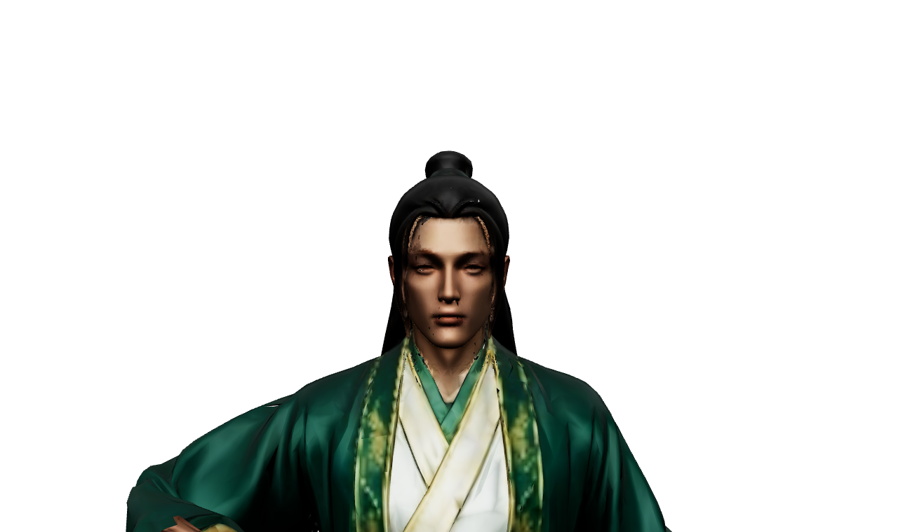

**Thời gian lưu trên Git: 2026-10-18 08:07:31 UTC+07:00**

Nguồn: `docs/fidelity/after-uastc-checkpoint/h01-face-reference.png`

[Commit lưu ảnh](https://github.com/oree-nguyen/Tutien/commit/982e9e042cabd0e49dc3086ea913c9b8e1c6c91d)

## Ảnh 17

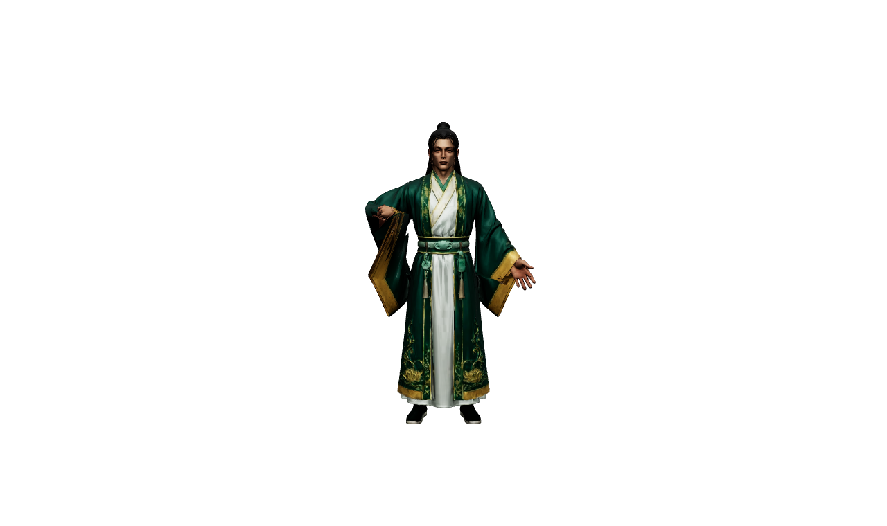

**Thời gian lưu trên Git: 2026-10-18 08:07:31 UTC+07:00**

Nguồn: `docs/fidelity/after-uastc-checkpoint/h01-full-game.png`

[Commit lưu ảnh](https://github.com/oree-nguyen/Tutien/commit/982e9e042cabd0e49dc3086ea913c9b8e1c6c91d)

## Ảnh 18

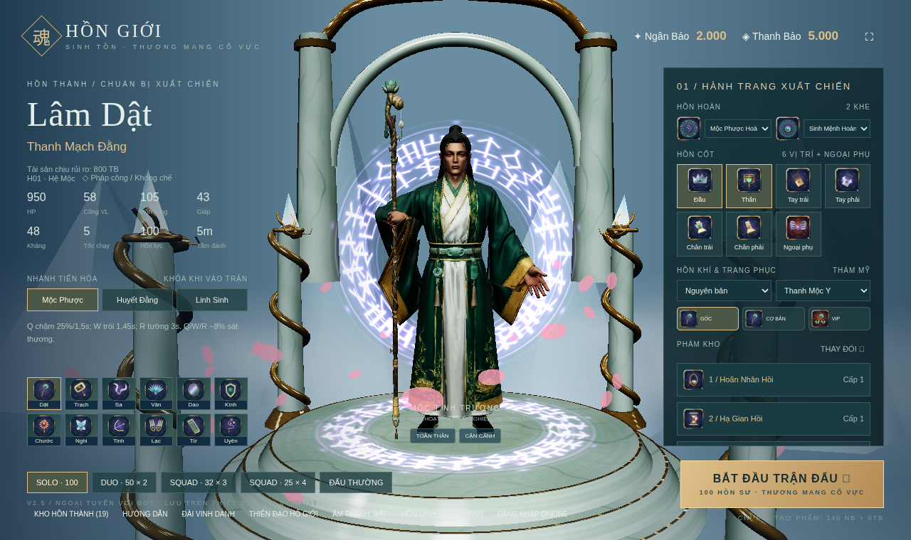

**Thời gian lưu trên Git: 2026-10-18 08:07:31 UTC+07:00**

Nguồn: `docs/fidelity/after-uastc-checkpoint/h01-full-lobby.png`

[Commit lưu ảnh](https://github.com/oree-nguyen/Tutien/commit/982e9e042cabd0e49dc3086ea913c9b8e1c6c91d)

## Ảnh 19

**Thời gian lưu trên Git: 2026-10-18 08:07:31 UTC+07:00**

Nguồn: `docs/fidelity/after-uastc-checkpoint/h01-full-mask.png`

[Commit lưu ảnh](https://github.com/oree-nguyen/Tutien/commit/982e9e042cabd0e49dc3086ea913c9b8e1c6c91d)

## Ảnh 20

**Thời gian lưu trên Git: 2026-10-18 08:07:31 UTC+07:00**

Nguồn: `docs/fidelity/after-uastc-checkpoint/h01-full-reference.png`

[Commit lưu ảnh](https://github.com/oree-nguyen/Tutien/commit/982e9e042cabd0e49dc3086ea913c9b8e1c6c91d)

## Ảnh 21

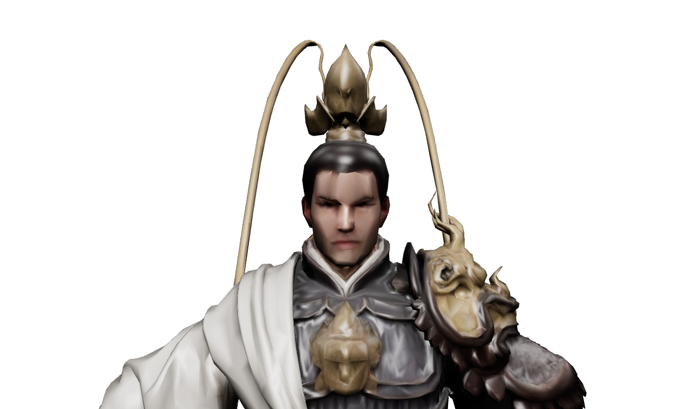

**Thời gian lưu trên Git: 2026-10-18 08:07:31 UTC+07:00**

Nguồn: `docs/fidelity/after-uastc-checkpoint/h02-face-game.png`, `docs/fidelity/after-uastc-checkpoint/h02-face-reference.png`

[Commit lưu ảnh](https://github.com/oree-nguyen/Tutien/commit/982e9e042cabd0e49dc3086ea913c9b8e1c6c91d)

## Ảnh 22

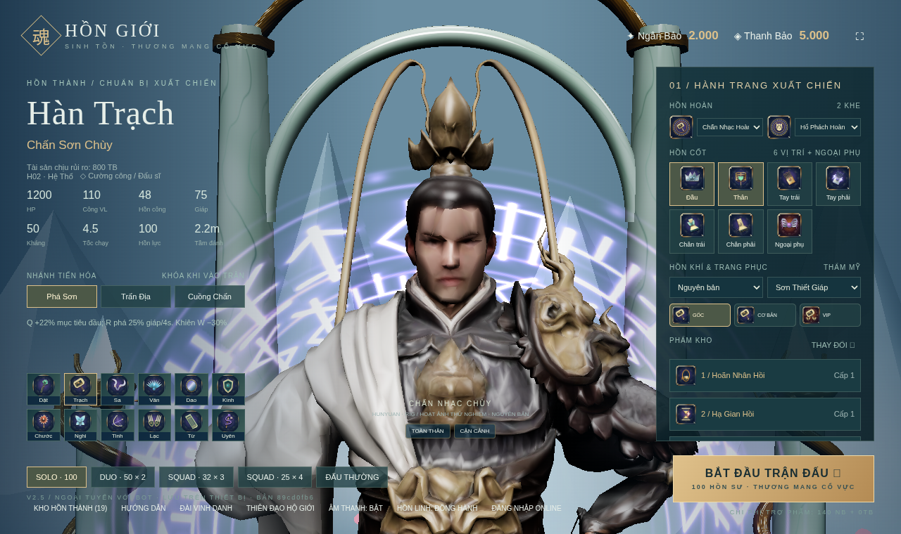

**Thời gian lưu trên Git: 2026-10-18 08:07:31 UTC+07:00**

Nguồn: `docs/fidelity/after-uastc-checkpoint/h02-face-lobby.png`

[Commit lưu ảnh](https://github.com/oree-nguyen/Tutien/commit/982e9e042cabd0e49dc3086ea913c9b8e1c6c91d)

## Ảnh 23

**Thời gian lưu trên Git: 2026-10-18 08:07:31 UTC+07:00**

Nguồn: `docs/fidelity/after-uastc-checkpoint/h02-face-mask.png`

[Commit lưu ảnh](https://github.com/oree-nguyen/Tutien/commit/982e9e042cabd0e49dc3086ea913c9b8e1c6c91d)

## Ảnh 24

**Thời gian lưu trên Git: 2026-10-18 08:07:31 UTC+07:00**

Nguồn: `docs/fidelity/after-uastc-checkpoint/h02-full-game.png`, `docs/fidelity/after-uastc-checkpoint/h02-full-reference.png`

[Commit lưu ảnh](https://github.com/oree-nguyen/Tutien/commit/982e9e042cabd0e49dc3086ea913c9b8e1c6c91d)

## Ảnh 25

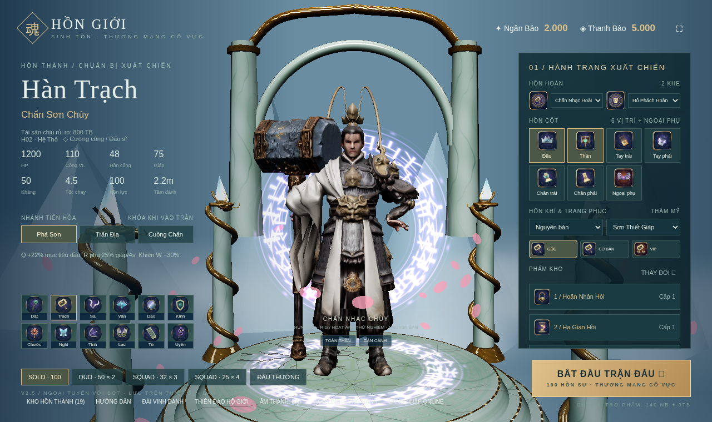

**Thời gian lưu trên Git: 2026-10-18 08:07:31 UTC+07:00**

Nguồn: `docs/fidelity/after-uastc-checkpoint/h02-full-lobby.png`

[Commit lưu ảnh](https://github.com/oree-nguyen/Tutien/commit/982e9e042cabd0e49dc3086ea913c9b8e1c6c91d)

## Ảnh 26

**Thời gian lưu trên Git: 2026-10-18 08:07:31 UTC+07:00**

Nguồn: `docs/fidelity/after-uastc-checkpoint/h02-full-mask.png`

[Commit lưu ảnh](https://github.com/oree-nguyen/Tutien/commit/982e9e042cabd0e49dc3086ea913c9b8e1c6c91d)

## Ảnh 27

**Thời gian lưu trên Git: 2026-10-18 08:07:31 UTC+07:00**

Nguồn: `docs/fidelity/before/h01-face-game.png`

[Commit lưu ảnh](https://github.com/oree-nguyen/Tutien/commit/982e9e042cabd0e49dc3086ea913c9b8e1c6c91d)

## Ảnh 28

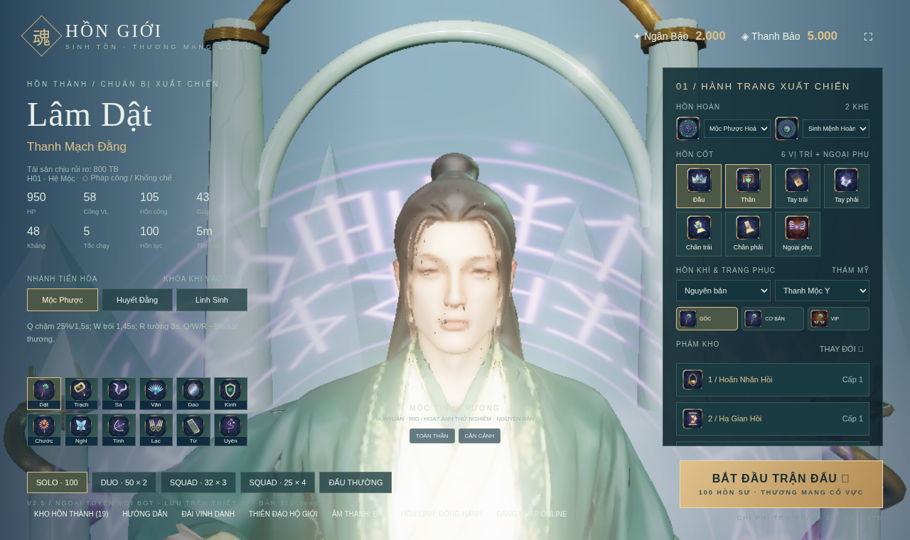

**Thời gian lưu trên Git: 2026-10-18 08:07:31 UTC+07:00**

Nguồn: `docs/fidelity/before/h01-face-lobby.png`

[Commit lưu ảnh](https://github.com/oree-nguyen/Tutien/commit/982e9e042cabd0e49dc3086ea913c9b8e1c6c91d)

## Ảnh 29

**Thời gian lưu trên Git: 2026-10-18 08:07:31 UTC+07:00**

Nguồn: `docs/fidelity/before/h01-face-mask.png`

[Commit lưu ảnh](https://github.com/oree-nguyen/Tutien/commit/982e9e042cabd0e49dc3086ea913c9b8e1c6c91d)

## Ảnh 30

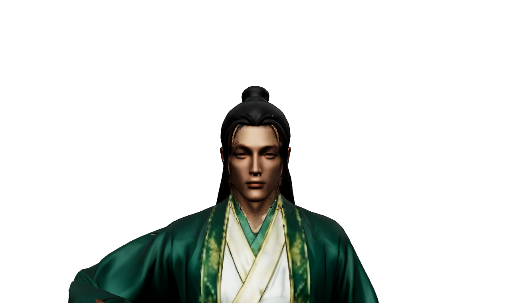

**Thời gian lưu trên Git: 2026-10-18 08:07:31 UTC+07:00**

Nguồn: `docs/fidelity/before/h01-face-reference.png`

[Commit lưu ảnh](https://github.com/oree-nguyen/Tutien/commit/982e9e042cabd0e49dc3086ea913c9b8e1c6c91d)

## Ảnh 31

**Thời gian lưu trên Git: 2026-10-18 08:07:31 UTC+07:00**

Nguồn: `docs/fidelity/before/h01-full-game.png`

[Commit lưu ảnh](https://github.com/oree-nguyen/Tutien/commit/982e9e042cabd0e49dc3086ea913c9b8e1c6c91d)

## Ảnh 32

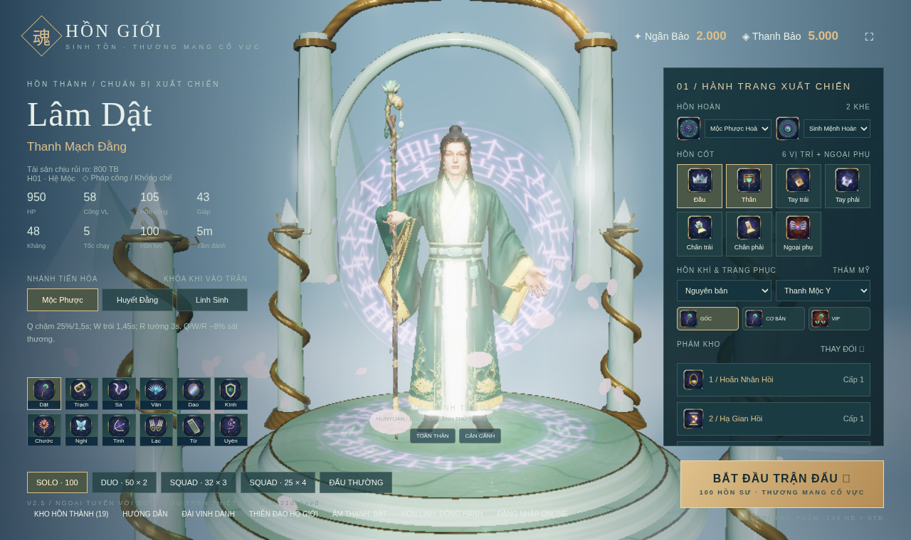

**Thời gian lưu trên Git: 2026-10-18 08:07:31 UTC+07:00**

Nguồn: `docs/fidelity/before/h01-full-lobby.png`

[Commit lưu ảnh](https://github.com/oree-nguyen/Tutien/commit/982e9e042cabd0e49dc3086ea913c9b8e1c6c91d)

## Ảnh 33

**Thời gian lưu trên Git: 2026-10-18 08:07:31 UTC+07:00**

Nguồn: `docs/fidelity/before/h01-full-mask.png`

[Commit lưu ảnh](https://github.com/oree-nguyen/Tutien/commit/982e9e042cabd0e49dc3086ea913c9b8e1c6c91d)

## Ảnh 34

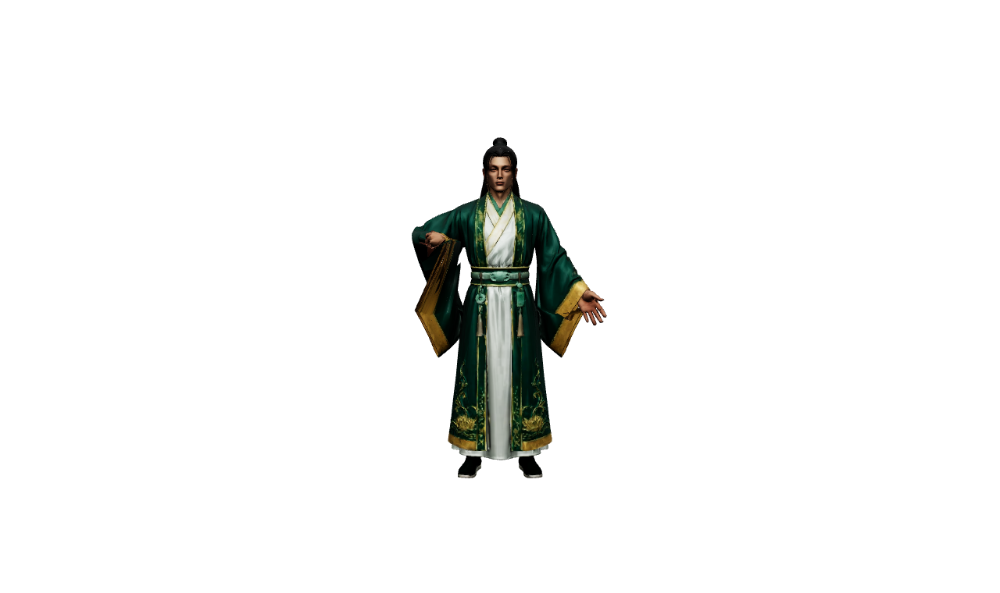

**Thời gian lưu trên Git: 2026-10-18 08:07:31 UTC+07:00**

Nguồn: `docs/fidelity/before/h01-full-reference.png`

[Commit lưu ảnh](https://github.com/oree-nguyen/Tutien/commit/982e9e042cabd0e49dc3086ea913c9b8e1c6c91d)

## Ảnh 35

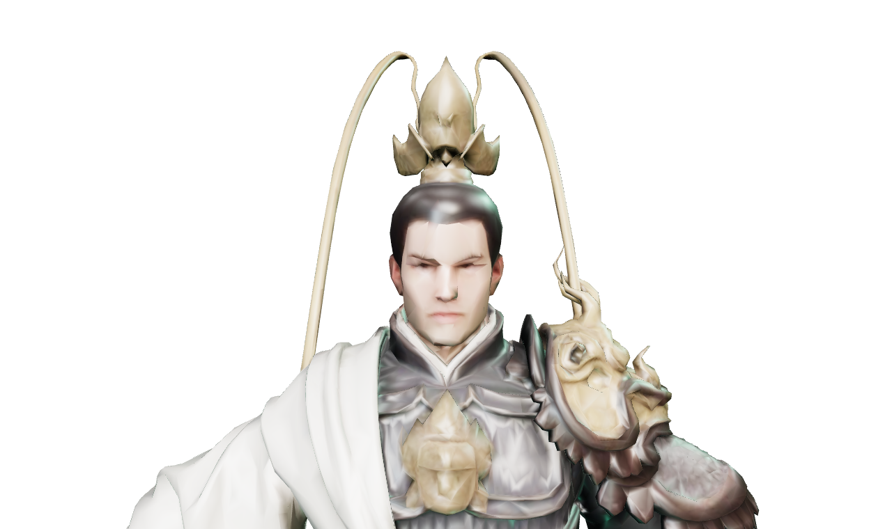

**Thời gian lưu trên Git: 2026-10-18 08:07:31 UTC+07:00**

Nguồn: `docs/fidelity/before/h02-face-game.png`

[Commit lưu ảnh](https://github.com/oree-nguyen/Tutien/commit/982e9e042cabd0e49dc3086ea913c9b8e1c6c91d)

## Ảnh 36

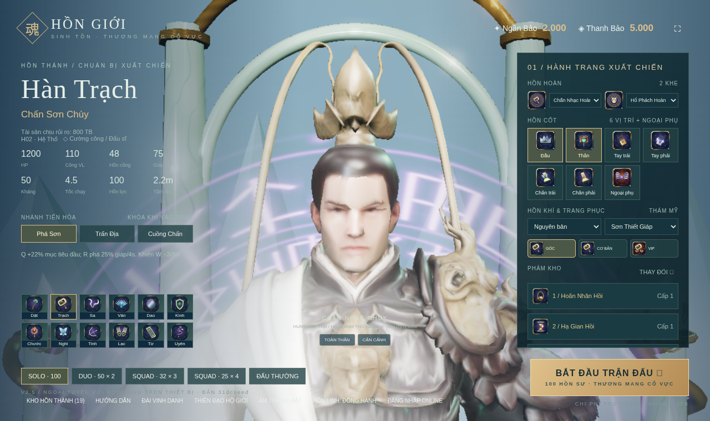

**Thời gian lưu trên Git: 2026-10-18 08:07:31 UTC+07:00**

Nguồn: `docs/fidelity/before/h02-face-lobby.png`

[Commit lưu ảnh](https://github.com/oree-nguyen/Tutien/commit/982e9e042cabd0e49dc3086ea913c9b8e1c6c91d)

## Ảnh 37

**Thời gian lưu trên Git: 2026-10-18 08:07:31 UTC+07:00**

Nguồn: `docs/fidelity/before/h02-face-mask.png`

[Commit lưu ảnh](https://github.com/oree-nguyen/Tutien/commit/982e9e042cabd0e49dc3086ea913c9b8e1c6c91d)

## Ảnh 38

**Thời gian lưu trên Git: 2026-10-18 08:07:31 UTC+07:00**

Nguồn: `docs/fidelity/before/h02-face-reference.png`

[Commit lưu ảnh](https://github.com/oree-nguyen/Tutien/commit/982e9e042cabd0e49dc3086ea913c9b8e1c6c91d)

## Ảnh 39

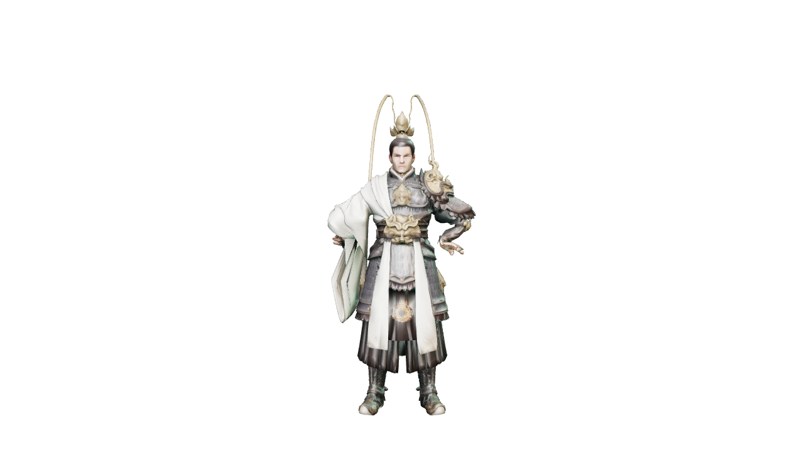

**Thời gian lưu trên Git: 2026-10-18 08:07:31 UTC+07:00**

Nguồn: `docs/fidelity/before/h02-full-game.png`

[Commit lưu ảnh](https://github.com/oree-nguyen/Tutien/commit/982e9e042cabd0e49dc3086ea913c9b8e1c6c91d)

## Ảnh 40

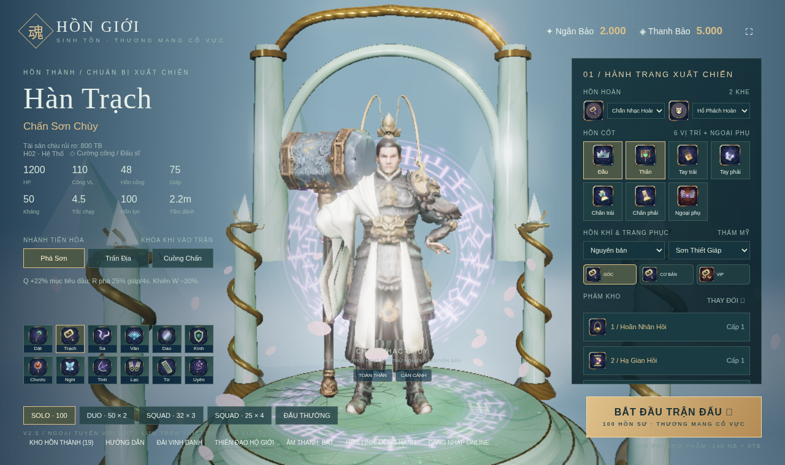

**Thời gian lưu trên Git: 2026-10-18 08:07:31 UTC+07:00**

Nguồn: `docs/fidelity/before/h02-full-lobby.png`

[Commit lưu ảnh](https://github.com/oree-nguyen/Tutien/commit/982e9e042cabd0e49dc3086ea913c9b8e1c6c91d)

## Ảnh 41

**Thời gian lưu trên Git: 2026-10-18 08:07:31 UTC+07:00**

Nguồn: `docs/fidelity/before/h02-full-mask.png`

[Commit lưu ảnh](https://github.com/oree-nguyen/Tutien/commit/982e9e042cabd0e49dc3086ea913c9b8e1c6c91d)

## Ảnh 42

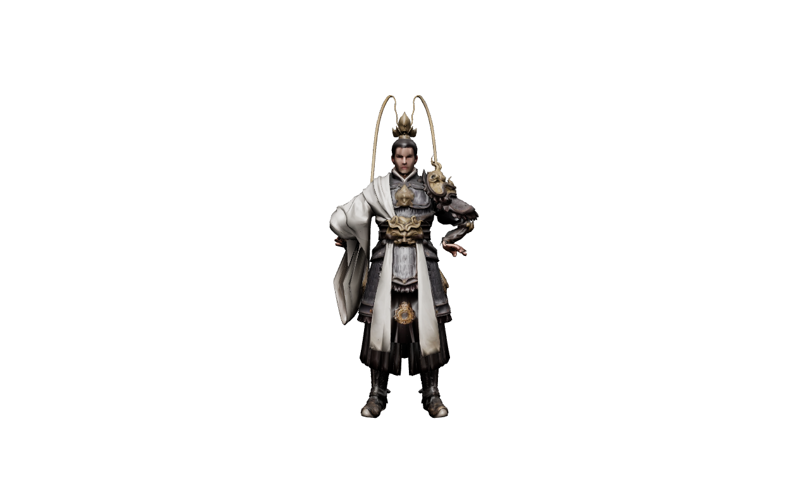

**Thời gian lưu trên Git: 2026-10-18 08:07:31 UTC+07:00**

Nguồn: `docs/fidelity/before/h02-full-reference.png`

[Commit lưu ảnh](https://github.com/oree-nguyen/Tutien/commit/982e9e042cabd0e49dc3086ea913c9b8e1c6c91d)

## Ảnh 43

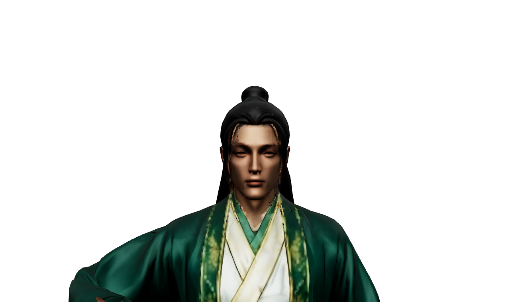

**Thời gian lưu trên Git: 2026-10-18 08:07:31 UTC+07:00**

Nguồn: `docs/fidelity/checkpoint-native/h01-face-game.png`, `docs/fidelity/checkpoint-native/h01-face-reference.png`

[Commit lưu ảnh](https://github.com/oree-nguyen/Tutien/commit/982e9e042cabd0e49dc3086ea913c9b8e1c6c91d)

## Ảnh 44

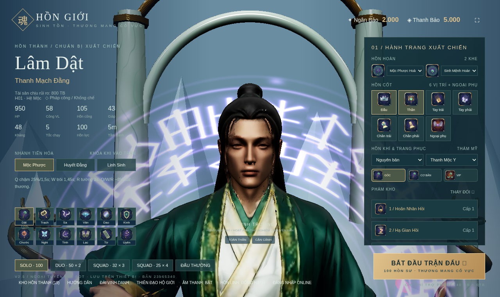

**Thời gian lưu trên Git: 2026-10-18 08:07:31 UTC+07:00**

Nguồn: `docs/fidelity/checkpoint-native/h01-face-lobby.png`

[Commit lưu ảnh](https://github.com/oree-nguyen/Tutien/commit/982e9e042cabd0e49dc3086ea913c9b8e1c6c91d)

## Ảnh 45

**Thời gian lưu trên Git: 2026-10-18 08:07:31 UTC+07:00**

Nguồn: `docs/fidelity/checkpoint-native/h01-face-mask.png`

[Commit lưu ảnh](https://github.com/oree-nguyen/Tutien/commit/982e9e042cabd0e49dc3086ea913c9b8e1c6c91d)

## Ảnh 46

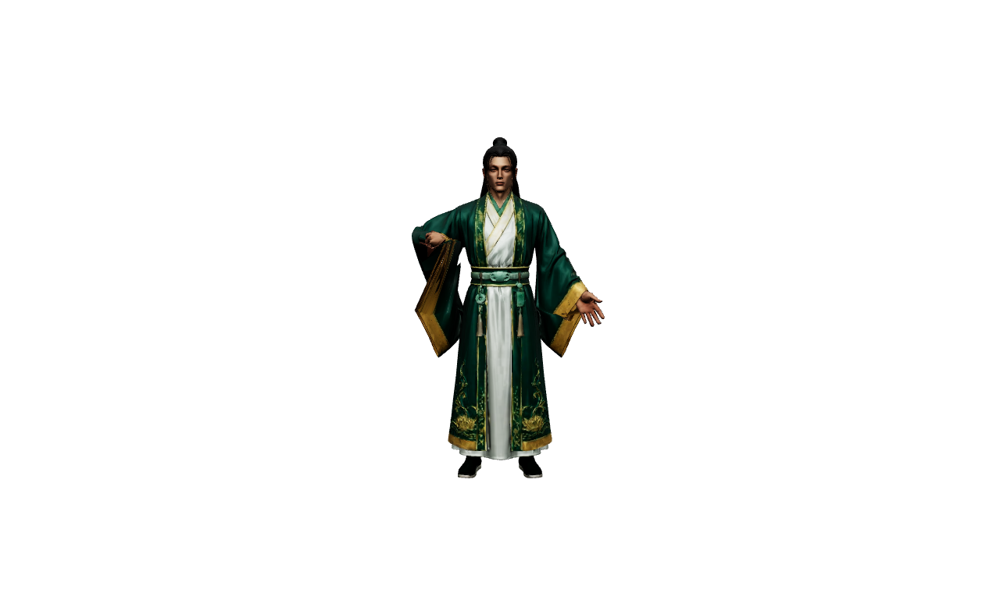

**Thời gian lưu trên Git: 2026-10-18 08:07:31 UTC+07:00**

Nguồn: `docs/fidelity/checkpoint-native/h01-full-game.png`, `docs/fidelity/checkpoint-native/h01-full-reference.png`

[Commit lưu ảnh](https://github.com/oree-nguyen/Tutien/commit/982e9e042cabd0e49dc3086ea913c9b8e1c6c91d)

## Ảnh 47

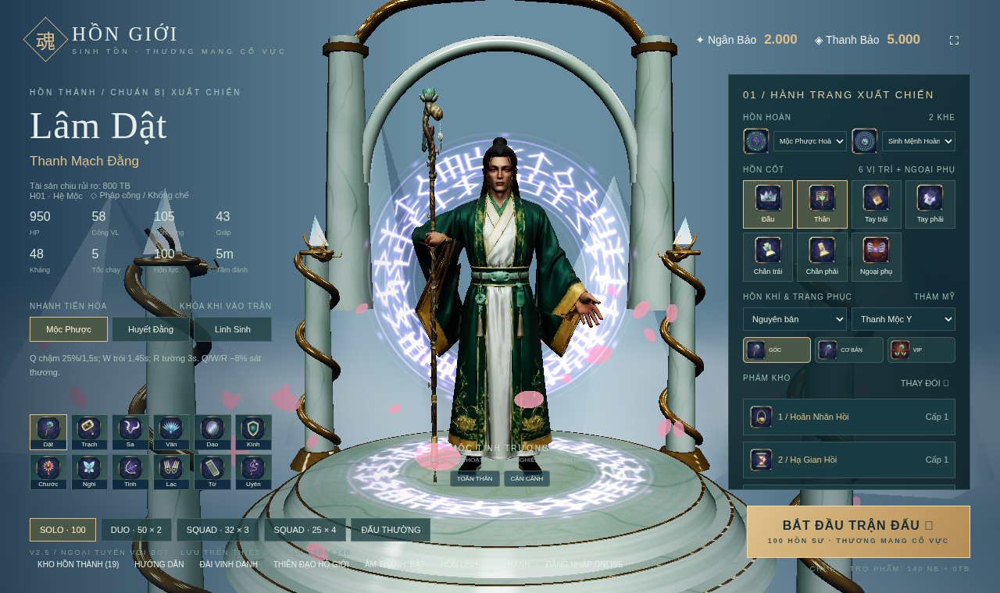

**Thời gian lưu trên Git: 2026-10-18 08:07:31 UTC+07:00**

Nguồn: `docs/fidelity/checkpoint-native/h01-full-lobby.png`

[Commit lưu ảnh](https://github.com/oree-nguyen/Tutien/commit/982e9e042cabd0e49dc3086ea913c9b8e1c6c91d)

## Ảnh 48

**Thời gian lưu trên Git: 2026-10-18 08:07:31 UTC+07:00**

Nguồn: `docs/fidelity/checkpoint-native/h01-full-mask.png`

[Commit lưu ảnh](https://github.com/oree-nguyen/Tutien/commit/982e9e042cabd0e49dc3086ea913c9b8e1c6c91d)

## Ảnh 49

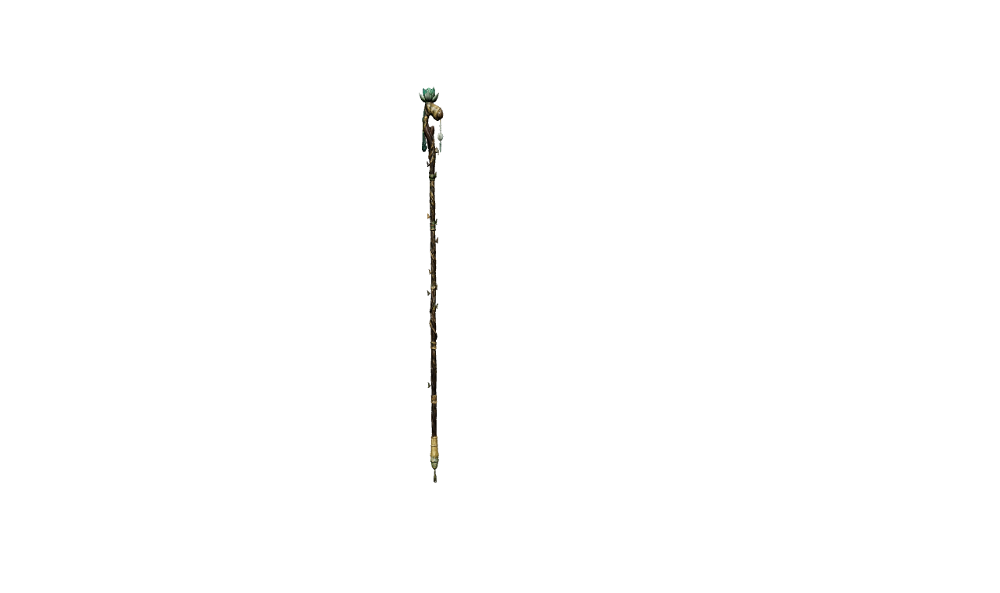

**Thời gian lưu trên Git: 2026-10-18 08:07:31 UTC+07:00**

Nguồn: `docs/fidelity/checkpoint-native/h01-full-weapon-game.png`, `docs/fidelity/checkpoint-native/h01-full-weapon-reference.png`

[Commit lưu ảnh](https://github.com/oree-nguyen/Tutien/commit/982e9e042cabd0e49dc3086ea913c9b8e1c6c91d)

## Ảnh 50

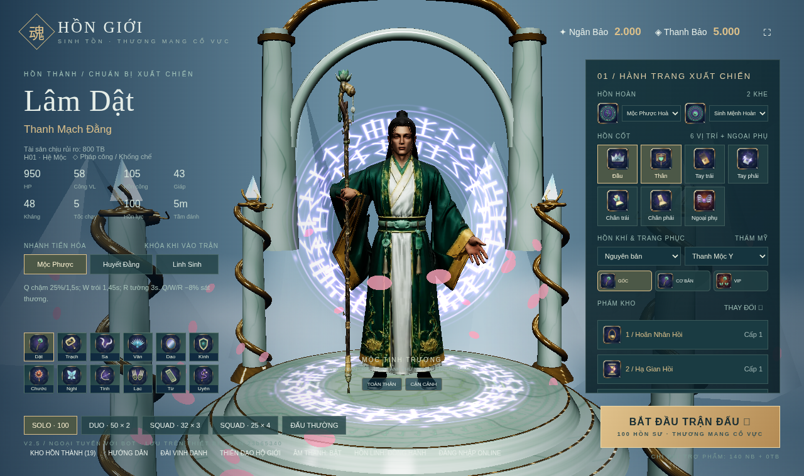

**Thời gian lưu trên Git: 2026-10-18 08:07:31 UTC+07:00**

Nguồn: `docs/fidelity/checkpoint-native/h01-full-weapon-lobby.png`

[Commit lưu ảnh](https://github.com/oree-nguyen/Tutien/commit/982e9e042cabd0e49dc3086ea913c9b8e1c6c91d)

## Ảnh 51

**Thời gian lưu trên Git: 2026-10-18 08:07:31 UTC+07:00**

Nguồn: `docs/fidelity/checkpoint-native/h01-full-weapon-mask.png`

[Commit lưu ảnh](https://github.com/oree-nguyen/Tutien/commit/982e9e042cabd0e49dc3086ea913c9b8e1c6c91d)

## Ảnh 52

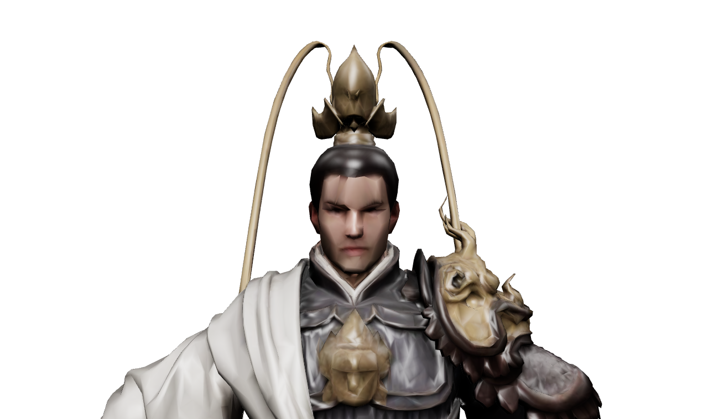

**Thời gian lưu trên Git: 2026-10-18 08:07:31 UTC+07:00**

Nguồn: `docs/fidelity/checkpoint-native/h02-face-game.png`, `docs/fidelity/checkpoint-native/h02-face-reference.png`

[Commit lưu ảnh](https://github.com/oree-nguyen/Tutien/commit/982e9e042cabd0e49dc3086ea913c9b8e1c6c91d)

## Ảnh 53

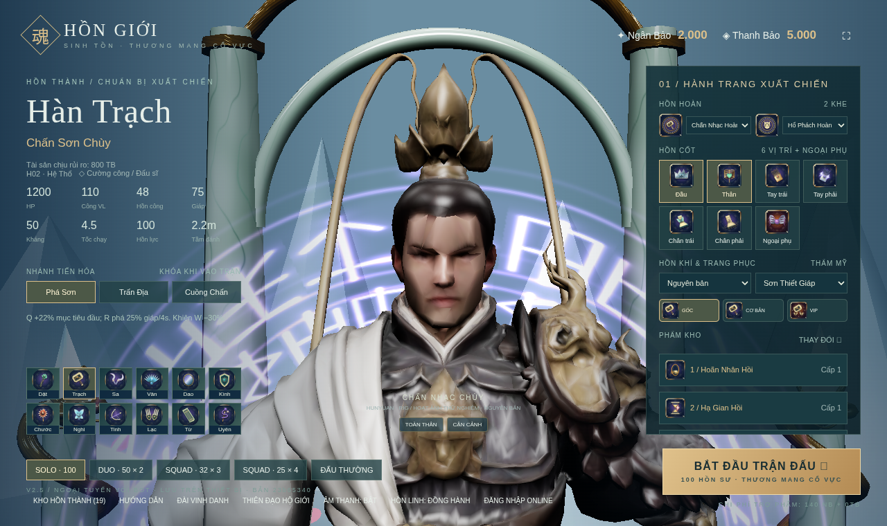

**Thời gian lưu trên Git: 2026-10-18 08:07:31 UTC+07:00**

Nguồn: `docs/fidelity/checkpoint-native/h02-face-lobby.png`

[Commit lưu ảnh](https://github.com/oree-nguyen/Tutien/commit/982e9e042cabd0e49dc3086ea913c9b8e1c6c91d)

## Ảnh 54

**Thời gian lưu trên Git: 2026-10-18 08:07:31 UTC+07:00**

Nguồn: `docs/fidelity/checkpoint-native/h02-face-mask.png`

[Commit lưu ảnh](https://github.com/oree-nguyen/Tutien/commit/982e9e042cabd0e49dc3086ea913c9b8e1c6c91d)

## Ảnh 55

**Thời gian lưu trên Git: 2026-10-18 08:07:31 UTC+07:00**

Nguồn: `docs/fidelity/checkpoint-native/h02-full-game.png`, `docs/fidelity/checkpoint-native/h02-full-reference.png`

[Commit lưu ảnh](https://github.com/oree-nguyen/Tutien/commit/982e9e042cabd0e49dc3086ea913c9b8e1c6c91d)

## Ảnh 56

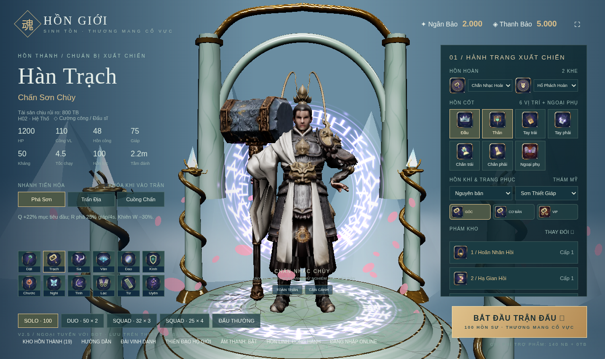

**Thời gian lưu trên Git: 2026-10-18 08:07:31 UTC+07:00**

Nguồn: `docs/fidelity/checkpoint-native/h02-full-lobby.png`

[Commit lưu ảnh](https://github.com/oree-nguyen/Tutien/commit/982e9e042cabd0e49dc3086ea913c9b8e1c6c91d)

## Ảnh 57

**Thời gian lưu trên Git: 2026-10-18 08:07:31 UTC+07:00**

Nguồn: `docs/fidelity/checkpoint-native/h02-full-mask.png`

[Commit lưu ảnh](https://github.com/oree-nguyen/Tutien/commit/982e9e042cabd0e49dc3086ea913c9b8e1c6c91d)

## Ảnh 58

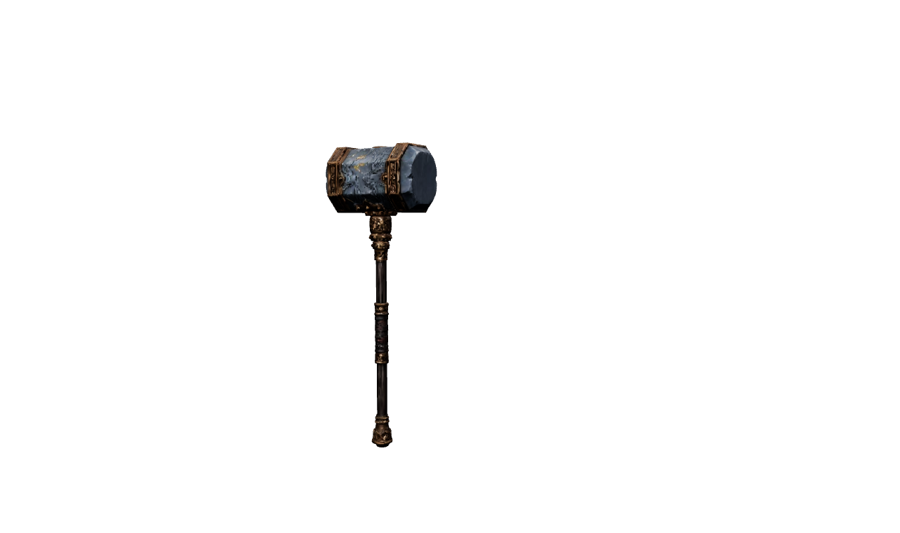

**Thời gian lưu trên Git: 2026-10-18 08:07:31 UTC+07:00**

Nguồn: `docs/fidelity/checkpoint-native/h02-full-weapon-game.png`, `docs/fidelity/checkpoint-native/h02-full-weapon-reference.png`

[Commit lưu ảnh](https://github.com/oree-nguyen/Tutien/commit/982e9e042cabd0e49dc3086ea913c9b8e1c6c91d)

## Ảnh 59

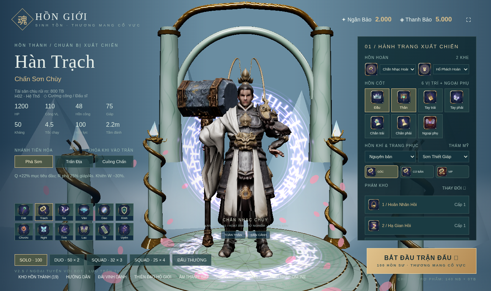

**Thời gian lưu trên Git: 2026-10-18 08:07:31 UTC+07:00**

Nguồn: `docs/fidelity/checkpoint-native/h02-full-weapon-lobby.png`

[Commit lưu ảnh](https://github.com/oree-nguyen/Tutien/commit/982e9e042cabd0e49dc3086ea913c9b8e1c6c91d)

## Ảnh 60

**Thời gian lưu trên Git: 2026-10-18 08:07:31 UTC+07:00**

Nguồn: `docs/fidelity/checkpoint-native/h02-full-weapon-mask.png`

[Commit lưu ảnh](https://github.com/oree-nguyen/Tutien/commit/982e9e042cabd0e49dc3086ea913c9b8e1c6c91d)
